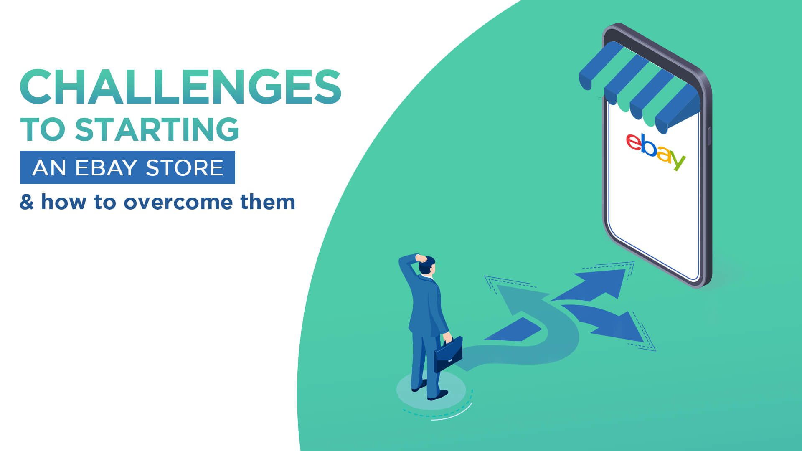

## Challenge 1: Finding Reliable Inventory

New sellers often struggle to find a sourcing method that's both profitable and repeatable. Start with one sourcing channel (retail arbitrage, wholesale, or liquidation), validate it works, then diversify.

## Challenge 2: Standing Out in a Crowded Marketplace

With millions of listings live at any time, a weak title or thin description buries your item in search. Invest early in keyword-rich titles, full item specifics, and clear multi-angle photos.

## Challenge 3: Pricing Competitively Without Killing Margin

New sellers often either underprice out of fear of not selling, or overprice without checking sold comps. Price against actual sold listings, not current ones, and build eBay's final value fee into your cost math upfront.

## Challenge 4: Managing Shipping and Handling Times

Late shipping damages your seller metrics fast, and new sellers often underestimate how much time packing and shipping takes once order volume picks up. Set a realistic handling time and build a simple shipping routine from day one.

## Challenge 5: Building Buyer Trust with No Feedback History

A brand-new store with zero feedback faces natural buyer hesitation. Focus your first sales on flawless execution — accurate listings, fast shipping, responsive communication — to build feedback score quickly.

## Challenge 6: Keeping Inventory Accurate as You Grow

Once you're managing more than a handful of SKUs, manual inventory tracking starts causing overselling and stockouts. This is usually the point where sellers need a real system instead of a spreadsheet.

## Getting Past the Early Hurdles Faster

Most of these challenges compound once you try to grow beyond eBay alone. SellerChamp handles bulk listing, pricing consistency and real-time inventory sync from the start, so you're not relearning these lessons again when you add Amazon or Walmart.
