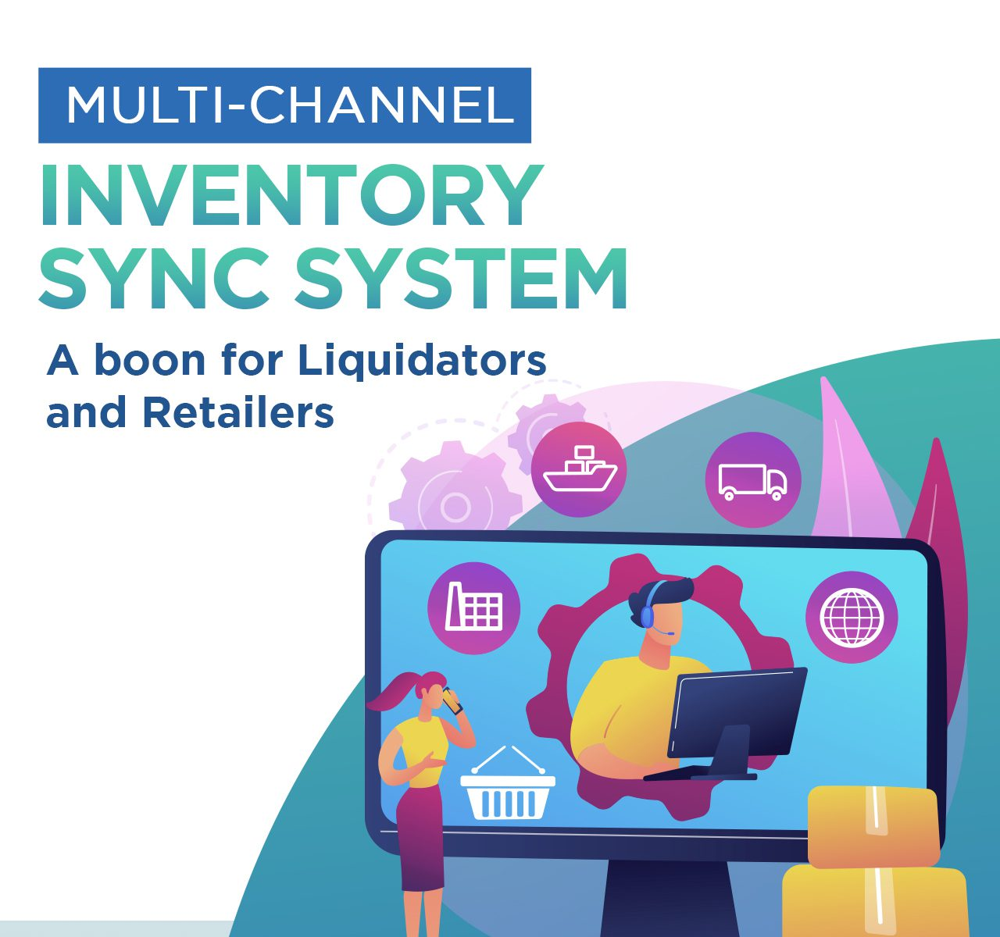

## Why Liquidators and Retailers Face a Unique Inventory Problem

Liquidation and retail inventory often means one-off quantities, constantly rotating SKUs, and selling the same lot across multiple channels at once to move it fast. Without real-time sync, that combination leads directly to overselling — promising an item to two buyers on two different platforms.

## What a Multi-Channel Inventory Sync System Does

It keeps your stock count accurate across every marketplace you list on simultaneously — the moment an item sells on one channel, its quantity updates everywhere else instantly, so you never list more than you actually have.

## Why This Matters More for Liquidators Specifically

Unlike a seller restocking the same SKU repeatedly, a liquidator often has exactly one unit of an item. A sync delay of even a few minutes can mean a canceled order, a refund, and a damaged seller rating — all for an item you no longer had to sell.

## What to Look for in a Sync System

- **True real-time updates**, not batched syncing every few hours
- **Coverage across every channel you actually sell on** — Amazon, eBay, Walmart, Shopify, Etsy
- **Bulk listing support** so one-off liquidation lots can go live across channels fast, not one listing at a time

## The Bottom Line

For liquidators and retailers moving fast-changing, often one-of-a-kind inventory, a real-time multi-channel sync system isn't a nice-to-have — it's what prevents the oversold-item problem that erodes buyer trust. SellerChamp was built for exactly this: real-time inventory sync and bulk listing across every major channel from one dashboard.
