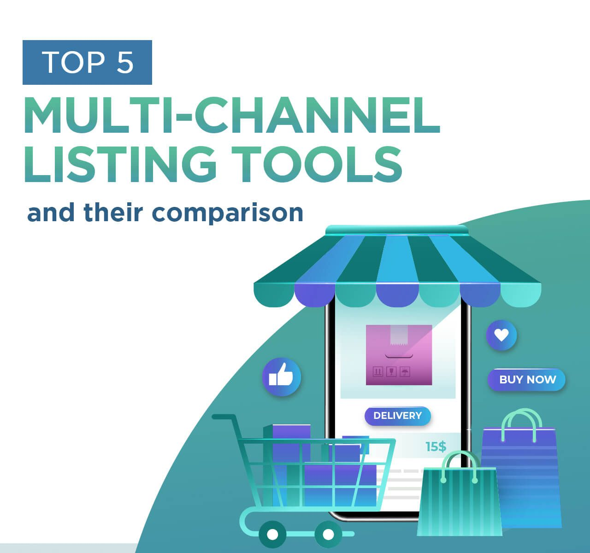

Listing and managing inventory by hand across Amazon, eBay, Walmart, Etsy and Shopify doesn't scale past a handful of SKUs. Here's how the main multi-channel listing tools compare.

## What to Look For First

Before comparing features, the two that matter most: how many channels the tool actually supports natively (not through a workaround), and whether inventory sync is real-time or batched on a delay — a delay means you can still oversell.

## 1. SellerChamp

Built specifically for bulk listing and real-time inventory sync across Amazon, eBay, Walmart, Etsy, Shopify and more from one dashboard. Strongest for sellers who need to push the same catalog across many channels fast and keep stock counts accurate everywhere at once.

## 2. ChannelAdvisor

An enterprise-focused platform with broad channel coverage and strong reporting — built more for larger retailers with dedicated ops teams than for growing independent sellers.

## 3. Sellbrite

A lighter-weight listing and sync tool, good for sellers just starting to expand beyond one channel, with a simpler interface but fewer advanced automation features.

## 4. Linnworks

Strong on the order-management and fulfillment side, with multi-channel listing as part of a broader operations suite — a heavier tool suited to sellers who also need warehouse and shipping management built in.

## 5. Ecomdash

Covers the multi-channel basics — listing, inventory sync, order management — at a lower price point, trading off some of the automation depth of pricier tools.

## Choosing the Right One

The right tool depends on how many channels you're actually listing on today and how fast you plan to add more. A tool that only loosely supports a channel "through an integration" costs you time later — SellerChamp was built to handle bulk listing and real-time sync across all major marketplaces from day one.
