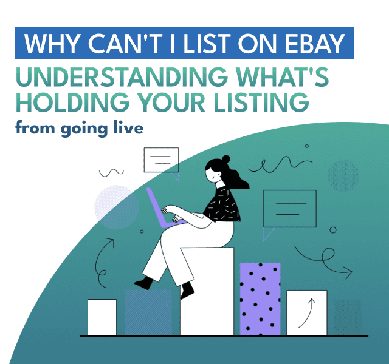

## Check for a Selling Limit First

New and growing eBay sellers operate under a **selling limit** — a cap on how many items and how much total value you can list per month. If you've hit it, eBay blocks new listings until the limit resets or you request an increase (Seller Hub > request a limit increase).

## Category or Item Restrictions

Some categories (electronics, branded goods, certain collectibles) require additional approval or documentation before you can list in them. Check the listing error message — eBay will usually name the specific restriction.

## Account Standing Issues

A low seller performance rating, unresolved policy violation, or an unpaid seller fee can all block new listings until it's resolved. Check **Seller Hub > Performance** for any flags.

## Listing Errors in the Draft Itself

Missing required item specifics, an invalid category, or a policy violation in the title/description (banned keywords, external links) will stop a listing from going live — eBay flags the specific field when this happens.

## Payment or Verification Holds

If eBay needs to verify your identity or bank details for payouts, new listings can be paused until that's confirmed. Check **Account Settings > Payments** for any pending action.

## Avoid This Going Forward

Most "why can't I list" moments come down to a seller limit you didn't see coming, because listings were made manually across channels without visibility into pace. SellerChamp shows your listing activity and limits in one place and keeps your catalog clean across eBay, Amazon, Walmart and more — so you catch a limit or policy flag before it stalls a new listing.
