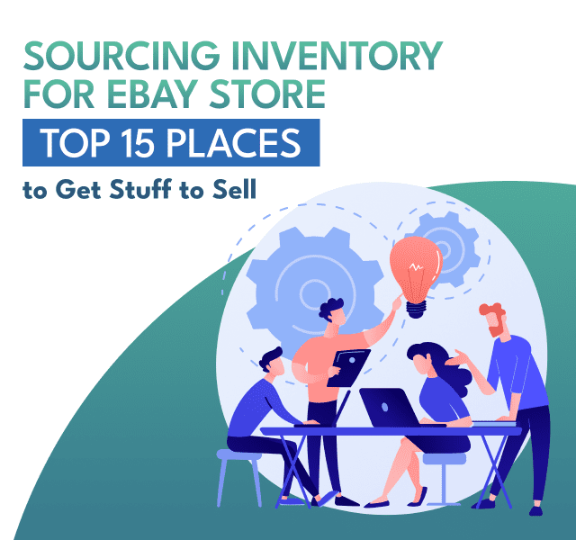

Finding reliable, profitable inventory is the real bottleneck for most eBay sellers — not listing or shipping. Here are 15 places worth sourcing from, from lowest to highest barrier to entry.

1. **Retail Arbitrage** — Clearance racks and sales at big-box retailers, resold at a markup. Low cost to start, but time-intensive to scale.
2. **Online Arbitrage** — Same idea, done from home by tracking deals across retailer websites.
3. **Wholesale Suppliers** — Buy name-brand inventory in bulk directly from manufacturers or distributors at wholesale pricing.
4. **Liquidation Pallets** — Bulk lots of returned or overstock goods from liquidation marketplaces, often at steep discounts.
5. **Dropshipping Suppliers** — No inventory held — the supplier ships directly to your buyer when you make a sale.
6. **Thrift Stores** — A classic source for used clothing, collectibles and vintage items with strong resale margins.
7. **Garage Sales and Estate Sales** — Often the cheapest source for unique or collectible items with real resale value.
8. **Auction Houses** — Local and online auctions for bulk lots, specialty goods, or estate inventory.
9. **Manufacturer Closeouts** — Discontinued or excess-run products sold off directly by the brand.
10. **Trade Shows** — A source for new, niche or import products before they're widely available online.
11. **Local Craftspeople and Makers** — Handmade and niche goods for sellers building a differentiated catalog.
12. **Import Marketplaces (Alibaba, etc.)** — Source products directly from overseas manufacturers at volume pricing.
13. **Private Label Manufacturers** — Build your own branded version of an existing product category.
14. **Flea Markets** — Similar to garage sales but with higher volume and more negotiable sellers.
15. **Return/Overstock Marketplaces** — Dedicated platforms specializing in retailer returns and excess inventory at discount.

## Managing Inventory From Multiple Sources

Sourcing from several of these at once is normal — but it quickly turns into a stock-tracking headache without a system. SellerChamp keeps inventory counts accurate across every source and every channel you list on, so you're not overselling an item that came from three different places.
