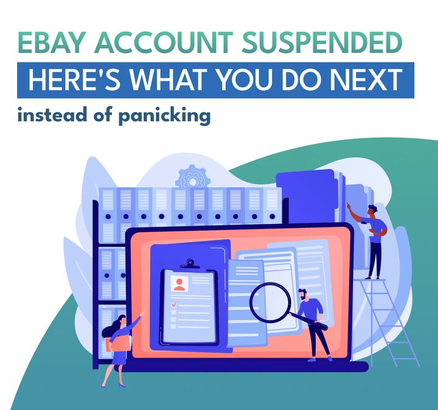

## First: Don't Create a New Account

It's tempting to just start over, but eBay links new accounts back to a suspended one through payment details, device and address — a second suspension usually follows fast, and now you have two flagged accounts instead of one.

## Step 1: Read the Suspension Notice Carefully

Ebay's suspension email states the reason — policy violation, unpaid fees, suspected fraud, too many buyer complaints, or a verification issue. The fix depends entirely on which one it is, so don't skip this.

## Step 2: Gather Your Evidence

Before you appeal, pull together whatever supports your case: order records, tracking numbers, communication with buyers, proof of identity or business registration if it's a verification hold.

## Step 3: File an Appeal Through the Right Channel

Go to **eBay > Help & Contact > Appeal a suspension** (or call eBay Seller Support directly for urgent cases). Be factual and specific — reference the exact policy cited and explain what happened, rather than disputing that a review is warranted.

## Step 4: Fix the Underlying Issue While You Wait

If the suspension was tied to late shipments, item-not-as-described cases, or unpaid seller fees, fix what you can now — pay outstanding fees, tighten your handling times — so you can point to concrete changes in your appeal.

## Step 5: Keep Selling Elsewhere in the Meantime

A suspension on one channel shouldn't stop your whole business — if you're already listing on Amazon, Walmart or Shopify too, lean on those channels while eBay resolves the appeal. SellerChamp keeps your inventory synced across all of them, so an eBay suspension doesn't mean guessing at stock counts on your other channels while you wait it out.
