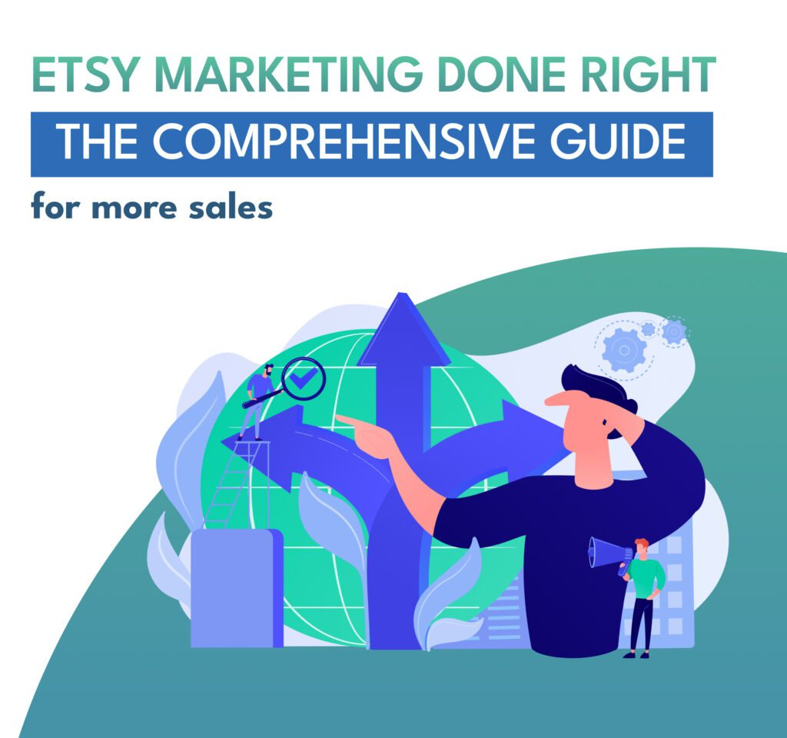

## 1. Optimize for Etsy Search First

Etsy's search algorithm weighs titles, tags and categories heavily. Use all 13 tags available, front-load your title with the terms buyers actually search, and keep your category and attributes accurate — this drives more free traffic than any paid tactic.

## 2. Build Out Your Shop Branding

A cohesive shop banner, profile photo and "About" story builds buyer trust fast — Etsy shoppers browse shops, not just individual listings, especially for repeat purchases.

## 3. Use Etsy Ads Strategically

Start with a small daily budget on your best-converting listings rather than spreading thin across your whole catalog — let data tell you which listings deserve more ad spend before scaling up.

## 4. Leverage Social Proof

Encourage reviews actively (a polite follow-up message after delivery works well) and feature your best photos of real customer use when allowed — social proof is one of the strongest Etsy conversion levers.

## 5. Promote Off-Etsy Too

Pinterest in particular drives strong traffic to Etsy shops given the visual, searchable nature of both platforms. Instagram and TikTok work well for handmade and niche products with a strong visual story.

## 6. Run Seasonal and Sale Campaigns

Etsy shoppers respond well to holiday and seasonal promotions — plan your sales calendar around major gifting periods (holidays, Mother's Day, back-to-school) rather than running discounts at random.

## 7. Track What's Actually Working

Use Etsy's own Shop Stats to see which listings and traffic sources convert best, and double down there instead of spreading marketing effort evenly across your whole catalog.

## Selling Beyond Etsy With the Same Catalog

Many successful Etsy sellers eventually expand to Amazon Handmade, eBay or their own Shopify store. SellerChamp lets you manage that expansion from one dashboard, keeping inventory and listings synced across every channel you add.
