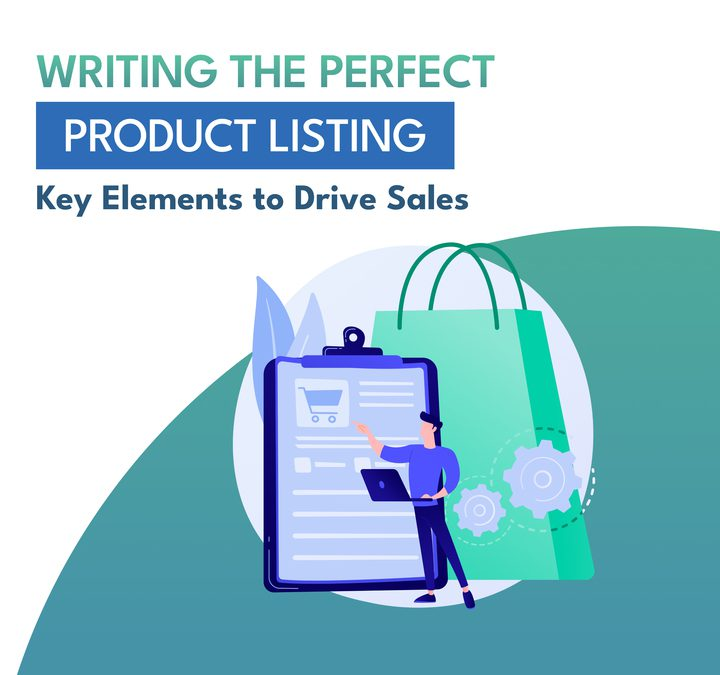

## 1. A Title That Front-Loads the Keywords Buyers Search

Lead with the brand, product name and the 2-3 defining attributes (size, color, model) a shopper would actually type in. Marketplace search algorithms weight the title heavily — vague or clever titles get buried.

## 2. Photos That Show the Product from Every Angle

Minimum: a clean main image on a white background, plus close-ups of material, labeling and any flaws for used/liquidation items. Listings with 5+ photos consistently outsell ones with 1-2.

## 3. A Description That Answers Objections Before They're Asked

Dimensions, materials, compatibility, what's included in the box, and return policy — cover the questions that would otherwise become pre-sale messages or, worse, returns.

## 4. Accurate Item Specifics / Attributes

On Amazon, eBay and Walmart alike, the structured attribute fields (not just the description) drive search filtering. A missing or wrong attribute means your listing doesn't show up when a buyer filters by size, color or brand.

## 5. Competitive, Channel-Aware Pricing

Price against what's actually selling in that category on that channel — not just your cost plus margin. A listing that's 15% above the going rate with no differentiator sits unsold no matter how good the copy is.

## 6. A Clear Call to the Buyer's Next Step

Stock scarcity when it's real ("Only 4 left"), shipping speed, or a bundle offer gives a hesitant buyer the last nudge to click Buy.

## Keep Listings Consistent Across Every Channel

Writing one great listing is one thing — keeping title, photos and attributes consistent (and each platform's specific requirements met) across Amazon, eBay, Walmart and Shopify by hand doesn't scale. SellerChamp lets you build the listing once and push it everywhere, formatted to each channel's rules, so your best listing copy doesn't get diluted channel by channel.
