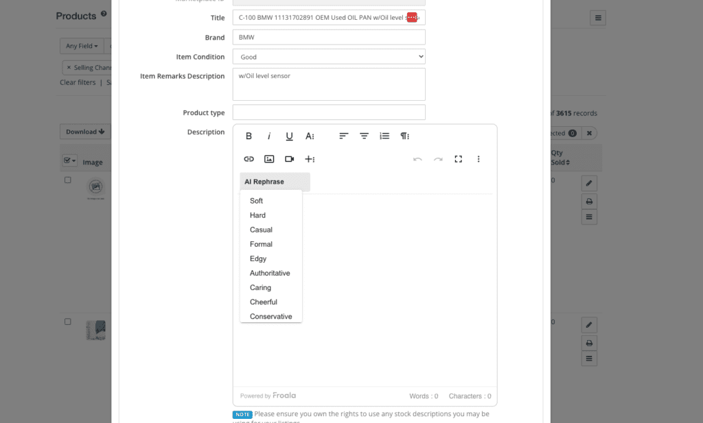
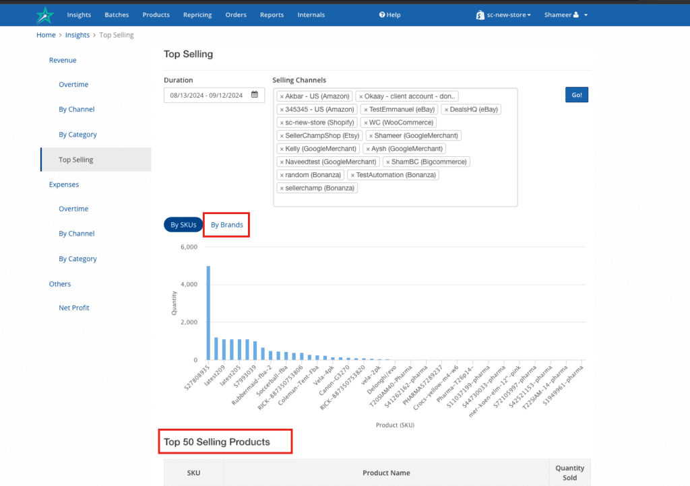
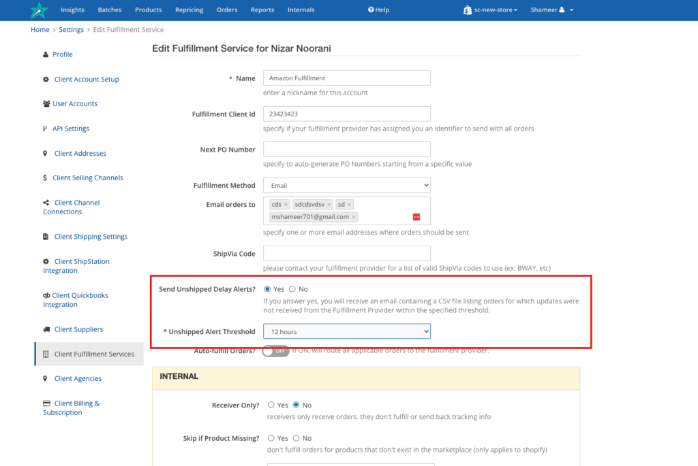
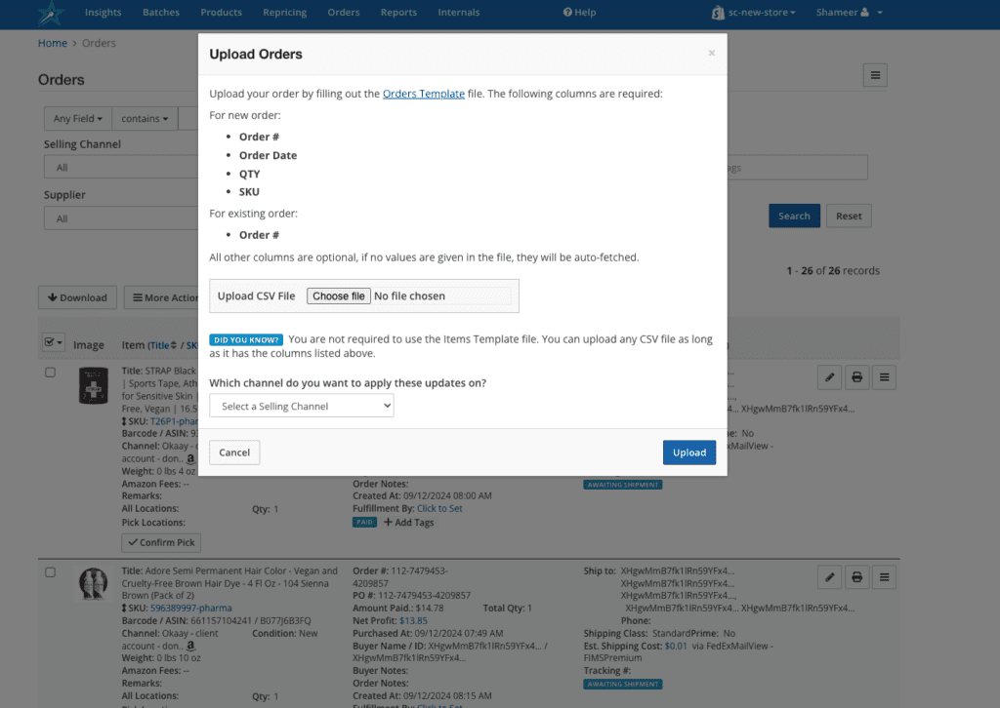
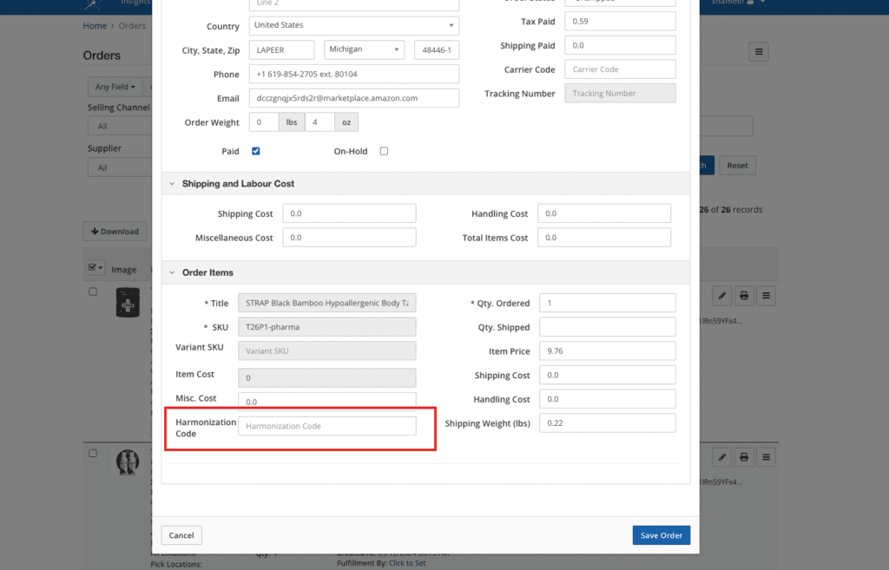

We’ve added some exciting updates to help you streamline your e-commerce operations and save time. Here’s a quick rundown of this month’s top 5 features:

<h2>1. AI-Powered Product Descriptions
</h2>

Want to make your product descriptions more engaging? Now you can use AI to rephrase descriptions in any tone you want. Whether you’re aiming for a professional, friendly, or quirky vibe, AI will help you craft descriptions that catch your customers’ attention while boosting your SEO. Plus, this feature helps you save hours of writing time by automating the content creation process.

<h2>2. Expanded Top-Selling Product Insights
</h2>

We’ve made it easier to track your best-sellers. You can now see up to 50 top-selling products, instead of just 10. Plus, you can filter by brand to get a better understanding of which items are performing well. This improved feature helps you stay on top of trends and boost your sales potential.

<h2>3. Fulfillment Delay Alerts
</h2>

Worried about late shipments? You can now set alerts to notify you if your fulfillment provider hasn’t shipped your orders on time. Just go to the Fulfillment Service settings, turn on “Send Unshipped Delay Alerts,” and set your preferred delay time (like 12 hours). If your order isn’t shipped in time, you’ll receive an email with a list of the affected orders.

<h2>4. Bulk Order Updates with CSV
</h2>

Managing orders is easier than ever. You can now update existing orders in bulk by uploading a CSV file. This feature saves you time and reduces manual effort by letting you make multiple changes all at once.

<h2>5. Harmonization Codes for International Shipping
</h2>

products. You can add these codes when you create shipping labels or preset them on the product level. The code will automatically apply to your order when a purchase is made, making international shipping smoother.

<b>Need help with these new features? </b><a href="/support/#"><b>Our support team is ready to assist. Visit our Help Center or chat with us directly for guidance.</b></a>

