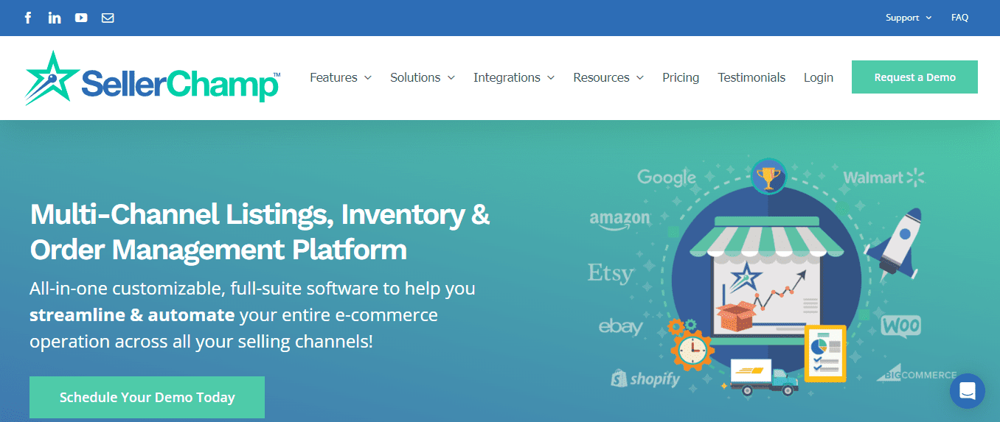
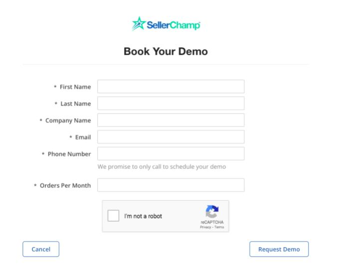

With advanced <b>order fulfillment software</b>, processing orders has become much simpler and less of a headache. These programs help streamline the process, saving time and allowing business owners to focus on other tasks.

Small businesses looking to expand can leverage these solutions to enhance their <a href="/solutions/retailer-solution/">e-commerce</a> or <a href="/solutions/drop-shipper/">dropshipping</a> ventures.

<b><i>Do You Know: About </i></b><a href="https://wifitalents.com/statistic/ecommerce-fulfillment/#sources:~:text=%2243%25%20of%20ecommerce%20merchants%20stated%20that%20logistics%20and%20delivery%20were%20their%20biggest%20operational%20challenges.%22"><b><i>43%</i></b></a><b><i> of e-commerce owners revealed that logistics and delivery are the biggest challenges when fulfilling orders?</i></b>

In this guide, we will review seven affordable order fulfillment software options in 2024 and explain how you can choose the best one.

<b><i>Read More: </i></b><a href="/blog/unlock-your-online-stores-potential-a-fun-guide-to-selling-on-multiple-channels/"><b><i>Unlock Your Online Store’s Potential: A Fun Guide to Selling on Multiple Channels!</i></b></a>

<h2>1. SellerChamp
</h2>

SellerChamp is automated order fulfillment software designed by e-commerce tech experts for B2B sellers and dropshippers who want to manage their businesses efficiently.

With SellerChamp, you can streamline orders and reduce manual tasks while enabling <a href="/integrations/">integrations</a> across various systems. It has incredible features, including a dynamic RePricer, Bulk Lister, and many other technical tools required to manage inventory.

Whether you are a brand owner or, let’s say, an <a href="/solutions/amazon-fba-seller/">Amazon FBA seller</a>, SellerChamp offers features to optimize your multi-channel listings and analyze inventory simultaneously.

<i>Learn More (Video): </i><a href="https://youtu.be/UrAXHS2A4s8?si=BMqDJaBitc9-cDyQ"><i>How to Analyze Inventory Data Using SellerChamp</i></a><i>.</i>

Additionally, its innovative algorithms also allow you to create bulk FBA shipments quickly using CSV files, saving you valuable time.

In terms of pricing, SellerChamp is highly flexible. It lets you get a customized quote tailored to your business plan with zero hidden charges.

<a href="https://app.sellerchamp.com/leads/new?_gl=1*1pxa8cz*_gcl_au*MTQwODk2NDE4Ny4xNzIyNTI5ODY2*_ga*MTMzNzM3NTgxNS4xNzIyNTI5ODU5*_ga_F2WQV1CVLC*MTcyMjg2NTAzMC45LjEuMTcyMjg2ODEyMS4zNi4wLjQ5NTIwMTg3OA..&_ga=2.164868797.347162068.1722865030-1337375815.1722529859">Start your free trial with Seller Champ Today!</a>

<strong>Pros</strong>

<ul><li>Straightforward order fulfillment process.</li><li>Responsive customer service.</li>
</ul>

<strong>Cons</strong>

<ul><li>Learning curve involved.</li>
</ul>

<b><i>Read More: </i></b><a href="/blog/unlock-your-online-stores-potential-a-fun-guide-to-selling-on-multiple-channels/"><b><i>Sell on Multiple Channels Using a Single Platform.</i></b></a>

<h2>2. BrightPearl
</h2>

Brightpearl by Sage is a comprehensive retail management system that consolidates your inventory, orders, receipts, and CRM in one place.

One of Brightpearl’s key features is its robust inventory and order management system, allowing you to keep track of stocks, process orders, and manage receipts, all within a single platform.

Brightpearl also includes an integrated POS system, making managing sales or tracking net profit across various locations more accessible.

<b><i>Bonus: </i></b><i>Interested in tracing net profit? Check out this helpful tutorial on “How to Track Net Profit” </i><a href="https://www.youtube.com/watch?v=fzwR0uxQiVg&list=PLAQ4f85wtJsSEyHZhVSk01W6LGVRxfmuW&index=8"><i>here</i></a><i>.</i>

Additionally, Brightpearl offers multichannel inventory synchronization. This feature ensures inventory levels are updated in real-time across all sales channels, preventing stockouts.

<strong>Pros</strong>

<ul><li>Different <a href="/blog/top-10-e-commerce-payment-gateways-for-your-online-store-empower-your-business-with-secure-and-seamless-transactions/">payment getaways</a>.</li><li>Real-time automation and reporting.</li>
</ul>

<strong>Cons</strong>

<ul><li>Limited updates.</li>
</ul>

<h2>3. Mintsoft
</h2>

Mintsoft offers third-party logistics programs to simplify order fulfillment processes.

For data-driven decision-making, Mintsoft includes brief reporting and analytics. This feature provides valuable insights into your order fulfillment performance, helping you identify trends, track key metrics, and make informed decisions to optimize your business operations.

With Mintsoft, inventory management is not just confined to the warehouse. It controls all operations, from hunting products to shipping logistics.

<strong>Pros</strong>

<ul><li>Offers 150+ integrations.</li><li>Effective scalability. </li>
</ul>

<strong>Cons</strong>

<ul><li>Slow response times</li>
</ul>

<h2>4. Extensiv
</h2>

Extensiv is another top-notch 3PL software that helps you locate, manage, and deliver timely orders.

With automated small parcel shipping, Extensiv simplifies the management of shipping tasks by automating label generation, tracking, and carrier selection.

One of Extensiv’s best features is its Integration Manager free trial, which allows you to test the platform before committing. Consequently, if the software meets your needs, you can also choose from one of the four comprehensive packages they offer.

Extensiv also has a SmartScan feature. It directly regulates near real-time data transfer from the warehouse floor to your Warehouse Management System (WMS). For instance, you can review tasks such as receiving, picking, and packing orders using a small device.

<strong>Pros</strong>

<ul><li>Intuitive interface.</li><li>Proficient inventory management.</li><li>Versatile customization.</li><li>Tools for demand forecasting</li>
</ul>

<strong>Cons</strong>

<ul><li>Slow inventory syncing. </li>
</ul>

<h2>5. Cin7
</h2>

Cin7 Omni is a cloud-based inventory management solution that centralizes operations across various sales channels on a single platform.

The platform integrates and automates the tracking of products, sales channels, stock locations, orders, warehouses, and workflows.

With Cin7, you get real-time synchronization with your accounting software. It integrates smoothly with your e-commerce platforms, preferred 3PL providers, and warehouses.

Furthermore, Cin7 Omni also includes built-in EDI functionality, simplifying managing large retail customers without costing extra. It is compatible with online marketplaces such as Shopify and supports various Amazon services, including FBA and FBM Direct Fulfillment.

<strong>Pros</strong>

<ul><li>Alert scalability and connectivity.</li><li>Prompt onboarding support.</li><li>700+ pre-built integrations</li>
</ul>

<strong>Cons</strong>

<ul><li>Lacks tools for complex operations.</li>
</ul>

<h2>6. Linnworks
</h2>

Linnworks is your go-to for effortless order management across multiple marketplaces and channels.

With over 100 integrations, including major platforms like Shopify, eBay, Amazon, and Walmart, Linnworks provides a complete order and inventory management solution.

Besides, the platform offers real-time inventory visibility and automation for numerous essential tasks, such as order routing, ensuring accurate inventory management and efficient order fulfillment.

<strong>Pros</strong>

<ul><li>30+ carrier integration.</li><li>Expedited order processing.</li><li>Accessible channels and couriers integration.</li>
</ul>

<strong>Cons</strong>

<ul><li>Minor bugs while managing inventory.</li>
</ul>

<h2>7. ShipBob
</h2>

ShipBob boasts a 99.95% order accuracy rate, with an average defect rate of just 5 in every 10,000 orders.

What’s more incredible is that they offer two-day shipping within the continental US, similar to Amazon Prime. Their Growth Plan supports smaller businesses with up to 400 monthly orders, providing access to their network and services.

<strong>Pros</strong>

<ul><li>Up to 50 global warehouses. </li><li>Next-level reporting.</li>
</ul>

<strong>Cons</strong>

<ul><li>High storage fees.</li>
</ul>

<h1>How To Choose the Best Order Fulfillment Software?
</h1>

To choose the best order fulfillment software, you should:

<ul><li>

<strong>Know Your Budget</strong>

</li>
</ul>

Consider how much you are willing to spend on order fulfillment software. Search for options that offer the best value for your money without compromising essential features.

Additionally, remember to factor in any hidden costs or additional fees. Ensure that you are paying for only what you are using.

<i>Check Out: </i><a href="/pricing-fullsuite-v2/"><i>Seller Champ Offers Customized Plans To Fit Your Business Needs.</i></a>

<ul><li>

<strong>Inquire Automation and Integrations</strong>

</li>
</ul>

Automating tasks and swift integration let you focus on other essential aspects of your small business, such as improving customer service or increasing traffic.

So, if you want to grow your small business, you must purchase an order fulfillment plan with automation features.

<ul><li>

<strong>Think About User Experience</strong>

</li>
</ul>

Managing the order fulfillment process is complex and requires your utmost attention. Balancing inventory management with customer demands often leads to unnecessary delivery delays.

<b><i>Do You Know: </i></b><a href="https://www.websitemagazine.com/ecommerce/the-impact-of-late-and-inaccurate-deliveries-on-customer-loyalty"><b><i>69% of consumers would refuse or return an order from their doorstep simply because it took more than two days to be delivered!</i></b><b>
</b></a>

Opt for a program with a user-friendly layout that requires minimal learning time. This will allow you and your team to adapt quickly and have your small business make prompt deliveries.

<ul><li>

<strong>Try Free Trials and Demos</strong>

</li>
</ul>

Many software providers offer free trials or demos. Take advantage of these opportunities to thoroughly test the software and ensure it meets your requirements before committing.

This hands-on experience allows you to assess the features, ease of use, and compatibility with your business needs, helping you make an informed decision.

<b><i>Bonus:</i></b>
<a href="https://app.sellerchamp.com/leads/new"><i>Book Your Free Demo With SellerChamp Now!</i></a>

<h1>Sign Up for a Free Demo Now!
</h1>

SellerChamp is an exceptional choice for those seeking flexible and budget-friendly order fulfillment software.

<b>Ready to up your e-commerce business? </b><a href="https://app.sellerchamp.com/leads/new"><b>Learn why thousands trust SellerChamp firsthand by booking a demo today.</b></a><b>
</b>

