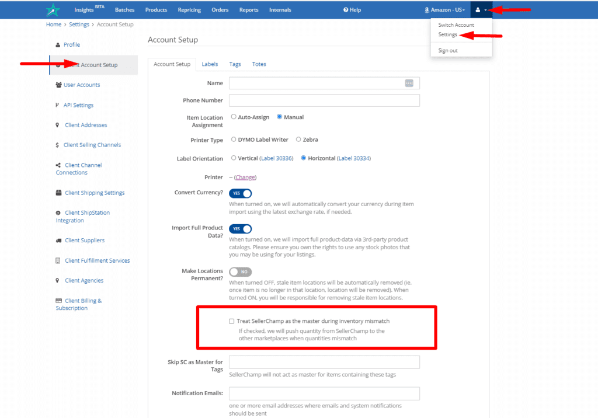

Knowing <b> effective eBay inventory management tips</b> are key to making a splash on the e- platform.

With <a href="https://investors.ebayinc.com/fast-facts/default.aspx">132 million active buyers</a>, eBay is a prime spot for finding customers. However, listing products isn’t enough. You need a solid strategy and an organized inventory.

In this guide, we look at <b>10 top tips to keep your inventory running </b> smoothly and profitably on eBay.

<strong>Read more:</strong><a href="http://kb.sellerchamp.com/en/collections/1988250-inventory"><b>Understand The Tools Used To Manage The Listings Within Your Inventory.</b></a>

<h2>Tip 1: Use Simple IDs for Products
</h2>

Using simple IDs for your products can make your life so much easier.

Think of it as organizing a filing cabinet—assigning easy-to-understand IDs to <b> each item helps you keep track of everything</b> without getting lost in a sea of complex codes.

Whether you’re managing hundreds or thousands of items, <b>simple IDs streamline the process, </b> making it a breeze to track stock levels and manage listings.

<h2>Tip 2: Try eBay’s Tools
</h2>

If you’re not using eBay’s built-in tools, you’re missing out. eBay offers a suite of tools designed to <b>make inventory management simpler. </b>

The Seller Hub is your business’s control center, offering insights into sales trends, stock levels, and performance metrics. The Inventory Management Tool keeps your listings updated, preventing the dreaded <b> “out-of-stock”</b> message that can turn customers away.

Utilizing software tools for managing listings is an effective eBay inventory management tip. For those looking to up their game, platforms like <a href="/features/#inventory">SellerChamp provide additional features </a>to enhance your inventory management.

<h2>Tip 3: Utilize a Labeling System
</h2>

Imagine walking into a library where books are randomly placed on shelves—it’s chaos.

The same applies to your inventory. Implementing a <b> clear labeling system </b> can keep your stock organized and it is an essential eBay inventory management tip.

Use labels that include <b>product names, sizes, and expiration dates. </b> This makes finding items a snap and ensures you never waste time searching for a product again. So implement this effective eBay inventory management tip and make your life easier.

<b><i>Read More: </i></b><a href="/blog/unlock-your-online-stores-potential-a-fun-guide-to-selling-on-multiple-channels/"><b><i>Unlock Your Online Store’s Potential: A Fun Guide to Selling on Multiple Channels!</i></b></a>

<h2>Tip 4: Keep Up with eBay’s Seller Policies
</h2>

EBay’s seller policies are more than just guidelines; they’re also your roadmap to success. <b>
</b>

Staying informed about changes to these policies ensures your listings remain compliant and protects your account from penalties.

By keeping up with eBay’s rules, you <b>ensure smooth sailing for your business</b>.

<h2>Tip 5: Creating a Workflow for Inventory Intake and Storage
</h2>

Another effective eBay inventory management tip is establishing a workflow for inventory intake and storage is like building a solid foundation for your business.

A well-defined process for<a href="https://medium.com/@versaclouderp/ebay-inventory-management-tips-a-complete-guide-for-sellers-a6415c569a66"> handling new stock helps you maintain accurate records</a> and <b> prevents mistakes. </b>

From receiving inventory to updating stock levels and storing items in their designated places, a clear workflow <b>ensures consistency, reduces errors, and boosts productivity.</b>

<h2>Tip 6: Conduct Regular Stock Audits
</h2>

No one likes surprises when it comes to inventory <b>. Regular stock audits are your safety net, </b> helping you catch discrepancies between actual stock levels and your records.

Whether it’s due to misplaced items or data entry errors, audits identify issues before they become costly problems. Accurate inventory records <b> improve order fulfillment and ensure you meet customer expectations</b> every time.

<b><i>Check Out: </i></b><a href="/blog/how-to-make-money-on-amazon-7-strategies-to-ace-the-game/"><b><i>How to Make Money on Amazon: 7 Strategies to Ace The Game</i></b></a>

<h2>Tip 7: Setting Reorder Points to Avoid Stockouts
</h2>

Another effective eBay inventory management tip is to set reorder points to avoid stockouts and maintain a balanced inventory.

Reorder points are the minimum stock levels at which you should trigger a new purchase order.

By establishing these thresholds, you can automate the reordering process and ensure you’re always ready to meet demand.

<h2>Tip 8: Smartly Optimize Listings for Fast-Moving Product
</h2>

Not all products are the same. Some fly off the shelves, while others gather dust.

Focus on <b>optimizing listings for fast-moving items</b> by using compelling titles, detailed descriptions, and high-quality images.

These products deserve the spotlight, and a little <b>extra effort can maximize sales </b> and reduce the time they spend in inventory. Updating product listings regularly is an important eBay inventory management tip.

<h2>Tip 9: Bundle Products to Boost Sales
</h2>

Bundling products is like offering your customers a value-packed deal they can’t resist. Create bundles that <b> combine complementary items and offer them at a discount</b>.

Not only does this increase sales, but it also <b>helps clear out slower-selling products. </b> It’s a win-win: customers get a great deal, and you move more inventory.

<h2>Tip 10: Use an Inventory Sync Tool
</h2>

Another effective eBay inventory management tip is <b>investing in SellerChamp’s inventory sync tool. </b>

<a href="https://sellerchamp.com/"><b>SellerChamp’s</b></a>
<a href="/features/#inventory">inventory sync tool</a> will keep all your item quantities aligned so you never oversell.

This tool also provides full-support for syncing variations, bundles and kits across all channels.

<b style="font-family: var( --e-global-typography-text-font-family ), Sans-serif; text-align: var(--text-align); font-size: var(--body_typography-font-size); font-style: var(--body_typography-font-style,normal); letter-spacing: var(--body_typography-letter-spacing);"><i>Read More: </i></b><a style="font-family: var( --e-global-typography-text-font-family ), Sans-serif; font-weight: var( --e-global-typography-text-font-weight ); text-align: var(--text-align); font-size: var(--body_typography-font-size); font-style: var(--body_typography-font-style,normal); letter-spacing: var(--body_typography-letter-spacing);" href="/blog/how-to-promote-ebay-listing-to-get-more-views-test/"><b><i>How to Promote eBay Listing to Get More Views</i></b></a>

<h2>How to Use SellerChamp as Your eBay Inventory Management Tool?i
</h2>

Here’s how you can easily implement SellerChamp to your operations:

<ol><li>Go to SellerChamp Settings.</li><li>Click on Account Setup from the left menu.</li><li>Check the box for <i>“Treat SellerChamp as the master during the inventory mismatch.”</i></li><li>Save the changes.</li>
</ol>

By following these steps, you can ensure accurate inventory management across all your marketplaces.

<h2>Try SellerChamp’s Free Trial!
</h2>

<b>SellerChamp makes eBay inventory management easy</b> with features like multi-channel listings, bulk listing, and inventory sync.

<a href="https://app.sellerchamp.com/users/sign_up?_gl=1*1mz56dp*_gcl_au*MTYyNDA0MDc4NC4xNzIxODMzODE1*_ga*MTExNzQzMjU1Ni4xNzIxODMzODEz*_ga_F2WQV1CVLC*MTcyMzkzOTkxMS40Mi4xLjE3MjM5NDAyNDYuNTYuMC4yODc1NDM5&_ga=2.85221721.1166155339.1723380123-1117432556.1721833813"><b>Try our free trial today and see the difference!</b></a>

