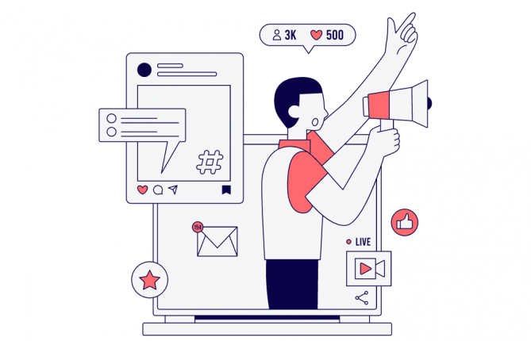
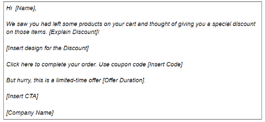

To make decent sales on your e-commerce venture, you need to know <b>how to attract online customers</b> to your platform.

But how exactly can you draw customers to your e-commerce business today?

In this comprehensive guide, we’ll show you <b> how to attract online customers</b> with 13 tips:

<strong>You might also like:</strong><a href="/blog/unlock-your-online-stores-potential-a-fun-guide-to-selling-on-multiple-channels/"><b>A Fun Guide to Selling on Multiple Channels!</b></a>

<h2>Tip 1. Run Google Adword Campaigns
</h2>

One of the most popular forms of paid advertising, Adwords, claims it can reach <a href="https://www.webfx.com/blog/marketing/google-ads-statistics/">80% of internet users</a>. Since they’re already looking for products you sell, this is a fantastic source of potential customers.

This is a pay-per-click (PPC) form of advertising. You pay the platform only when someone clicks on your ad.

Adwords can be published on the web in as little as 15 minutes, so you have a quicker source of income on your website.

You can reach potential customers at the best point in the funnel—when they’re actively looking for an answer to their question. This makes them likelier to make a purchase.

<h2>Tip 2. Partner with Creators and Influencers
</h2>

Run an influencer marketing campaign to leverage a popular social media personality’s existing audience to drive website traffic.

<a href="https://www.sprinklr.com/blog/influencer-marketing-statistics/#toc-2">Research</a> shows that for <b>every $1 invested in influencer marketing, brands make a solid $5.78.</b> So, find creators and influencers whose target audience matches your own.

<h2>Tip 3. Optimize Your Social Handle Bios
</h2>

Social media is a powerful tool for driving traffic to your online store. The only problem: most social media giants don’t like it when brands divert people off the platform.

Instagram, for example, only allows one link in your profile bio. Since you cannot divert people to a specific page on your e-commerce website, executing social campaigns that increase web traffic is challenging.

Use Linkpop to create a landing page that diverts people to your most-viewed pages, like

<ul><li>Best-selling items’ product pages </li><li>Popular item category pages</li><li>Lead magnet landing pages</li><li>Other social media profiles</li>
</ul>

<b><i>Limited-time</i></b>
<b><i>offer</i></b><b>: </b><a href="/integrations/shopping-carts/shopify/"><b>Get a free demo of Sellerchamp’s</b><b><i> multi-channel listing platform! </i></b></a>

<h2>Tip 4. Offer Online Promotions and Discounts
</h2>

Whether it’s a

<ul><li>Limited-time discount</li><li>Buy-one-get-one-free offer</li><li>Giveaway</li><li>Flash Sale</li><li>Special promotional code</li>
</ul>

Online promotions instantly snag attention and create a sense of urgency.

The chance to save money or get more value for their purchase attracts customers. This translates into increased website traffic as they eagerly explore your offers.

Shoppers often look for coupons before making a purchase online. Use them as a hook.

<h2>Tip 5. Create a Referral Program
</h2>

Happy customers are your best salespeople. Referral schemes exploit this effectively, giving customers specific perks if they successfully refer your brand to a friend or family member.

They are great marketing strategies. They can increase website visitors, leveraging the power of word-of-mouth marketing.

These perks include (if the referee signs up on your website or buys something)

<ul><li>Loyalty points</li><li>Discount codes</li><li>Free gifts </li>
</ul>

<h2>Tip 6. Integrate Contact Channels into your Website
</h2>

One of the most frustrating barriers for a user on a website is not being able to access support.

If an online customer faces any issues or difficulties and there’s no way to resolve their questions, they’ll likely leave your site for good.

Digital customer service comes to the rescue here.

By ensuring the proper communication channels on your website, you can take the in-store customer experience online.

Here are some examples:

<ol><li>Live chat </li><li>Video chat </li><li>Chatbots </li>
</ol>

<h2>Tip 7. Make the Most Out of Email Marketing
</h2>

You’ve heard this before, but email marketing can be an impactful and cost-effective strategy to draw customers to your business website.

Through an effective email marketing campaign, you will stay in touch with online customers and those who have already visited your website but haven’t purchased.

Sometimes, even a single email with compelling content or an attractive discount can turn email subscribers into customers.

<a href="https://blog.hubspot.com/marketing/email-marketing-stats?__hstc=2794607.d9954a5a2bac8bf1a659b8c3a22c395d.1722430471333.1722432462414.1722437113481.3&__hssc=2794607.1.1722437113481&__hsfp=958145259">59% of consumers</a> report that marketing emails influence their purchasing decisions. Here are three valuable pointers to help you devise a successful email marketing campaign:

<h3>Point 1. Build a quality email list
</h3>

Build a permission-based email list of engaged subscribers who’ve signed up to receive your correspondence.

Offer incentives and valuable content to generate sign-ups. Also known as lead magnets:

<ul><li>A free quiz</li><li>A coupon code</li><li>A checklist or downloadable PDF</li>
</ul>

<h3>Point 2. Personalise all emails
</h3>

Use techniques like addressing subscribers by name and tailoring the content to their interests.

<h3>Point 3. Include clear CTAs
</h3>

Every email should include a clear call-to-action that prompts recipients to visit your website.

<h2>Tip 8. List Your Store on Free Advertising Sites
</h2>

Advertising increases the odds of reaching your target customer. But you don’t need to invest cash into advertising to get started. Attract your target market by listing your online store on free advertising sites like

<ul><li><a href="https://www.craigslist.org/">Craigslist</a></li><li><a href="https://locanto.com/">Locanto</a></li><li><a href="https://www.facebook.com/groups/explore/">Facebook Groups</a></li><li><a href="https://www.google.com/business/">Google Business</a></li><li><a href="https://m.yelp.com/">Yelp</a></li><li><a href="https://weebo.co.in/">Weebo</a></li>
</ul>

Free advertising can’t do your business any harm.

Invest some time, create a profile, upload your product listings, and write a strong description that directs them to your online website (instead of the free advertising site).

<b><i>Learn More:</i></b><a href="https://www.youtube.com/watch?v=KsJR4_TIjvc&list=PLAQ4f85wtJsSEyHZhVSk01W6LGVRxfmuW&index=11"><b><i> Sync Inventory across Multiple Marketplaces</i></b></a>

<h2>Tip 9. Run Retargeting Campaigns
</h2>

The mean <a href="https://baymard.com/lists/cart-abandonment-rate">online shopping cart abandonment rate is a staggering 69%</a>.

How do you get them back to complete their purchases? The best tools you have are shopping cart tracking and conversion tools.

Retarget website visitors who have:

<ul><li>Viewed your website</li><li>Liked your social media pages</li><li>Added items to their online cart but not yet purchased</li>
</ul>

Sending a series of ‘Can I help you?’ remarketing emails, from within an hour to weeks later, can make all the difference in a sale conversion.

Often, online shoppers hesitate before buying because they have questions about the product, pricing, delivery time, or delivery options.

Consider having an FAQ page on your website to prevent the need for retargeting in the first place. Give quality answers to questions your buyer might have.

<strong>Read more:</strong><a href="/blog/7-abandoned-cart-email-best-practices-to-win-back-customers/"><b>7 Abandoned Cart Emails Best Practices To Win Back Customers</b></a>

<h2>Tip 10. Ensure Website Usability
</h2>

 A well-designed site creates a positive customer experience, encouraging visitors to explore more of your content.

When visitors quickly and effortlessly find the information they’re looking for, they’re more likely to engage with your content. Remember, time is money.

If your website needs to be clearer and easier to navigate, visitors will likely become frustrated and leave your site within seconds.

A high bounce rate repels visitors.‍ Website usability is also closely linked to search engine optimization.

In order to determine search rankings, search engines like Google consider user experience metrics, such as

<ul><li><b>bounce rate, </b></li>
</ul>

<ul><li><b>time on site, </b></li>
</ul>

<ul><li><b>pages per session.</b></li>
</ul>

<strong>Read more:</strong><a href="/blog/writing-the-perfect-product-listing-key-elements-to-drive-sales/"><b>Writing The Perfect Product Listing!</b></a>

<h2>Tip 11. Use SMS campaigns
</h2>

Use SMS campaign marketing to snag customers.

If you have explicit permission to email your prospective customers, SMS can drive customers toward your online store.

Collect mobile phone numbers through touchpoints you already have with consumers.

Add a phone number option to checkout forms, use pop-up boxes on popular online store pages, and ask email subscribers to opt into SMS marketing.

Those messages could be:

<ul><li>Flash sales and promotions</li><li>Subscriber-exclusive offers</li><li>Text-to-win competitions</li><li>New product or restock alerts</li><li>Loyalty program invites</li>
</ul>

<h2>Tip 12. Consistently Use Social Media Ads
</h2>

<a href="https://www.invespcro.com/blog/social-media-customer-support/">80% of consumers</a> now use social media to connect with brands. Social media platforms have a lot of information about users. Use this to your advantage.

<b><i>Do You Know: About </i></b><a href="https://wifitalents.com/statistic/ecommerce-fulfillment/#sources:~:text=%2243%25%20of%20ecommerce%20merchants%20stated%20that%20logistics%20and%20delivery%20were%20their%20biggest%20operational%20challenges.%22"><b><i>43%</i></b></a><b><i> of e-commerce owners revealed that logistics and delivery are the biggest challenges when fulfilling orders?</i></b>

Target ads are based on demographics, location, and individual user preferences.

Your campaign should be practical, too, as you’ve researched precisely who your target audience is and what interests them most.

<ul><li>Share website links</li><li>Create visual content </li><li>Run contests and promotions </li><li>Collaborate with influencers</li>
</ul>

<h2>Tip 13. Go local
</h2>

Experiential retail gives customers experiences in person.

Almost a third of customers said they’re likely to engage with branded experiences, which is why 40% of brands plan to prioritise it this year.

Networking is better in person.

You don’t need a permanent store for physical retail, though. Drive in-person shoppers toward your website by attending local events such as:

<ul><li>Craft fairs</li><li>Trade shows</li><li>Local markets</li><li>Pop-up shops</li>
</ul>

Hand out your business cards at each event or have people scan a QR code from your signage. Ideally, the code should be stamped with an incentive like “Get <b> 10% off </b> with this card at yourwebsite.com.”

That way, you don’t need to carry or sell inventory in person.

<h2>Attract Online Customers With SellerChamp!
</h2>

SellerChamp has helped countless e-commerce businesses scale and grow year over year.

<a href="https://app.sellerchamp.com/leads/new"><b>Sign up for a FREE 14-day SellerChamp Demo </b></a><b>and see how easy it is to automate your operations, increase your inventory, and expand to multiple channels!</b>

