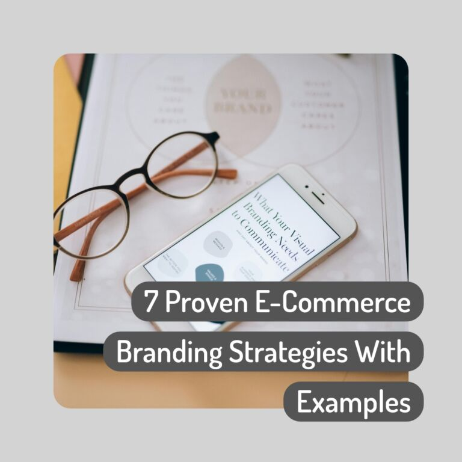

<b>E-commerce branding strategies</b> are crucial to set your online business apart from the competition.

A strong brand helps you better connect with customers and build trust, despite not having a physical point of contact.

In this article, we’ll explore <b> 7 proven e-commerce branding strategies</b> to help you create a memorable and successful brand.

<b><i>You Might Like: </i></b><a href="/blog/how-to-make-money-on-amazon-7-strategies-to-ace-the-game/"><b><i>How to Make Money on Amazon: 7 Strategies to Ace The Game</i></b></a>

<h2>Strategy 1. You Must Implement SEO Best Practices
</h2>

SEO best practices are a cornerstone of e-commerce branding strategies. By optimizing your website for search engines, you can improve your visibility and attract more customers.

<em><strong>Did You Know: According to a 2023 study by BrightEdge, <a href="https://www.highervisibility.com/seo/learn/organic-vs-paid-search-statistics/#:~:text=53.3%25%20of%20all%20web%20traffic,than%20all%20other%20channels%20combined.">53.3% of all website traffic comes from organic search.</a></strong></em>

<h3>Example:
</h3>

Implement SEO by using keyword optimization, high-quality backlinks, and detailed product descriptions. Regularly update your content to align with search engine algorithms. Also, regularly keep an eye on Google SEO updates.

<h3>Tip
</h3>

Use tools like Google Keyword Planner and SEMrush to research relevant keywords for your product titles and descriptions. Regularly update your content to keep up with search engine algorithms.

<b><i>Read More: </i></b><a href="/blog/unlock-your-online-stores-potential-a-fun-guide-to-selling-on-multiple-channels/"><b><i>Unlock Your Online Store’s Potential: A Fun Guide to Selling on Multiple Channels!</i></b></a>

<h2>Strategy 2. Make Your Product Images Stand Out
</h2>

Image search optimization is another powerful digital branding strategy. By ensuring your product images are search-engine friendly, you can attract more traffic from image searches.

A 2024 report from HubSpot indicates that<a href="https://blog.hubspot.com/marketing/marketing-statistics"> 19% of online searches are image-based.</a>

<h3>Example:
</h3>

Add descriptive, keyword-rich alt text to all your product images. Use high-quality images and compress them for faster loading to improve visibility and attract more traffic from image searches.

<h3>Tip
</h3>

Use descriptive, keyword-rich alt text for your images and ensure they are high-quality. Tools like TinyPNG can help compress image sizes for faster loading times.

<h2>Strategy 3. Target New Audiences with E-Commerce Advertising
</h2>

Running cold e-commerce advertising campaigns can be an effective way to get in front of your target market and generate sales quickly.

<h3>Example:
</h3>

To implement this, first identify who your ideal customer is. Then, use platforms like TikTok, Facebook, and Instagram to target these potential customers. Make sure to set up tracking pixels on your website to measure the success of your ads. This way, you can see which ads are performing well and adjust your strategy accordingly.

<h3>Tip:
</h3>

Create attention-grabbing ad content to catch the eye of potential shoppers. Since this might be their first encounter with your brand, make a strong impression to stop them mid-scroll and encourage them to learn more about your products.

<strong>Read more:</strong><a href="/blog/7-abandoned-cart-email-best-practices-to-win-back-customers/"><b>7 Abandoned Cart Email Best Practices to Win Back Customers</b></a>

<h2>Strategy 4. Build Your Ideal Customer Persona
</h2>

A 2024 survey by THM Agency found that<a href="https://tomislavhorvat.com/37-buyer-persona-statistics-that-will-make-you-want-to-create-one-today/#:~:text=value%20proposition.-,71%25%20of%20companies%20that%20exceed%20lead%20generation%20and%20revenue%20goals%20have%C2%A0documented%20buyer%20personas.,-Buyer%20persona%20based"> 71% of marketers who exceed revenue goals</a> have a detailed customer persona.

Building an ideal customer persona is a key <a href="/solutions/brand-owner/">e-commerce branding strategy. </a>Understanding your target audience helps tailor your branding and marketing efforts more effectively.

<h3>Example:
</h3>

Conduct surveys and analyze customer data to create detailed customer profiles. Use these personas to create your marketing and branding strategies to better meet your audience’s needs.

<h3>Tip
</h3>

Conduct surveys and analyze customer data to create accurate personas. Use this information to guide your branding, product development, and marketing strategies.

<h2>Strategy 5. Grow Your Brand on Social Media
</h2>

Expanding your social media presence is an essential e-commerce branding strategy. Active social media profiles help you engage with customers, showcase your brand, and drive traffic to your website.

<em><b>Did You Know: According to a 2024 report by Hootsuite,</b><a href="https://www.hootsuite.com/research/social-trends"><b> 73% of marketers believe social media has been effective for their business. </b></a></em>

<h3>Example:
</h3>

Focus on social media platforms where your target audience is most active. Share interesting and relatable content that showcases your brand’s personality. Use scheduling tools like Hootsuite to plan and manage your posts effectively.

<h3>Tip
</h3>

Choose social media platforms where your target audience is most active. Create and share content that reflects your brand’s personality and values. Use social media management tools like Hootsuite or Buffer to streamline your efforts.

<h2>Strategy 6. Make the Most of UGC and Influencer Marketing
</h2>

User-generated content (UGC) and influencer marketing are powerful e-commerce branding strategies. UGC provides authentic reviews and testimonials, while influencers can expand your brand’s reach and credibility. Almost <a href="https://everyonesocial.com/blog/user-generated-content-statistics/">92% of consumers trust user-generated content</a> more than traditional advertising.

<h3>Example:
</h3>

Work with influencers who match your brand’s image to promote your products. Encourage your customers to post their own photos or reviews using your branded hashtags. Keep track of how well these posts perform to improve your marketing.

<h3>Tip
</h3>

Collaborate with influencers who align with your brand values. Encourage customers to share their experiences and track the performance of your UGC campaigns using tools like Social Blade and Influencer.co.

<b>You May Also Like:</b><a href="/blog/tag/7-strategy-to-make-money-on-amazon/"><b> 7 strategy to Make Money on Amazon</b></a>

<h2>Strategy 7. Don’t Forget To Reward Loyal Customers
</h2>

Implementing a customer loyalty program is a key e-commerce branding strategy. Rewarding loyal customers with discounts, points, or exclusive offers strengthens your relationship with them and encourages repeat purchases.

<b>Did You Know: In a survey, it was disclosed that </b><a href="https://queue-it.com/blog/loyalty-program-statistics/#:~:text=85%25%20say%20loyalty%20programs%20make,continue%20to%20shop%20with%20brands."><b>around 85% of customers say that loyalty programs make them more likely to stay with a brand</b></a><b>.</b>

<h3>Example:
</h3>

Set up a loyalty program where customers earn points with each purchase. Offer special discounts or perks for reaching certain point levels. This encourages them to return and shop more often.

<h3>Tip
</h3>

Design a loyalty program that offers valuable rewards and is easy for customers to use. Use CRM tools to track customer behavior and personalize rewards based on their preferences and purchase history.

<b>Bonus: </b> If you’re a business owner, we recommend checking out these 4 tools you need to grow an eCommerce business.

<h2>Try SellerChamp!
</h2>

Grow your online store with smart strategies and tools. Our all-in-one platform simplifies listing products, managing inventory, and handling shipping.

<b>Want to save time, increase sales, and streamline your business operations? </b><a href="/free-trial/"><b>Try SellerChamp today and see how easy online selling can be!</b></a>

