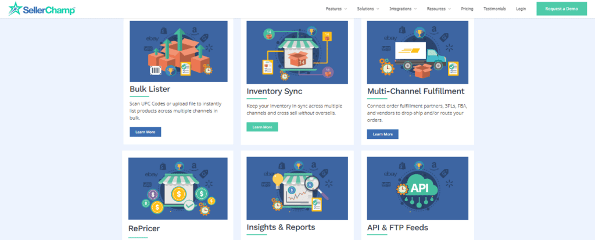

<b>Order processing </b> determines how you acquire customer orders, process them, and deliver the end product in a timely manner.

In this guide, we dive into what order processing essentially is, the key steps involved in it, and how you can automate & streamline your order processing.

<strong>You might also like:</strong><a href="/blog/how-to-attract-online-customers/"><b>How to Attract Online Customers: 13 Tried and Tested Tips</b></a>

<h2>What Exactly is Order Processing?
</h2>

Order processing can be defined as all activities that take place after the customer places the order to the delivery of the product.

Efficient order processing is important as it directly impacts customer satisfaction by ensuring orders are accurately fulfilled and delivered on time.

Additionally, it also involves the coordination between various departments, such as sales, inventory management, and logistics, making it an integral part of a company’s supply chain management.

<strong>Check out:</strong><a href="/solutions/reseller/"><b>Automated Order Processing Solution! </b></a>

<h2>6 Key Steps in Order Processing
</h2>

The following 6 steps are usually involved in order processing:

<h3>Step 1. Order Receipt
</h3>

Order receipt is among the first processes when an order from the customer is entered into the system.

In e-commerce, this involves receiving orders from customers through online store links, market linkages like Amazon and eBay, and manual input entries from sales representatives.

<h3>Step 2. Order Verification
</h3>

This step involves documenting the payment status of the orders, confirming the shipment details, and making sure that all the products in the order are in stock. Globally, e-commerce firms are estimated to have <a href="https://wisernotify.com/blog/cart-abandonment-stats/#:~:text=Cart%20Abandonment%20Benchmarks,-Around%2041%20studies&text=24%25%20of%20users%20abandon%20their,off%2Dputting%20for%20many%20consumers.&text=According%20to%20Forrester%20Research%2C%20%2418,to%20cart%20abandonment%20every%20year.">left $18 billion worth of sales</a> in the cart annually due to cart abandonment.

<h3>Step 3. Inventory Management
</h3>

The efficient management of inventory helps guarantee that the items ordered are ready to be delivered. This is done to ensure that there are no stockouts and backorders during the production process. <b>Do You Know: According to research, it has been estimated that organizations that have a regular update of their stock records can reduce expenses by </b><a href="https://www.atltranslate.com/ai/blog/lower-costs-of-inventory-tracking-with-ai#:~:text=By%20keeping%20track%20of%20inventory,problems%20of%20overstocking%20and%20understocking."><b>about 10%</b></a><b>.</b>

<h3>Step 4. Order Fulfillment & Quality Control
</h3>

This involves selecting the products from the stock and ensuring they are packed securely and correctly for dispatch.

Proper warehouse management systems are needed to minimize the time taken to pick and pack and ensure that each order is correct and properly packed.

Carrying out quality checks heavily at this stage helps in making sure that the right products are sent out in good condition.

<h3>Step 5. Shipping and Delivery
</h3>

Delivery entails the method of transporting the packaged order to the customer and the time it takes for the package to arrive at the destination.

Notably, time or speed of delivery is a concern for <b>80%</b> of consumers when shopping online.

<h3>Step 6. Order Confirmation and Tracking
</h3>

After the order has been shipped, the last key step in order processing is notifying the customer of this by providing tracking information for the shipped order.

<h2>How To Optimize Order Processing With SellerChamp?
</h2>

<b>SellerChamp</b> is a complete tool that helps manage the order processing workflow without a hitch. Here are some features that will really enhance your order processing:

<ul><li><b>Multi-Channel Listing:</b> Centralize orders that come from multiple sales points. Cross-channel management is deemed necessary as 70 % of consumers shop across multiple channels.</li><li><b>Inventory Sync:</b> Ensure that inventory quantities are updated. Sellers can increase revenues while helping customers avoid stock outs with <b>SellerChamp</b>.</li><li><b>Bulk Lister:</b> Efficient in adding products and performing stock control. Possibly boost productivity by <a href="/features/#bulklister">up to 40% due to the usage of effective instruments for a bulk listing procedure</a>.</li><li><b>Automated RePricer:</b> Substantial efforts should be put into the right pricing strategies to reduce the costs of products and services in order to meet market demand and boost sales.</li><li><b>Reports and Insights:</b> Ensure that you receive a comprehensive report on sales, cost, and the resultant gains.</li>
</ul>

<h3>Sign Up for a Free Demo!
</h3>

<b>Interested in automating and streamlining order processing? </b><a href="/pricing-fullsuite-v2/"><b><i>Sign up for a free trial with SellerChamp today to see how we offer the most streamlined e-commerce automation solution! </i></b></a>

