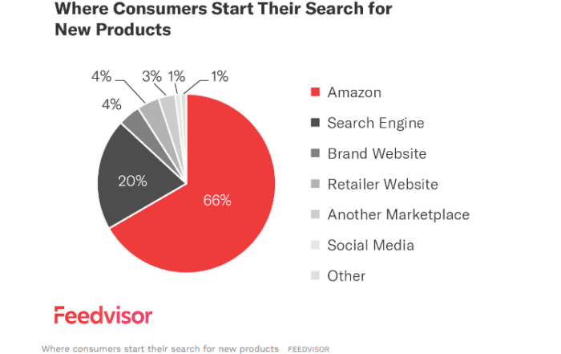
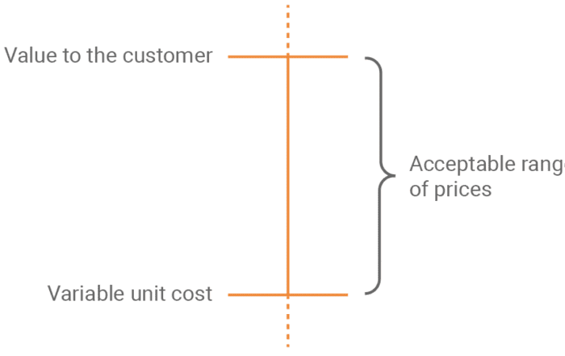
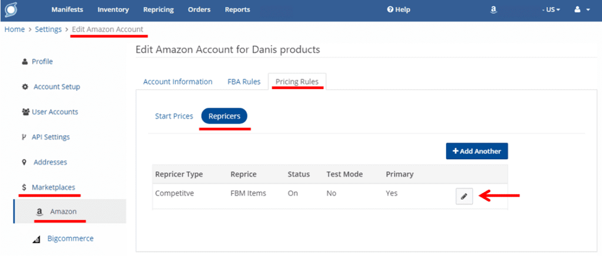
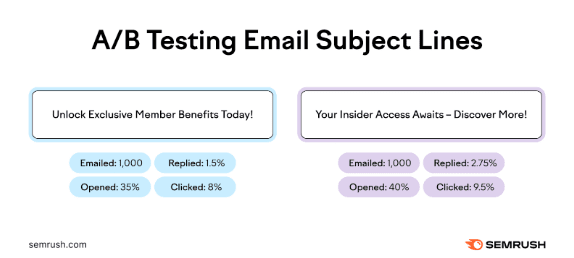
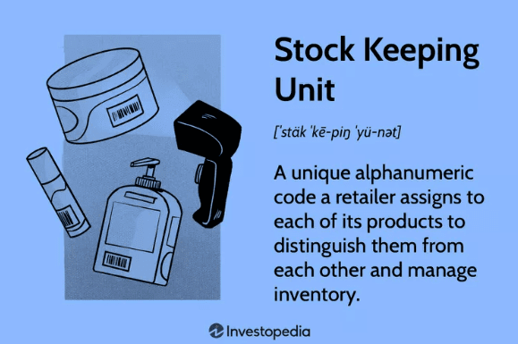
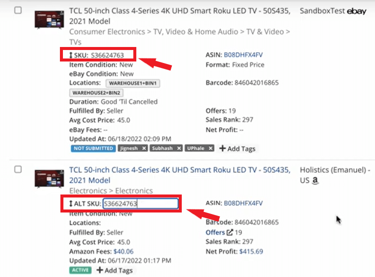
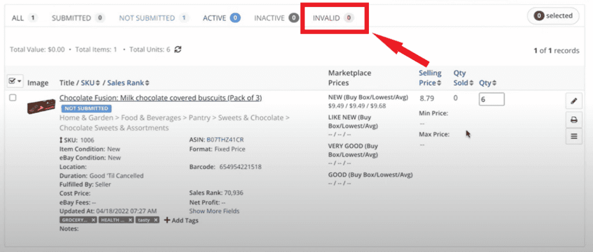

Selling on multiple marketplaces will let you tap into diverse customer base experiences worth a lot of potential revenue.

<ul><li>Global eCommerce sales for 2024 are <a href="https://www.statista.com/topics/871/online-shopping/#topicOverview:~:text=In%202024%2C%20retail%20e%2Dcommerce%20sales%20are%20estimated%20to%20exceed%206.3%20trillion%20U.S.%20dollars%20worldwide">estimated to hit $6.3 trillion</a>. By 2027, that figure is expected to <a href="https://www.statista.com/statistics/379046/worldwide-retail-e-commerce-sales/#:~:text=surpass%20eight%20trillion%20dollars%20by%202027">hit and surpass the $8 trillion mark</a>.</li><li>Nevertheless, a closer look shows that competition on these marketplaces is just as busy as traffic or revenue. Amazon, for example, has about <a href="https://www.contimod.com/amazon-seller-statistics/#:~:text=Amazon%20has%20around%209.7%20million%20sellers">9.7 million sellers</a> battling to convert prospects to sales. And what’s more, almost <a href="https://www.contimod.com/amazon-seller-statistics/#:~:text=Every%20day%2C%20roughly%203%2C700%20new%20sellers%20join%20Amazon">4,000 sellers join Amazon everyday</a>.</li>
</ul>

These online retail stats show the gains to be made in spreading operations to sell on multiple marketplaces.

However, many marketers know this already. So standing out from the over-4,000 sellers you’ll join Amazon and multiple e-tailers with today, requires a good strategy for a multichannel marketing plan.

In this guide, we’ll be discussing 13 practical strategies to sell on multiple marketplaces:.

<strong>Check out:</strong><a href="/blog/important-marketplace-stats-you-should-know-as-sellers/"><b>Important Marketplace Stats You Should Know as Sellers</b></a>

<h2>What is a Multichannel Marketing Strategy?
</h2>

A good multichannel marketing strategy should enable you:

<ul><li>Reach a broader customer base and increase your market presence.</li><li>Leverage unique strengths of sales channels to meet customers’ shopping preferences.</li><li>Enhancing brand visibility and customer engagement.</li><li>Diversify sales and enhance resilience to market fluctuations by reducing reliance on a single platform.</li>
</ul>

<strong>Check out:</strong><a href="/features/#fulfillment"><b>Multi-channel Fulfillment Solution!</b></a><b>
</b>

<h2>13 Action Plans for Selling on Multiple Marketplaces Successfully.
</h2>

<h3><b>1. Strategically Select Marketplaces That Match Your Products</b>
</h3>

Simply selecting the most visited marketplaces to cross-list your products is not enough.

Statista reports that in 2022 eBay was, “<a href="https://www.statista.com/statistics/1271820/second-hand-online-platforms-united-states/#:~:text=In%202022%2C%20almost%20two%2Dthirds%20of%20U.S.%20consumers%20surveyed%20said%20they%20had%20bought%20used%20products%20on%20eBay%2C%20making%20it%20the%20most%20popular%20online%20site%20for%20second%2Dhand%20goods%20in%20the%20North%20American%20country.%20Facebook%20Marketplace%20ranked%20second%20with%2055%20percent%20of%20respondents%2C%20followed%20by%20OfferUp%20with%2024%20percent">the most popular online site for second-hand goods</a>” in America with almost two-thirds of surveyed US consumers claiming they had gone there for used products.

On the other hand, a Forbes survey found that <a href="https://www.forbes.com/sites/kirimasters/2019/03/20/study-89-of-consumers-are-more-likely-to-buy-products-from-amazon-than-other-e-commerce-sites/#:~:text=Two%2Dthirds%20of%20respondents%20(66%25)%20typically%20start%20their%20search%20for%20new%20products%20on%20Amazon%2C%20compared%20with%20one%2Dfifth%20(20%25)%20who%20start%20on%20a%20search%20engine%20such%20as%20Google.">1 out of 4 people will first use a search engine looking for new products but the rest will go to Amazon</a>.

For a luxury fashion buyer, <a href="https://www.zalando.co.uk/">Zalando</a> or <a href="https://www.amazon.co.uk/stores/luxurystores/page/AE6B2B43-74F4-4EF2-A183-28CA51D017AC">Amazon Luxury Stores</a> might be the only thing that appeals to you.

In the same vein, to create trust in your brand, not every product has to go on every marketplace.

<h3><b>2. Keep Inventory Across Marketplaces in Sync</b>
</h3>

Most of your listed items will overlap across marketplaces making manual inventory management a hellish task.

Nevertheless, managing your inventory and, crucially, doing it in real-time will prevent overselling and is a practical strategy to sell on multiple marketplaces.

Therefore, automating this process is both less work and better results. And the <a href="/features/#inventory:~:text=each%20selling%20channel.-,Inventory%20Sync,-Cross%20Sell%20Your">SellerChampTM Inventory Sync</a> feature provides the best inventory management software that enables you:

<ul><li>Sync variations, bundles and kits</li><li>Automatically import items across channels</li><li>Set rules to auto-import products across channels</li>
</ul>

<a href="https://youtu.be/KsJR4_TIjvc?si=JabHPpkVFkmwfA4v">Video to Embed</a>

<b><i>Read More: </i></b><a href="/blog/multi-channel-inventory-sync-system-a-boon-for-liquidators-and-retailers/"><b><i>Multi Channel Inventory Sync System – A Boon for Liquidators and Retailers</i></b></a>

<h3><b>3. Reports Across all Channels</b>
</h3>

Reports showing key metrics in each marketplace and across all marketplaces is another crucial strategy.

Past buying behaviors of your customers give insights for your future decisions, like restocking during special events (like Black Friday) for example. In other words – <a href="https://www.netsuite.com/portal/resource/articles/inventory-management/inventory-forecasting.shtml">Inventory Forecasting</a>.

With <a href="https://kb.sellerchamp.com/en/?q=reports">SellerChampTM manifest and inventory reports</a>, you can get <b><i>Lite</i></b>, <b><i>Full</i></b>, and <b><i>Variant</i></b> reports showing you key data points like quantity sold and even item remarks.

Big companies like Target, with the help of advanced AI tools, have been reported to <a href="https://www.forbes.com/sites/kashmirhill/2012/02/16/how-target-figured-out-a-teen-girl-was-pregnant-before-her-father-did/">use customer buying behaviors to predict when they were pregnant</a>. Therefore, knowing what products to put in front of them next.

<h3><b>4. Utilize SEO to Spend Less on Ads</b>
</h3>

Another strategy to effectively sell on multiple marketplaces is implementing simple SEO hacks, which may completely undercut costs otherwise spent on ad campaigns.

These SEO hacks for product listing include details like:

<ul><li>Keywords</li><li>Images</li><li>Scannable Formatting, etc.</li>
</ul>

Copy <a href="/blog/amazon-listing-examples-and-templates-that-can-help-you-rank-higher/">great templates for listing optimization</a> that tap into the algorithms used by these marketplaces. Said algorithms like Amazon’s A9 decide the products to show a buyer.

<b><i>Read More: </i></b><a href="https://searchengineland.com/amazons-a9-product-ranking-algorithm-beginners-guide-329801"><b><i>Amazon’s A9 product ranking algorithm: Your guide to Amazon SEO for maximum visibility</i></b></a>

<h3><b>5. If You Must, Run Free Ad Campaigns or Spend on The Right Advertising Options</b>
</h3>

You can advertise for free on sites like:

<ul><li><a href="https://www.facebook.com/groups/explore/">Facebook Groups</a></li><li><a href="https://www.craigslist.org/">Craigslist</a></li><li><a href="https://weebo.co.in/">Weebo</a></li><li><a href="https://m.yelp.com/">Yelp</a></li><li><a href="https://locanto.com/">Locanto</a></li><li><a href="https://www.google.com/business/">Google Business</a></li>
</ul>

However, if you must splash some cash, Google Ads Pay-Per-Click advertising, alongside <a href="https://ads.google.com/intl/en_uk/home/resources/articles/how-to-analyze-google-ads-successfully/">traffic analytics</a> and <a href="https://ads.google.com/intl/en_uk/home/tools/keyword-planner/">keyword planner</a> features is a huge bang for your buck.

<b><i>You Might Also Like: </i></b><a href="/blog/how-to-attract-online-customers/#:~:text=on%20Multiple%20Channels!-,Tip%201.%20Run%20Google%20Adword%20Campaigns,-One%20of%20the"><b><i>How to Attract Online Customers: 13 Tried and Tested Tips</i></b></a>

<h3><b>6. Implement The Right Marketplace Pricing Strategy</b>
</h3>

Associate Professor in Marketing, Eric Dolansky, says that a customer’s willingness to pay mostly depends on “<a href="https://www.bdc.ca/en/articles-tools/marketing-sales-export/marketing/pricing-5-common-strategies#:~:text=very%20much%20to%20do%20with%20how%20much%20they%20value%20the%20product%20or%20service%20they%E2%80%99re%20buying">how much they value the product or service</a>”.

Experts say your price is somewhere between the total cost of producing a single unit of a product (<a href="https://www.investopedia.com/terms/v/variablecost.asp">variable cost per unit</a>) and the perceived value to the customer.

A great real-life example of right pricing is this emotional Shark Tank episode.

<a href="https://youtu.be/LZEY15Fsjgk?t=148">Timestamped Video To Embed</a>

<i>Read More: </i><a href="https://www.bdc.ca/en/articles-tools/marketing-sales-export/marketing/pricing-5-common-strategies"><i>The 5 most common pricing strategies</i></a>

<h3><b>7. Intelligent Repricing</b>
</h3>

The <a href="/features/#RePricer:~:text=integration%20with%20Shipstation-,RePricer,-Dynamic%20RePricer%20to">SellerChampTM Dynamic RePricer</a> enables you to take whatever market pricing strategy you’ve settled on, and automatically implement it many times over.

<i>RePricers</i> (price rise and fall conditions set by you) automate your prices based on factors like sales velocity, and can earn you coveted visibility perks like <a href="https://feedvisor.com/university/amazon-buy-box/">Amazon’s Buy Box</a>.

See all item RePricer rules available to you <a href="http://kb.sellerchamp.com/en/articles/3544073-repricers-sales-based-item-repricer-rules">here</a>.

<h3><b>8. Compare Analytics of Different Marketplaces</b>
</h3>

The reports from SellerChamp are great for analytics if you do it right. Specifically, cross-channel analytics.

A simple example is comparing the effects of details in your listing on sales from one channel to another.

We could consider this <a href="https://hbr.org/2017/06/a-refresher-on-ab-testing">A/B testing</a>, and it is common among marketers especially in ad campaigns.

<h3><b>9. Use Listing Software That Has SKU Flexibility</b>.
</h3>

Why is <a href="https://www.investopedia.com/terms/s/stock-keeping-unit-sku.asp">SKU</a> flexibility in multi-channel online marketing important?

Well, imagine you want to sync two identical products with different SKUs across two marketplaces. On platforms like Walmart or Amazon, you’d have to delist the item before relisting it.

However, with the <b>ALT SKU (Alternate SKU)</b> feature in <a href="/features/#inventory">SellerChampTM</a>, you can sync them immediately and avoid any potential overselling.

<h3><b>10. Check Your Manifest for Listing Errors</b>
</h3>

Another issue that is common with listing the same item on multiple marketplaces at once is listing errors.

Some common listing errors you’ll see on eBay, Shopify, Walmart, etc, include:

<ul><li>Insufficient number of variations</li><li>Shipping Policy Invalid</li><li><a href="https://www.webinterpret.com/us/blog/why-are-ebay-required-product-identifiers-gtin-upc-ean-mpn-important/">Product ID (UPC, EAN, etc.)</a> already in use by another item.</li>
</ul>

In any of your SellerChampTM product manifests, errors across your marketplaces will be flagged and described under the “<i>INVALID</i>” tab.

<h3><b>11. Deliver Excellent Customer Service</b>
</h3>

Delivering excellent customer service is another practical strategy to sell on multiple marketplaces effectively. The customer’s experience <b>will</b> directly influence your sales and brand through customer reviews and/or word-of-mouth.

Research shows that word-of-mouth results in <a href="https://www.semrush.com/blog/word-of-mouth-stats/#:~:text=Word%2Dof%2Dmouth%20is%20even%20more%20effective%20than%20paid%20ads%2C%20resulting%20in%20five%20times%20more%20sales">five times more sales than paid ads</a> and is responsible for about <a href="https://www.semrush.com/blog/word-of-mouth-stats/#:~:text=word%2Dof%2Dmouth%20drives%20%246%20trillion%20in%20annual%20global%20spending">$6 trillion dollars in global spending</a>.

One key strategy is integrating a <a href="https://www.zoho.com/crm/what-is-crm.html?source_from=crm-ft">CRM</a> that unifies all customers’ interactions, just as SellerChampTM unifies your product listing across multiple marketplaces.

Top CRMs include:

<ul><li><a href="https://www.zoho.com/crm/?source_from=sales-exce-lp">Zoho</a></li><li><a href="https://www.salesforce.com/crm/">Salesforce</a></li><li><a href="https://www.zendesk.com/">Zendesk</a></li><li><a href="https://www.hubspot.com/crm/cr045">Hubspot</a>, etc.</li>
</ul>

<h3><b>12. The Multi-Channel Fulfillment (MCF) Strategy</b>
</h3>

<a href="https://datawrapper.dwcdn.net/lG6DY/24/#embed">Image to Embed</a>

SellerChampTM has several <a href="/integrations/#fulfillment">fulfillment & shipping integrations</a> from FBA to ShipStation.

These are essential to attract the <a href="https://www.forbes.com/advisor/business/ecommerce-statistics/#:~:text=52%25%20of%20online%20shoppers%20report%20shopping%20internationally">52% of online shoppers</a> who like shopping internationally.

The ideal fulfillment and <a href="https://thegood.com/insights/reduce-ecommerce-returns/">returns strategy</a> should also involve tracking details for customers. This builds loyalty and trust in your brand.

<i>Read More: </i><a href="/blog/what-is-multi-channel-fulfillment-and-how-does-it-work/"><i>What is Multi-Channel Fulfillment and How Does it Work?</i></a>

<h3><b>13. Automate The Listing Process</b>
</h3>

The cross channel listing process is better if it can be done at incredible speeds and large volumes.

If your business model is retail or online arbitrage, then you know all too well that price fluctuations can cause harm.

The <a href="/solutions/resellerold/#:~:text=Learn%20More-,Bulk%20Lister,-List%20Products%20in">SellerChampTM Bulk Lister</a> feature helps you list products in minutes from a barcode scan or across your channels.

<a href="https://youtu.be/4ZiD2n3gGb0?list=PLAQ4f85wtJsSTZ-9rntxaWu97Sub9G22w&t=180">Timestamped Video to Embed</a>

<h2><b>How Effective is Multichannel Marketing to Sell on Multiple Marketplaces?</b>
</h2>

When done right, you can reap healthy benefits with a strategy to sell on multiple marketplaces.

Let’s look at 3 statistics that show how effective multichannel marketing can be:

<ol><li>The average customer has <a href="https://kobedigital.com/multi-channel-marketing-for-conversion/#:~:text=six%20to%20eight%20touch%20points%20with%20a%20brand%20before%20a%20customer%20buys%20from%20them">6 to 8 encounters</a> with a brand before buying from them. Selling on multiple marketplaces reduces the timeframe to hit that point of capture.</li><li><a href="https://www.chasingcreative.io/post/the-future-of-marketing-multi-channel-strategies-in-2024#:~:text=95%25%20of%20customers%20use%20more%20than%20one%20channel%20when%20making%20a%20purchase%20decision.">95% of buyers</a> explore multiple channels when they’re about to make a purchase.</li><li>Statista revealed that in 2023, buyers worldwide mostly <a href="https://www.statista.com/statistics/1034209/global-product-search-online-sources/#:~:text=In%202023%2C%20marketplaces%20were%20the%20primary%20source%20for%20starting%20to%20search%20for%20products%20online%20worldwide">searched for products first on marketplaces</a> before other methods like search engines and brand websites.</li>
</ol>
