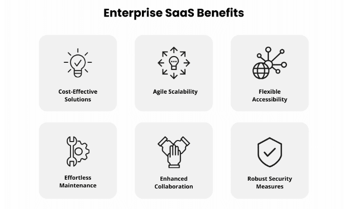
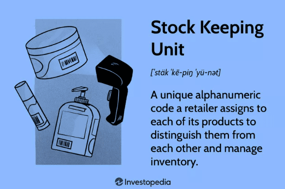
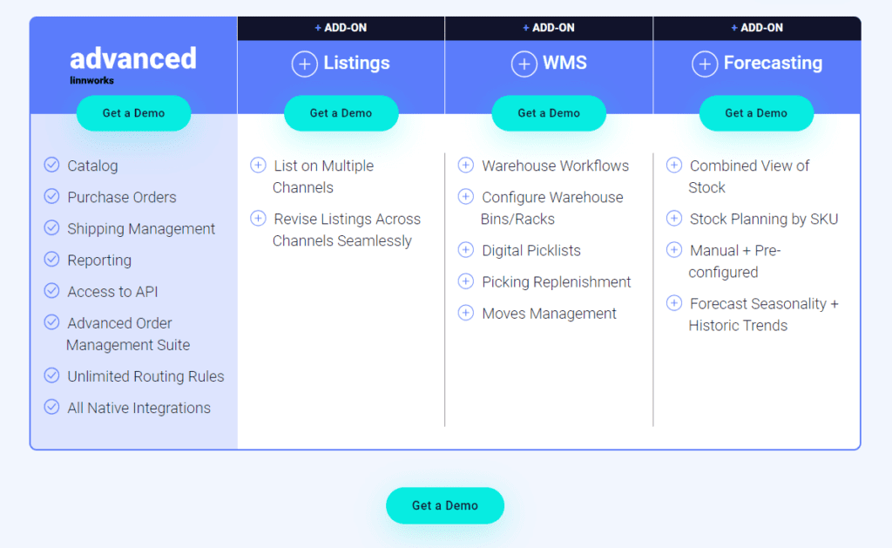
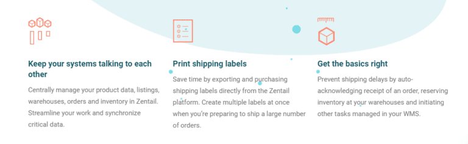
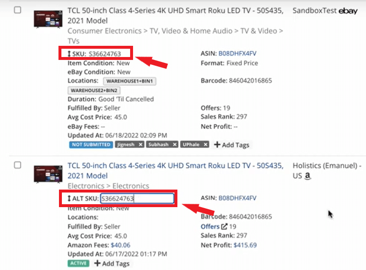

As online retailing gains unprecedented traction, sellers have now begun looking for cheaper, dare I say, better sellercloud alternatives to manage multichannel selling on different platforms.

<a href="https://www.statista.com/statistics/1316966/e-commerce-sales-retailers-worldwide/">Statista predicts</a> that the online retailing industry will continue to see growth in the coming years with companies like Alibaba and Amazon tipped to surpass the trillion-dollar mark for online sales by 2027.

Well, you’re in luck! Sit tight as we show you the <b>5 best Sellercloud alternatives in 2024</b>.

<strong>Check out:</strong><a href="/blog/13-practical-strategies-to-sell-on-multiple-marketplaces/">13 Practical Strategies to Sell on Multiple Marketplaces</a>

<h3>Top 5 Sellercloud Alternatives for Omnichannel Marketing
</h3>

The ideal omnichannel marketing platform for ecommerce has to prioritize value for money.

Without further ado, here’s a brief rundown of the best Sellercloud alternatives that do just that.

<h3><b>SellerChamp</b>
</h3>

<a href="https://sellerchamp.com/">Sellerchamp</a> is probably the most ideal pick from the other four sellercloud alternatives. And it’s placed so highly for one key reason – it’s highly customisable.

SellerChamp has solutions like:

<ul><li>Multichannel listings</li><li>Order Management</li><li>Inventory Management</li><li>Warehouse Management</li><li><a href="/features/#inventory:~:text=each%20selling%20channel.-,Inventory%20Sync,-Cross%20Sell%20Your">Inventory Sync</a></li><li>Auto-import inventory across marketplaces</li><li><a href="https://kb.sellerchamp.com/en/?q=reports">Reports and insights</a> for manifest and inventory that enable <a href="https://www.netsuite.com/portal/resource/articles/inventory-management/inventory-forecasting.shtml">inventory forecasting</a>.</li><li>Multi-Channel Fulfillment (MCF)</li><li><a href="/features/#_repricer:~:text=integration%20with%20Shipstation-,RePricer,-Dynamic%20RePricer%20to">Dynamic Repricer</a> which allows you set rules to allow automation of your product prices based on sales velocity, customer behavior and the competition.</li><li>Bulk Lister</li><li>API integrations and Data Feeds</li><li><a href="/pricing-fullsuite-v2/#4b3d6537f4d681fed">Onboarding support with free training call</a></li><li><a href="/pricing-fullsuite-v2/#13f627a07590d79fc">High SKU flexibility</a></li><li>Labeling Integrations for brand growth</li><li>One Click Integrations, and more.</li>
</ul>

Sellerchamp is ideal for small businesses because of its customizable package and pricing. This is different from customizable enterprise SaaS subscription plans reserved only for the elite.

Typical subscription pricing systems are based on the idea of <a href="https://blog.hubspot.com/marketing/buyer-persona-research?hubs_content=blog.hubspot.com/sales/pricing-strategy&hubs_content-cta=persona">buyer personas</a> which put the customer in a box and assume their needs.

Sellerchamp’s personalized option also comes with industry-standard features.

<iframe title="YouTube video player" src="https://www.youtube.com/embed/KsJR4_TIjvc?si=ex2fEsCR2PEsWFDw" width="560" height="315" frameborder="0" allowfullscreen="allowfullscreen"></iframe>

<strong>Read More:</strong>
<a href="/blog/unlock-your-online-stores-potential-a-fun-guide-to-selling-on-multiple-channels/">Unlock Your Online Store’s Potential: A Fun Guide to Selling on Multiple Channels!</a>

<h3><b>Sellbrite</b>
</h3>

<a href="https://www.sellbrite.com/inventory-management-software/">Sellbrite</a> is the next Sellercloud alternative we’ve examined and it’s really got a lot going for it.

Alongside the top marketplaces, it’s also got strong support for shopping carts with integrations for Shopify, WooCommerce, BigCommerce, Shopify Plus, etc.

Interestingly, of all the Sellercloud alternatives in this text, Sellbrite is probably the most specialized one. They offer a product that is highly specialized in three key things:

<ol><li>Listing on Multiple Marketplaces</li><li>Syncing Inventory</li><li>Order Fulfillment</li>
</ol>

Depending on what you want, this may not be ideal, but if your desires fit neatly into the three-sided box, then Sellbrite is an efficient machine. In fact, <a href="https://www.sellbrite.com/blog/ecommerce-sellers/">their analysis of 1,160 of their customers</a> is probably the best case made for online ecommerce sellers to sell on multiple marketplaces.

However, one key drawback is that the platform uses a <a href="https://www.sellbrite.com/integrations/skuvault">SkuVault</a> (a company <a href="https://www.marlinequity.com/marlin-portfolio-company-linnworks-acquires-skuvault/#:~:text=SkuVault%20will%20be%20merged%20with,accelerating%20growth%20for%20omnichannel%20sellers.">bought by competitor, Linnworks</a>) integration to manage inventory. Meanwhile, others like SellerChamp offer industry-standard <a href="/features/#inventory">inventory syncing</a> down to the product variations and with SKU flexibility, while Sellercloud itself has its own native <a href="https://sellercloud.com/products/skustack/">Skustack</a>.

<h3><b>Linnworks</b>
</h3>

<a href="https://www.linnworks.com/">Linnworks</a> is another favorite among ecommerce marketers that know their salt.

They offer a product that’s one of the most robust in terms of the features and its 100+ integrations being offered. Some of these include:

<ul><li>Multichannel listings</li><li>Shipping Management</li><li>Stock Forecasting</li><li>Reports & Insights</li><li>Order Management</li><li>Inventory Management</li><li>Warehouse Management</li>
</ul>

In addition to this, they also offer a flexible pricing system. There’s a base, Advanced suite of features, which you can expand with addons from the features you want under Listings, Forecasting, and Warehouse Management System (WMS).

Again, this is a sellercloud alternative because its product lineup is one of the best in the industry. At the same time, there are some details that only expert sellers use that’s not highlighted as being present in Linnworks’ product.

One example is shipping labels integration. Labels display information for handling the goods being delivered to the customer, and it also helps the product get to the customer on time. This adds to the customer service experience which surveys show can make <a href="https://www.investopedia.com/terms/b/brand-loyalty.asp#:~:text=83%25%20of%20customers%20would%20switch%20brands%20because%20of%20a%20bad%20customer%20service%20experience">83% of customers</a> switch brands. We all want to avoid <a href="https://blog.hubspot.com/service/what-is-customer-churn?hubs_content=blog.hubspot.com/sales/pricing-strategy&hubs_content-cta=customer%20churn">customer churn</a>.

Therefore, one-click label printing integrations like the one offered by SellerChamp is essential.

<b><i>Read More: </i></b><a href="http://kb.sellerchamp.com/en/articles/3019539-set-up-1-click-label-printing">Set Up 1-Click Label Printing</a>

<h3><b>NetSuite</b>
</h3>

Oracle’s <a href="https://www.netsuite.com/portal/home.shtml?noredirect=T">NetSuite</a> is not a like-for-like Sellercloud alternative. As the name implies, it’s a suite of solutions for businesses. And unlike Sellercloud and the other alternatives listed here, it is not specialized for ecommerce sellers on multiple channels. You could consider it on the opposite end of the spectrum from Sellbrite in this sense.

It has business solutions for three categories:

<ul><li>Enterprise Resource Planning (ERP)</li><li>Financials</li><li>Customer Relationship Management (CRM)</li><li>eCommerce</li>
</ul>

At first glance, this looks like the ideal situation. Having one platform to manage eCommerce, financials, and CRM sounds like the ideal situation. And it is.

But on the other hand, the lack of specialization and the fact that you have to pay for each service/category separately under its own subscription plan, also means that you should probably just get the best of each category separately.

For instance – <a href="https://www.zoho.com/crm/?source_from=sales-exce-lp">Zoho</a>, <a href="https://www.zendesk.com/">Zendesk</a>, and <a href="https://www.salesforce.com/crm/">Salesforce</a> are widely considered the champions of the CRM industry, and Forbes has its <a href="https://www.forbes.com/advisor/business/software/best-erp-systems/">7 best recommendations for ERPs in 2024</a>. Paying for those separately and integrating them into your workflow for your business (if you really need them) is one way to go get the true robustness of each system as well as a multichannel platform.

NetSuite has great services everyone could use, however, it feels more like a premium tool that might not be the best for small online marketers.

<h3><b>Zentail</b>
</h3>

<a href="https://www.zentail.com/">Zentail</a> is a breath of fresh air from its interface to its customer service. In fact, it’s one of the platforms on this list of Sellercloud alternatives that promises a “Zentail Intro Call” (besides <a href="/pricing-fullsuite-v2/#4b3d6537f4d681fed">SellerChamp</a>’s training call and Linnworks’ onboarding specialists) for easy onboarding.

For online ecommerce selling on multiple marketplaces, Zentail offers almost everything:

<ul><li>Listing</li><li>Inventory Management and Reports for Forecasting</li><li>Order Management</li><li>Analytics</li><li>Integrations</li>
</ul>

It also has shipping labels integration like SellerChamp and bulk listing like Sellbrite. But one thing it shares in common with Sellbrite that isn’t ideal is the need to integrate with <a href="https://www.zentail.com/apps/skuvault">SkuVault for inventory management</a>.

In fact, Zentail explains the ideal use case where SkuVault works best as “<a href="https://www.zentail.com/apps/skuvault#:~:text=Retailers%20with%20revenue%20between%20%241%20million%20to%20%24100%20million%20a%20year">Retailers with revenue between $1 million to $100 million a year</a>”. Compared with SellerChamp’s remarkable on-platform SKU flexibility that lets you create Alternate SKUs (ALT SKUs) to connect two products with different SKUs together, it’s not the best deal.

<h3><b>What is The Best Omnichannel Management Platform?</b>
</h3>

Sellercloud may be considered a top ecommerce multichannel management platform, but is it better than the 5 best Sellercloud alternatives? Let’s find out in the comparison table below:

<table id="tablepress-2" class="tablepress tablepress-id-2">
<tbody class="row-hover">
<tr class="row-1">
<td class="column-1"></td><td class="column-2">Sellercloud</td><td class="column-3">SellerChamp</td><td class="column-4">Sellbrite</td><td class="column-5">Linnworks</td><td class="column-6">NetSuite</td><td class="column-7">Zentail</td>
</tr>
<tr class="row-2">
<td class="column-1">Multichannel Listing</td><td class="column-2">✅</td><td class="column-3">✅</td><td class="column-4">✅</td><td class="column-5">✅</td><td class="column-6">✅</td><td class="column-7">✅</td>
</tr>
<tr class="row-3">
<td class="column-1">Inventory Sync</td><td class="column-2">✅</td><td class="column-3">✅</td><td class="column-4">✅</td><td class="column-5">✅</td><td class="column-6">✅</td><td class="column-7">✅</td>
</tr>
<tr class="row-4">
<td class="column-1">Reports, Forecasting, and Analytics</td><td class="column-2">✅</td><td class="column-3">✅</td><td class="column-4">❌</td><td class="column-5">✅</td><td class="column-6">✅</td><td class="column-7">✅</td>
</tr>
<tr class="row-5">
<td class="column-1">Automatic Repricing</td><td class="column-2">❌</td><td class="column-3">✅</td><td class="column-4">❌</td><td class="column-5">❌</td><td class="column-6">❌</td><td class="column-7">✅</td>
</tr>
<tr class="row-6">
<td class="column-1">Shopping Cart Integrations</td><td class="column-2">✅</td><td class="column-3">✅</td><td class="column-4">✅</td><td class="column-5">✅</td><td class="column-6">✅</td><td class="column-7">✅</td>
</tr>
<tr class="row-7">
<td class="column-1">3PL Integrations</td><td class="column-2">✅</td><td class="column-3">✅</td><td class="column-4">✅</td><td class="column-5">✅</td><td class="column-6">✅</td><td class="column-7">✅</td>
</tr>
<tr class="row-8">
<td class="column-1">WMS/fulfillment integrations</td><td class="column-2">✅</td><td class="column-3">✅</td><td class="column-4">✅</td><td class="column-5">✅</td><td class="column-6">✅</td><td class="column-7">✅</td>
</tr>
<tr class="row-9">
<td class="column-1">Label printing/printer integration</td><td class="column-2">❌</td><td class="column-3">✅</td><td class="column-4">✅</td><td class="column-5">❌</td><td class="column-6">❌</td><td class="column-7">✅</td>
</tr>
<tr class="row-10">
<td class="column-1">SKU Flexibility</td><td class="column-2">Standard</td><td class="column-3">Excellent</td><td class="column-4">Standard</td><td class="column-5">Standard</td><td class="column-6">Standard</td><td class="column-7">Standard</td>
</tr>
<tr class="row-11">
<td class="column-1">Onboarding Call</td><td class="column-2">✅</td><td class="column-3">✅</td><td class="column-4">❌</td><td class="column-5">✅</td><td class="column-6">❌</td><td class="column-7">✅</td>
</tr>
<tr class="row-12">
<td class="column-1">Pricing System</td><td class="column-2">Standard for $1,199  Custom starts at $1,499 
  Skustack WMS and Skublox addons paid for per user. 
 
</td><td class="column-3"><a href="/pricing-fullsuite-v2/">Completely Customized</a></td><td class="column-4"><a href="https://www.sellbrite.com/pricing-pro">Sellbrite Regular:  Free (30 Orders Max)  $29/Month (100 Orders Max)  $79/Month (500 Orders Max)  $179/Month (2,000 Orders Max)  * Extra $19 on all plans (except Free) for FBA Integration and MCF 
  * 17% off for annual plans 
  Sellbrite Shopify:  Free (30 Orders Max)  $19/Month (100 Orders Max)  $59/Month (500 Orders Max)  $99/Month (2,000 Orders Max)  $159/Month (10,000 Orders Max)  $279/Month (25,000 Orders Max)  $399/Month (50,000 Orders Max)  $679/Month (100,000 Orders Max) 
</a></td><td class="column-5"><a href="https://www.linnworks.com/pricing/">Customizable Advanced Plan with addons</a></td><td class="column-6">Customizable <u>NetSuite Commerce</u> and <u>NetSuite ERP</u> options</td><td class="column-7">Customized 
  * You can calculate the potential cost yourself on the website using their GMV metric.</td>
</tr>
</tbody>
</table>

At the end of the day, the best platform is dependent on the very specific needs that only a seller themselves can identify. However, everything points to SellerChamp having the most reliable system for managing your omnichannel ecommerce selling on the top marketplaces.

