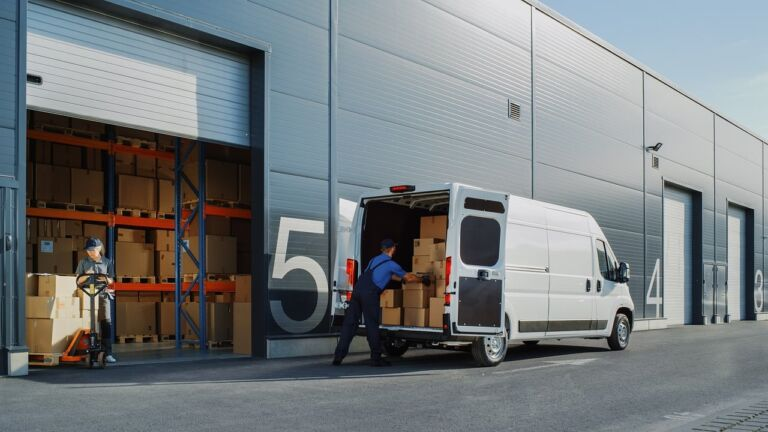

Understanding how to automate dropshipping has become key to staying competitive in the e-commerce sector today.

The dropshipping industry is growing rapidly with a projected<a href="https://www.vantagemarketresearch.com/industry-report/dropshipping-market-2104"> CAGR of 22.8% from 2023 to 2030</a>. With such immense growth, comes vigorous competition, which is precisely why e-commerce businesses today are increasingly automating their operations.

In this guide, we dive into what automated dropshipping is, why you should do it, and how you can implement it practically:

<strong>You might also like:</strong><a href="/blog/how-to-attract-online-customers/"><b>13 Tried and Tested Tips to Attract Customers Online </b></a>

<h2>What Exactly is Dropshipping Automation?
</h2>

Dropshipping automation utilizes technology for processes that would otherwise require manual effort. It allows you to use digital tools for repetitive business tasks including everything from product research to inventory management.

With automation, you can reduce your labor costs and increase business efficiency for smooth operations around the clock. This means fewer errors and more time to focus on strategic growth!

<h2>4 Reasons Why Dropshipping Automation is Essential for Growth!
</h2>

Automation has found its place in almost all industries today, for all the right reasons.

Here are 4 reasons why you need to automate your dropshipping business now.

<ol><li>Automation can save you critically important time, which would otherwise go to mindless tasks. It allows you to focus on more important things such as strategy and growth. </li><li>Repetitive tasks when performed by a human can lead to mental exhaustion. This often results in errors. However, it is not a problem with automated tasks which thus, ensure more accurate operations.</li><li>Automation can allow businesses to handle more orders without problems. This means you get a successful and thriving business. </li><li>Automated tasks release you from the need to hire more people, and thus, help you save money.</li>
</ol>

<h2>3 Areas in Dropshipping Where Automation Will Help You the Greatest
</h2>

While there are many areas where automated dropshipping will help you, these three stand out:

<ol><li>

<h3>Better Product Research and Quicker Listings
</h3></li>
</ol>

<b> </b> Automation tools frequently use AI algorithms to analyze trends and competition. This can be monumental in finding the right product for your particular business.

With automation, you can find winning products and quickly get them online before your competitors.

<strong>Check out:</strong><a href="/blog/how-to-promote-ebay-listing-to-get-more-views/"><b>4 Easy Ways to Promote Your eBay Listings </b></a>

<ol><li>

<h3>Efficient Inventory Management
</h3></li>
</ol>

<b> </b> Automated inventory management tools ensure that you always have the right stock levels across all your sales channels. By doing so, they prevent overselling and stockouts, which can damage your reputation and sales.

<ol><li>

<h3>Rapid Order Processing
</h3></li>
</ol>

Shipping delays often occur due to slow communication and processing.

With automated dropshipping, orders are forwarded to suppliers as soon as they’re placed. This speeds up deliveries and ensures high customer satisfaction.

<strong>Check out:</strong><a href="/solutions/drop-shipper/"><b>Tools to Automate Your Dropshipping Today!</b></a>

<h2>How To Automate Dropshipping?
</h2>

 Here’s how you can automate your dropshipping in 5 simple steps:

<h3>Step 1: Automate Your Product Research
</h3>

<ul>
<li>If you’re just starting out, SellerChamp’s <a href="/features/#_repricer">RePricer </a>can be a great tool. Picking the right prices is often quite tricky when beginning; RePricer helps you out by finding the ideal price point for maximum sales.</li>
</ul>

<h3>Step 2: Use Listing Automation To Import Products Seamlessly
</h3>

<ul>
<li>Use <a href="/features/#bulklister">multi-channel listing </a>features to list products across various platforms such as Amazon, eBay, and Shopify in just a few clicks. </li>
</ul>

Check out: <a href="/blog/unlock-your-online-stores-potential-a-fun-guide-to-selling-on-multiple-channels/">A Fun Guide to Selling on Multiple Channels!</a>

<h3>Step 3: Automate Inventory Management With Real-Time Sync
</h3>

<ul>
<li>Use inventory management tools to sync your stock levels in real time across all sales channels. This ensures that when a product is sold on one platform, the inventory updates everywhere else automatically. </li>
</ul>

<h3>Step 4: Automate Order Processing For Higher Customer Satisfaction
</h3>

<ul>
<li>Utilize automated fulfillment to have customers’ orders forwarded directly to the supplier for faster processing and shipment.</li>
<li>Automated order processing lets you email out shipping times and tracking information as soon as orders are placed. This keeps the customers informed with no hassle to you.</li>
</ul>

<h3>Step 5: Automate Customer Service For Support Outside Business Hours
</h3>

<ul>
<li><a href="https://www.statista.com/statistics/1422346/interest-in-chatbots-as-shopping-assistants/#:~:text=Chatbots%20are%20AI%2Dpowered%20tools,information%20before%20the%20actual%20purchase.">Automated chatbots</a> take charge and handle common customer questions efficiently. Use this to offer prompt support to customers outside business hours. </li>
<li>With automation, you can set up pre-programmed requests for customer feedback to build trust and gain valuable insights into their experiences.</li>
</ul>

Video: Learn how to streamline your business operations more efficiently:

<iframe width="560" height="315" src="https://www.youtube.com/embed/4xPS3VLqx_s?si=8rMoofKBD5AmOtBA" title="YouTube video player" frameborder="0" allow="accelerometer; autoplay; clipboard-write; encrypted-media; gyroscope; picture-in-picture; web-share" referrerpolicy="strict-origin-when-cross-origin" allowfullscreen></iframe>

<h2>5 Key Tips to Make Your Dropshipping Automation More Effective
</h2>

Implement these five tips to make the most out of your dropshipping automation:

<h3>Tip 1. Choose the Right Software Tools
</h3>

Invest time in finding the right software that aligns with your unique needs. Begin by identifying the specific requirements of your business, and then look for software that not only meets these needs but also <a href="/integrations/">integrates</a> well with your existing systems.

<h3>Tip 2. Test and Optimize A Lot
</h3>

Conduct regular evaluations and audits of your automated processes and their results. Improve every error and inefficiency you identify to enhance performance and reliability over time.

<h3>Tip 3. Always Stay Updated
</h3>

Business trends are changing rapidly today. Stay up to date with <a href="https://www.ibm.com/blog/ecommerce-trends/">new advancements</a> by following industry news, attending conferences, and engaging with professional networks to maintain a competitive edge.

<h3>Tip 4. Exceptionalize your Customer Experience
</h3>

Your automation processes must always elevate the customer experience. Designing your automation processes with the customer journey in mind will lead to increased satisfaction rates.

<h3>Tip 5. Continuously Monitor Your KPIs
</h3>

Keep a strict track of <a href="/features/#_insights">KPIs </a>to gauge the success of your automation strategies. Use this data and make informed adjustments to continuously improve your approach.

<h2>Use SellerChamp To Automate & Streamline!
</h2>

Automation with SellerChamp allows businesses to streamline operations, improve efficiency, and focus only on growth. <a href="https://app.sellerchamp.com/leads/new"><b>Schedule a free demo with us</b></a><b> and activate automated dropshipping today!</b>

