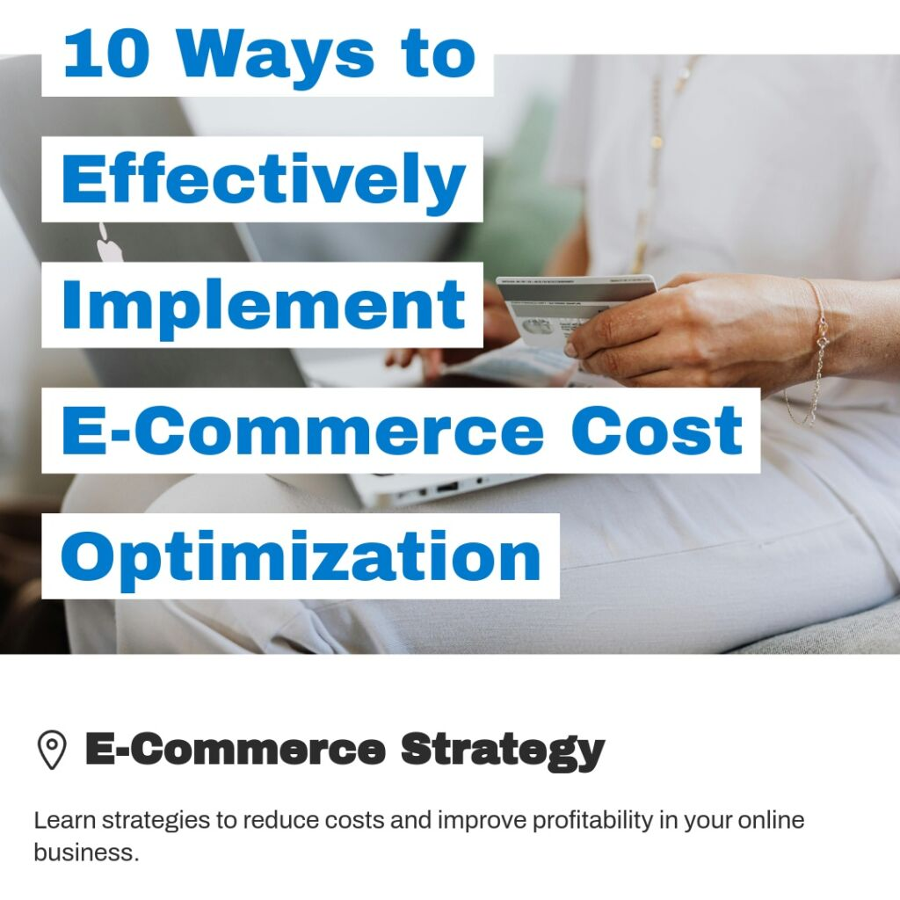
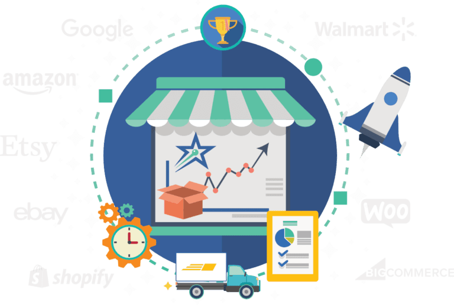

<b>E-commerce cost optimization</b> isn’t just about cutting costs—it’s about making smarter decisions to increase profitability and stay competitive.

Whether you’re running a small online shop or managing a large e-commerce platform, implementing effective cost optimization strategies can significantly boost your bottom line.

Here are 10 practical ways to implement e-commerce cost optimization, along with examples to guide you.

<strong>Read more:</strong><a href="/blog/how-to-attract-online-customers/"><b>How to Attract Online Customers: 13 Tried and Tested Tips</b></a>

<h2>1. Automate Your Inventory Management
</h2>

Automation is crucial for e-commerce cost optimization, as it reduces errors and saves time. <a href="https://sellerchamp.com/">Tools like SellerChamp</a> can automate your inventory processes, ensuring that your stock levels remain optimal.

This not only cuts down on costly overstocking or stockouts but also allows you to focus on growing your business.

<b>Example:</b> Use an <b> automated inventory management system </b> that updates stock levels across all sales channels when a sale is made, keeping everything in sync.

<i>Also, watch our video on How to Analyze Inventory Data:</i>

<iframe title="YouTube video player" src="https://www.youtube.com/embed/UrAXHS2A4s8?si=xuBmRWXndfKLTh9s" width="560" height="315" frameborder="0" allowfullscreen="allowfullscreen"></iframe>

<h2>2. Cut Shipping Costs with Smart Strategies
</h2>

Shipping can be one of the <b> biggest expenses in e-commerce</b>, making it a critical area for cost optimization.

Consider using flat-rate shipping or negotiating better rates with logistics providers. By refining your shipping methods, you can cut costs while maintaining fast delivery times.

<b>Example:</b> Offer <i>free shipping</i> on orders over a specific amount to encourage larger purchases, and use a logistics aggregator to find the best shipping rates.

<h2>3. Optimize for Mobile Audiences
</h2>

With a significant portion of e-commerce traffic coming from mobile devices, ensuring your site is mobile-friendly is essential for e-commerce cost optimization.

Mobile optimization not only enhances the user experience but <b> also boosts conversions</b>, which directly impacts your bottom line.

<b>Example:</b> Implement responsive design to make sure your website looks great on any device, and regularly test it on different mobile platforms to catch any potential issues.

You Might Like: <a href="/blog/tag/7-strategy-to-make-money-on-amazon/"><b>7 strategy to Make Money on Amazon</b></a>

<h2>4. The Power of Pricing with 9
</h2>

You must have noticed online prices often end in 9, like $29 or $199. This isn’t by chance—it’s a powerful psychological tactic known as the <b>“</b><a href="https://newristics.com/heuristics-biases/left-digit-bias"><b>Left Digit Effect</b></a><b>“</b>.

People perceive $199 as significantly cheaper than $200, even though the difference is just $1. This simple change can lead to higher sales.

<h2>5. Go for Flexible and Cost-Based Pricing
</h2>

Flexible pricing is a great way to optimize ecommerce costs. By adjusting prices based on demand and competition, you can stay competitive while increasing profits.

For example, you can use tools that automatically adjust prices according to market conditions, keeping you ahead without needing constant manual updates.

<ul><li><b>Cost-Based Pricing:</b> In this method, you set prices based on the total cost of production plus a desired profit margin. This ensures you cover all costs while achieving a specific profit margin.</li><li><b>Value-Based Pricing:</b> Here, prices are determined by the perceived value to the customer. If your product offers something unique or highly desirable, you can charge more based on what customers are willing to pay.</li><li><b>Bundle Pricing:</b> This strategy involves selling products together at a single price, often at a discount. By bundling items, you can encourage customers to spend more, increasing your revenue while reducing marketing expenses.</li><li><b>Price Skimming:</b> This involves setting high initial prices for new or exclusive products, and then lowering them over time. This strategy capitalizes on the urgency and willingness of early adopters to pay more, gradually adjusting as demand decreases.</li>
</ul>

<b>Example:</b> Implement cost-based pricing by calculating all production and distribution costs, then adding your desired profit margin. Use value-based pricing for unique items by assessing customer willingness to pay.

For bundle pricing, group-related products and offer them at a discounted rate. Lastly, apply <b>price skimming</b> by launching new products with high prices and reducing them as competition grows.

<strong>Check out:</strong><a href="/blog/7-abandoned-cart-email-best-practices-to-win-back-customers/"><b>7 Abandoned Cart Email Best Practices to Win Back Customers</b></a>

<h2>6. Use Data Analytics for Cost Savings
</h2>

Data analytics plays a vital role in e-commerce cost optimization by uncovering cost-saving opportunities through the<i> analysis of customer behavior and operational efficiency.</i>

Analytics can help you identify underperforming products or inefficient processes that are driving up costs.

<b>Example:</b> Use <b> Google Analytics to track </b> which products have high views but low sales, and investigate if these products need better descriptions, images, or pricing adjustments to improve their performance.

<h2>7. Outsource Non-Core Activities
</h2>

Outsourcing non-core activities like <b> customer support or IT </b> is another effective strategy for e-commerce cost optimization.

By reducing overhead and improving efficiency, outsourcing allows you to <i>focus on what you do best while experts handle the rest.</i>

<b>Example:</b> Outsource your customer service to a<i> third-party provider who can offer 24/7 support </i>at a lower cost than maintaining an in-house team. This not only improves customer satisfaction but also reduces costs.

<h2>8. Implement The Loss-Leader Strategy
</h2>

The loss-leader strategy is a pricing tactic<i> where you sell a product below its market value to attract customers.</i>

The idea is that once customers are drawn in by the low price, they are more likely to purchase additional items, boosting their overall sales and profit margins.

This approach not only increases the total cart value through upselling and cross-selling but also helps in acquiring new customers, which can be just as valuable as immediate profits.

<b>Example:</b> Offer a popular item at a deep discount, like a $50 item for $30. Customers attracted by the deal may also buy other products at full price, increasing the overall order value. According to a <a href="https://www.researchgate.net/publication/262966277_The_impact_of_customer_participation_on_NPD_performance_The_mediating_role_of_inter-organisation_relationship">study by NPD Group,</a> customers spend more on additional items when they feel they’re getting a great deal on the first purchase.

<strong>Read more:</strong><a href="/blog/7-affordable-order-fulfillment-software-to-check-out-in-2024/"><b>7 Affordable Order Fulfillment Software to Check Out in 2024 </b></a>

<h2>9. Use Tracking Tools
</h2>

Tracking tools are indispensable for e-commerce cost optimization, helping you monitor customer behavior and website performance.

By understanding <b>how users interact with your site,</b> you can make cost-effective improvements that enhance the user experience and reduce costs.

<b>Example:</b> Implement <b>heat mapping tools like Hotjar</b> to see where users click most on your website. This information can help you optimize your site’s layout to drive more conversions.

<h2>10. Streamline Your Checkout Process
</h2>

A complicated checkout process is one of the<a href="https://www.bolt.com/thinkshop/14-reasons-for-cart-abandonment-and-strategies-to-improve-conversions#:~:text=Complicated%2C%20time%2Dconsuming%20checkout,and%20makes%20it%20more%20difficult.">
<b>leading causes of cart abandonment,</b></a> making it a prime target for e-commerce cost optimization.

Simplifying this process can significantly increase your conversion rate and reduce the number of lost sales.

<b>Example:</b> Reduce the number of steps in your checkout process and offer guest checkout options to make it faster and easier for customers, thereby improving your overall e-commerce cost optimization.

<h2>Perform E-Commerce Optimization With SellerChamp!
</h2>

<a href="/free-trial/"><b>Sign up for a FREE 14-day SellerChamp Demo </b></a><b>and discover how the fastest growing multi channel solution for ecommerce professionals can simplify your operations. </b>

