
Amazon and eBay are the go-to for any serious online marketer in 2024. Amazon is <a href="https://www.forbes.com/sites/kirimasters/2019/03/20/study-89-of-consumers-are-more-likely-to-buy-products-from-amazon-than-other-e-commerce-sites/#:~:text=Two%2Dthirds%20of%20respondents%20(66%25)%20typically%20start%20their%20search%20for%20new%20products%20on%20Amazon%2C%20compared%20with%20one%2Dfifth%20(20%25)%20who%20start%20on%20a%20search%20engine%20such%20as%20Google.">trusted even more than search engines</a> when buyers are looking for products to buy.

Meanwhile, eBay has the <a href="https://startupbonsai.com/ebay-statistics/#:~:text=only%20has%20a-,3.5%25%20market,-share%20among%20retail">fourth highest share</a> of the eCommerce retail market in the US behind only Walmart, Apple, and, you guessed it, Amazon.

However, the backend of selling on both is more complex and requires <a href="/blog/sell-on-multiple-marketplaces/">good multichannel marketing strategies</a>.

This article, however, isn’t about strategy. Instead it’s a breakdown for beginners describing how to sell on eBay and Amazon in 2024.

<strong>Check out:</strong><a href="/blog/how-to-automate-dropshipping/"><b>How to Automate Dropshipping Practically?</b></a>

<h2>How Can I Sell on Amazon and eBay at The Same Time?
</h2>

The easiest way to sell on both Amazon and eBay is to use a multichannel platform. The best multichannel platform in 2024 is SellerChamp; ideal for small businesses, retail and online arbitrage sellers, and more.

This obviously becomes more tedious as your inventory and business operations from listing to shipping to returns all begin to scale.

This is why having a unified view of all these operations on both are fitted into one capable platform is essential. And the best way to sell on eBay and Amazon in 2024 is by unifying four key things:

<ol><li>Listing</li><li>Inventory</li><li>Fulfillment</li>
</ol>

Let’s take a look at how you can unify those three things to sell on eBay and Amazon at once using <a href="https://sellerchamp.com/">SellerChamp</a>.

<h2>How to List on eBay and Amazon at The Same Time
</h2>

Here’s a step-by-step guide on how to list on both eBay and Amazon at the same time using a multichannel platform like Sellerchamp:

<h3><b>1. Connect Your Selling Channels:</b>
</h3>

<ul><li>Begin by logging into your Sellerchamp account and go to settings </li>
</ul>

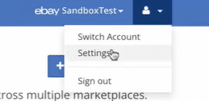

<ul><li>Then click on Client Channel Connections</li>
</ul>

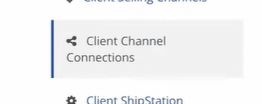

<ul><li>You’ll then be redirected to a form on the same window where you can make the connections.</li>
</ul>

From there, you can select the channel to “Connect From” and “Connect To”.

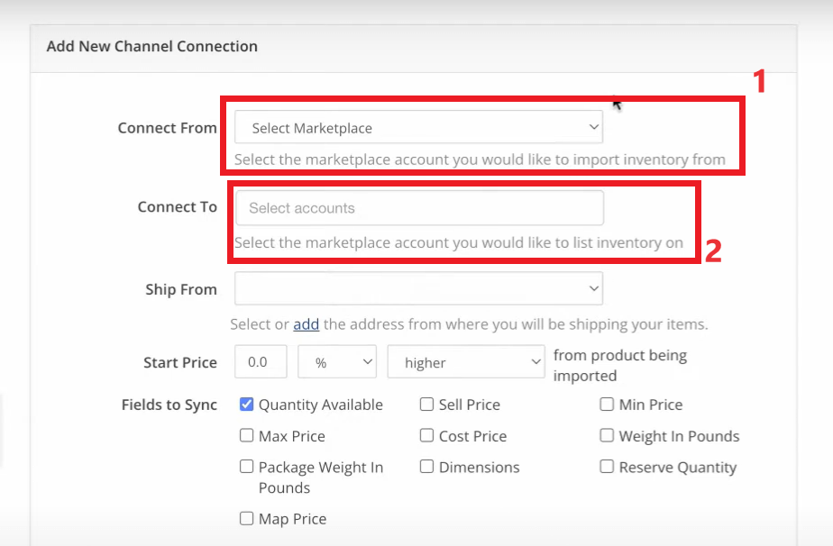

<ul><li>It should look something like this when you’re selecting. . .</li>
</ul>

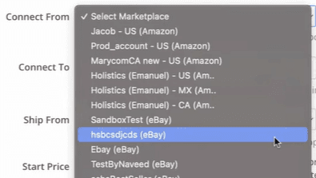

<ul><li>. . . and like this when you’ve selected the Amazon and eBay channels you want to connect.</li>
</ul>

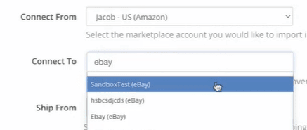

<ul><li>There are several other details to fill in with respect to inventory syncing, variants, fulfillment, warehousing, shipping, etc., and we’ll touch on some of those soon. But after you fill them up, to connect the listing on your Amazon and eBay selling accounts, you should tick the “Auto-import Products” and “Auto-list after import” (optional) boxes then hit the “Create” button.</li>
</ul>

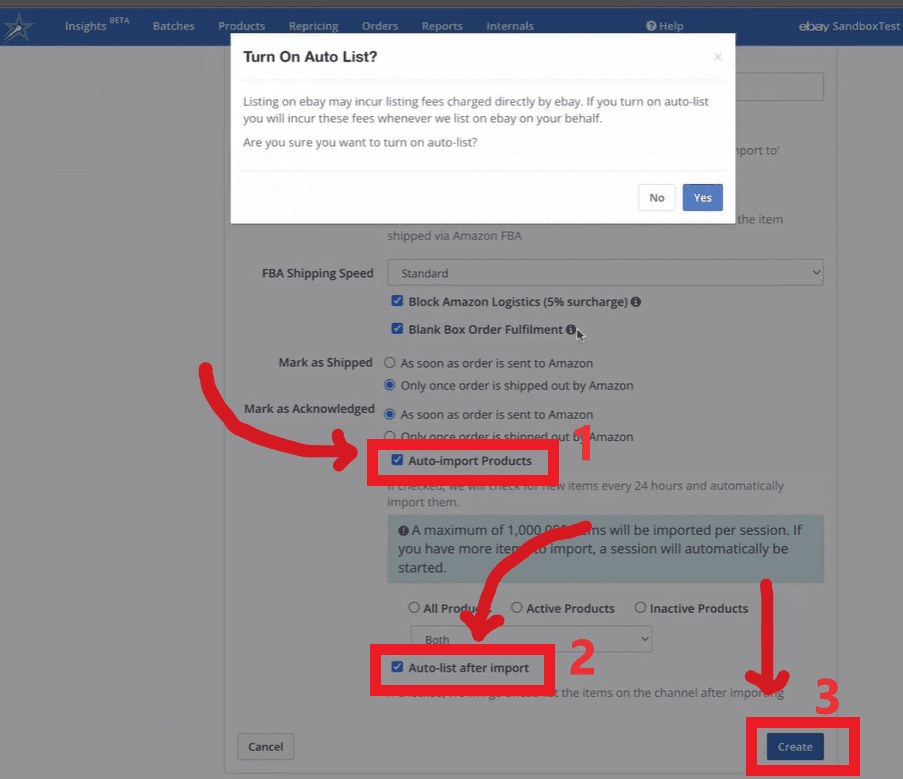

And voila! Your Amazon and eBay accounts now have the same listing at the same time!

Below is a video showing the entire channel connection process.

<h3><b>2. Sync Your Inventory:</b>
</h3>

Inventory SyncTM on SelleChamp already begins from the previous step of connecting your channels starting with the pre-ticked “Quantity Available” box.

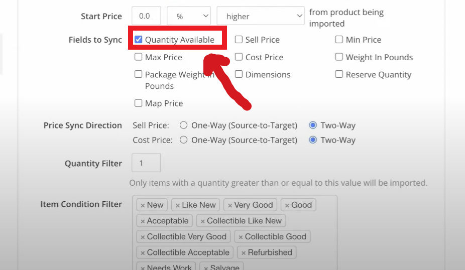

That field makes sure that every sale on eBay is reflected in your inventory on Amazon, and vice versa.

But you can go even further and sync everything from selling price to product features and product conditions.

Still, this is not enough if you’re selling on several online marketplaces.

Let’s examining two problems you will definitely face when selling on both eBay and Amazon:

<ol><li>You need to sync just a variation of a product to your eBay account.</li><li>You have the same type of product that doesn’t sync on your Amazon and eBay account.</li>
</ol>

The second scenario is happening because although they are the same products, the SKUs don’t match.

You’d typically have to delist said item, change the SKU so that both have matching SKUs, and then relist it.

In contrast, let’s see how you can solve all your inventory syncing and SKU flexibility issues in 4 simple steps:

<ul><li>Head over to the “Products” page after signing in to your SellerChamp account.</li>
</ul>

<ul><li>You’ll be redirected here where you can see all your products, how many products they’re linked to, the channels they’re connected to, and much more.</li>
</ul>

In the Woocommerce products page below for example, product 2 is connected to eBay and Shopify with 3 linked products.

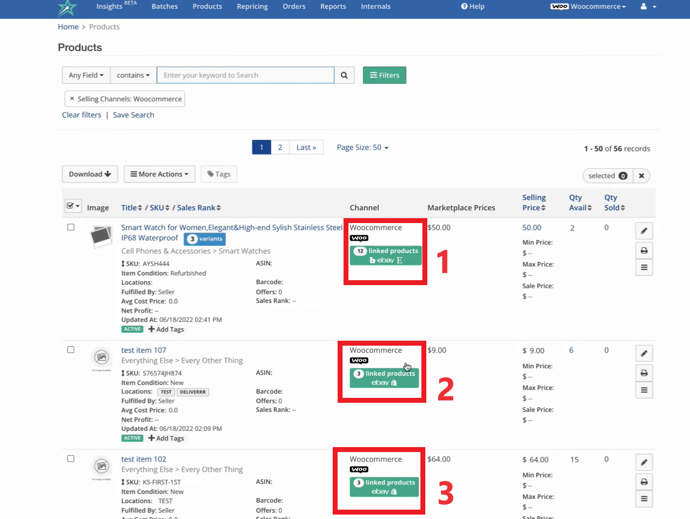

If the quantity on one platform changes from 5 to 6, it is reflected on the other accounts.

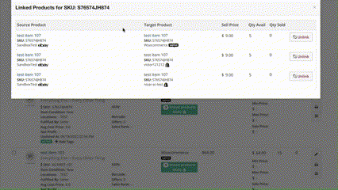

All you have to do is make sure that the SKU is the same.

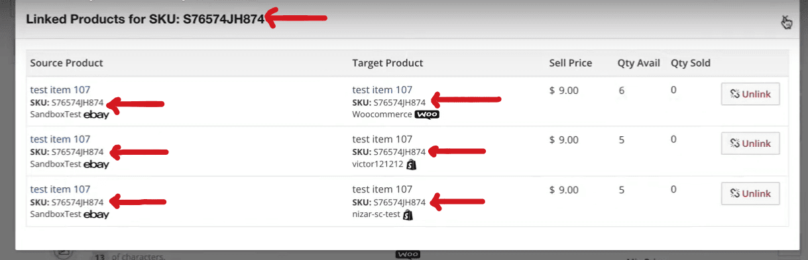

<ul><li>This SKU flexibility means that you can list a single variation of a product on another channel if you want. For instance, if you want to sync the medium sized version of a product on eBay to Amazon, all you have to do is name the parent SKU of the Amazon version as the variation SKU on eBay.</li>
</ul>

In the example below, the variation SKU is “3”.

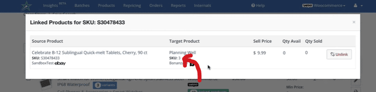

<ul><li>Finally, if you need to sync two similar products on eBay and Amazon with different SKUs, you need to connect the Primary SKU of one product to the ALT SKU (Alternate SKU) of the other. 

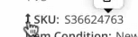

 </li>
</ul>

You can fill in the ALT SKU by clicking on this arrow. . .

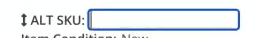

And just like that you’ve connected the product on eBay and Amazon without having to delist and relist.

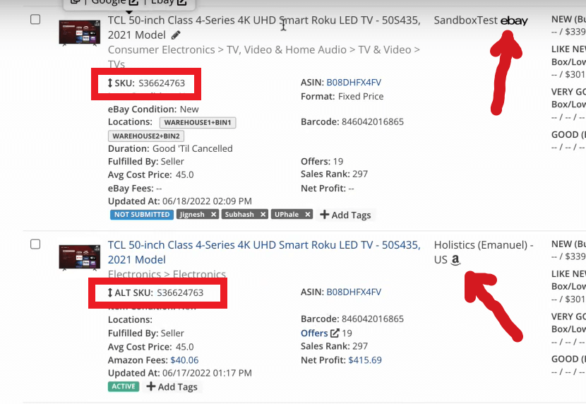

The video below gives a detailed explanation of how to sync your inventory on eBay and Amazon at the same time.

<h2>How to Copy Amazon Listing to eBay
</h2>

Here’s how to copy your Amazon listing to eBay automatically, or vice versa.

<ul><li>Again, this is only efficiently done using a multichannel selling platform so log in to your SellerChamp account and click on the “Products” page.</li>
</ul>

<ul><li>On the “Products” page, hit the “Filters” button [ <b>1</b> ], select your filter preferences [ <b>2</b> ] (including the eBay or Amazon account you’re cross-listing from), then you’ll see the amount of products you’re about to crosslist to your Amazon or eBay account [ <b>3</b> ].</li>
</ul>

You can tick the boxes by the front of the select products you want to copy. On the other hand, if you’re trying to copy a batch of your listing, then you should just hit the “More Actions” dropdown [ <b>4</b> ] and then select “Copy to Another Channel” [ <b>5</b> ].

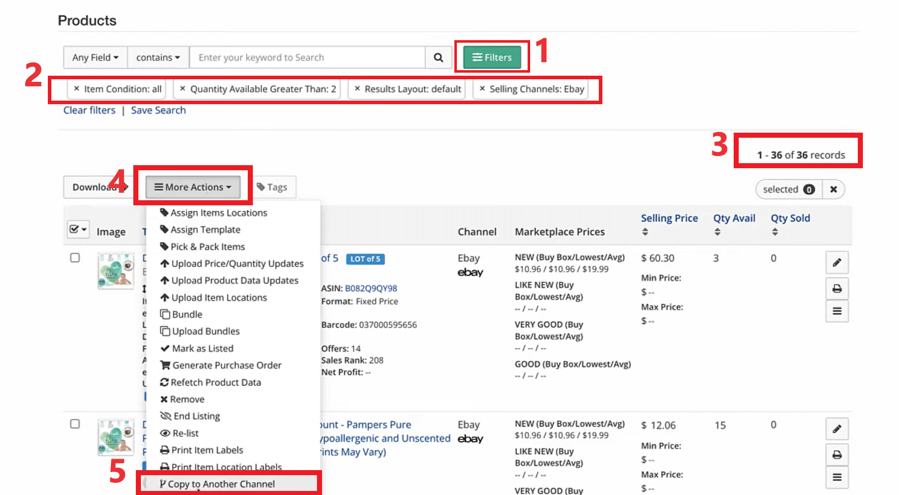

<ul><li>A mini-window will popup where you will select the channel to copy to, how you want to fulfill the products (more on this later), and if you want to create a new batch.</li>
</ul>

Next is to tick the “Keep Quantities Synced” box so that Inventory Sync is enabled. Then hit “Submit”.

<ul><li>You’ll get a confirmation message and when you hit “Click here”. . .</li>
</ul>

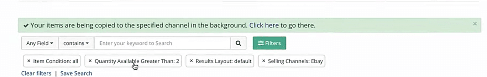

. . .you’ll be redirected to this page where your listing will load and you can then hit “Submit” to import it to your recipient eBay or Amazon account.

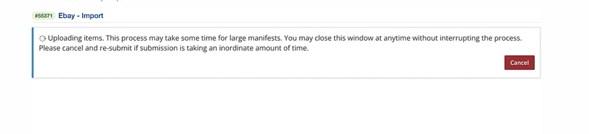

Here’s a demo showing how to copy Amazon listings to eBay.

Take note that you can also activate the automatic copying of products listing from Amazon to eBay. You can do this by ticking the “Auto-import Products” and “Auto-list after import” boxes we discussed during the <a href="https://docs.google.com/document/d/15lCeI0MmcJ6YbYkFUV9iuwsSURqUU9qRx1VdqAMlMmI/edit#heading=h.bvqrus8onn31">channel connection</a> process earlier.

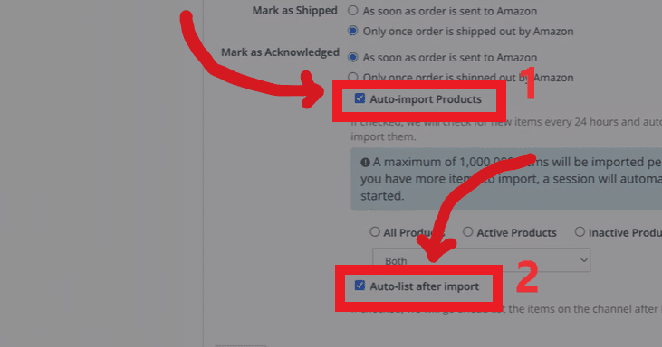

<h2>Can Amazon Fulfill eBay Orders?
</h2>

You can fulfill your eBay orders using the Fulfillment by Amazon service. Here’s the easiest way to do it:

<ol><li>Using SellerChamp, switch to the desired eBay account and then click on “View Manifests”.</li>
</ol>

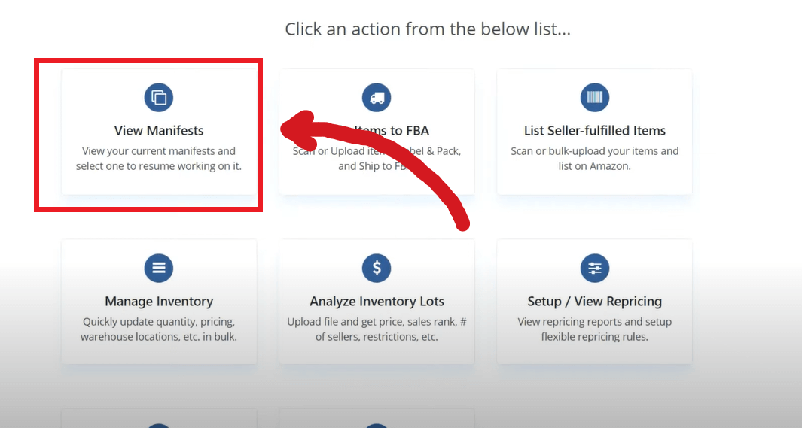

2. You’ll be redirected to a page where you fill in all the details of your manifest. Crucially, you have to select Amazon to ship under the fulfillment channel option so your eBay orders can be fulfilled through FBA.

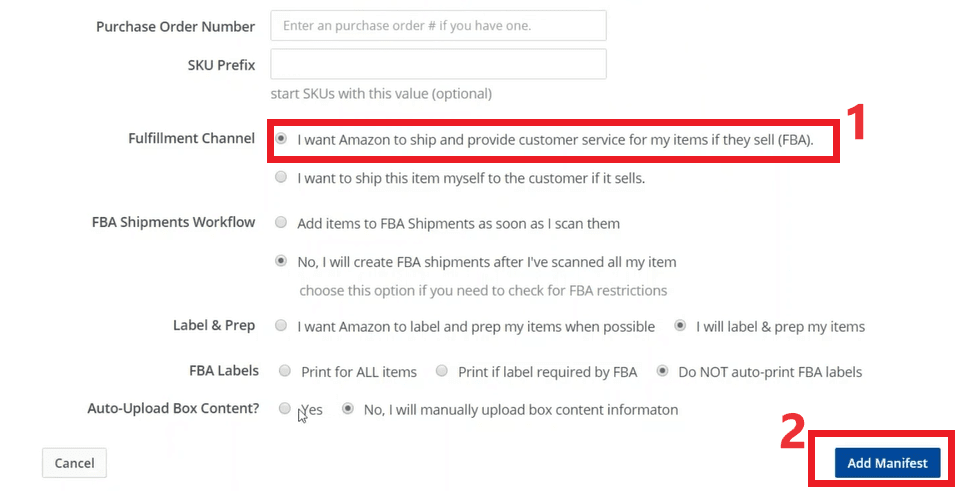

3. You’ll be redirected to a page where you can begin filling out the manifest.

If you want to fill out the manifest manually, you can add an ID (ASIN, UPC, etc.) or the item name.

However, if you want to fill out a batch at a go, simply hit the “Upload” button.

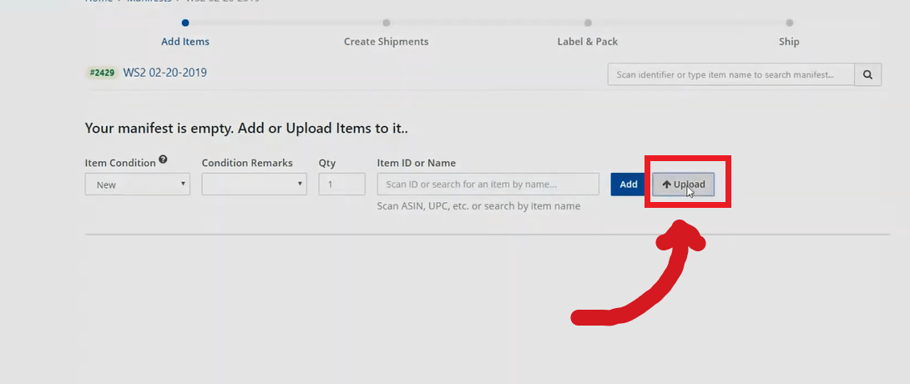

Then you can upload a CSV file [ <b>2</b> ] with information on the item ID, quantity and condition using a certain template [ <b>1</b> ] which has been provided for you. Once done, hit the “Upload” [ <b>3</b> ] button to populate the manifest instantly.

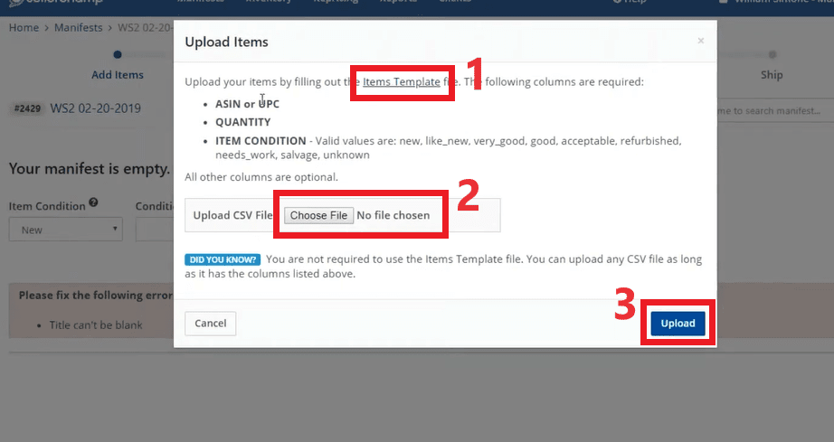

4. After the manifest has been populated, and every necessary detail for shipping has been reviewed, hit the “Submit to Amazon” button.

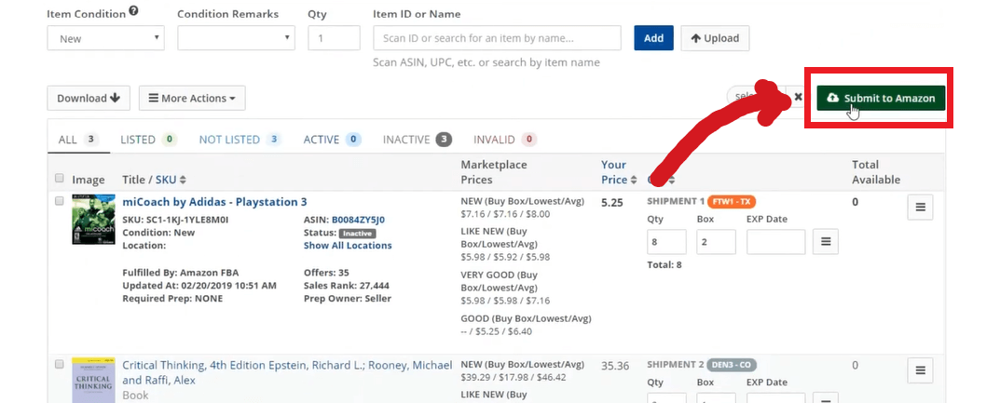

5. Once that is done processing and no errors are found, you can click on the “Label & Pack” button to proceed.

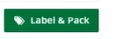

6. Next, select “Finish All” and confirm your decision by selecting it again in the new mini-window.

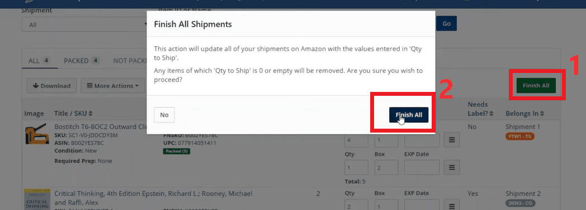

7. You’ll be redirected to the shipping page where you will fill in details about the shipments’ weight and dimensions. Fill them in, click “Save Changes” and wait for SellerChamp to calculate the shipping cost.

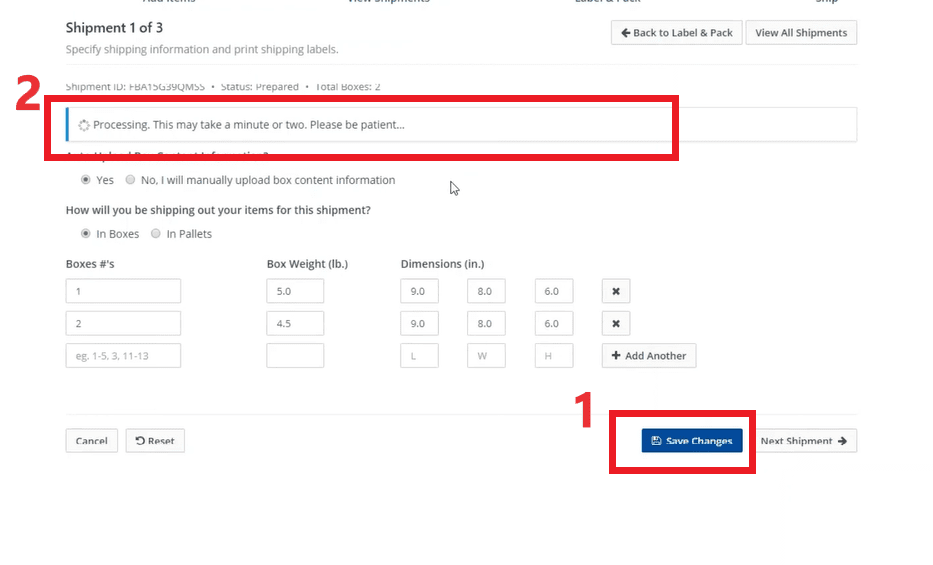

8. For the final step, “Accept Shipping Cost”. . .

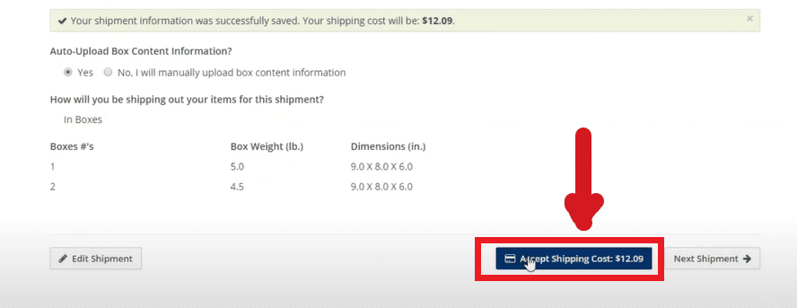

. . .then download “Box Labels”. And you can move on to the “Next Shipment” if any.

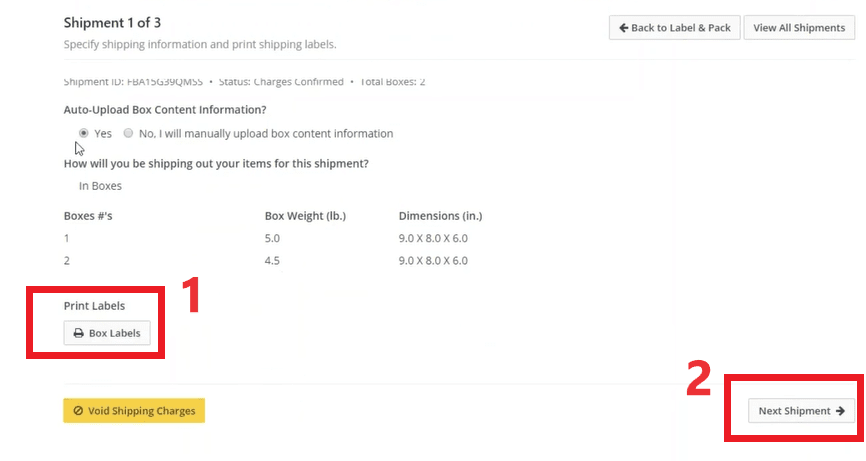

<b>NOTE: </b> Several decisions you make in this process of fulfilling your eBay orders through Amazon will increase the costs. Watch the video below to get a full breakdown of all the factors.

<h3>Request a Demo!
</h3>

Selling on eBay and Amazon in 2024 requires the ease of listing (even in bulk), inventory syncing, and order fulfillment across both marketplaces.

<b>So do you want to take your eCommerce brand to the next level on eBay and Amazon? </b><a href="https://app.sellerchamp.com/leads/new"><b>Sign up for a demo on SellerChamp today and start selling!</b></a>

