
Wondering <b>what the best things to sell on eBay</b> in 2024 are?

I’ve done the research for you, so you can start listing profitable items in no time.

From trending gadgets to fashion, this guide covers the top 27 products and categories that are seeing high demand this year.

<strong>Check out:</strong><a href="/blog/how-to-sell-on-ebay-and-amazon/"><b>How to Sell on eBay in 2024!</b></a>

<i>Before you begin, also check out our video on how to create a listing on eBay. </i>

<h2>1. Smartphones
</h2>

Smartphones are one of the most consistent sellers on eBay. Whether it’s the latest iPhone or refurbished models, people are always looking for deals.

<b><i>Did you know?</i></b><b> The global smartphone market is projected to ship </b><a href="https://www.statista.com/statistics/1418443/smartphone-shipments-worldwide/#:~:text=The%20volume%20of%20global%20smartphone,to%201.25%20billion%20by%202027."><b>1.25 billion units by 2027. </b></a><b>The market is expected to keep growing, making it one of the best things to sell on eBay.</b>

<h2>2. Wireless Earbuds
</h2>

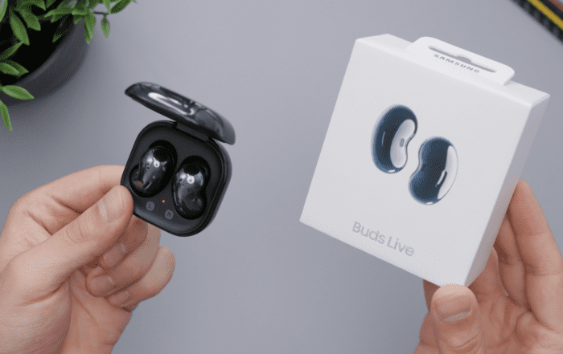

With the rise of wireless technology, earbuds like<i> Apple’s AirPods and Samsung Galaxy Buds </i>are extremely popular. Their compact size and light weight make them easy to ship, which is a bonus for sellers.

<h2>3. Smartwatches
</h2>

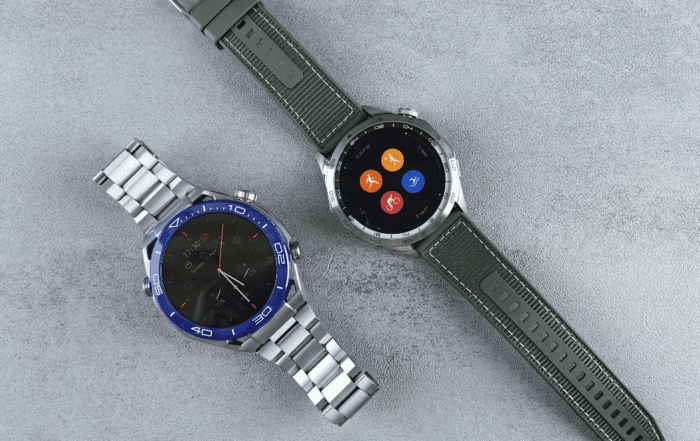

Fitness trackers and smartwatches are still trending as people focus on health and fitness. Brands like Apple, Samsung, and Fitbit offer high-value products that are great for resale.

<b><i>Did you know?</i></b><b> The smartwatch market is expected to grow by </b><a href="https://www.statista.com/forecasts/1314322/worldwide-revenue-of-smartwatch-market#:~:text=Revenue%20of%20the%20smartwatches%20industry%20worldwide%202020%2D2029&text=After%20the%20ninth%20consecutive%20increasing,a%20new%20peak%20in%202029."><b>$11.9 billion from 2024 to 2029, </b></a><b>reaching $40.57 billion.</b>

<h2>4. Laptops
</h2>

As remote work continues, laptops are a hot commodity. Many buyers are looking for both<i> new and refurbished models</i> at competitive prices. This makes laptops one of the best things to sell on eBay if you can source them reliably.

<strong>Read more:</strong><a href="/blog/how-to-attract-online-customers/"><b>How To Attract Online Customers? 13 Tried and Tested Tips</b></a>

<h2>5. Tablets
</h2>

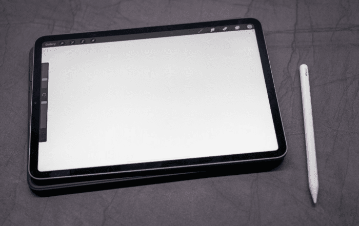

Tablets are becoming more versatile, functioning as entertainment systems, educational tools, and business devices. Popular brands like Apple’s iPad and Samsung’s Galaxy Tab sell consistently well.

<h2>6. Gaming Consoles
</h2>

Gaming consoles, particularly the<i> PlayStation 5 and Xbox Series X</i>, are in constant demand. With the gaming industry growing steadily, consoles are among the <b>best things to sell on eBay</b>.

<b><i>Did you know?</i></b><b> The global gaming console market, valued at $34.27 billion in 2019, is expected to reach </b><a href="https://www.fortunebusinessinsights.com/gaming-console-market-102420"><b>$51.15 billion by 2027, </b></a><b>growing at a 5.3% CAGR. </b>

<h2>7. Vintage Toys
</h2>

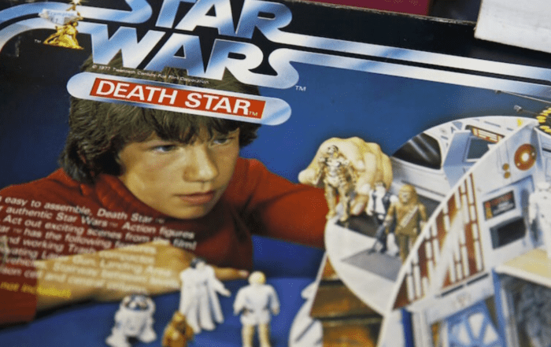

Vintage toys are highly collectible, especially if they’re from well-known franchises like Star Wars or Transformers. Sellers who specialize in rare and nostalgic items can see significant profits.

<h2>8. Rare Coins
</h2>

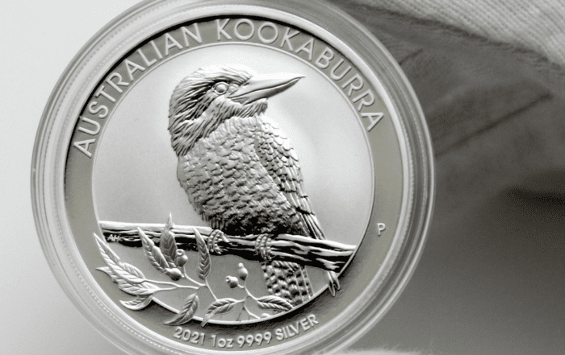

Rare coins remain a niche but profitable market on eBay. Collectors are always looking for <b>unique pieces</b> to add to their collections, and auctions for rare coins often see intense bidding wars.

<em><strong>Did you know? The global rare coin market is valued at over<a href="https://coinweek.com/"> $2 billion</a> and continues to grow annually.</strong></em>

<h2>9. Designer Clothes
</h2>

High-end designer clothes from brands like Gucci, Prada, and Balenciaga are popular items on eBay. Buyers are often searching for <b> luxury items at discounted prices,</b> making this a lucrative category for sellers who can source authentic pieces.

<b>You Might Like: </b><a href="/blog/ecommerce-branding-strategies/"><b>7 Proven E-Commerce Branding Strategies With Examples</b></a>

<h2>10. Luxury Handbags
</h2>

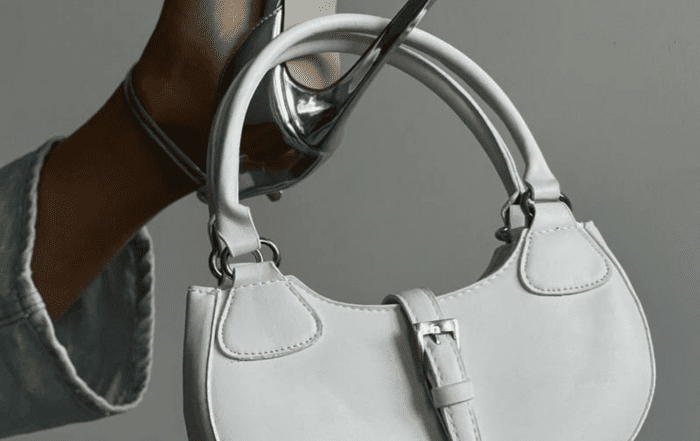

Luxury handbags, such as those from <b> Louis Vuitton, Chanel, and Hermes,</b> are among the top sellers in the fashion category on eBay. These items tend to hold their value well, and limited editions can sell for even higher prices.

<h2>11. Watches
</h2>

Luxury watches are a status symbol, and brands like Rolex and Omega are highly sought after on eBay. Pre-owned watches in good condition can still fetch a high price.

<b><i>Did you know? </i></b><b>In 2024, the global revenue for luxury watches is expected to reach</b><a href="https://www.statista.com/outlook/cmo/luxury-goods/luxury-watches-jewelry/luxury-watches/worldwide#:~:text=In%202024%2C%20the%20revenue%20in,amounts%20to%20US%2472.97bn."><b> $72.97 billion. </b></a>

<h2>12. Sneakers
</h2>

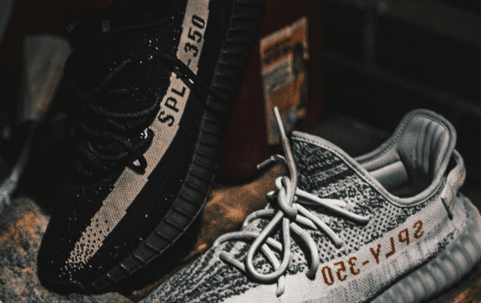

Sneaker culture has exploded in recent years, with limited-edition releases from brands like Nike and Adidas selling out fast. Collectors often turn to eBay to find <b> rare models,</b> making sneakers one of the best things to sell on eBay.

<h2>13. Sunglasses
</h2>

Sunglasses from top brands like <b> Ray-Ban, Oakley, and Gucci</b> remain a steady seller on eBay. Whether it’s for style or practicality, buyers are always looking for new and vintage models.

<h2>14. Furniture
</h2>

Selling furniture on eBay has become easier with many buyers looking for unique, high-quality pieces for their homes. Items like <b>mid-century modern chairs, vintage desks, and small tables</b> are particularly popular.

<h2>15. Outdoor Furniture
</h2>

With people investing more in their outdoor spaces, outdoor furniture is in high demand. Items like patio sets, garden chairs, and even outdoor heaters have become popular choices.

<b><i>Did you know?</i></b><b> The outdoor furniture market is projected to grow by 3.60% annually from 2024 to 2029, </b><a href="https://www.statista.com/outlook/cmo/furniture/outdoor-furniture/worldwide"><b>reaching $62.17 billion by 2029.</b></a>

<h2>16. Home Decor
</h2>

Home decor, including items like vases, lamps, and wall art, is always in demand. Buyers often search for unique pieces that can add a personal touch to their living spaces.

<h2>17. Kitchen Appliances
</h2>

Kitchen gadgets like <b>air fryers, espresso machines, and high-end blenders</b> are trending. With more people cooking at home, these are some of the best things to sell on eBay.

<h2>18. Fitness Equipment
</h2>

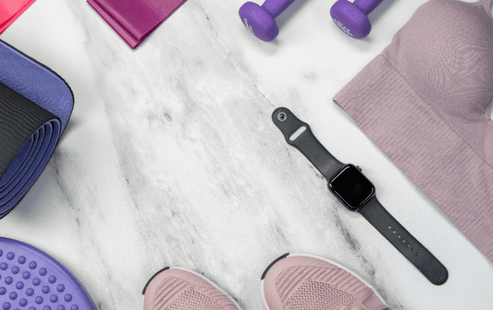

The rise of home fitness has made equipment like <i>dumbbells, resistance bands, and yoga mats </i>very popular on eBay. Health-conscious consumers are always looking for ways to stay in shape without going to the gym.

<h2>19. Skincare Products
</h2>

Skincare products, especially those from natural and organic brands, are seeing increased sales as more people invest in self-care.

<h2>20. Haircare Products
</h2>

Haircare items like styling tools, treatments, and high-quality shampoos are reliable sellers on eBay, especially for buyers looking for salon-grade products at discounted prices.

<h2>21. Beauty Tools
</h2>

Beauty tools like <b>facial rollers, LED masks, and microdermabrasion devices </b> are part of a growing trend as consumers focus on high-tech skincare solutions. These tools are some of the best things to sell on eBay in the beauty category.

<strong>Read more:</strong><a href="/blog/e-commerce-cost-optimization/"><b>10 Ways to Effectively Implement E-Commerce Cost Optimization</b></a>

<h2>22. Supplements
</h2>

With a growing interest in health and wellness, supplements like vitamins, protein powders, and herbal remedies are becoming increasingly popular.

<h2>23. Smart Home Devices
</h2>

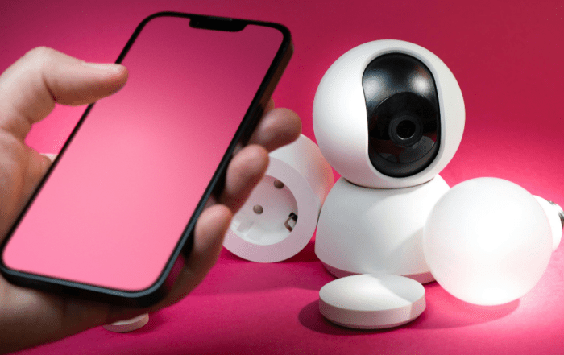

Smart home products such as thermostats, smart locks, and security cameras are increasingly popular as more people look to upgrade their homes with technology.

<b><i>Did you know?</i></b><b> The smart home market is expected to hit</b><a href="https://www.statista.com/forecasts/887554/revenue-in-the-smart-home-market-in-the-world"><b> $182 billion by 2025 </b></a><b>and grow to $231.6 billion by 2028. </b>

<h2>24. Electric Scooters
</h2>

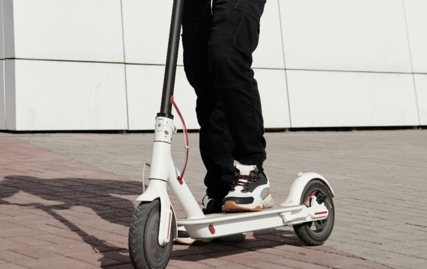

Electric scooters are a rising trend as urban commuters look for<a href="https://dictionary.cambridge.org/dictionary/english/eco-friendly"> eco-friendly</a> ways to travel. With cities around the world investing in green infrastructure <b>, electric scooters</b> have become a practical and popular mode of transport.

<h2>25. Pet Supplies
</h2>

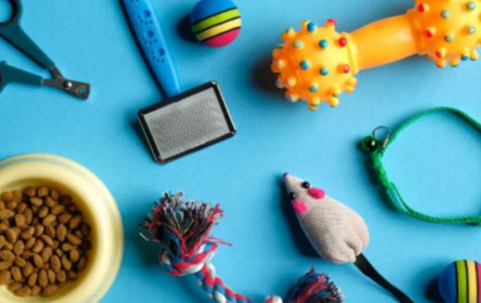

From toys to grooming kits, pet supplies are always in demand. Sellers who cater to pet owners can see steady sales year-round, especially in popular categories like pet toys and bedding.

<h2>26. Baby Gear
</h2>

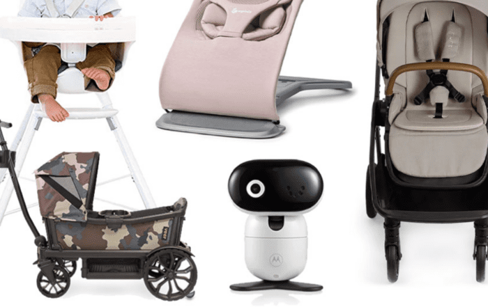

Baby products like <b> strollers, cribs, and car seats</b> are some of the best things to sell on eBay. New parents are often looking for quality items at lower prices, and eBay provides a great platform to sell both new and gently used baby gear.

<b>You Might Like: </b><a href="/blog/sell-on-multiple-marketplaces/"><b>13 Practical Strategies to Sell on Multiple Marketplaces</b></a>

<h2>27. Collectibles
</h2>

Rare collectibles, whether it’s <b> trading cards, stamps, CDs, or vintage memorabilia,</b> remain some of the highest-selling items on eBay. Collectors often turn to the platform to complete their collections, making this a niche but <a href="https://www.investopedia.com/terms/c/collectible.asp">highly profitable market.</a>

<h3>Request a SellerChamp Demo
</h3>

<b>Interested in simplifying your listings and managing your inventory better?</b>
<a href="https://app.sellerchamp.com/users/sign_up?_gl=1*15rk328*_gcl_aw*R0NMLjE3MjI1NTExNTguQ2owS0NRand3YWUxQmhDX0FSSXNBSzRKZnJ6dndrbGdsZUp1RDI5TENkZld2aGFSWEl2ZkFyNHpoejV3VEVDR1lUc1NlejBGeDlHTzEzVWFBcUluRUFMd193Y0I.*_gcl_au*MTMyMzA3ODQ0MS4xNzIyNDQ4ODU4*_ga*Mjk2NTM2Njk4LjE3MjI0NDg4NTg.*_ga_F2WQV1CVLC*MTcyNjE4MzE4Ni4zOC4wLjE3MjYxODMxODYuNjAuMC4yMTE1MTIxNDc2&_ga=2.162898044.1162068164.1726167707-296536698.1722448858&_gac=1.21352777.1722448858.Cj0KCQjwwae1BhC_ARIsAK4JfrzvwklgleJuD29LCdfWvhaRXIvfAr4zhz5wTECGYTsSez0Fx9GO13UaAqInEALw_wcB"><b>Request a SellerChamp demo today to automate & streamline your e-commerce!</b></a>

