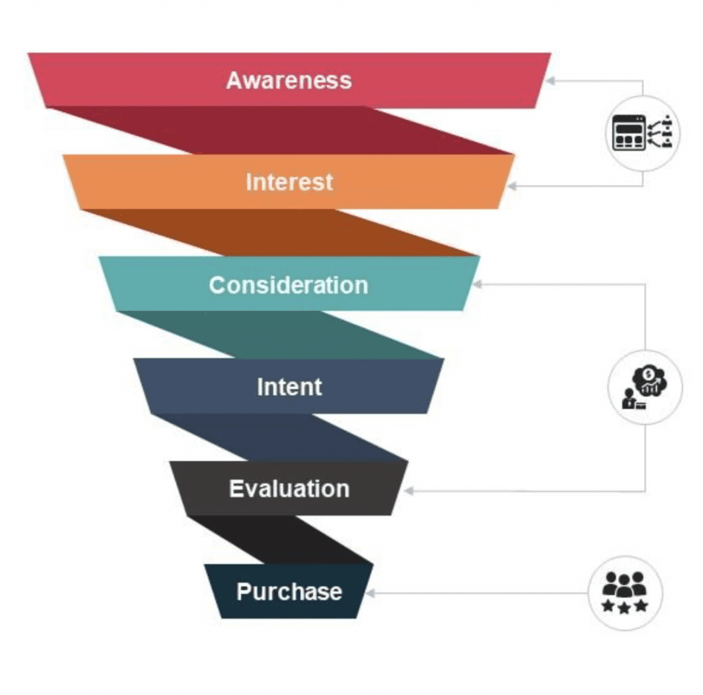

 The <b>customer acquisition funnel</b> is a vital marketing framework that guides businesses in transforming prospects into loyal customers. By understanding each stage of this funnel, businesses can tailor their marketing efforts, address customers’ needs, and create strategies that lead to more conversions and long-term relationships.

<strong>Read more:</strong><a href="/blog/selling-on-amazon-vs-ebay-what-will-get-you-to-6-figures-faster/"><b>Selling on Amazon vs eBay: What Will Get You to 6 Figures Faster </b></a>

<h2>Customer Acquisition Funnel Definition
</h2>

At its core, the customer acquisition funnel is a process that visualizes the journey a potential customer takes from<i> learning about your brand to making a purchase. </i> By optimizing this funnel, you can enhance the user experience and significantly <b> increase conversion rates. </b> This process consists of several phases that narrow down as the customer moves through each stage. Let’s dive into the stages, steps, and tips on how to optimize the customer acquisition funnel.

<strong>Check out:</strong><a href="/blog/what-is-multi-channel-retailing-tips-tricks-and-solutions/"><b>What is Multi-Channel Retailing? Tips, Tricks, and Solutions! </b></a>

<h2>The Stages of the Customer Acquisition Funnel
</h2>

The 5 stages of the Customer Acquisition Funnel are:

<h3>Stage 1: Awareness
</h3>

In the awareness stage,<i> potential customers first discover your product or service.</i> This is the widest part of the funnel, where you capture the attention of a broad audience. Strategies like <b>digital advertising, SEO, social media, and content marketing </b> are crucial here to generate visibility and interest. The goal is to put your brand on the map and attract as many relevant prospects as possible.

<h3>Stage 2: Interest
</h3>

Once awareness is created, the next stage is generating interest. At this stage, the<i> prospect knows about your brand but hasn’t yet committed. </i>The key here is to provide valuable information that showcases your expertise and highlights your product or service. <b>Blog posts, webinars, videos, and newsletters</b> are useful tools to keep potential customers engaged and show them why your product is worth considering. <b>You Might Like:</b><a href="/blog/best-things-to-sell-on-ebay/"><b> 27 Best (Most Profitable) Things to Sell on eBay This Year! </b></a>

<h3>Stage 3: Consideration
</h3>

Now that your prospect is interested, they will begin to evaluate whether your offering is the right fit. This is the stage where they<i> might compare your product with competitors, read reviews, and weigh the pros and cons. </i> Businesses must present persuasive content such as <b>case studies, product comparisons, and customer testimonials</b> to sway the decision in their favor.

<h3>Stage 4: Decision
</h3>

In the decision stage, the prospect is ready to make a purchase. They have<i> compared all available options and are leaning toward your product.</i> The task here is to make the buying process as seamless as possible. Ensure that your <b>checkout process is simple, offer promotions or discounts, </b> and provide excellent customer support to guide them through the final steps.

<h3>Stage 5: Retention
</h3>

The final stage of the customer acquisition funnel, which many businesses overlook, is retention. This phase focuses on <i>turning one-time customers into repeat buyers </i>by maintaining an excellent customer experience post-purchase. You can achieve this through <b>personalized follow-up emails, loyalty programs, and high-quality customer service. </b> Retention strategies ensure customer satisfaction, reduce churn rates and promote long-term loyalty.

<strong>Read more:</strong><a href="/blog/e-commerce-cost-optimization/"><b>10 Ways to Effectively Implement E-Commerce Cost Optimization </b></a>

<h2>Key Steps in Optimizing the Customer Acquisition Funnel
</h2>

Understanding the stages is essential, but knowing how to optimize the funnel is the key to success. Here are steps to improve each stage:

<h3>1. Boost Awareness
</h3>

<ul><li><b>Invest in content marketing: </b> Regularly produce blog posts, videos, and infographics that rank well in search engines and resonate with your target audience.  </li><li><b>Utilize social media:</b> Platforms like Facebook, LinkedIn, and Instagram are excellent for increasing brand visibility and engaging with potential customers.  </li><li><b>Use paid ads strategically:</b> Targeted ads on Google or social media can put your product in front of relevant audiences quickly.</li>
</ul>

<h3>2. Generate Interest
</h3>

<ul><li><b>Offer lead magnets: </b> Provide valuable resources like eBooks, whitepapers, or webinars in exchange for contact information. This builds interest and establishes you as an expert in your field.  </li><li>
<b style="font-family: var( --e-global-typography-text-font-family ), Sans-serif; text-align: var(--text-align); font-size: var(--body_typography-font-size); font-style: var(--body_typography-font-style,normal); letter-spacing: var(--body_typography-letter-spacing);">Email marketing:</b> Once you have their contact details, nurture these leads through personalized email campaigns that address their specific needs and concerns.  </li><li><b>Showcase social proof: </b> Use testimonials, case studies, and user reviews to build trust and keep your audience interested.</li>
</ul>

<h3>3. Help with Consideration
</h3>

<ul><li><b>Provide in-depth comparisons: </b> If your product is competing in a crowded market, offer detailed comparisons that highlight your unique selling points (USPs).  </li><li><b>Give free trials or demos: </b> Allow potential customers to experience your product firsthand through free trials or product demos, especially if you offer software or subscription-based services.  </li><li><b>Host webinars or live Q&As: </b> Engage with your audience by offering them the opportunity to ask questions directly and gain deeper insights into your offering</li>
</ul>

<h3>4. Simplify the Purchase Process
</h3>

<ul><li><b>Offer a clear value proposition: </b> Make sure your messaging is concise and shows the value of your product or service in solving the customer’s pain points.  </li><li><b>Simplify the checkout process:</b> Eliminate unnecessary steps in your buying process and offer multiple payment options to ensure a smooth transaction.  </li><li><b>Provide excellent support: Ensure </b> your customer support team is available to answer any questions, whether via live chat, email, or phone, which can make the decision process easier for the customer.</li>
</ul>

<h3>5. Strengthen Retention
</h3>

<ul><li><b>Send personalized thank-you emails:</b> Show appreciation after a purchase with a follow-up email that includes helpful tips or recommendations related to their purchase.  </li><li><b>Offer rewards programs:</b> Encourage repeat purchases by rewarding loyal customers with points, discounts, or exclusive offers.  </li><li><b>Gather feedback: </b> Post-purchase surveys or feedback forms can help you understand customer satisfaction levels and identify areas for improvement.  </li><li><b>Provide ongoing support:</b> Always be available to address customer concerns, whether it’s through a help center, live chat, or email. Proactively solving customer problems can lead to positive reviews and long-term loyalty.</li>
</ul>

<strong>Check out:</strong><a href="/blog/order-processing-definition-key-steps/"><b>Order Processing Definition + Key Steps </b></a>

<h2>Tips for Optimizing Your Customer Acquisition Funnel
</h2>

While the above strategies focus on the key stages of the funnel, here are some additional tips that can enhance your overall approach:

<h3>Use Data Analytics
</h3>

<ul>
<li>Monitor and measure performance at each stage of the funnel.Tools like <a href="https://marketingplatform.google.com/about/analytics/"><b>Google Analytics</b></a><b> or CRM systems</b> can provide insights into where potential customers drop off and which stages need improvement.</li>
</ul>

<h3>Optimize for Mobile
</h3>

<ul>
<li>A significant number of users browse and make purchases via mobile devices. Ensure that your <b>website and content are mobile-friendly </b> to cater to this growing demographic.</li>
</ul>

<h3>A/B Testing
</h3>

<ul><li>Continuously experiment with <b> different headlines, images, call-to-actions (CTAs), </b> and even pricing strategies to see what resonates best with your audience. Testing allows you to refine and optimize your funnel over time.</li>
</ul>

<b>Did you know: </b> A/B testing can increase <a href="https://revnew.com/blog/a-b-testing-for-lead-generation#:~:text=According%20to%20a%20study%20by,see%20which%20one%20performs%20better.">conversion rates by up to <b>49%</b> for businesses </a>that regularly test and optimize their content and design elements.

<h3>Segment Your Audience
</h3>

<ul><li>Personalization is key to improving conversions. Segment your audience based on <b>demographics, behavior, and preferences </b> to send them tailored messages that are more likely to convert.</li>
</ul>

<h3>Incorporate Retargeting
</h3>

<ul>
<li>Use retargeting ads to <b> bring back visitors who didn’t convert</b> during their first visit. These ads can remind them of the benefits of your product and encourage them to complete the buying process.</li>
</ul>

<strong>Check out:</strong><a href="/blog/how-to-attract-online-customers/"><b>How To Attract Online Customers? 13 Tried and Tested Tips </b></a>

<h2>Request a SellerChamp Demo!
</h2>

{{ site.app.leads }}?utm_source=blog&utm_campaign=what-is-the-customer-acquisition-funnel-stages-steps-and-tips



<a href="https://app.sellerchamp.com/users/sign_up?_gl=1*xjyjup*_gcl_aw*R0NMLjE3MjI1NTExNTguQ2owS0NRand3YWUxQmhDX0FSSXNBSzRKZnJ6dndrbGdsZUp1RDI5TENkZld2aGFSWEl2ZkFyNHpoejV3VEVDR1lUc1NlejBGeDlHTzEzVWFBcUluRUFMd193Y0I.*_gcl_au*MTMyMzA3ODQ0MS4xNzIyNDQ4ODU4*_ga*Mjk2NTM2Njk4LjE3MjI0NDg4NTg.*_ga_F2WQV1CVLC*MTcyODc3MjE4My41OS4xLjE3Mjg3NzMwMDguNTAuMC4xMzUzNzIxNjY0&_ga=2.206862998.429913037.1728772183-296536698.1722448858">Request a SellerChamp demo today and see how it can 10x your eCommerce business! </a>

