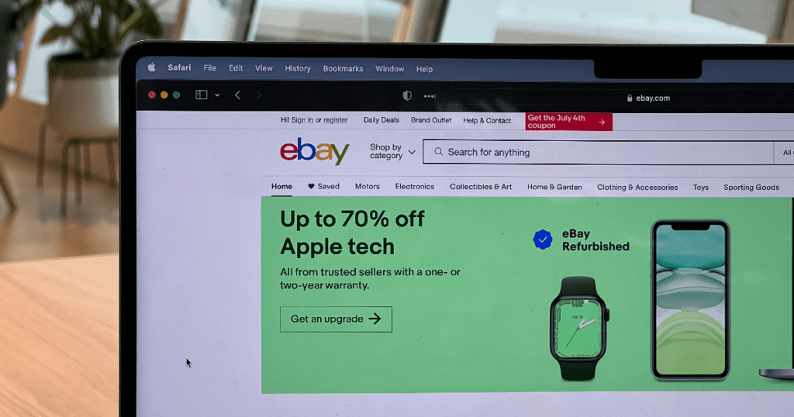

 Figuring out the formula of <b>how to get more views on eBay</b> is the first and most important step for a good eBay <a href="/blog/what-is-the-customer-acquisition-funnel/">customer acquisition funnel</a>. If you’re troubled with low views or an undesirable number of sales from your listings, this is the ideal guide for you. <b>Also Read: </b><a href="/blog/best-things-to-sell-on-ebay/"><b>27 Best (Most Profitable) Things to Sell on eBay This Year! </b></a>

<h2>1. Make Your Listings Stand Out With SEO Titles
</h2>

Listing optimization is key to making your products more attractive and showing up more frequently on the search page.

<h3>Optimize your Listing for SEO and Visibility with Keywords
</h3>

<ol>
<li>Research <b> relevant keywords</b> that relate to your business, product, and the customers’ needs.</li>
<li>You can use <b>eBay search suggestions</b> in combination with other free and/or paid keyword research tools.</li>
<li>Once you have a list, <b>work them naturally</b> into your listing titles and descriptions.</li>
</ol>

The goal here is to help eBay match your products with buyer searches.

<h3>Craft Attention-Grabbing Titles
</h3>

The right keyword increases the likelihood of higher visibility. However, using it in combination with an <a href="/blog/amazon-listing-examples-and-templates-that-can-help-you-rank-higher/">effective title</a> will exponentially improve those chances while also <b>making your listing more likeable.</b>

<ol>
<li>Utilize eBay’s character limit to your advantage by going for <b>crisp and focused titles.</b></li>
<li>Avoid spammy keywords.</li>
<li>Try to use your keyword as the first word in the title</li>
</ol>

<h5>Try SellerChamp for Yourself!
</h5>

Schedule a demo today and discover how our Bulk Lister can help you list more products, increase sales, and grow your e-commerce business faster than ever.

<h2>2. Write Accurate and Detailed Descriptions
</h2>

Descriptions are <b>key to building buyer trust</b> and present an opportunity to truly lock in someone who shows interest. <i>The more details you include in your description, the higher the likelihood of conversion and the lower the chance of a refund or return.</i>

<ol>
<li>Address everything a buyer may want to know.</li>
<li><b>Include all details</b> relevant to the material, size, condition, and any unique features.</li>
<li>Write clearly and <b>answer common questions upfront.</b></li>
<li>Add SEO keywords to your description.</li>
<li><b>Review </b> for grammar, spelling, or punctuation errors.</li>
</ol>
<a href="/integrations/market-places/ebay/">Click here</a> to learn more about <b>SellerChamp’s professional eBay listing software</b> that lists products in seconds

<h2>3. Use High-Quality Images and Videos
</h2>

<h3>Use the Right Images
</h3>

Photos show up on the results’ page and are very important to make your listings clickable to get more views on eBay. Here’s how to get it right:

<ol>
<li>Utilize eBay’s character limit to your advantage by going for <b>crisp and focused titles.</b></li>
<li>Avoid spammy keywords.</li>
<li>Try to use your keyword as the first word in the title</li>
</ol>

<h3>Showcase Your Product with Videos
</h3>

Adding a short video clip can showcase how an item looks, feels or works and helps build buyer confidence. Uploading videos to listings is simple and with a quick 360° view or demo of the product, you can give buyers a clear picture of what they’re getting.

<h2>4. Leverage eBay’s Promotions & Advertising Tools
</h2>

<h3>Make Use of Promoted Listings for More Views
</h3>

eBay offers a “Promoted Listings” option that boosts your products in search results. When used wisely, it’s a <b>solid investment.</b>

<ol>
<li>here are <a href="https://www.ebay.com/sellercenter/growth/ebay-advertising/promoted-listings"><b>two strategies </b></a><b>for using promoted listings</b> to get more views on eBay. One is that you target just about anyone with your ads, whereas the other only targets highly motivated users. In both cases, you <b>only pay when someone clicks on your ad.</b></li>
<li>Start by promoting your high-margin items or products with strong demand.</li>
<li>Test out your settings, <b>track results, and adjust</b> budget as needed.</li>
</ol>

<h3>Go for Markdown Sales and Promotions
</h3>

eBay lets you run sales and markdowns that <b>add urgency to pull in more views</b>.

<ol>
<li>You can create a <a href="https://www.ebay.com/sellercenter/growth/seller-hub-discounts/sale-events">sales event</a> and group multiple products together to sell at lower prices.</li>
<li>Make the discount clear in your listing and use countdown timers or limited-time offers to <b>push buyers to act fast.</b></li>
<li>When offering discounts make sure that you don’t go into loss per product and keep making some profit. </li>
<li>It is a good idea to offer sales on specific events or holidays.</li>
</ol>

<h3>Give Out Coupons and Discounts
</h3>
<a href="https://www.ebay.com/help/selling/selling-tools/promotions-manager?id=4094">Coupons and discounts </a>can also help you get more views on eBay by giving buyers a good deal.

<ol>
<li>You can give out coupons on <b>holidays </b> or on specific products and share them via your social media.</li>
<li>You can also give out coupons to <b>loyal buyers.</b></li>
<li>A discount on the second or third item encourages buyers to <b>make larger purchases.</b></li>
<li><b>Shipping discounts</b> are also a great way to get customers to purchase fast</li>
</ol>

<strong>Read more:</strong><a href="/blog/how-to-attract-online-customers/"><b>How To Attract Online Customers? 13 Tried and Tested Tips</b></a>

<iframe width="214" height="286" src="https://www.youtube.com/embed/lwp4Zr7rQXY" title="That's WHY Your Listings Are NOT Getting Views on eBay" frameborder="0" allow="accelerometer; autoplay; clipboard-write; encrypted-media; gyroscope; picture-in-picture; web-share" referrerpolicy="strict-origin-when-cross-origin" allowfullscreen></iframe>

<h2>5. Use Multi-Channel Selling to Drive Traffic to eBay
</h2>

Selling on multiple channels such as Amazon, Shopify, and Walmart can help you <b>reach a bigger audience</b>, and this means more eyes on your eBay listings too. It’s not just about <a href="/blog/how-to-sell-on-ebay-and-amazon/">more sales on different platforms;</a> multi-channel selling adds <b>visibility and credibility</b> to your brand as a whole. <a href="/integrations/market-places/ebay/"><i>SellerChamp’s Multi-Channel Fulfilment tool </i></a><i>syncs your listings across all platforms, </i><b><i>keeping inventory up-to-date and preventing stockouts.</i></b>

<strong>Check out:</strong><a href="/blog/sell-on-multiple-marketplaces/"><b>13 Practical Strategies to Sell on Multiple Marketplaces</b></a>

<h2>6. Engage with Your Audience Outside of eBay
</h2>

<h3>Share Actively on Social Media
</h3>

Over 63.8% of people globally <a href="https://datareportal.com/social-media-users#:~:text=Detailed%20analysis%20by%20the%20team,of%20the%20total%20global%20population">use social media</a> with a rate of <b>8.1 new sign-ups per second.</b> This makes social media a great place to <b>build brand awareness </b> and get new customers as well as to retain old ones. Furthermore, more than 99.9% of online consumers read <a href="https://www.powerreviews.com/power-of-reviews-survey-2021/">reviews </a>before making their purchase.

<ol>
<li>Make sure that you come across as a professional brand on your profile media profile.</li>
<li><b>Engage </b> with your audience frequently and address negative comments with good customer service.</li>
<li><b>Be regular</b> on social media with posts and engagement.</li>
</ol>

<h3>Utilize Email Marketing for Consistent Views and Customers
</h3>

Create a list of buyers and stay in touch with them via email marketing. While this may not bring in new customers, email marketing is excellent at keeping old customers coming back and <b>getting more views regularly.</b> Use emails to announce new listings, exclusive discounts, and holiday promotions.

<h2>7. Target Competitive Pricing
</h2>

If your product is priced too high compared to competitors, customers might want to skip it. Keep a <b>regular check on competitors</b> ’ prices and reprice your listings accordingly. You can use <a href="/features/#_repricer">SellerChamp’s rePricing</a> feature to <b>automatically adjust prices</b> no matter what time fluctuations occur.

<h2>Use SellerChamp to Get More Views on eBay
</h2>

SellerChamp is the fastest growing e-commerce automation platform this year, and has helped over 1,000 stores get more views on their listings.

{{ site.app.leads }}?utm_source=blog&utm_campaign=how-to-get-more-views-on-ebay


 <a href="https://app.sellerchamp.com/leads/new"><b>Book your demo now to see how SellerChamp can help your business!</b></a>
