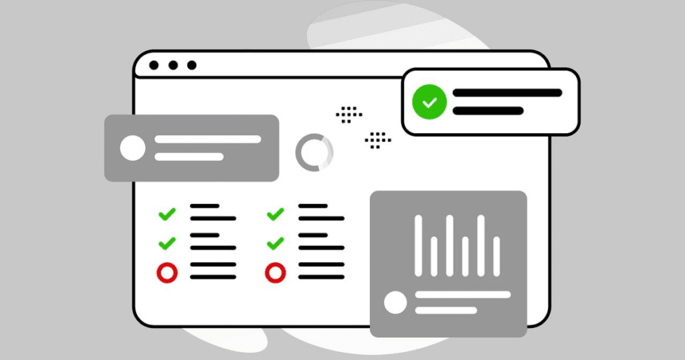

 Having reliable sources for quality products is critical to building a <b>profitable business</b>. Despite its importance, information on finding good suppliers is scant online, and thus, businesses often struggle when deciding where to buy products to sell online Whether you’re just starting out or looking to <b>improve your offerings,</b> understanding where to source products from is essential for long-term success. In this guide, we’ll tell you how to identify the right suppliers and where to find them, along with tips for efficient business management.

<strong>You might also like:</strong><a href="/blog/ecommerce-growth-hacks/"><b>33 Proven eCommerce Growth Hacks for Long-Term Success</b></a>

<h2>Understand Why Product Source Matters
</h2>

Your products are the biggest drivers of your business, and having a good source makes sure that you get high-quality pieces at the best deals. Here are three reasons why knowing the right sources when buying products to sell online is critical.

<ol>
<li>Sourcing from a reliable supplier ensures consistent product quality, which helps <b>reduce returns and complaints</b>.</li>
<li>The price at which you buy products directly affects the profit you make when selling. A dependable supplier will offer competitive pricing and thus, <b>better profit margins.</b></li>
<li>High-quality products and faster shipping directly impact your <b>customer satisfaction and brand loyalty</b></li>
</ol>

Suppliers are a key pillar supporting the foundations of your business. This is why it is critical to spend proper time researching and going for a trustworthy and reliable supplier.

<strong>Check out:</strong><a href="/blog/e-commerce-cost-optimization/"><b>10 Ways to Effectively Implement E-Commerce Cost Optimization</b></a>

<h5>Try SellerChamp for Yourself!
</h5>

Schedule a demo today and discover how our Bulk Lister can help you list more products, increase sales, and grow your e-commerce business faster than ever.

<h2>7 Attributes of a Good Product Supplier
</h2>

Here are 7 factors to consider when deciding where to buy products to sell online.

<ol>
<li><b>Reliability and Consistency: </b> According to Statista, for 53% of millennials, reliability is the <a href="https://www.statista.com/statistics/1410698/brand-qualities-desired-by-millennials-worldwide/">most wanted quality in brands.</a> If your supplier is providing products on time and maintains consistent quality, your customers will trust you as a brand too.</li>
<li><b>Costs:</b> Look for suppliers that offer discounts on bulk orders or those who can work with you to bring the cost down. Conduct thorough research on all available options and discuss costs.</li>
<li><b>Scalability</b>: As your business grows, your product sources should be able to handle the increased demand. You can judge this by the supplier’s facilities and clientele.</li>
<li><b>Transparency and Communication:</b> A trustworthy supplier should be open to discussions about product features and qualities before ordering, and will address all your concerns.</li>
<li><b>Responsive Support:</b> A good supplier must have responsive customer service to handle issues such as order discrepancies, product defects, and delivery problems. Clear terms for returns and exchanges are a must. This is even more important for dropshipping businesses.</li>
<li><b>Third-party Audits</b>: Ask your supplier about third-party quality control and audits, as these are critical to protecting your business and are becoming increasingly popular.</li>
<li><b>Industry</b>
<b>Expertise</b>: Make sure that your supplier has expertise in your industry and product type. This ensures that they can avoid common problems and fix issues if/when they occur.</li>
</ol>

<strong>Check out:</strong><a href="/blog/how-to-prevent-fraudulent-returns-to-your-ecommerce-store/"><b>How to Prevent Fraudulent Returns to Your Ecommerce Store</b></a>

 <a href="https://blog.shift4shop.com/can-dropshipping-be-profitable-check-these-key-statistics"><b><i>84%</i></b></a><b><i> of online business owners say that finding the right supplier has been their biggest obstacle in business.</i></b>

<h2>Where to Buy Products to Sell Online
</h2>

Now that you know what to look for in a good source, let’s dive into the best places to find products. Make sure to pick a source based on your <b> business’s niche and needs</b>.

<h3>1. Online Marketplaces
</h3>

<h4>i. Chinese Suppliers
</h4>

Online marketplaces like <b>AliExpress and Alibaba</b> are among the most popular sources for products to sell via eCommerce. Wholesale sellers, primarily from China, host their shops on these platforms to market products globally. <b>AliExpress</b>

<ul>
<li>AliExpress is primarily a B2C site, however, many retailers and dropshippers use it to find products and suppliers for bulk buying.</li>
<li>You can easily find sellers that offer <b> custom labeling and packaging.</b></li>
<li>Since there is <b>no minimum quantity</b> to place an order, you can try out a bunch of products/sellers and then only reach out to the ones you like.</li>
</ul>
<b>AliBaba</b>

<ul>
<li>Alibaba is a major platform for wholesalers and operates on a B2B business model.</li>
<li>With Alibaba, you can easily connect with manufacturers who offer <b>lower prices for larger orders.</b></li>
<li>Almost all sellers offer <b>private labeling</b> so you can sell their products under your brand name. Many offer product customizations too.</li>
<li>While there is a minimum order quantity on Alibaba, almost all sellers offer samples and many offer <b>free samples</b>.</li>
</ul>
<b>Tips</b>:

<ul style="list-style-type: circle;">
<li>Ensure to carefully <b>vet suppliers</b> and check reviews for reliability and quality.</li>
<li>Try to <b>connect with manufacturers</b> directly instead of buying from middlemen.</li>
</ul>
<b>Other Sellers</b> Besides Alibaba and AliExpress, there are many Chinese suppliers who work independently or on other platforms. You can use social media sites like <b>Instagram and TikTok</b> as well as other platforms such as <b>Made In China and HKTDC </b> to find such suppliers.

<h4>ii. Amazon
</h4>

Amazon is one of the largest and most popular e-commerce platforms. If you’re looking to resell branded products, Amazon Business is an excellent place to source items from.

<ul>
<li>You can easily find <b>great wholesale prices</b> on Amazon Business to sell products in your store. 5-30% markdowns are common and you can further negotiate as well.</li>
<li>There are <b>different plans </b> offered on the site that accommodate varying numbers of users and thus, business sizes. </li>
<li><b>All plans cover shipping and surveys</b>, whereas the paid plans also include spend visibility, guided buying, and easier payment terms.</li>
</ul>
<b>Tips</b>:

<ul style="list-style-type: circle;">
<li>Look at Amazon’s “Best Sellers” list to identify products in high demand. You can source these products in bulk and resell them through your store.</li>
</ul>

<strong>You might also like:</strong><a href="/blog/best-things-to-sell-on-ebay/"><b>27 Best (Most Profitable) Things to Sell on eBay This Year! </b></a>
<b><i>According to QIMA, in 2023, China was the top </i></b><a href="https://blog.qima.com/traceability/global-sourcing-trends"><b><i>sourcing </i></b></a><b><i>market by relative share for roughly 50% of businesses in the US & UK. </i></b>

<h3>2. Local Sources
</h3>

If you’re looking for unique items that might not be readily available online, consider sourcing locally.

<h4>i. Thrift Stores & Garage Sales
</h4>

You might be surprised at the brand names and unique items found at thrift stores, flea markets, and garage sales. These places often carry <b>vintage items or collectibles </b> that sell very well online.

<b>Tips</b>:

<ul style="list-style-type: circle;"><li>Look for high-value, branded items or rare collectibles.</li><li>Research <b>brands and market trends</b> to ensure purchasing products that will sell for a higher price online.</li><li>If your business shows success, you can reach out to <b> suppliers of second-hand products</b> to make the process smoother.</li>
</ul>

<h4>ii. Wholesale Suppliers & Distributors
</h4>
<b>Building long-term relationships</b> with local wholesale suppliers is a good strategy for a successful business. You can find <b>local or regional suppliers</b> to purchase products, to sell online, with competitive pricing and reliable shipping. While these may be a bit more expensive, closer proximity makes them more reliable for many businesses. <b>Tips</b>:

<ul style="list-style-type: circle;">
<li>Look at <b>online platforms or directories</b> to find trustworthy suppliers, or reach out directly to local distributors who can provide the products you need. store.</li>
</ul>

<h4>iii. Trade Shows
</h4>

Trade shows are an excellent opportunity to <b>discover trending products</b> before they hit the mainstream. Additionally, you can also use them to connect directly with manufacturers or raw material suppliers for custom products. Networking effectively at these events can lead to <b>exclusive deals or early access</b> to popular products. <b>Tips</b>:

<ul style="list-style-type: circle;">
<li>Attend niche-specific trade shows to find products that align with your business. </li>
</ul>
<b><i>According to </i></b><a href="https://www.ceir.org/"><b><i>CEIR</i></b></a><b><i>, 91% of attendees say that trade shows help them get the most useful buying information, whereas for 79%, trade shows play a big role in deciding which products to move forward with. </i></b>

<h3>3. Private Label Manufacturers
</h3>

For business owners looking to scale and build brands, sourcing directly from manufacturers allows great control and customization benefits. With private labeling, you can build your brand by working directly with a manufacturer to create products that are <b>uniquely yours</b>.

<ul>
<li>Private label is ideal for businesses that want <b>more control </b> over branding, packaging, and profit margins.</li>
<li>Brands like <b>Nike, Apple, and Kirkland Signature</b> by Costco are some examples of private label brands.</li>
</ul>
<b>Tips</b>:

<ul style="list-style-type: circle;">
<li>Start with <b>smaller test batches</b> to minimize risk. Once you’ve found a product that resonates with your audience, scale up production.</li>
<li>Don’t be afraid to negotiate for lower prices, better terms, or customized features. The more you buy, the more room you have for negotiation.</li>
</ul>

<strong>Check out:</strong><a href="/blog/how-to-sell-on-ebay-and-amazon/"><b>How to Sell on eBay and Amazon in 2024</b></a>
<b><i>53% of retailers believe that</i></b><a href="https://nielseniq.com/global/en/insights/analysis/2024/brandbank-branded-vs-private-label-who-is-going-to-come-out-on-top/"><b><i> private labeling</i></b></a><b><i> could be the number one growth driver of their business and sales. (NIQ x Advantage Manufacturer and Retailer Outlook Survey)</i></b>

<h3>4. Liquidation Warehouses
</h3>

Liquidators are businesses that work with retailers to acquire <b style="color: #151921; font-family: var( --e-global-typography-text-font-family ), Sans-serif; text-align: var(--text-align); font-size: var(--body_typography-font-size); font-style: var(--body_typography-font-style,normal); letter-spacing: var(--body_typography-letter-spacing);">excess stocks</b> (closeouts and overstocks) and <b style="color: #151921; font-family: var( --e-global-typography-text-font-family ), Sans-serif; text-align: var(--text-align); font-size: var(--body_typography-font-size); font-style: var(--body_typography-font-style,normal); letter-spacing: var(--body_typography-letter-spacing);">returned items</b>. Liquidators partner with reputable retailers like Amazon and Target and purchase items in bulk via live liquidation auctions.

This makes going for liquidation warehouses an excellent strategy to buy products to sell online as you can get <b>decent quality products at low prices</b>.

<b>Where to Source Liquidated Stock:</b>

<b>i. B-Stock Solutions</b>

<b>B-Stock</b> connects businesses with top retailers such as Walmart, Amazon, and Target, offering liquidation auctions for overstock and returned items. You can bid on categories like electronics, apparel, and home goods.

<b>ii. Bulk.com</b>

<b>Bulk.com</b> specializes in bulk purchasing of liquidation stock. They offer a variety of conditions, from new and like-new items to salvage inventory, making them a flexible option for diverse business needs.

<b>iii. DirectLiquidation.com</b>

This site partners with major retailers such as Best Buy and Walmart to offer items from a wide range of categories, including refurbished electronics and apparel.

<b>iv. Liquidation.com</b>

A versatile platform that auctions items directly from retailers like Home Depot and Amazon. Categories include home improvement, consumer electronics, and apparel.

<b>v. BlueLots.com</b>

<b>BlueLots</b> connects resellers with high-quality surplus inventory from manufacturers and retailers, offering transparent pricing and fewer middlemen.

<b>Tips</b>:

<ul style="color: #151921; list-style-type: circle;"><li>Auctions can get very lively, and you can easily go overboard with spending. It is important to clearly know the products/categories you want to purchase and to <b>define a budget </b> before going to the auction.</li><li>Verify product quality before committing to purchases.</li>
</ul>

<strong>Check out:</strong><a href="/blog/what-is-multi-channel-retailing-tips-tricks-and-solutions/"><b>What is Multi-Channel Retailing? Tips, Tricks, and Solutions!</b></a>

<h3>5. Specialized Dropshipping Suppliers
</h3>

For sellers who don’t want to manage inventory, specialized dropshipping suppliers are an excellent choice.

<ul>
<li>Find suppliers who are <b>well-experienced </b> and regularly work with dropshipping businesses to ensure that you don’t run into common problems.</li>
<li><b>Spocket, Modalyst, and Zendrop </b> are great options for sourcing high-quality products from suppliers who handle shipping directly.</li>
</ul>
<b>Tips</b>:

<ul style="list-style-type: circle;">
<li>Partner with suppliers that offer fast <a href="/blog/order-processing-definition-key-steps/">order processing</a> and shipping with strict quality control to ensure a positive customer experience.</li>
</ul>

<strong>Read more:</strong><a href="/blog/how-to-automate-dropshipping/"><b>How to Automate Dropshipping Practically? </b></a>

<iframe width="214" height="286" src="https://www.youtube.com/embed/OzWFfwWqPmY" title="4 Tools You Need to Grow an eCommerce Business" frameborder="0" allow="accelerometer; autoplay; clipboard-write; encrypted-media; gyroscope; picture-in-picture; web-share" referrerpolicy="strict-origin-when-cross-origin" allowfullscreen></iframe>

<h2>✅Pro Tips for Building an Efficient Online Store
</h2>

<ol>
<li><b>Start small </b> and scale with proven products.</li>
<li><b>Focus on evergreen</b> products for steady sales and <b>seasonal</b> products to capitalize on trends. Utilize our smart strategies above when sourcing products for a successful business.</li>
<li><b>Sell on multiple channels </b> with <a href="/multi-channel-fulfillment-software/">SellerChamp </a>for sales across many platforms including Amazon, eBay, and 13 other marketplaces. Learn more about multi-channel sales <a href="/blog/how-to-sell-on-multiple-platforms/">here</a>.</li>
<li>Buying in bulk but don’t know how to manage listings on multiple channels? Check out <a href="/bulk-lister-seller-champ/">SellerChamp’s Bulk Product Listing Tool</a> which can <b> list thousands of products in minutes.</b></li>
<li>Be sure to keep a stringent <b>check on your inventory and stock counts</b> with <a href="/inventory-sync-software/">SellerChamp’s Multi-Channel Inventory Sync Software</a>. Click <a href="/blog/automated-inventory-management/">here </a>to learn more about automation for inventory management.</li>
</ol>

<h2>Request a SellerChamp Demo!
</h2>

{{ site.app.leads }}?utm_source=blog&utm_campaign=where-to-buy-products-to-sell-online



 Learn more about scaling your business for efficiency. Book your </b><a href="https://app.sellerchamp.com/leads/new"><b>SellerChamp demo</b></a> today!
