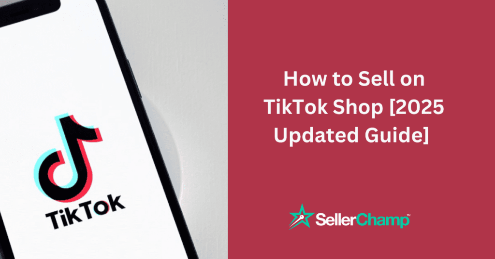
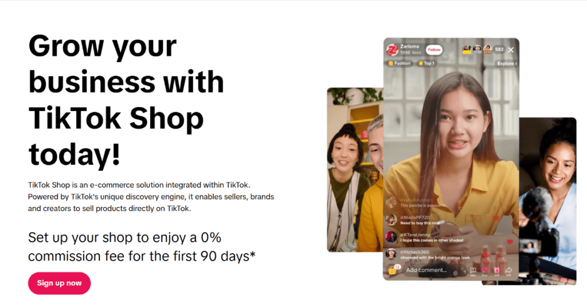
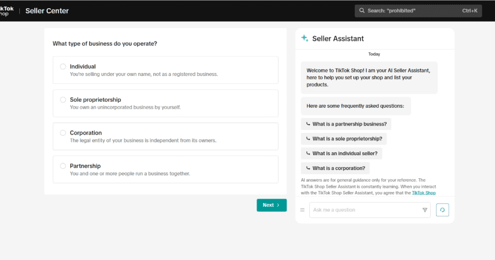
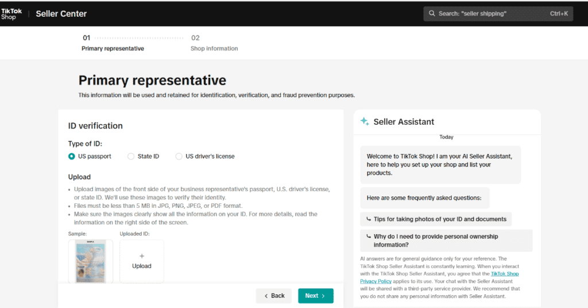
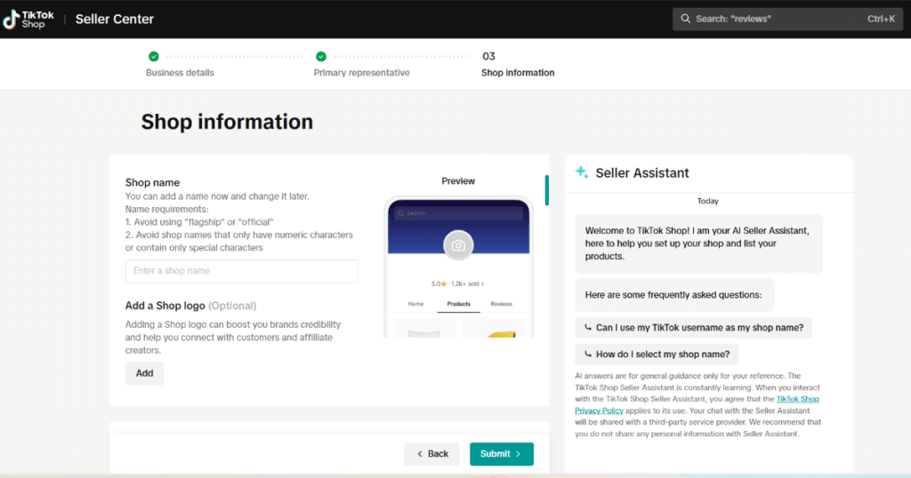
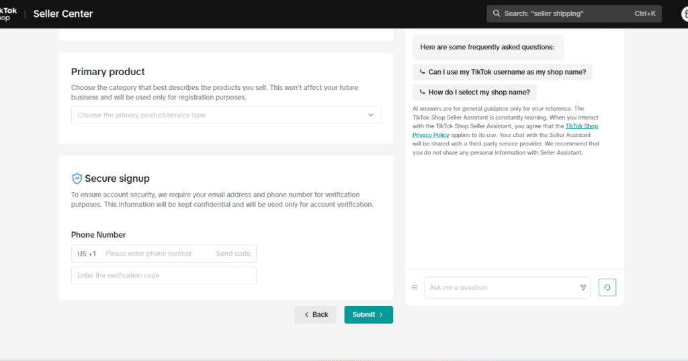
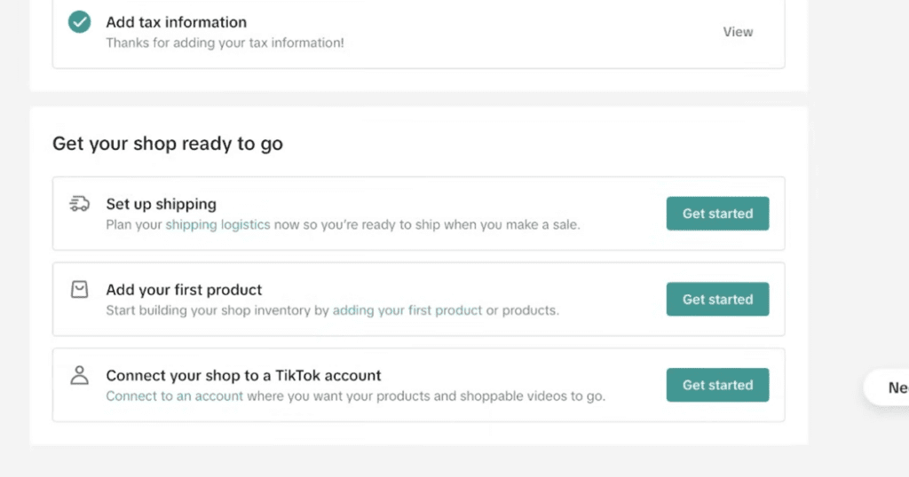
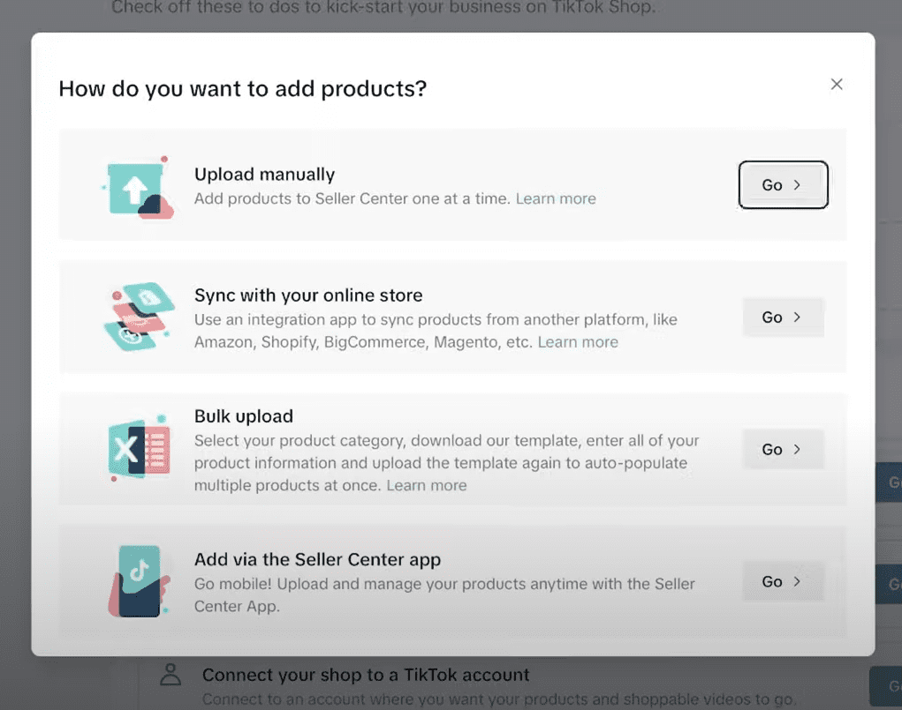

 Looking to set up a <b> successful e-commerce business on TikTok</b>? With the platform still in its early stages, now is the perfect time to learn <b> how to sell on TikTok Shop </b> for maximum growth and profitability. In this guide, you will learn about everything from setting up your shop to proven strategies for <b>sales in 2025.</b>

<strong>You might also like:</strong><a href="/blog/ecommerce-growth-hacks/"><b> 33 Proven eCommerce Growth Hacks for Long-Term Success</b></a>

<h5>Try SellerChamp for Yourself!
</h5>

Schedule a demo today and discover how our Bulk Lister can help you list more products, increase sales, and grow your e-commerce business faster than ever.

<h2>What is TikTok Shop and Why You Can’t Ignore It in 2025
</h2>

TikTok Shop is an immersive marketplace feature by TikTok that allows creators and sellers to build authentic relationships with users while simplifying the <b>online shopping experience.</b> TikTok Shop is<a href="https://www.businessdasher.com/tiktok-shopping/"> increasingly being adopted </a>by online sellers for its <b>functionality and benefits. </b> Here’s why it’s a game-changer for sellers:

<ul>
<li>TikTok boasts over 1 billion <a href="https://www.statista.com/statistics/272014/global-social-networks-ranked-by-number-of-users/">active users</a> worldwide. Over 60% of these are <b> between the ages of 10-29, </b> an age group known for being trend-conscious.</li>
<li>TikTok’s algorithm pushes engaging content to the right audience, with studies showing an average <a href="https://www.socialinsider.io/blog/tiktok-metrics/#:~:text=Plus%2C%20our%20latest%20social%20media,an%20eye%20on%20engagement%20metrics"><b>engagement rate</b></a><b> of 5.96%,</b> surpassing other platforms.</li>
<li>With features like <b>in-video shopping links and live-stream sales</b>, TikTok Shop bridges the gap between product discovery and purchase.</li>
<li>While platforms like Amazon and Shopify are crowded, TikTok Shop is still relatively new and thus gives early adopters a <b>competitive edge</b>.</li>
</ul>

For sellers, these features mean more visibility, higher engagement, and <b>increased sales potential</b> —all on a platform that thrives on creativity and fun.

<strong>Check out:</strong><a href="/blog/where-to-buy-products-to-sell-online/"><b>Product Sourcing Guide: Where to Buy Products to Sell Online? </b></a>

<h2>Set Up Your TikTok Shop
</h2>
<b>Step 1:</b> Head over to <a href="https://business.tiktokshop.com/us/seller/sell">TikTok Shop’s official website</a> to create your seller account and Shop.

 <b>Step 2: </b> On the homepage, click on “Sign up now” to start the registration process. <b>Step 3: </b> Enter your business details and select the business type that best describes you. For each type, you can easily view all the documents you need before starting the signup process; be sure to have these ready before proceeding.

 <b>Step 4: </b> Fill out the necessary information. Different business types have different requirements. These might include tax identification numbers, proof of address, or operational licenses. Once done, move on to the next step.

 <b>Step 5:</b> Describe your business in more detail via key attributes such as name, domain, and other information.

 <b>Step 6:</b> Your shop is now created. While TikTok verifies your data, you can prepare your shop for launch. If you’re a new seller, start by adding your first product.

 Ensure the product listings are accurate and engaging to attract potential buyers.

 If you already have a set-up business and are just getting on TikTok now, you can start with Shipping details.

<strong>Read more:</strong><a href="/blog/ecommerce-branding-strategies/"><b>7 Proven E-Commerce Branding Strategies With Examples</b></a>

<h2>Sell on TikTok Shop with the Right Strategies for 2025
</h2>

 With the above steps completed, your TikTok Shop is set. However, setting up the shop is <b>just the beginning</b>. To start selling successfully in 2025, you’ll need to optimize your store, engage with TikTok’s dynamic community, and take additional steps <b>!</b>

<h2>1. Craft the Perfect Product Listings
</h2>

On a platform that <a href="https://www.jsr.org/hs/index.php/path/article/view/2963">dominates the attention economy</a>, even hundreds of listings won’t make a difference if they aren’t <b>effectively optimized.</b> Product listings are your <b> first impression,</b> which is why you need to grab attention right away.

<h3>Use High-Quality Visuals
</h3>

<ul>
<li><b>Hook users</b> with unique opening lines on videos.</li>
<li>Upload clear, <b> professional media </b> that showcases the product from multiple angles.</li>
<li>Include <b>short demonstrations</b> of the product in use.</li>
</ul>

<h3>Write SEO-Optimized Titles and Descriptions
</h3>

<ul>
<li>Use SEO keywords after <b> extensive research</b> on your target audience, their needs, and your products.</li>
<li><b>Highlight product benefits</b> in concise yet descriptive terms.</li>
</ul>

<h3>Optimize for TikTok Algorithm
</h3>

<ul><li>Optimize your Shop profile by aligning it with your <b>brand identity</b> and using the right keywords.</li><li>Use hashtags like <b>#TikTokMadeMeBuyIt</b> and other trending or suitable keywords in your product descriptions and videos.</li><li><b>Engage with customers </b> in the comments to boost visibility.</li>
</ul>

<b>Read More:<a href="/blog/writing-the-perfect-product-listing-key-elements-to-drive-sales/"> Writing the Perfect Product Listing: Key Elements to Drive Sales </a></b>

<h2>2. Streamline Your Inventory and Order Management
</h2>

Your approach to <a href="/blog/order-processing-definition-key-steps/">inventory and order management</a> has a significant impact on your business reputation and Shop success. While juggling multiple channels can be draining, <b>with the right tools, </b> it’s a strategy for success.

<ul>
<li>Keep your inventory updated at all times to avoid <b>out-of-stock or overselling problems</b>.</li>
<li>With automation, you can <b>simplify order processing</b>, inventory syncing, and product uploads to <b>reduce manual tasks</b>.</li>
<li>Streamline your order management for timely order fulfillment and shipping. This <b>improves customer experience</b> and reduces delays or errors in order processing.</li>
<li>With automation, you will have more free time to focus on growing your TikTok Shop and creating engaging content.</li>
</ul>

To effectively manage your inventory and order processing, utilize tools like <b>SellerChamp’s Multi-Channel </b><a href="/inventory-sync-software/"><b>Inventory Sync Software</b></a> that provides updates in real-time with full support for customization and control.

<strong>You might also like:</strong><a href="/blog/automated-inventory-management/"><b>What is Automated Inventory Management and 9 Tips for You! </b></a>

<h2>3. Effectively Utilize TikTok Shop Ads and Promotions
</h2>

 While standard ad formats like in-feed and TopView are widely available, TikTok Shop offers <b>exclusive ad formats </b> tailored for its creators and sellers.

<table id="tablepress-27" class="tablepress tablepress-id-27">
<thead>
<tr class="row-1">
<th class="column-1">Ad/Promotion Type</th><th class="column-2">Features</th><th class="column-3">Benefits</th><th class="column-4">Challenges</th><th class="column-5">Strategies For Improved ROI</th>
</tr>
</thead>
<tbody>
<tr class="row-2">
<td class="column-1"><strong>Video Shopping Ads</strong></td><td class="column-2">Shopping options and buttons are integrated into users’ feeds.</td><td class="column-3">These come off as organic content to the user. 
  Include clickable elements to enhance user engagement. 
  Reduce purchasing resistance for customers by reducing the steps they have to take to order. 
</td><td class="column-4">Extensive competition. 
  Difficult to grab user attention 
</td><td class="column-5">High-quality videos with clear calls-to-action (CTAs) can motivate the audience to interact with shopping buttons.</td>
</tr>
<tr class="row-3">
<td class="column-1"><strong>LIVE Shopping Ads</strong></td><td class="column-2">Shopping options and buttons are integrated into your live streams.</td><td class="column-3">Customers can browse your shop and listings during the live stream. 
  Dual exposure to your shop increases the likelihood of conversions. 
 
</td><td class="column-4">Retaining attention in real-time, for extended durations, can be challenging. 
  Limited reach if you have a smaller follower base. 
</td><td class="column-5">Focus on creating interactive content. 
  Promote urgency and exclusivity during live events. 
</td>
</tr>
<tr class="row-4">
<td class="column-1"><strong>Product Shopping Ads</strong></td><td class="column-2">Ads are displayed on the Shopping Center and Search pages.</td><td class="column-3">An effective strategy for reaching new customers.</td><td class="column-4">Extensive competition makes it challenging to capture user attention.</td><td class="column-5">Use SEO optimization for better ad placements. 
  Utilize interesting visuals to grab and retain attention. 
</td>
</tr>
</tbody>
</table>

<h3>Suggestions:
</h3>

<ul>
<li>Use short videos with <b> trending music </b> and captivating visuals.</li>
<li>Highlight unique product features in the first few seconds.</li>
<li>Use <b>SellerChamp’s</b><a href="/ecommerce-analytics-tool-insights-reports/"><b> insights tools</b></a> to monitor ad success and make data-driven decisions.</li>
</ul>

<h2>4. Build Trust and Credibility
</h2>

 <a href="https://www.statista.com/statistics/1425531/brand-products-considerations-customers/">88% of customers prioritize</a> trust as their <b>number one factor</b> when deciding whether to make a purchase or not <b>. Establishing credibility</b> is therefore essential, especially when selling on TikTok where the competition is immense. Here’s how you can establish credibility to sell successfully on TikTok Shop:

<ul>
<li>Follow up with buyers for positive reviews, offering <b>discounts on future purchases</b> as incentives.</li>
<li>Highlight <b>user-generated content</b> (UGC) featuring your products.</li>
<li>Share testimonials and <b>tag satisfied customers</b> in posts.</li>
<li>Monitor feedback and respond promptly to build <b>strong customer relationships</b></li>
</ul>

<strong>Check out:</strong><a href="/blog/what-is-the-customer-acquisition-funnel-stages-steps-and-tips/"><b>What is the Customer Acquisition Funnel? Stages, Steps, and Tips</b></a>

<h2>5. Leverage TikTok’s Algorithm to Your Advantage
</h2>

The <b> secret to TikTok success</b> lies in mastering its algorithm, especially the For You Page (FYP). As it is dominated by short-form and highly engaging content, prioritizing high-quality videos that capture <b>attention within 1-2 seconds</b> is crucial to doing well. <b>User engagement factors</b> like watch times, likes, shares, saves, and comments, are key in determining who sees your content and how frequently.

<ul>
<li>Include <b>SEO keywords</b> in your video scripts.</li>
<li>Use trending music, sounds, and hashtags. Tracks with <b>120+ beats per minute</b> have good view-through rates.</li>
<li>Engage with your audience through quick responses to <b>comments and DMs</b>.</li>
<li>Create <b>short videos</b> with a strong hook in the first 2 seconds.</li>
<li>Don’t give up after the hook. Keep the audience engaged throughout the video.</li>
<li>Study <b>analytics</b> to optimize your TikTok activity.</li>
</ul>

<h2>6. Try Out New Features and Jump on Trends
</h2>

<h3>Follow New Feature Release
</h3>

<ul>
<li>As the app rolls out new features and tests them, users utilizing them are prioritized.</li>
<li>Keep an eye on <b>emerging tools</b> like shoppable videos and advertising formats.</li>
<li>Adapt content strategies to align with <b>algorithm updates</b> for better reach.</li>
</ul>

<h3>Spot Trends Early
</h3>

<ul><li>Use TikTok’s Discover tab to <b>identify trending topics</b>.</li><li>Watch competitors and influencers in your niche for <b>inspiration</b>.</li>
</ul>

<strong>You might also like:</strong><a href="/blog/ecommerce-growth-strategy/"><b>5 Proven Ecommerce Growth Strategies from 100K+ Revenue Success Stories</b></a>

<h2>Tips and Recommendations
</h2>

<ul><li><b>Expand via connections: </b> Collaborate with influencers who have a strong presence on TikTok to amplify your reach and build trust.</li><li><b>Repurpose content</b>: TikTok thrives on repurposing—take your best content from Instagram, YouTube, or any other platform and tweak it for TikTok.</li><li><b>Sell on multiple platforms</b>: Expanding to multiple marketplaces like Amazon, eBay, and Etsy will ensure broader reach and steady sales. Check out SellerChamp’s<a href="/integrations/#marketplaces"> MultiChannel Integration tool</a> for more details.</li><li><b>Utilize promotion features</b>: Experiment with TikTok ads, branded challenges, and creative storytelling.</li><li><b>Assess results and optimize processes</b>: Use <a href="/ecommerce-analytics-tool-insights-reports">data and insights</a> from SellerChamp to continuously optimize your approach to sales and management and stay competitive <b>.</b></li>
</ul>

<h2>Ready for a successful TikTok business? <strong>Sign up for SellerChamp and excel at multi-channel selling.<a href="https://app.sellerchamp.com/leads/new"> Book a SellerChamp demo here!</a></strong>
</h2>

{{ site.app.leads }}?utm_source=blog&utm_campaign=how-to-sell-on-tiktok-shop


