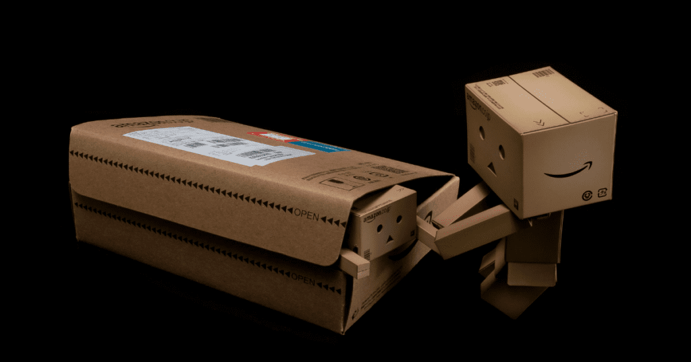

 Wondering <b>how to win the Buy Box</b> on Amazon, eBay, Shopify, or any e-commerce selling channel? This ultimate guide breaks down key tricks you need to secure this spot. From pricing tactics to fulfillment tips, discover everything that’ll put your product in front of eager buyers.

{{ site.app.leads }}?utm_source=blog&utm_campaign=how-to-win-the-buy-box


Want to win the Buy Box? Try SellerChamp’s demo now and see how our tools can help you win the buy box more often!

<h2>What is the Buy Box?
</h2>

The Amazon Buy Box is the highly visible <b>“Add to Cart” and “Buy Now”</b> button on a product page. It allows one seller to become the default option for customers looking to purchase that product. Winning this spot is crucial for capturing more sales. Amazon selects the seller for the Buy Box based on specific criteria like <i>pricing, performance, and inventory levels.</i> If multiple sellers offer the same product, only the one who meets Amazon’s requirements will win the Buy Box.

<b>Did You Know? </b><i>In 2023, US-based sellers sold more than </i><a href="https://www.aboutamazon.com/news/small-business/amazon-2023-small-business-empowerment-report?initialSessionID=140-6315939-0536424&ld=ELUSSOA-chatgpt.com"><i>4.5 billion items</i></a><i>—an average of 8,600 items every minute.</i>

<h2>Why is the Buy Box Critical for Sellers?
</h2>

Winning the Buy Box is key to increasing sales, building trust, and staying ahead of other sellers. Here’s why:

<ul>
<li><b>Major Sales Driver:</b> Over<a href="https://www.accelerlist.com/blog/amazon-buy-box/"> 80% of sales on Amazon</a> happen through the Buy Box, making it the gateway to higher conversions.</li>
<li><b>Enhanced Visibility:</b> Products in the Buy Box are more likely to be purchased than those listed in the “Other Sellers” section.</li>
<li><b>Customer Trust:</b> Buyers perceive Buy Box sellers as reliable and credible, boosting their confidence in the purchase.</li>
</ul>

<b>Did You Know?</b> Shoppers rarely scroll down to view alternative sellers, which is why missing out on the Buy Box can drastically impact sales.

<strong>You might also like:</strong><a href="/blog/ecommerce-growth-hacks/"><b>33 Proven eCommerce Growth Hacks for Long-Term Success</b></a>

<h2>Key Factors Influencing Buy Box Eligibility
</h2>

Understanding what influences your Buy Box eligibility can help you focus on the right strategies to increase your chances.

<h3>1. Competitive Pricing
</h3>

Amazon favors sellers who price their products competitively. This includes<i> not just the product cost but also shipping fees.</i> However, being the cheapest isn’t always the answer. The pricing must be balanced with performance metrics, ensuring profitability while maintaining eligibility.

<b><i>Did You Know? </i></b><i>More than </i><a href="https://www.aboutamazon.com/news/small-business/amazon-2023-small-business-empowerment-report?initialSessionID=140-6315939-0536424&ld=ELUSSOA-chatgpt.com"><i>60% of sales</i></a>
<i>in the Amazon store come from independent sellers—most of which are small and medium-sized businesses.</i>

<h3>2. Fulfillment Method
</h3>

Amazon prioritizes sellers who use its <a href="https://www.googleadservices.com/pagead/aclk?sa=L&ai=DChcSEwiJ5dTulOeKAxU_koMHHexMBzQYABAAGgJlZg&ae=2&aspm=1&co=1&ase=5&gclid=Cj0KCQiA4fi7BhC5ARIsAEV1YiZRCJGDEuko8-13KCXykftY1YlX9OCxiZrzFKrLdbkqE43EFFkkXOYaAoseEALw_wcB&ohost=www.google.com&cid=CAESVuD2Yh8b9hE1wCG86P5iJxR6wv1yPlK3ygjsbZTKaE7Gboq5v0dlJLJOq07nnKasEzmPhgq_TXUN69KdkTS2IygIkbTfVYFGAiixjcTrjfVYrw8uBaaD&sig=AOD64_2C84aYG-LTEYWDraV5pVtHMlB-Gg&q&adurl&ved=2ahUKEwiMwM_ulOeKAxWFgf0HHbkaOCsQ0Qx6BAgOEAE">Fulfilled by Amazon (FBA) service</a>. This ensures faster delivery, reliable shipping, and better customer service, improving Buy Box’s chances.

<h3>3. Seller Performance Metrics
</h3>

Amazon uses several metrics to assess sellers:

<ul>
<li><b>Order Defect Rate (ODR):</b> Should remain below 1%.</li>
<li><b>On-Time Delivery Rate:</b> Must exceed 97%.</li>
<li><b>Feedback Score:</b> A rating above 4.7 stars improves eligibility.</li>
</ul>

<h3>4. Inventory Levels
</h3>

Running out of stock can<i> disqualify a seller from winning the Buy Box.</i> Maintaining adequate inventory, especially during peak shopping seasons, is essential to stay competitive. <a href="/integrations/market-places/ebay/"><i>SellerChamp’s Multi-Channel Fulfilment tool </i></a><i>syncs your listings across all platforms, </i><b><i>keeping inventory up-to-date and preventing stockouts.</i></b>

<h2>Pricing Tricks to Help You Win the Buy Box
</h2>

Smart pricing strategies can make all the difference in winning the Buy Box and boosting your sales.

<h3>➜ Utilize Dynamic Pricing
</h3>

Dynamic pricing automatically<i> adjusts your product prices based on competitor actions, </i>demand, and market trends. Tools like RepricerExpress or Seller Champ help keep you competitive without needing constant monitoring.

<h3>➜ Match or Undercut Competitor Pricing
</h3>

One way to secure the Buy Box is by offering prices <b>equal to or slightly lower than</b>

<b>your competitors.</b> However, avoid aggressive price cuts, as they can negatively impact profitability in the long term.

<h3>➜ Offer Value-Based Pricing
</h3>

If you can’t win on price alone, differentiate your product with added value. This can include <i>faster shipping, extended warranties, or bundling complementary items.</i>

<h3>➜ Conduct Regular Pricing Reviews
</h3>

Amazon’s marketplace is dynamic, and pricing changes frequently. It is critical to monitor competitor prices regularly and adjust yours accordingly.

<h3>➜ Implement Promotional Discounts
</h3>
<b>Occasional discounts or lightning deals</b> can boost your chances of winning the Buy Box, especially during high-demand periods. Amazon often favors sellers running promotions, as it aligns with their focus on delivering value to customers.

<strong>Check out:</strong><a href="/blog/sell-on-multiple-marketplaces/"><b>13 Practical Strategies to Sell on Multiple Marketplaces</b></a>

<h2>Other Strategies to Secure the Buy Box
</h2>

Want to win the Buy Box? These strategies can help you stand out and improve your chances of success.

<h3>1. Use Fulfilled by Amazon (FBA)
</h3>
<i>Switching to FBA </i>can improve your chances by ensuring faster shipping, reliable service, and fewer returns, all of which Amazon values

<h3>2. Maintain Top-Notch Seller Metrics
</h3>

Focus on achieving high performance in areas Amazon values most, such as:

<ul>
<li><b>Order Defect Rate (ODR):</b> Keep this below 1% by minimizing defective products.</li>
<li><b>Late Shipment Rate:</b> Maintain timely shipping to avoid penalties.</li>
<li><b>Customer Feedback:</b> Encourage satisfied buyers to leave positive reviews.</li>
</ul>

<h3>3. Manage Your Inventory Effectively
</h3>

Inventory mismanagement is a common reason sellers lose the Buy Box. Use inventory management tools to monitor stock levels and avoid stockouts.

<b>Tip</b><b><i>:</i></b><i> Always maintain a buffer stock during peak sales periods like Black Friday or Prime Day.</i>

<h3>4. Prioritize Customer Experience
</h3>

Excellent customer service leads to positive reviews, higher ratings, and repeat business. Respond promptly to queries, resolve disputes amicably, and process returns efficiently.

<b>You Might Like: </b><a href="/blog/how-to-sell-on-multiple-platforms/"><b>How to Sell on Multiple Platforms and Streamline E-Commerce</b></a>

<h2>Common Pitfalls to Avoid
</h2>

Avoid these mistakes to improve your chances of winning the Buy Box.

<h3>● Ignoring Fulfillment Methods
</h3>
<i>Switching to FBA </i>can improve your chances by ensuring faster shipping, reliable service, and fewer returns, all of which Amazon values

<h3>● Focusing Only on Price
</h3>

While pricing is critical, neglecting factors like fulfillment and customer experience can disqualify you.

<h3>● Inconsistent Stock Levels
</h3>

Failing to manage inventory can lead to missed sales and loss of Buy Box eligibility.

<h3>● Neglecting Performance Metrics
</h3>

Even with competitive pricing, poor seller performance (e.g., negative feedback or delayed shipments) can cost you the Buy Box.

<strong>Check out:</strong><a href="/blog/how-to-prevent-fraudulent-returns-to-your-ecommerce-store/"><b>How to Prevent Fraudulent Returns to Your Ecommerce Store</b></a>

<h2>Request a SellerChamp Demo!
</h2>

<h5>Try SellerChamp for Yourself!
</h5>

Want to win the Buy Box? Try SellerChamp’s demo now and see how our tools can help you win the buy box more often!

