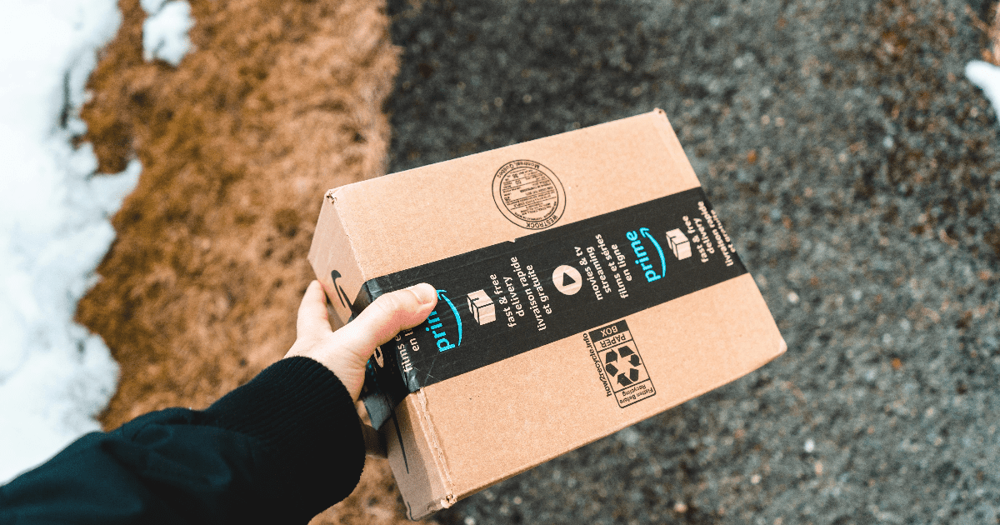

 If you’re still running on Amazon’s old MWS system, you’re on borrowed time. The <b> Amazon API upgrade </b> to the new Selling Partner API (SP-API) isn’t just a technical update—it’s your lifeline as an Amazon seller. Amazon is shutting down MWS for good, and every seller who depends on automated tools, inventory syncing, or performance data needs to move now. Delay it, and you risk error messages, broken listings, or even a full account suspension. In this article, you’ll learn why the Amazon API upgrade matters, what you gain, and how to make the switch as smooth as butter. Let’s break it down.

<strong>Check out:</strong><a href="/blog/best-3pl-for-amazon-sellers/"><b>10 Best 3PL for Amazon Sellers [2025 Updated]</b></a>

{{ site.app.leads }}?utm_source=blog&utm_campaign=new-amazon-selling-partner-api


<h2>What Is the Amazon API Upgrade?
</h2>

Amazon’s legacy system, MWS (Marketplace Web Service), has been powering seller tools for over a decade. But in 2025, Amazon is officially pulling the plug. Enter SP-API—the new, secure, faster, and smarter Selling Partner API. This Amazon API upgrade isn’t just Amazon being difficult. It’s about modernizing the seller ecosystem with:

<ul>
<li>A faster RESTful structure (goodbye XML) </li>
<li>OAuth2 authentication (way more secure) </li>
<li>Region-specific endpoints for global sellers </li>
<li>Real-time access to listings, orders, pricing, and reports </li>
<li>Better throttling and performance metrics</li>
</ul>

In short: SP-API is built for what Amazon selling looks like <i>today</i>.

<b>Check Out </b><a href="/blog/how-to-sell-on-multiple-platform/"><b>How to Sell on Multiple Platforms? E-Commerce Guide to Multi-Channel Listing</b></a>

<h2>Why the Amazon API Upgrade Is Non-Negotiable
</h2>

Here’s why:

<h3>1. Avoid Account Suspension
</h3>

Yes, we’re leading with the big one. If your integrations rely on MWS and you don’t switch, those connections will break, and broken tools can trigger performance alerts or TOS violations. Amazon has already begun phasing out parts of MWS, and full deprecation is underway. If your pricing tool, ERP, or listing software stops syncing, your account could take the hit.

<h3>2. Automation That Actually Works
</h3>

The new SP-API is made for speed and scale. With the <a href="https://developer.amazonservices.com/">Amazon API upgrade,</a> you get instant syncing across:

<ul>
<li>Inventory and pricing updates </li>
<li>Order fulfillment flows </li>
<li>Multi-channel listing management </li>
<li>Financial reports and analytics</li>
</ul>

That means fewer errors, faster updates, and way less babysitting your backend.

<strong>Read more:</strong><a href="/blog/amazon-fba-vs-dropshipping/"><b>Amazon FBA vs Dropshipping: Which is Better for E-Commerce Sellers?</b></a>

<h3>3. Access to New Seller Features
</h3>

Amazon is now developing <i>only</i> on SP-API. If you’re stuck on MWS, you won’t get access to new tools like the Business Report API, Amazon Ads integrations, or the new Seller Wallet data endpoints. Want to compete in 2025 and beyond? This is how.

<h3>4. Security That Matches Today’s Risks
</h3>

SP-API uses<a href="https://auth0.com/intro-to-iam/what-is-oauth-2"> OAuth2 login</a>, role-based permissions, and token expiration to reduce unauthorized access. You can now control access to sensitive info like buyer addresses or payments more safely, especially if you use third-party tools. The Amazon API upgrade also helps you stay aligned with global data protection laws and Amazon’s privacy standards.

<h2>What’s at Risk If You Don’t Upgrade?
</h2>

<ul>
<li>Listing errors and failed uploads </li>
<li>Broken repricing and fulfillment automations </li>
<li>Delays in order syncing or refund processing </li>
<li>Losing access to financial and reporting data </li>
<li>TOS violations from deprecated calls </li>
<li>Full or partial account suspension</li>
</ul>

This isn’t fear marketing—it’s happening already. Amazon has officially ended access to many MWS features in the US, with full cutoff expected globally this year.

<b>You Might Like: </b><a href="/blog/how-to-perform-amazon-automation/"><b>How to Perform Amazon Automation? Steps and Tips to Automate E-Commerce</b></a>

<h2>6 Steps to Complete the Amazon API Upgrade
</h2>

Follow these 6 steps to complete the Amazon API Upgrade:

<h3>Step 1: Audit Your Tools
</h3>

Check what tools, scripts, or services your store depends on. Are any still using MWS calls? That’s your priority list.

<h3>Step 2: Review Amazon’s SP-API Docs
</h3>

Go to<a href="https://developer-docs.amazon.com/sp-api/"> Amazon’s SP-API documentation</a> and study the new endpoints, rate limits, scopes, and OAuth flow.

<h3>Step 3: Register Your App
</h3>

Use Seller Central > Developer Central to register or migrate your app and assign access roles for data like listings, orders, and payments.

<h3>Step 4: Set Up OAuth2 Auth Flow
</h3>

Replace static keys and signatures with OAuth2 access tokens and refresh tokens. This is mandatory for third-party apps and internal tools alike.

<h3>Step 5: Use Sandbox Testing
</h3>

Amazon provides a full sandbox environment for SP-API so you can test endpoints and logic without touching live data.

<h3>Step 6: Monitor After Launch
</h3>

Go live and monitor logs closely. Watch for expired tokens, rate throttling, or permission mismatches. Fix issues quickly to avoid disruptions.

<strong>Check out:</strong><a href="/blog/reasons-sellers-should-use-multi-channel-listing-tools/"><b>10 Game-changing Reasons Sellers Should Use Multi-Channel Listing Tools</b></a>

<h2>Benefits of Switching Early
</h2>
<li>First-mover edge: Adopt features your competitors don’t even have access to yet</li>
<li>Cleaner backend: JSON-based endpoints make for easier data handling</li>
<li>Full visibility: Real-time insights from the Reports, Orders, and Catalog APIs</li>
<li>Data security: OAuth2 and granular permissions = more protection</li>
<li>Long-term stability: Amazon’s updates, support, and innovation are all SP-API first</li>

<h2>Try SellerChamp Demo
</h2>

Don’t go it alone. SellerChamp is already SP-API ready and helps sellers automate everything from listings and pricing to inventory and orders across Amazon, eBay, Walmart, and more.

<h5>Try SellerChamp for Yourself!
</h5>

<a href="https://app.sellerchamp.com/users/sign_up?_gl=1*1ukisxs*_gcl_au*MzY0MTA0ODQyLjE3NDU1ODAyNTA.*_ga*MTc1MDE5MTE4MS4xNzM3MDY4MTgx*_ga_F2WQV1CVLC*czE3NDY1NzM1MDEkbzQ0JGcxJHQxNzQ2NTczNjM5JGo2MCRsMCRoMzc1MDYxMTU4&_ga=2.158060536.318104915.1746573501-1750191181.1737068181"><b>Request your personalized demo today </b></a>and experience smarter inventory management in action.

