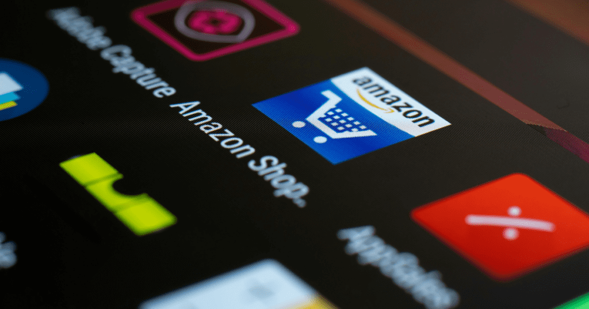

 The <b> top online marketplaces in the USA </b> are where serious sellers go to grow. In 2025, your choice of marketplace is just as important as the product you sell. You could have the best idea in the world, but if it’s sitting in the wrong place, it won’t move.<i> Customers won’t find it. Sales won’t happen.</i> That’s why this guide exists—to help you avoid that mistake. Here are the top 10-performing platforms in 2025, and what makes each one worth your time.

{{ site.app.leads }}?utm_source=blog&utm_campaign=online-marketplaces-in-usa-for-ecommerce-sellers


<h2>1. Amazon
</h2>

 Amazon is still the leader when it comes to the top online marketplaces in USA. It has over 300 million customer accounts and continues to grow. In 2024, it pulled in<a href="https://ir.aboutamazon.com/news-release/news-release-details/2024/Amazon.com-Announces-Second-Quarter-Results/default.aspx"> $148 billion</a> in just one quarter. That kind of power is why many sellers start with Amazon.

<table id="tablepress-48" class="tablepress tablepress-id-48 blogborder">
<thead>
<tr class="row-1">
<th class="column-1">Why it works</th><th class="column-2">Challenges</th>
</tr>
</thead>
<tbody>
<tr class="row-2">
<td class="column-1">A huge number of customers</td><td class="column-2">Very high competition</td>
</tr>
<tr class="row-3">
<td class="column-1">Fast and reliable shipping with Fulfilled by Amazon (FBA)</td><td class="column-2">Seller fees can cut into profit</td>
</tr>
<tr class="row-4">
<td class="column-1">Trusted brand</td><td class="column-2">Rules are strict and can be tough</td>
</tr>
</tbody>
</table>
<b>Best for:</b> Sellers who can compete on price and scale their business fast.

<strong>You Might Like: <a href="/blog/best-3pl-for-amazon-sellers/">10 Best 3PL for Amazon Sellers [2025 Updated]</a></strong>

<h2>2. Walmart Marketplace
</h2>

Walmart is no longer just a physical store. Its marketplace is one of the fastest-growing and now <a href="https://www.businessinsider.com/walmart-delivery-amazon-fast-profitable-first-time-2025-5">reaches 95% of U.S. </a>households in under three hours. In 2024, its online sales helped turn a profit for the first time. This is one of the top online marketplaces in USA that new sellers should seriously consider.

<table id="tablepress-49" class="tablepress tablepress-id-49 blogborder">
<thead>
<tr class="row-1">
<th class="column-1">Why it works</th><th class="column-2">Challenges</th>
</tr>
</thead>
<tbody>
<tr class="row-2">
<td class="column-1">Fast delivery attracts loyal buyers</td><td class="column-2">Only accepts selected sellers</td>
</tr>
<tr class="row-3">
<td class="column-1">Huge national footprint</td><td class="column-2">Smaller global reach than Amazon</td>
</tr>
<tr class="row-4">
<td class="column-1">Walmart’s brand trust helps boost new sellers</td><td class="column-2"></td>
</tr>
</tbody>
</table>
<b>Best for:</b> Sellers who want to sell to budget-conscious shoppers.

<h2>3. eBay
</h2>

 eBay remains a strong choice, especially for sellers with unique or hard-to-find items. It had <a href="https://www.yaguara.co/ebay-statistics/#:~:text=In%20December%202024%2C%20eBay%20experienced,portion%20driven%20by%20paid%20advertising.">722 million visits </a>in December 2024. It’s one of the top online marketplaces in USA for vintage, used, and collector products.

<table id="tablepress-50" class="tablepress tablepress-id-50 blogborder">
<thead>
<tr class="row-1">
<th class="column-1">Why it works</th><th class="column-2">Challenges</th>
</tr>
</thead>
<tbody>
<tr class="row-2">
<td class="column-1">Flexible listing formats (auction or buy-now)</td><td class="column-2">Lower traffic than Amazon</td>
</tr>
<tr class="row-3">
<td class="column-1">Reach beyond the U.S.</td><td class="column-2">Fees can get tricky</td>
</tr>
<tr class="row-4">
<td class="column-1">Niche buyers often search here first</td><td class="column-2"></td>
</tr>
</tbody>
</table>
<b>Best for:</b> Sellers of used, collectible, or niche goods.

<strong>Check Out: <a href="/blog/surprising-things-sell-well-ebay/">12 Surprising Things That Sell Very Well on eBay</a></strong>

<h2>4. Etsy
</h2>

Etsy is a favorite for sellers with handmade, artistic, or vintage items. In 2024, it had<a href="https://www.yaguara.co/etsy-statistics/#:~:text=Etsy%20Monthly%20Visitors:%20Etsy%20attracts,billion%20in%20revenue%20in%202024."> over 400 million visits.</a> Its users look for creativity and personal touches, not mass-market products.

<table id="tablepress-51" class="tablepress tablepress-id-51 blogborder">
<thead>
<tr class="row-1">
<th class="column-1">Why it works</th><th class="column-2">Challenges</th>
</tr>
</thead>
<tbody>
<tr class="row-2">
<td class="column-1">Highly targeted audience</td><td class="column-2">The product range is limited to certain types</td>
</tr>
<tr class="row-3">
<td class="column-1">Low seller fees</td><td class="column-2">Smaller reach compared to Amazon or Walmart</td>
</tr>
<tr class="row-4">
<td class="column-1">Strong community fees</td><td class="column-2"></td>
</tr>
</tbody>
</table>
<b>Best for:</b> Crafters, artists, and small brands with a unique product line.

<h2>5. Temu
</h2>

Temu is the new player, but it’s gaining fast. PDD Holdings backs it and offers low fees and wide reach. Many sellers are now listing here to test prices that undercut Amazon by <a href="https://www.wsj.com/business/retail/amazon-temu-suppliers-online-sellers-e3327fa1">15% to 35%.</a>

<table id="tablepress-52" class="tablepress tablepress-id-52 blogborder">
<thead>
<tr class="row-1">
<th class="column-1">Why it works</th><th class="column-2">Challenges</th>
</tr>
</thead>
<tbody>
<tr class="row-2">
<td class="column-1">Very low fees</td><td class="column-2">The platform is still evolving</td>
</tr>
<tr class="row-3">
<td class="column-1">Attracts price-sensitive buyers</td><td class="column-2">Policies may change quickly</td>
</tr>
<tr class="row-4">
<td class="column-1">Fast growth in user numbers</td><td class="column-2"></td>
</tr>
</tbody>
</table>
<b>Best for:</b> Sellers looking for a cheaper alternative with growth potential.

<strong>Read More: <a href="/blog/how-to-sell-on-temu/">How to Sell on Temu: Temu Selling Guide 2025</a></strong>

<h2>6. Target Plus
</h2>

Target Plus is invite-only, which means you can’t just sign up. But if you get in, it gives you premium exposure to Target’s trusted audience. This is one of the top online marketplaces in USA if your brand already has a strong reputation.

<table id="tablepress-53" class="tablepress tablepress-id-53 blogborder">
<thead>
<tr class="row-1">
<th class="column-1">Why it works</th><th class="column-2">Challenges</th>
</tr>
</thead>
<tbody>
<tr class="row-2">
<td class="column-1">Trusted retail brand</td><td class="column-2">Invite-only</td>
</tr>
<tr class="row-3">
<td class="column-1">Curated product list keeps quality high</td><td class="column-2">Limited space for new sellers</td>
</tr>
<tr class="row-4">
<td class="column-1">Loyal customer base</td><td class="column-2"></td>
</tr>
</tbody>
</table>
<b>Best for:</b> Established brands and premium product lines.

<h2>7. Wayfair
</h2>

Wayfair is perfect if your products belong in the home. This site focuses only on home goods and furniture. It doesn’t get as much attention as Amazon, but in its niche, it’s one of the top online marketplaces in USA.

<table id="tablepress-54" class="tablepress tablepress-id-54 blogborder">
<thead>
<tr class="row-1">
<th class="column-1">Why it works</th><th class="column-2">Challenges</th>
</tr>
</thead>
<tbody>
<tr class="row-2">
<td class="column-1">Highly targeted for home and living</td><td class="column-2">Limited to one category</td>
</tr>
<tr class="row-3">
<td class="column-1">Loyal customers</td><td class="column-2">Pricing can be competitive</td>
</tr>
<tr class="row-4">
<td class="column-1">Room for large products like furniture</td><td class="column-2"></td>
</tr>
</tbody>
</table>
<b>Best for:</b> Sellers of décor, furniture, and home improvement items.

<h2>8. Newegg
</h2>

Newegg is where tech lovers shop. It’s all about electronics, hardware, and gadgets. If that’s what you sell, this marketplace helps you reach your ideal buyer.

<table id="tablepress-55" class="tablepress tablepress-id-55 blogborder">
<thead>
<tr class="row-1">
<th class="column-1">Why it works</th><th class="column-2">Challenges</th>
</tr>
</thead>
<tbody>
<tr class="row-2">
<td class="column-1">Customers are tech-savvy</td><td class="column-2">Only works for tech and electronics</td>
</tr>
<tr class="row-3">
<td class="column-1">You can sell high-ticket items</td><td class="column-2">Very niche audience</td>
</tr>
<tr class="row-4">
<td class="column-1">Product categories are specific and detailed</td><td class="column-2"></td>
</tr>
</tbody>
</table>
<b>Best for:</b> Sellers of computers, parts, and consumer electronics.

<strong>You Might Like: <a href="/blog/how-to-sell-on-newegg/">How to Sell on Newegg: A Simple Step-by-Step Guide</a></strong>

<h2>9. Facebook Marketplace
</h2>

Facebook Marketplace lets you reach local buyers without much cost. You don’t need a website. You don’t even need a store. You just need a product and a Facebook account. It’s one of the easiest ways to test your products before committing to a big platform.

<table id="tablepress-56" class="tablepress tablepress-id-56 blogborder">
<thead>
<tr class="row-1">
<th class="column-1">Why it works</th><th class="column-2">Challenges</th>
</tr>
</thead>
<tbody>
<tr class="row-2">
<td class="column-1">No listing fees</td><td class="column-2">Limited seller protection</td>
</tr>
<tr class="row-3">
<td class="column-1">Easy to use</td><td class="column-2">Mostly local sales</td>
</tr>
<tr class="row-4">
<td class="column-1">Great for testing and fast cash sales</td><td class="column-2"></td>
</tr>
</tbody>
</table>
<b>Best for:</b> People selling to nearby customers or testing new ideas.

<h2>10. TikTok Shop
</h2>

 TikTok Shop blends video and e-commerce. It gives sellers a way to show off their product in action. In 2024, TikTok Shop in the U.S. brought in about <a href="https://www.practicalecommerce.com/charts-u-s-tiktok-shop-sales-2023-2024">$1 billion a month.</a> That makes it one of the top online marketplaces in USA for reaching younger shoppers.

<table id="tablepress-57" class="tablepress tablepress-id-57 blogborder">
<thead>
<tr class="row-1">
<th class="column-1">Why it works</th><th class="column-2">Challenges</th>
</tr>
</thead>
<tbody>
<tr class="row-2">
<td class="column-1">Videos show products in real time</td><td class="column-2">You need to make content</td>
</tr>
<tr class="row-3">
<td class="column-1">High engagement with Gen Z and Millennials</td><td class="column-2">Sales can swing up and down</td>
</tr>
<tr class="row-4">
<td class="column-1">Chance to go viral</td><td class="column-2"></td>
</tr>
</tbody>
</table>
<b>Best for:</b> Sellers who are creative and comfortable making video content.

<strong>Read More: <a href="/blog/how-to-sell-on-tiktok-shop/">How to Sell on TikTok Shop [2025 Updated Guide]</a></strong>

 The top online marketplaces in USA offer different strengths. Some give you reach. Others give you a focused audience. The key is matching your product with the right platform. Use this guide to decide where to list, how to grow, and where your customers are already shopping. If you want results in 2025, don’t just list everywhere. List where it counts.

<h2>Multi-Platform Strategy
</h2>

 Smart sellers don’t rely on just one marketplace. Here’s how to approach multi-platform selling: <b>Start Small, Scale Smart:</b>

<ol>
<li>Begin with 1-2 platforms that best match your products</li>
<li>Master each platform’s requirements before expanding</li>
<li>Use tools like SellerChamp to manage multiple listings efficiently</li>
</ol>
<b>Cross-Platform Considerations:</b>

<ul>
<li>Maintain consistent branding across platforms</li>
<li>Adjust pricing strategies for each marketplace’s audience</li>
<li>Monitor inventory carefully to avoid overselling</li>
<li>Track performance metrics to identify your most profitable channels</li>
</ul>
<b>Platform Combinations That Work:</b>

<ul>
<li><b>Amazon + Etsy:</b> General products on Amazon, unique items on Etsy</li>
<li><b>eBay + Facebook Marketplace:</b> Online reach + local sales</li>
<li><b>Walmart + TikTok Shop:</b> Value buyers + trend-conscious shoppers</li>
</ul>

<h2>Try SellerChamp today!
</h2>

Request your free demo now and take the first step toward stress-free, efficient selling on the top online marketplaces in the USA.

<h5>Try SellerChamp for Yourself!
</h5>

<a href="https://app.sellerchamp.com/users/sign_up?_gl=1*1ukisxs*_gcl_au*MzY0MTA0ODQyLjE3NDU1ODAyNTA.*_ga*MTc1MDE5MTE4MS4xNzM3MDY4MTgx*_ga_F2WQV1CVLC*czE3NDY1NzM1MDEkbzQ0JGcxJHQxNzQ2NTczNjM5JGo2MCRsMCRoMzc1MDYxMTU4&_ga=2.158060536.318104915.1746573501-1750191181.1737068181"><b>Request your personalized demo today </b></a>and experience smarter inventory management in action.

