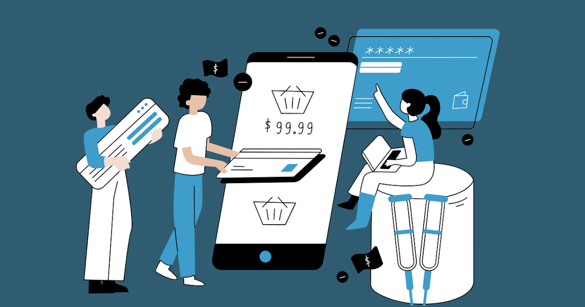

 Why do your competitors keep outselling you—even when your product is better? Simple: they’ve nailed their <b> repricing strategies. </b> Every hour your prices stay static, you’re either leaving money on the table or pushing buyers to someone else. Pricing isn’t a guessing game anymore. It’s a system. In this guide, we’re pulling back the curtain on 10 proven repricing tactics used by the big players so that you can finally stop losing the sale and start owning the cart.

<b>You Might Like: </b><a href="/blog/ecommerce-marketing-strategies/"><b>E-Commerce Marketing Strategies: How to Market Your E-Commerce Store in 2025</b></a>

{{ site.app.leads }}?utm_source=blog&utm_campaign=repricing-strategies-ecommerce-profitability


<h2>What Are Repricing Strategies in E-Commerce?
</h2>

Repricing strategies are simply ways to adjust your product prices based on market shifts, competitor actions, and consumer behavior. Whether you’re tweaking prices manually or using automated tools, these strategies help keep your products appealing to buyers while maintaining your profit margins.

<h2>4 Benefits of Smart Repricing
</h2>

Some benefits of smart repricing are:

<h3>1. Increased Buy Box Wins:
</h3>

If you’re selling on Amazon, pricing plays a massive role in winning the Buy Box—where most of the sales happen.

<h3>2. Enhanced Profit Margins:
</h3>

By adjusting your prices according to market demand and competition, you can maximize profits without sacrificing sales volume.

<h3>3. Improved Competitiveness:
</h3>

Repricing keeps you agile, ensuring your prices stay attractive compared to others in the market.

<h3>4. Real-Time Market Responsiveness:
</h3>

Automated tools allow you to adjust prices instantly based on real-time market conditions <b>Did You Know? </b><i>Global e-commerce sales reached $5.9 trillion in 2023 and are projected to exceed </i><a href="https://www.sellerscommerce.com/blog/ecommerce-statistics/"><i>$6.8 trillion in 2025.</i></a>

<strong>Read more:</strong><a href="/blog/best-ecommerce-automation-tools-for-2025/"><b>Best E-Commerce Automation Tools for 2025</b></a>

<h2>10 Repricing Strategies Used by E-Commerce Giants
</h2>

These strategies are flexible and can be mixed and matched to suit your business model and goals. The key is to monitor them constantly and adjust based on how your products and competitors behave in the market.

<h3>1. Rule-Based Repricing
</h3>

This is the simplest repricing strategy. You <i>define clear, fixed rules for price changes</i>—like undercutting a competitor’s price by 5%. It’s predictable, easy to implement, and works well for businesses that want consistent, automated adjustments without the need for constant oversight.

<h3>2. Algorithmic Repricing (AI/ML-Based)
</h3>

Artificial Intelligence and Machine Learning analyze vast amounts of data in real-time—taking into account competitors’ prices, customer demand, and even inventory levels. This automated approach is dynamic, continuously optimizing pricing decisions, allowing for faster, smarter responses to market shifts, without the guesswork.

<h3>3. Time-Based Repricing
</h3>

This strategy is all about timing. For example, if you know certain times of the day or specific days of the week <i>see more customer activity,</i> you raise prices during those peak times. The idea is to capitalize on the influx of dem

<h3>4. Demand-Based Repricing
</h3>

When demand for a product spikes, it’s time to increase prices. Conversely, when sales slow down, cutting prices can help move the product. This dynamic strategy reacts to shifts in consumer interest, allowing you to maximize profits during high-demand periods and clear inventory when things are quiet.

<h3>5. Inventory-Based Repricing
</h3>
<i>Low stock? Increase prices. High stock? Offer discounts to drive sales</i>. This strategy ensures that you’re pricing in a way that reflects your current inventory levels, minimizing the risk of running out of stock too soon while also avoiding the need to discount excessively if you have an overstock.

<h3>6. Competitor-Based Repricing
</h3>

This strategy involves monitoring and reacting to your competitors’ pricing tactics. You can <b>adjust your prices to stay competitive</b>, ensuring you aren’t priced out of the market. However, you’ll need to maintain a balance—undercutting too much can damage your margins, while ignoring your competitors can cost you sales.

<h3>7. Location-Based Repricing
</h3>

Price based on geographic location. For example, prices might be higher in urban areas with higher purchasing power or demand, while prices in rural areas might need to be lower to be competitive. This approach takes into account regional variations in income, customer preferences, and local market conditions.

<h3>8. Value-Based Repricing
</h3>

This pricing strategy centers around the perceived value of a product. If your product is seen as premium, unique, or superior, you can <b> set a higher price point</b>. Customers are often willing to pay more for products they perceive as having extra value, whether it’s quality, brand reputation, or rarity.

<h3>9. Velocity-Based Repricing
</h3>

Sales velocity is the key to this strategy. Products that are flying off the shelves should see <b>prices raised to maximize profits, </b> while products that aren’t selling as fast can be discounted to boost their attractiveness. It helps keep your stock turning and maximizes profit from products at different stages of the sales cycle.

<h3>10. Event-Based Repricing
</h3>

Special events like holidays, seasonal sales, or promotional events are great opportunities to adjust prices. Whether it’s <i>raising prices during high-demand times or offering discounts to drive sales during slower periods</i>, event-based repricing takes advantage of external factors to drive sales and improve profitability. <b>Did You Know</b><i>? Online sellers who automate their pricing on Amazon can see a </i><a href="https://www.xsellco.com/resources/impact-automating-pricing-amazon-sales-report/"><i>145% increase in weekly sales</i></a><i> over 30 weeks.</i>

<strong>Check out:</strong><a href="/blog/best-wholesale-ecommerce-platforms/"><b>15 Best Wholesale E-Commerce Platforms in 2025</b></a>

<h2>Common Mistakes to Avoid When Repricing
</h2>

You must avoid these mistakes:

<ul><li><b>Over-Reliance on Automation:</b> While automation saves time, don’t forget to review and tweak strategies regularly to avoid costly pricing mistakes.  </li><li><b>Ignoring Competitor Movements:</b> Keeping tabs on competitor prices is crucial. If you’re not aware of their actions, you might miss opportunities.  </li><li><b>Neglecting Profit Margins:</b> It’s tempting to undercut competitors, but aggressive pricing can eat into your profits if you’re not careful.</li>
</ul>

<h2>Repricing Strategy vs. Discounting: What’s the Difference?
</h2>

Repricing is a smart, ongoing adjustment based on data, aiming for long-term profitability. Discounting, on the other hand, is typically a short-term tactic used to clear stock or attract quick sales. Understanding the difference helps you build a strategy that balances both.

<strong>Read more:</strong><a href="/blog/how-to-manage-ecommerce-inventory/"><b>How to Manage E-Commerce Inventory: 8 Tried and Tested Methods + Tools</b></a>

<h2>Request a SellerChamp Demo
</h2>

<h5>Try SellerChamp for Yourself!
</h5>

Schedule a demo now to see how our repricing tools can help you stay competitive, increase sales, and grow your e-commerce business.

