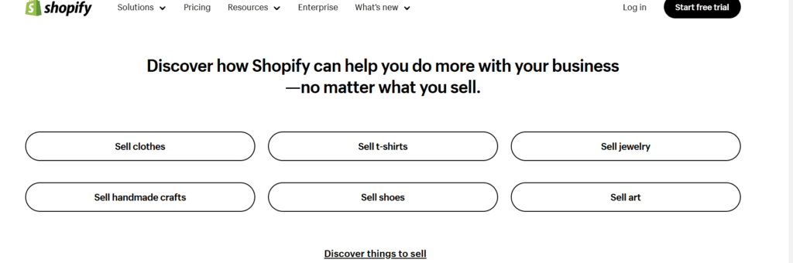
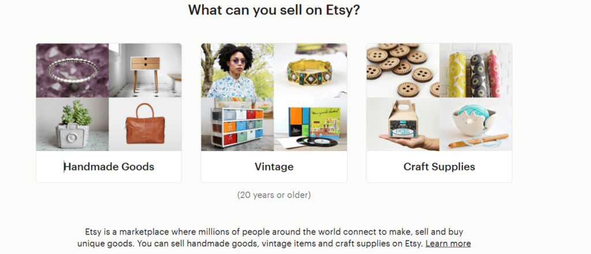
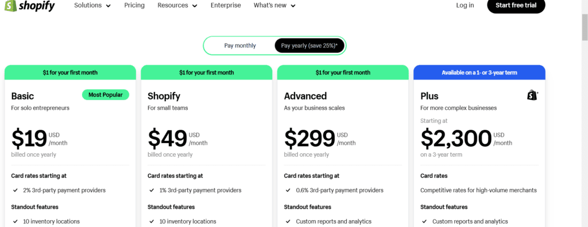
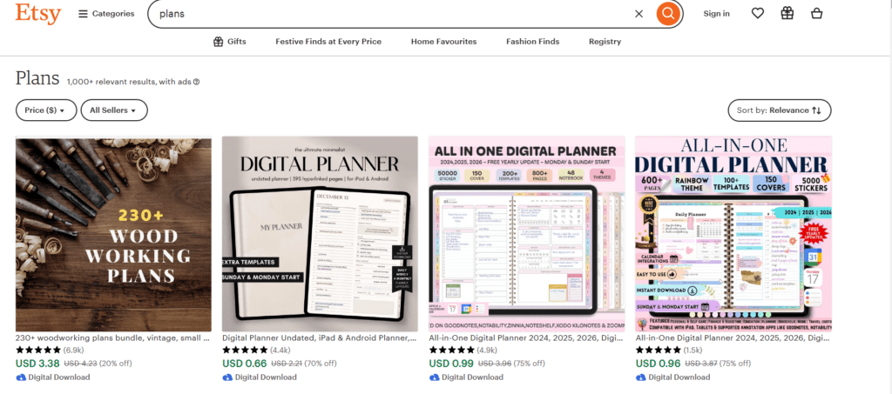

The <b>Shopify vs Etsy</b> decision is among the most pressing ones for entrepreneurs looking to establish or grow their e-commerce business. Both these platforms have a large audience and will help you scale your business quickly and increase profits. Entrepreneurs can create fully operational stores on these e-commerce platforms within a short period of time. This guide provides a thorough comparison of the two marketplaces, highlighting their unique features to help you make an informed decision.

 <b><i>Do you know:</i></b> By 2029, global e-commerce revenue is projected to reach a staggering <a href="https://www.statista.com/forecasts/1223973/e-commerce-revenue-worldwide-by-segment">6.49 trillion US dollars</a>?

<h2>Main Differences Between Shopify and Etsy
</h2>

There are some major differences between the two platforms. Here is a table showing a comparison between Shopify and Etsy

<table id="tablepress-12" class="tablepress tablepress-id-12">
<thead>
<tr class="row-1">
<th class="column-1">Feature</th><th class="column-2">Shopify</th><th class="column-3">Etsy</th>
</tr>
</thead>
<tbody>
<tr class="row-2">
<td class="column-1">Type of store</td><td class="column-2">Independent store</td><td class="column-3">Shared with others on the marketplace</td>
</tr>
<tr class="row-3">
<td class="column-1">Owned by</td><td class="column-2">Entrepreneur</td><td class="column-3">Etsy’s marketplace</td>
</tr>
<tr class="row-4">
<td class="column-1">Customization</td><td class="column-2">High with many themes and options possible</td><td class="column-3">Limited to Etsy’s predefined themes</td>
</tr>
<tr class="row-5">
<td class="column-1">Fee structure</td><td class="column-2">Subscription, transaction fees</td><td class="column-3">Multiple fees applicable</td>
</tr>
<tr class="row-6">
<td class="column-1">Product categories</td><td class="column-2">Vast</td><td class="column-3">Niche products</td>
</tr>
<tr class="row-7">
<td class="column-1">Reach</td><td class="column-2">Need to build an audience</td><td class="column-3">Etsy’s pre-existing audience</td>
</tr>
<tr class="row-8">
<td class="column-1">Branding Control</td><td class="column-2">Full control over branding, from domain name to checkout experience.</td><td class="column-3">Restricted due to Etsy’s marketplace framework</td>
</tr>
<tr class="row-9">
<td class="column-1">Suited to</td><td class="column-2">Established brands with full control over their business</td><td class="column-3">Beginners and niche brands mostly small scale</td>
</tr>
<tr class="row-10">
<td class="column-1">Support available</td><td class="column-2">24/7 customer support available</td><td class="column-3">Community-based support</td>
</tr>
</tbody>
</table>

This table gives a broader picture of the shopify vs Etsy comparison. <b><i>Do you know: </i></b> By the end of 2023, the US had <a href="https://www.statista.com/statistics/1401597/shopify-online-stores-by-country/">1 million Shopify online stores</a>

<h5>Try SellerChamp for Yourself!
</h5>

Schedule a demo today and discover how our Bulk Lister can help you list more products, increase sales, and grow your e-commerce business faster than ever.

<h2>Shopify vs Etsy Pricing Breakdown
</h2>

To get a better picture of how pricing works on both platforms, let us take a look at the table below showing a detailed breakdown of Shopify vs Etsy pricing. Before you make a final choice you can enjoy a 3-day free trial on Shopify and a 30-day free trial on Etsy.

<table id="tablepress-13" class="tablepress tablepress-id-13">
<thead>
<tr class="row-1">
<th class="column-1">Category</th><th class="column-2">Shopify</th><th class="column-3">Etsy</th>
</tr>
</thead>
<tbody>
<tr class="row-2">
<td class="column-1">Subscription Fees Billed Yearly</td><td class="column-2">Basic Shopify: $19/month 
 Shopify: $49/month 
 Advanced: $299/month  Plus: $2,300/month 
 
</td><td class="column-3">One-time shop setup fee 
 Etsy Plus costs $10/month for additional tools.</td>
</tr>
<tr class="row-3">
<td class="column-1">Listing Fees</td><td class="column-2">None</td><td class="column-3">$0.20 per product listing</td>
</tr>
<tr class="row-4">
<td class="column-1">Transaction Fees</td><td class="column-2">Varies depending on the plan chosen, payment method and region</td><td class="column-3">6.5% transaction fee on the product’s sale price.</td>
</tr>
<tr class="row-5">
<td class="column-1">Payment Processing Fees</td><td class="column-2">Varies by region if using Shopify Payments.</td><td class="column-3">The payment processing fee depends on the seller’s location.</td>
</tr>
</tbody>
</table>
<b>Main Cost Considerations</b>:

<ol>
<li><b>Shopify</b> has higher upfront costs due to subscription fees but offers greater scalability and independence. Costs can increase based on additional apps and customizations.</li>
<li><b>Etsy</b> has a pay-as-you-go model, which is attractive for smaller-scale sellers but can add up with listing and transaction fees over time.</li>
</ol>

The right platform depends on your sales volume, business model, and long-term goals.

<strong>Read more:</strong><a href="/blog/e-commerce-cost-optimization/"><b>10 Ways to Effectively Implement E-Commerce Cost Optimization</b></a>

<h2>Shopify vs Etsy Ease of Use
</h2>

When it comes to ease of use, Shopify vs Etsy is an easy comparison. Shopify is a user-friendly platform and has powerful tools that give entrepreneurs the power to fully customize their stores and manage inventory on their own. This makes Shopify ideal for businesses that want to be independent and scalable. The marketplace even provides a straightforward setup process which makes setting off on the business journey pretty simple. Beginners, however, may require a bit of a learning curve due to the extensive features available on Shopify. On the other hand, Etsy is simpler and faster to set up. It is perfect for small businesses or sellers looking to make use of an existing marketplace. The platform is especially suited for selling handmade, vintage, or unique products and comes with built-in traffic from Etsy’s large user base. This is why it is considered a good option for sellers who prefer less complex tasks. However, the trade-off is that sellers have less control over the appearance and functionality of their shops compared to Shopify. So in short, Shopify is more suitable for entrepreneurs who value independence and want a personalized online store but are willing to invest time in learning and setup. Etsy, in contrast, excels in simplicity, making it ideal for smaller sellers or hobbyists looking to start selling immediately without any technical expertise. The choice depends on how much control and scalability you need versus how quickly you want to get started.

<strong>Read more:</strong><strong><a href="/blog/how-to-attract-online-customers/">How To Attract Online Customers? 13 Tried and Tested Tips</a></strong>
<b><i>Do you know:</i></b> The revenue generated by Etsy in <a href="https://www.statista.com/statistics/409371/etsy-annual-revenue/">2023 was 2.7 billion US dollars.</a>

<h2>Pros and Cons: Shopify vs Etsy
</h2>

Let us look at the pros and cons on the whole of both platforms.

<table id="tablepress-14" class="tablepress tablepress-id-14">
<thead>
<tr class="row-1">
<th class="column-1"></th><th class="column-2">Shopify</th><th class="column-3">Etsy</th>
</tr>
</thead>
<tbody>
<tr class="row-2">
<td class="column-1"><strong>Pros</strong></td><td class="column-2">Offers a wide range of themes and plugins for personalized stores.</td><td class="column-3">Provides access to a built-in audience of millions of active buyers.</td>
</tr>
<tr class="row-3">
<td class="column-1"></td><td class="column-2">Ideal for growing businesses with advanced inventory and multi-channel integration.</td><td class="column-3">Simple setup process, perfect for beginners.</td>
</tr>
<tr class="row-4">
<td class="column-1"></td><td class="column-2">Includes robust tools like SEO optimization, email marketing, and app integrations.</td><td class="column-3">No subscription fee; charges are based on listings and transactions.</td>
</tr>
<tr class="row-5">
<td class="column-1"></td><td class="column-2">Supports over 100 payment options, including Shopify Payments with no additional transaction fees.</td><td class="column-3">Opportunities to engage with a community of artisans and small businesses.</td>
</tr>
<tr class="row-6">
<td class="column-1"></td><td class="column-2">Offers in-depth reporting for customer insights and sales tracking.</td><td class="column-3">Provides marketing tools like Promoted Listings to boost visibility.</td>
</tr>
<tr class="row-7">
<td class="column-1"></td><td class="column-2">Reliable 24/7 customer service via chat, email, and phone.</td><td class="column-3"></td>
</tr>
<tr class="row-8">
<td class="column-1"><strong>Cons</strong></td><td class="column-2">Higher upfront subscription fees and potential costs for premium apps and themes.</td><td class="column-3">Limited customization options are restricted to Etsy’s design templates.</td>
</tr>
<tr class="row-9">
<td class="column-1"></td><td class="column-2">Requires external marketing efforts to attract visitors.</td><td class="column-3">Charges listing, transaction, and payment processing fees that add up.</td>
</tr>
<tr class="row-10">
<td class="column-1"></td><td class="column-2">More complex setup process compared to other platforms.</td><td class="column-3">High competition among sellers within the same niche.</td>
</tr>
<tr class="row-11">
<td class="column-1"></td><td class="column-2">Fees for third-party payment gateways if not using Shopify Payments.</td><td class="column-3">Limited tools for scaling your business beyond the marketplace.</td>
</tr>
<tr class="row-12">
<td class="column-1"></td><td class="column-2"></td><td class="column-3">Lack of full control over your store, as Etsy owns the platform.</td>
</tr>
</tbody>
</table>

<h2>Who Should Use Shopify vs Etsy?
</h2>

You will be better able to answer this question after looking at this comparison table for Shopify vs Etsy:

<table id="tablepress-15" class="tablepress tablepress-id-15">
<thead>
<tr class="row-1">
<th class="column-1">Criteria</th><th class="column-2">Shopify</th><th class="column-3">Etsy</th>
</tr>
</thead>
<tbody>
<tr class="row-2">
<td class="column-1"><strong>Business Type</strong></td><td class="column-2">Ideal for building a standalone brand with full control over a custom store.</td><td class="column-3">Best for small-scale sellers focusing on handmade or vintage products.</td>
</tr>
<tr class="row-3">
<td class="column-1"><strong>Scalability</strong></td><td class="column-2">Highly scalable with advanced tools for growing businesses.</td><td class="column-3">Limited scalability due to platform restrictions and reliance on the Etsy marketplace.</td>
</tr>
<tr class="row-4">
<td class="column-1"><strong>Ease of Setup</strong></td><td class="column-2">Requires technical know-how but offers flexibility in design and apps.</td><td class="column-3">Simple setup with pre-existing marketplace visibility.</td>
</tr>
<tr class="row-5">
<td class="column-1"><strong>Audience Reach</strong></td><td class="column-2">Requires marketing efforts to drive traffic to the site.</td><td class="column-3">Access to Etsy’s built-in audience of buyers.</td>
</tr>
<tr class="row-6">
<td class="column-1"><strong>Cost Efficiency</strong></td><td class="column-2">Higher initial costs with hosting, themes, and apps.</td><td class="column-3">Lower upfront cost; commission-based fees per sale.</td>
</tr>
<tr class="row-7">
<td class="column-1"><strong>Product Range</strong></td><td class="column-2">Suitable for any product type, including dropshipping.</td><td class="column-3">Best for handmade, vintage, and craft supplies.</td>
</tr>
</tbody>
</table>

Therefore, it can be summarized that Shopify is better suited for entrepreneurs looking for scalability, control, and branding opportunities. Whereas, Etsy is ideal for artisans and small-scale sellers who prefer a plug-and-play solution with built-in traffic.

<h2>Wrapping Up
</h2>

The Shopify vs Etsy debate ultimately comes down to your business needs and how much you are aiming to grow. Whichever platform you choose, the key to success lies in streamlining your processes, managing inventory effectively, and optimizing your listings. To maximize your ecommerce profitability on both channels, SellerChamp can be absolutely invaluable through its multi-channel selling, bulk listing, automated repricing and inventory management solutions.

{{ site.app.leads }}?utm_source=blog&utm_campaign=shopify-vs-etsy-comparison

