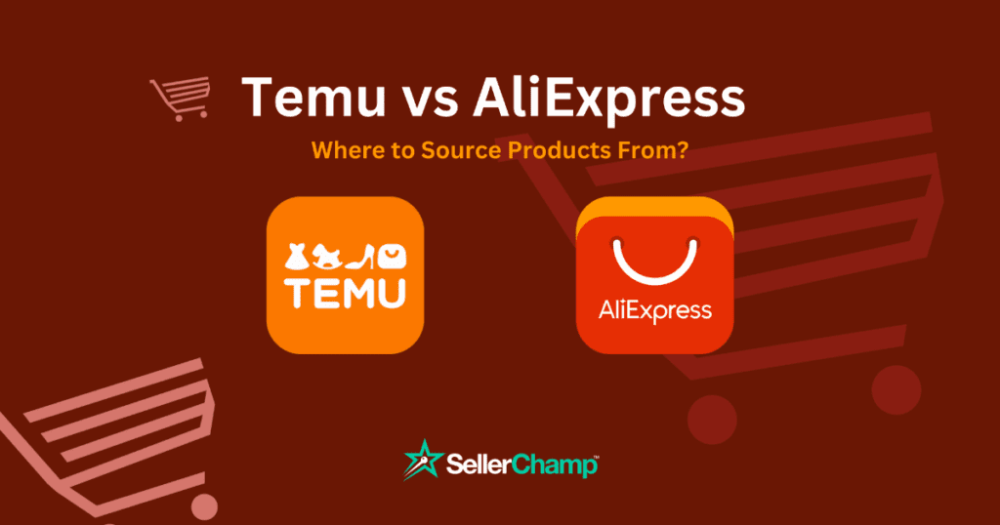
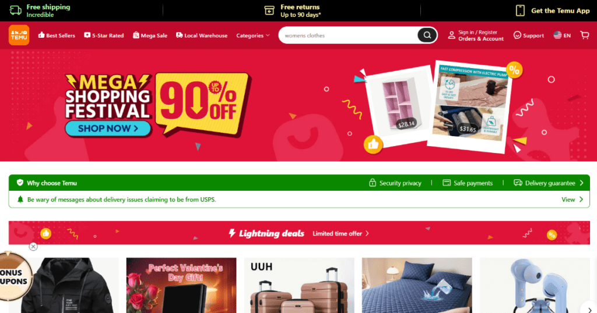
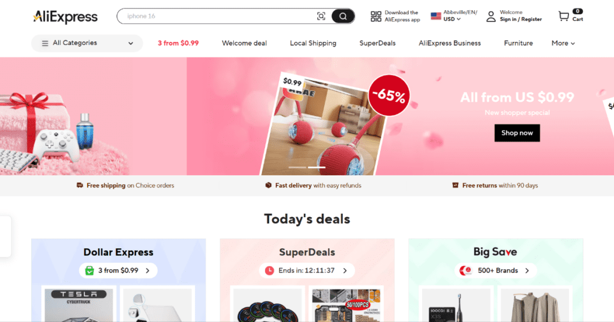

 Sourcing low-cost products from China has long been the <b> go-to strategy for e-commerce </b> businesses. With Temu’s recent rise in popularity, new entrepreneurs are torn between <b>Temu vs AliExpress</b> when it comes to finding good suppliers. While both offer affordable prices and diverse product selections, each platform caters to different buyer preferences and goals. This article breaks down the key <b>features and differences</b> of Temu and AliExpress to help you choose the best fit for your business.

<strong>You might also like:</strong><a href="/blog/where-to-buy-products-to-sell-online/"><b> Product Sourcing Guide: Where to Buy Products to Sell Online? </b></a>

{{ site.app.leads }}?utm_source=blog&utm_campaign=temu-vs-aliexpress


Want to make your flipping business easier? <a style="color: #ffffff;" href="https://app.sellerchamp.com/users/sign_up?_gl=1*1hmqx6y*_gcl_au*MjAyMjAzNDgwNi4xNzM3MDY4MTgx*_ga*MTc1MDE5MTE4MS4xNzM3MDY4MTgx*_ga_F2WQV1CVLC*MTczNzU2Mjg2Ni45LjAuMTczNzU2Mjg2Ni42MC4wLjExMzExNTUzNjg.&_ga=2.38173483.921892867.1737562867-1750191181.1737068181"><b>Request a demo of SellerChamp</b>
</a>and see how it can help you list faster, manage inventory, and increase sales!

<h2>Understanding Temu
</h2>

 Temu, launched in 2022 in the US, is a fast-growing online marketplace that sells <b>highly affordable products. </b> These products are sold across a wide range of categories and cater to global customers. Despite a fairly recent launch, Temu’s <b>wide range of trendy</b> and low-cost items is contributing to its rapid growth. While Temu primarily sells directly to customers, today businesses are increasingly utilizing it for their product sourcing needs.

<h2>Understanding AliExpress
</h2>

 AliExpress, <b> founded in 2010</b> by the Alibaba Group, is a leading Chinese e-commerce marketplace used <b> globally for product sourcing. </b> It is known for its <b> vast selection of products</b>, affordable prices, <b>global shipping options</b>, and a variety of sellers.

<b>Check Out</b><a href="/blog/shopify-vs-etsy-comparison/"><b>: Shopify vs Etsy: Which One is More Suitable Today?</b></a>

<h2>Temu vs AliExpress: Comparing Pricing
</h2>

Before you can start selling, you need inventory. Here are the best places to find products to flip:

<h3>➜ Temu
</h3>

As Temu is a new launch focused on gaining traction, its product costs are very low. This is why for <b>dropshippers and retail arbitrage sellers</b>, Temu is the perfect marketplace for product sourcing.

<ul>
<li>Temu offers <b>lower prices</b> than most major retailers.</li>
<li>Flash sales and frequent discounts make it easy to find <b>hot items with massive profit </b> potential.</li>
<li>Temu offers a convenient <a href="https://www.temu.com/support/c3/what-is-temus-price-adjustment--f-60-s-945.html">price adjustment service</a> if prices are reduced <b>within 30 days</b> of payment.</li>
<li>Temu’s <b>ultra-low pricing strategy</b> lets you source trending products for a fraction of the cost compared to other sources.</li>
</ul>

<h3>➜ AliExpress
</h3>

AliExpress offers <b>flexibility in pricing</b>, and has been in the market for 12 more years than Temu. Overall, AliExpress has larger control in the market and over prices. However,

<ul>
<li>On AliExpress, almost all sellers provide <b>volume discounts</b>. This makes it ideal for bulk buyers or those looking to <b>negotiate deals</b> directly.</li>
<li>There are regular <b>seasonal sales</b> (like 11.11 or Black Friday) which provide opportunities to stock up on inventory.</li>
</ul>

<strong>You might also like:</strong><a href="/blog/sellbrite-vs-sellerchamp/"><b>Sellbrite vs SellerChamp: Comparison </b></a>

<h2>Temu vs AliExpress: Comparing Product Selection
</h2>

Before you can start selling, you need inventory. Here are the best places to find products to flip:

<h3>➜ Temu
</h3>

Temu focuses on small, trending products that <b>sell fast</b>. Their curated catalog is smaller than AliExpress but cuts through the noise. Additionally, as Temu sells directly to customers, it can help to easily identify <b>high-demand items</b>.

<h3>➜ AliExpress
</h3>

AliExpress is like a <b>massive digital bazaar</b> with products in every category imaginable. Whether you’re sourcing niche electronics or fashion products, AliExpress will have it. Their supplier network is <b>well-established</b>, and many sellers offer <b>customization options</b> which are perfect for branding your own products.

<h2>Temu vs AliExpress: Comparing Shipping and Logistics
</h2>

Before you can start selling, you need inventory. Here are the best places to find products to flip:

<h3>➜ Temu
</h3>

Temu has revolutionized shipping with <b>faster delivery times</b> (5-14 days on average). Additionally, Temu also provides consistent <b>tracking updates</b> to its customers. For sellers, this means,

<ul>
<li><b>Fewer customer complaints</b> about long wait times.</li>
<li>Convenient and simple cost management due to <b>free shipping</b> policies.</li>
</ul>

<h3>➜ AliExpress
</h3>

Shipping times on AliExpress <b>vary widely</b> depending on the seller, the buyer’s location, and the chosen method.

<ul>
<li>Standard shipping time is 15-45 days whereas <b>AliExpress Premium</b> offers 7-15 day shipping.</li>
<li>For <a href="/blog/amazon-fba-vs-dropshipping/">dropshippers</a>, this unpredictability may lead to dissatisfied customers unless managed carefully. It is better to explicitly state the longest expected shipping time to the customer.</li>
</ul>

<strong>Check out:</strong><a href="/blog/how-to-sell-on-ebay-and-amazon/"><b> How to Sell on eBay and Amazon in 2024 </b></a>

<h2>Temu vs AliExpress: Comparing Ease of Use
</h2>

Before you can start selling, you need inventory. Here are the best places to find products to flip:

<h3>➜ Temu
</h3>

Temu’s sleek interface and <b>intuitive design</b> make it easy for sellers to find products, track orders, and manage inventory. Its <b>mobile app</b> stands out even more and offers a seamless experience on the go as well as regular discounts.

<h3>➜ AliExpress
</h3>

AliExpress features <b>advanced filters</b>, supplier <b>communication tools</b>, and detailed product reviews. If you’re looking for detailed insights on your product, this can be a great tool. However, AliExpress’s interface is loaded with visual stimuli which can be <b>overwhelming for beginners</b>. For AliExpress, you need to be patient and understand the platform well before moving on and <b> reaching out to suppliers.</b>

<h2>Temu vs AliExpress: Comparing Payment Options and Buyer Protection
</h2>

Before you can start selling, you need inventory. Here are the best places to find products to flip:

<h3>➜ Temu
</h3>

<ul>
<li>Temu supports a range of <b>payment methods</b>, including all major credit/debit cards, Apple Pay, and Google Pay.</li>
<li>Temu is <b>beginner-friendly</b> and provides reliable buyer<a href="https://www.temu.com/ee-en/temu-purchase-protection.html?rps=10032&r_pid=601099518384302"> purchase protection</a>, which ensures fewer disputes.</li>
<li>You can <b>return your product</b> for free if it’s damaged or doesn’t meet the description within 90 days of the purchase date.</li>
<li>A full refund is offered on products eligible for the <b>Temu Purchase Protection Program</b>.</li>
</ul>

<h3>➜ AliExpress
</h3>

<ul><li>AliExpress covers a wide range of <b>global payment methods,</b> including, but not limited to, AliPay, credit/debit cards, PayPal, and even cash on delivery in some regions. </li><li><a href="https://sale.aliexpress.com/__pc/BhQPgEWPNM.htm?spm=2114.11010108.1000001.2.650c649bwhzxQv">Buyer protection on AliExpress</a> is robust, with two types of support guaranteed.

<ul><li>The basic buyer protection program covers a <b>refund guarantee</b> in case the product isn’t delivered or doesn’t match the description. It also includes a separate <b>on-time guarantee</b> over shipping times.</li><li>The advanced buyer protection program includes a <b>2-year warranty</b> on products. This is limited to certain countries.</li>
</ul></li>
</ul>

<strong>You might also like:</strong><a href="/blog/e-commerce-vs-dropshipping/"><b>E-Commerce vs Dropshipping: Differences, Similarities, and Tips </b></a>

<h2>✅ 8 Profitability Tips for Sellers
</h2>

 ✅ List products sourced from <b>both Temu and AliExpress</b> on <a href="/blog/sell-on-multiple-marketplaces/">multiple platforms</a> like Amazon, eBay, and Shopify to expand your reach. ✅ Use<a href="/blog/automated-inventory-management/"> inventory management tools </a>like SellerCloud to <b>prevent stockouts</b> and streamline order processing. This will ensure that even if you face roadblocks during product sourcing or shipping, there is time to address issues. ✅ Temu’s curated products can help you easily <b>test products</b> and stay on top of trending items, while AliExpress is more <b>well-established and stable</b>. ✅ Utilize Temu’s fast shipping to <b>stand out</b> in a crowded market. However, if you decide on working with AliExpress, discuss shipping times and faster options with your supplier. ✅ Set up <a href="/blog/how-to-perform-amazon-automation/">automation </a>for efficient and fast <a href="/blog/order-processing-definition-key-steps/">order processing.</a> ✅ Work with Temu suppliers and utilize <b>Temu’s zero-flash sales</b> to offer free or discounted products to your customers. ✅ No matter where you source from, conduct <b>thorough research</b> on the product and suppliers. Find the most cost-effective yet quality-optimized one for higher profits. ✅ <b>Negotiate</b> shipping rates on AliExpress for high-volume orders.

<strong>Read more:</strong><a href="/blog/ecommerce-growth-hacks/"><b>33 Proven eCommerce Growth Hacks for Long-Term Success</b></a>

<h2>Temu vs AliExpress: Choosing the Right Platform
</h2>

 There is no better or worse platform when it comes to <b>Temu vs AliExpress;</b> choosing the right one for your business demands understanding your business approach and needs first.

<ul>
<li>If you’re a beginner and primarily work with low-cost products, <b>Temu</b> can be a great option with its convenient interface, active customer support, and discounts.</li>
</ul>

<b>Choose Temu if you</b>:

<ul>
<li>

<ul>
<li>Value fast shipping and straightforward logistics.</li>
<li>Want to test and sell trending products with low inventory overhead.</li>
</ul>
</li>
</ul>

<ul>
<li>On the other hand, for well-established businesses, <b>AliExpress</b> with its longer standing in the industry and extensive features for business facilitation can be an excellent option.</li>
</ul>

<b>Choose AliExpress If You</b>:

<ul>
<li>

<ul>
<li>Need access to a vast catalog of products, including niche or customizable items.</li>
<li>Are an experienced seller who can negotiate bulk deals.</li>
<li>Sell internationally and need global payment solutions.</li>
</ul>
</li>
</ul>

As you grow your business, you will gradually build direct and good <b>relationships with your suppliers</b>. In this way, you can work with suppliers comfortably for your product sourcing needs.

<strong>You might also like:</strong><a href="/blog/how-to-attract-online-customers/"><b>How To Attract Online Customers? 13 Tried and Tested Tips</b></a>

<h2>Quick Overview: Temu vs AliExpress Table
</h2>

<table id="tablepress-30" class="tablepress tablepress-id-30 blogborder">
<thead>
<tr class="row-1">
<th class="column-1">Feature</th><th class="column-2">Temu</th><th class="column-3">AliExpress</th>
</tr>
</thead>
<tbody>
<tr class="row-2">
<td class="column-1">Pricing</td><td class="column-2">Ultra-low, curated discounts</td><td class="column-3">Flexible, bulk deals</td>
</tr>
<tr class="row-3">
<td class="column-1">Product Range</td><td class="column-2">Trending items</td><td class="column-3">Vast and diverse</td>
</tr>
<tr class="row-4">
<td class="column-1">Industry Experience</td><td class="column-2">3 years</td><td class="column-3">15 years</td>
</tr>
<tr class="row-5">
<td class="column-1">Shipping Speed</td><td class="column-2">5-10 days, premium options available</td><td class="column-3">Varies; premium options available</td>
</tr>
<tr class="row-6">
<td class="column-1">Ease of Use</td><td class="column-2">Beginner-friendly</td><td class="column-3">Advanced tools for pros</td>
</tr>
<tr class="row-7">
<td class="column-1">Payment Options</td><td class="column-2">Most global solutions are available.</td><td class="column-3">Supports more payment gateways than Temu.</td>
</tr>
<tr class="row-8">
<td class="column-1">Buyer Protection</td><td class="column-2">Fast resolutions</td><td class="column-3">Robust but slower</td>
</tr>
<tr class="row-9">
<td class="column-1">Customization</td><td class="column-2">Limited</td><td class="column-3">Available for many products</td>
</tr>
</tbody>
</table>

<h2>Ready to grow your online business? <b>
</b><a href="/solutions/"><b>Check out SellerChamp’s solutions to maximize your e-commerce profitability.</b></a>
</h2>

<h5>Try SellerChamp for Yourself!
</h5>

<a style="color: #ffffff;" href="https://app.sellerchamp.com/users/sign_up?_gl=1*1hmqx6y*_gcl_au*MjAyMjAzNDgwNi4xNzM3MDY4MTgx*_ga*MTc1MDE5MTE4MS4xNzM3MDY4MTgx*_ga_F2WQV1CVLC*MTczNzU2Mjg2Ni45LjAuMTczNzU2Mjg2Ni42MC4wLjExMzExNTUzNjg.&_ga=2.38173483.921892867.1737562867-1750191181.1737068181"><b>Request a demo of SellerChamp</b>
</a>and see how it can help you list faster, manage inventory, and increase sales!

