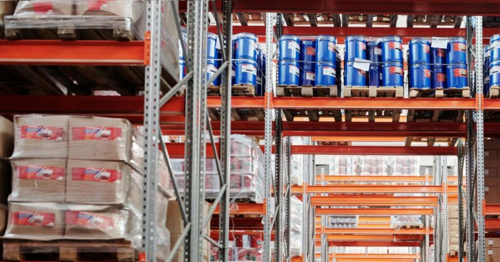

 <b>Finding the right trending products for dropshipping in 2025 can make or break your success.</b> But here’s the truth—most people waste time selling outdated, oversaturated items. The real winners? Products that tap into demand, solve problems and ride emerging trends. I’ve done the research—here are the <i>top 35 dropshipping products</i> you need to know!

<strong>Check out:</strong><a href="/blog/e-commerce-vs-dropshipping/"><b>E-Commerce vs Dropshipping: Differences, Similarities, and Tips</b></a>

{{ site.app.leads }}?utm_source=blog&utm_campaign=trending-products-for-dropshipping


<h2>What is Dropshipping?
</h2>

Dropshipping is a game-changing business model where you<i> sell products without ever touching inventory</i>. Your supplier handles the stock and ships directly to your customers, while you earn a profit. Simple, right?

<h3>How to Spot a Winning Dropshipping Product
</h3>

Not all trending products for dropshipping will make you money. Look for items with <b> high demand, low competition, </b> and strong profit margins. Tools like Google Trends and SellerChamp can help you identify what’s hot.

<h3>Where to Source Trending Dropshipping Products
</h3>

Finding the right suppliers is just as important as picking the right products. Consider platforms like <b>AliExpress, CJ Dropshipping, and Spocket</b> for reliable sourcing. Look for fast shipping options to keep customers happy.

<h3>Best Marketing Strategies for Dropshipping Success
</h3>

Even the best products won’t sell without the right marketing. Leverage <b>TikTok trends, influencer collaborations</b>, <b>Facebook Ads, and Instagram ads </b> to drive traffic. Focus on creating engaging content that makes your product irresistible.

<h3>Common Mistakes to Avoid in Dropshipping
</h3>

Don’t fall for the <b> “set and forget”</b> trap. Test different products, optimize pricing, and focus on customer service. Success comes from constant learning and adapting!

<strong>Read more:</strong><a href="/blog/ecommerce-growth-strategy/"><b>5 E-Commerce Growth Strategies from 100K+ Revenue Stories</b></a>

<h2>35 Trending Products for Dropshipping
</h2>

Following are the top 35 products that are in most demand and trending in the online market.

<h3>➜ Eco-Friendly and Sustainable Products
</h3>

With growing concerns about climate change and plastic waste, consumers are actively seeking sustainable alternatives. These trending products for dropshipping appeal to<a href="https://www.diversitech-global.com/post/environmentally-conscious-consumers-and-products"><b> environmentally conscious buyers</b></a> who prefer reusable, biodegradable, and ethically sourced items.

<ol>
<li><b>Reusable Bags and Water Bottles</b> – Durable, stylish, and environmentally friendly alternatives to single-use plastics are gaining massive traction.</li>
<li><b>Bamboo Toothbrushes and Cutlery</b> – Biodegradable and naturally antimicrobial, bamboo toothbrushes and utensils offer a sustainable lifestyle shift.</li>
<li><b>Biodegradable Cleaning Solutions</b> – Chemical-free and plant-based cleaning products ensure a safer home and healthier environment.</li>
<li><b>Solar-Powered Gadgets</b> – Solar-powered chargers, garden lights, and fans provide cost-effective energy-saving solutions.</li>
</ol>

<h3>➜ Health and Wellness Products
</h3>

As self-care and healthy lifestyles continue to dominate consumer trends, wellness products are experiencing a major boom in demand.

<ol start="5">
<li><b>Home Gym Equipment</b> – Resistance bands, adjustable dumbbells, and yoga mats support at-home fitness routines.</li>
<li><b>Supplements and Vitamins</b> – High-quality, <a href="https://www.qfc.com/health/info/commonly-asked-questions-about-organic-supplements">organic supplements</a> and wellness boosters cater to health-conscious consumers.</li>
<li><b>Aromatherapy Products</b> – Essential oils, humidifiers, and calming diffusers promote relaxation and stress relief.</li>
<li><b>Fitness Trackers</b> – Smartwatches and wearable tech help users track their health, steps, and sleep patterns.</li>
</ol>

<h3>➜ Smart Home Devices
</h3>

The smart home market is expanding as people seek convenience, automation, and enhanced security in their homes.

<ol start=9>
<li><b>Smart Bulbs and Lighting Systems</b> – Energy-efficient LED bulbs controlled via voice assistants enhance home automation.</li>
<li><b>Smart Thermostats</b> – Intelligent heating and cooling systems adjust automatically, saving energy and money.</li>
<li><b>Security Cameras and Doorbells</b> – Wi-Fi-enabled security devices allow homeowners to monitor their property remotely.</li>
<li><b>Smart Kitchen Appliances</b> – AI-powered coffee makers, air fryers, and cooking assistants simplify meal prep.</li>
</ol>

<strong>Check out:</strong><a href="/blog/where-to-buy-products-to-sell-online/"><b>Product Sourcing Guide: Where to Buy Products to Sell Online?</b></a>

<h3>➜ Pet Products
</h3>

The pet industry is thriving as pet owners invest in premium trending products for dropshipping to improve their furry friends’ lives.

<ol start=13>
<li><b>Smart Pet Collars and Trackers</b> – GPS-enabled collars ensure pet safety by providing real-time tracking.</li>
<li><b>Organic and Natural Pet Food</b> – Healthier, chemical-free options are gaining popularity among pet owners.</li>
<li><b>Interactive Pet Toys</b> – AI-powered toys and treat dispensers keep pets entertained when owners are away.</li>
<li><b>Grooming Accessories</b> – Automatic pet brushes, nail grinders, and de-shedding tools cater to pet grooming needs.</li>
</ol>

<h3>➜ Personalized Gifts and Custom Products
</h3>

Consumers love unique, customized trending products for dropshipping that add a special touch to gift-giving and home décor.

<ol start=17>
<li><b>Engraved Jewelry</b> – Name-engraved necklaces, bracelets, and rings make sentimental and stylish gifts.</li>
<li><b>Personalized Home Décor</b> – Customizable wall art, LED signs, and printed cushions add a personal touch.</li>
<li><b>Monogrammed Accessories</b> – Personalized tote bags, wallets, and phone cases remain trendy for both men and women.</li>
<li><b>Custom Pet Products</b> – Personalized pet collars, bowls, and clothing resonate with pet lovers.</li>
</ol>

<h3>➜ Outdoor Adventure Gear
</h3>

The rise in outdoor activities and adventure travel is driving demand for high-quality and practical outdoor gear.

<ol start=21>
<li><b>Portable Camping Stoves and Tents</b> – Compact, lightweight, and easy-to-set-up camping essentials are in high demand.</li>
<li><b>Hiking Shoes and Apparel</b> – Durable, waterproof hiking boots and breathable outdoor clothing offer comfort and protection.</li>
<li><b>Survival Kits and Tools</b> – Emergency preparedness kits, fire starters, and multi-tools are crucial for outdoor enthusiasts.</li>
<li><b>Travel Accessories</b> – Smart luggage, packing cubes, and portable water filters make traveling hassle-free.</li>
</ol>
<i>You Might Like: </i><a href="/blog/ecommerce-growth-hacks/"><b><i>33 Proven eCommerce Growth Hacks for Long-Term Success</i></b></a>

<h3>➜ DIY and Craft Supplies
</h3>

With the rise of handmade and customized trending products for dropshipping, crafting supplies are becoming a hot niche for hobbyists and small business owners.

<ol start=25>
<li><b>Jewelry-Making Kits</b> – Beads, wires, and DIY jewelry sets allow users to create their own accessories.</li>
<li><b>Crafting Tools</b> – Precision scissors, glue guns, and sewing kits cater to craft lovers.</li>
<li><b>Scrapbooking Materials</b> – Decorative stickers, patterned paper, and stamps enhance creative scrapbooks.</li>
<li><b>Art Supplies</b> – Watercolor sets, sketchbooks, and acrylic paints cater to beginner and professional artists alike.</li>
</ol>

<h3>➜ Beauty and Skincare Products
</h3>

Consumers continue to prioritize beauty, skincare, and self-care, making this an evergreen niche for trending products for dropshipping.

<ol start=29>
<li><b>Organic Skincare Products</b> – Chemical-free serums, facial oils, and cleansers appeal to health-conscious buyers.</li>
<li><b>Beauty Tools</b> – Jade rollers, LED therapy masks, and microcurrent devices enhance skincare routines.</li>
<li><b>Hair Care and Styling Tools</b> – Cordless hair straighteners, automatic curlers, and scalp massagers are best-sellers.</li>
<li><b>Vegan and Cruelty-Free Cosmetics</b> – Ethical beauty products, including foundation, lipstick, and mascara, attract eco-conscious shoppers.</li>
</ol>

<h3>➜ Tech Accessories
</h3>

As technology advances, so does the demand for innovative and functional accessories that enhance user experience.

<ol start=33>
<li><b>Wireless Chargers and Power Banks</b> – Fast-charging and high-capacity devices ensure seamless connectivity on the go.</li>
<li><b>Phone Cases and Screen Protectors</b> – Stylish, durable, and shockproof designs cater to a wide audience.</li>
<li><b>Bluetooth Headphones and Earbuds</b> – Noise-canceling, waterproof, and wireless options are continuously evolving.</li>
</ol>

<strong>Read more:</strong><a href="/blog/how-to-sell-on-multiple-platforms/"><b>How to Sell on Multiple Platforms and Streamline E-Commerce</b></a>

<h2>Request a SellerChamp Demo!
</h2>

Finding the right trending products for dropshipping is only half the battle—efficient inventory management is key.

<h5>Try SellerChamp for Yourself!
</h5>

<a style="color: #ffffff;" href="https://app.sellerchamp.com/users/sign_up?_gl=1*1hzispa*_gcl_au*MjAyMjAzNDgwNi4xNzM3MDY4MTgx*_ga*MTc1MDE5MTE4MS4xNzM3MDY4MTgx*_ga_F2WQV1CVLC*MTczNzQyMTQ5Ni42LjAuMTczNzQyMTQ5Ni42MC4wLjYyNDY3OTM3MA..&_ga=2.42355173.1742341021.1737421497-1750191181.1737068181"><b>Request SellerChamp’s demo today</b></a> and automate your dropshipping business for faster scaling and higher profits!

