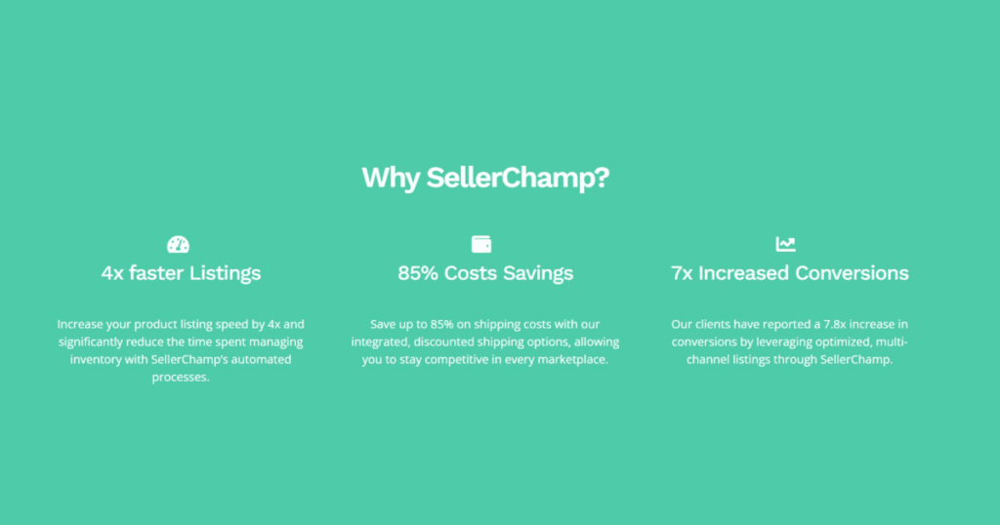



 In this guide, we will compare <strong>Sellbrite vs SellerChamp</strong>, two of the best multi-channel fulfillment solutions available today. With multiple management tools on the market, finding the right one for your business can be tough. Keep reading to learn in-depth about their features, integrations, and much more.

<strong>You might also like:</strong><a href="/blog/sellerchamp-vs-sellercloud/"><b>SellerChamp vs. SellerCloud: Multi-Channel E-Commerce Software Comparison </b></a>

<h5>Try SellerChamp for Yourself!
</h5>

Schedule a demo today and discover how our Bulk Lister can help you list more products, increase sales, and grow your e-commerce business faster than ever.

<h2>Core functionality and working
</h2>

<h3>1. Features
</h3>

<table style="height: 42px; width: 100%; border-collapse: collapse; border-color: #cccccc; border-style: solid;" border="1" cellpadding="10"><thead><tr style="height: 24px;"><th style="width: 47.4264%; height: 18px; background-color: #d9edf7;"><b>Sellbrite</b></th><th style="width: 52.5736%; height: 18px; background-color: #d9edf7;"><b>SellerChamp</b></th></tr></thead><tbody><tr style="height: 24px;"><td style="width: 47.4264%; height: 24px; vertical-align: top;">

<ul><li><b>Features Offered</b>: 3</li>
</ul>

Sellbrite is designed for e-commerce businesses struggling primarily with <b>product and order management</b>. It offers three services. These are,

<ol><li>List Products</li><li>Sync Inventory</li><li>Ship Orders</li>
</ol></td><td style="width: 52.5736%; height: 24px; border-color: #000000;">

<ul><li><b>Features Offered</b>: 6</li>
</ul>

SellerChamp is an all-rounder tool with 6 different features to help e-commerce businesses and real arbitrage sellers excel and grow. With SellerChamp’s <a href="/features/">features</a>, you can tackle, head-on, most of the <b>major business problems</b> of today.

SellerChamp’s features include,

<ol><li>Bulk Lister</li><li>Inventory Sync</li><li>Multi-channel Fulfilment</li><li>RePricer</li><li>Insights and Reports</li><li>API & FTP Feeds </li>
</ol></td></tr></tbody>
</table>

<strong>You might also like:</strong><a href="/blog/how-to-bulk-list-on-ebay/"><b>How to Bulk List on eBay? Tips, Tricks & Solutions</b></a>

<h3>2. Product Listing & Management
</h3>

<table style="height: 42px; width: 100%; border-collapse: collapse; border-color: #cccccc; border-style: solid;" border="1" cellpadding="10"><thead><tr style="height: 24px;"><th style="width: 47.4264%; height: 18px; background-color: #d9edf7;"><b>Sellbrite</b></th><th style="width: 52.5736%; height: 18px; background-color: #d9edf7;"><b>SellerChamp</b></th></tr></thead><tbody><tr style="height: 24px;"><td style="width: 47.4264%; height: 24px; vertical-align: top;">

<ul><li><b>Number of uploads</b>: Up to 100 at a time</li><li><b>Ease of Use</b>: 4/5</li><li><b>Multi-channel Support: </b> 3/5</li>
</ul>

Sellbrite offers product listing tools that allow you to bulk list products on your store page hassle-free. Everything is linked to one <b>central page</b>, and all changes once made are translated to each product automatically.

However, you have to upload listings for each channel separately.

</td><td style="width: 52.5736%; height: 24px; border-color: #000000; vertical-align: top;">

<ul><li><b>Number of uploads:</b> 1000+ at once</li><li><b>Ease of Use</b>: 4.5/5</li><li><b>Multi-channel Support: </b> 4.5/5</li>
</ul>

As SellerChamp offers fast <a href="/bulk-lister-seller-champ/">bulk listing </a>services<a href="/bulk-lister-seller-champ/">,</a> it also considers your ease and lets you upload <b>listings for all channels simultaneously,</b> while also automating their prices.

With <a href="/repricer/">SellerChamp’s RePricer</a>, you can ensure that your products are always online at <b>market-competitive rates</b>. These services make product listing and management much easier compared to the usually extensive processes.

</td></tr></tbody>
</table>

<strong>You might also like:</strong><a href="/blog/how-to-bulk-list-on-ebay/"><b>How to Bulk List on eBay? Tips, Tricks & Solutions</b></a>

<h3>3. Order Management
</h3>

<table style="height: 42px; width: 100%; border-collapse: collapse; border-color: #cccccc; border-style: solid;" border="1" cellpadding="10"><thead><tr style="height: 24px;"><th style="width: 47.4264%; height: 18px; background-color: #d9edf7;"><b>Sellbrite</b></th><th style="width: 52.5736%; height: 18px; background-color: #d9edf7;"><b>SellerChamp</b></th></tr></thead><tbody><tr style="height: 24px;"><td style="width: 47.4264%; height: 24px; vertical-align: top;">

<ul><li><b>Order Management Score</b>: 3.75/5</li>
</ul>

When it comes to order management, you have to make sure that <b>processing and delivery </b> are just as efficient as order taking. Sellbrite focuses on these aspects to improve your business.

You can use Sellbrite’s Inventory Sync and Shipping to improve your <a href="/blog/order-processing-definition-key-steps/">order management.</a>

</td><td style="width: 52.5736%; height: 24px; border-color: #000000; vertical-align: top;">

<ul><li><b>Order Management Score</b>: 4.25/5</li>
</ul>

With SellerChamp, you can do much more than just having an updated and well-stocked inventory.

<ul><li>SellerChamp offers a reliable way to <b>sell consistently on multiple platforms</b> via <a href="/inventory-sync-software/">Inventory Sync </a>and<a href="/multi-channel-fulfillment-software/"> Multi-channel Fulfilment. </a></li><li>SellerChamp is designed with the <b>functionality of all major platforms</b>. Thus, whether you sell on eBay, Amazon, Etsy, or all of them simultaneously, SellerChamp will integrate efficiently into your business processes. Discover <b>more </b><a href="/integrations/"><b>platforms</b> SellerChamp works with here</a>.</li><li>Get <b>regular updates</b> about your sales, inventory, and profits tracking.</li>
</ul>

</td></tr></tbody>
</table>

<strong>You might also like:</strong><a href="/blog/order-processing-definition-key-steps/"><b> Order Processing Definition + Key Steps </b></a>

<h3>4. Inventory Management
</h3>

<table style="height: 42px; width: 100%; border-collapse: collapse; border-color: #cccccc; border-style: solid;" border="1" cellpadding="10"><thead><tr style="height: 24px;"><th style="width: 47.4264%; height: 18px; background-color: #d9edf7;"><b>Sellbrite</b></th><th style="width: 52.5736%; height: 18px; background-color: #d9edf7;"><b>SellerChamp</b></th></tr></thead><tbody><tr style="height: 24px;"><td style="width: 47.4264%; height: 24px; vertical-align: top;">

<ul><li><b>Centralized Management: </b> 4/5</li><li><b>Reliability: </b> 4.5/5</li><li><b>Multi-channel Support: </b> 3.75/5</li><li><b>Scalability: </b> 3.75/5. Suitable for small and medium-sized businesses.</li>
</ul>

Sellbrite offers a simple solution to<a href="/blog/automated-inventory-management/"> inventory management</a> problems with its easy-to-use, centralized approach. You can use inventory sync features to <b> view and manage </b> your entire stock no matter how many warehouses you have.

With regular and consistent updates, you won’t ever run out of stock. Sellbrite is specialized for <a href="/solutions/amazon-fba-seller/"><b>FBA sellers</b></a><b> and inventory management</b> and maintains updates between you, Amazon, and itself.

</td><td style="width: 52.5736%; height: 24px; border-color: #000000; vertical-align: top;">

<ul><li><b>Centralized Management: </b> 4/5</li><li><b>Reliability: </b> 4/5</li><li><b>Multi-channel Support: </b> 4.5/5</li><li><b>Scalability: </b> 4.5/5. Suitable for SMBs (small and medium-sized businesses) and large enterprises.</li>
</ul>

SellerChamp’s inventory management tools are designed to work with <b>multiple platforms, warehouses, and products</b>. When it comes to inventory management, some of the features that SellerChamp offers include,

<ol><li><b>Real-time inventory updates</b> for lower business risk</li><li>Seamless integration with <a href="/blog/what-is-multi-channel-fulfillment-and-how-does-it-work/">multiple channels </a>for <b>easy cross-listing.</b></li><li><b>Auto-import</b> of all items across all channels every 24 hours.</li><li>Extensive <a href="/blog/ebay-templates-with-sellerchamp-how-to-add-and-modify/"><b>customization</b> features </a>for products and syncing rules</li><li>Support for product <b>variations</b>.</li><li><b>Bundle listing</b></li>
</ol>

With SellerChamp, you don’t have to worry about overselling and can easily spend time on building more and better opportunities.

</td></tr></tbody>
</table>

<strong>Read more:</strong><a href="/blog/what-is-cycle-counting-in-inventory-management/"><b>What is Cycle Counting in Inventory Management? </b></a>

<iframe width="214" height="286" src="https://www.youtube.com/embed/YZ5d8IOyp3k" title="1. SellerChamp Overview" frameborder="0" allow="accelerometer; autoplay; clipboard-write; encrypted-media; gyroscope; picture-in-picture; web-share" referrerpolicy="strict-origin-when-cross-origin" allowfullscreen></iframe>

<h3>5. Shipping
</h3>

<table style="height: 42px; width: 100%; border-collapse: collapse; border-color: #cccccc; border-style: solid;" border="1" cellpadding="10"><thead><tr style="height: 24px;"><th style="width: 47.4264%; height: 18px; background-color: #d9edf7;"><b>Sellbrite</b></th><th style="width: 52.5736%; height: 18px; background-color: #d9edf7;"><b>SellerChamp</b></th></tr></thead><tbody><tr style="height: 24px;"><td style="width: 47.4264%; height: 24px; vertical-align: top;">

<ul><li><b>Shipping integrations</b>: 4.5/5</li><li><b>Ease of Use</b>: 4/5</li>
</ul>

Sellbrite maintains a very <b>centralized approach</b> to shipping orders. No matter which platform your order is from, once it’s shipped out, the user is updated automatically.

Furthermore, Sellbrite lets you save time and money by,

<ul><li>Offering direct printing for shipping labels.</li><li>Giving amazing <b>USPS discounts </b> for cost-effective shipping.</li><li>Integration with 4 different shipping services</li>
</ul></td><td style="width: 52.5736%; height: 24px; border-color: #000000; vertical-align: top;">

<ul><li><b>Shipping integrations</b>: 4/5</li><li><b>Ease of Use: </b> 4/5</li>
</ul>

SellerChamp integrates with <a href="https://www.shipstation.com/"><b>ShipStation </b></a><b>and </b><a href="https://shiprush.com/"><b>ShipRush</b>
</a>which work with all major carriers including <b>UPS, USPS, DHL, and FedEx</b> for exceptional delivery services to your customers. These help streamline your order processing and shipping by,

<ol><li><b>Automating</b> redundant shipping tasks.</li><li><b>Easy importing</b> and <b>updates</b> to all channels.</li><li>Cheaper shipping with <b>up to 85% off in discounts</b></li>
</ol>

</td></tr></tbody>
</table>

<strong>You might also like:</strong><a href="/blog/e-commerce-cost-optimization/"><b> 10 Ways to Effectively Implement E-Commerce Cost Optimization</b></a>

<h3>6. Reporting & Analytics
</h3>

<table style="height: 42px; width: 100%; border-collapse: collapse; border-color: #cccccc; border-style: solid;" border="1" cellpadding="10"><thead><tr style="height: 24px;"><th style="width: 47.4264%; height: 18px; background-color: #d9edf7;"><b>Sellbrite</b></th><th style="width: 52.5736%; height: 18px; background-color: #d9edf7;"><b>SellerChamp</b></th></tr></thead><tbody><tr style="height: 24px;"><td style="width: 47.4264%; height: 24px; vertical-align: top;">

<ul><li><b>Reporting depth: </b> 3.5/5</li><li><b>Real-time updates: </b> 4.5/5</li><li><b>Multi-channel Reporting: </b> 3.5/5</li>
</ul>

As you’re working on inventory sync, product listings, and shipping out orders, Sellbrite starts to collect and organize data from all your channels. The data is reported with details for each sale, for parameters such as <b>order volume, channel flow, and sales,</b> in a specific time period.

These reports can help you make better decisions when it comes to inventory planning and order management.

Sellbrite is better for businesses that want <b>simple reports of essential metrics</b> without going into too much detail.

</td><td style="width: 52.5736%; height: 24px; border-color: #000000; vertical-align: top;">

<ul><li><b>Reporting depth: </b> 4.5/5</li><li><b>Real-time updates: </b> 4.25/5</li><li><b>Multi-channel Reporting: </b> 4.5/5</li>
</ul>

SellerChamp’s Insights and Reports are some of the best features that sell the software. SellerChamp is ideal for businesses that prioritize <b>in-depth reporting with detailed data and real-time updates</b>.

Here’s a non-exhaustive list of what’s covered in SellerChamp’s reports:

<ol><li><b>Intelligent reports</b> on sales and order data</li><li>Comprehensive product and performance <b>tracking</b></li><li><b>Real-time inventory </b> updates for specific as well as all marketplaces</li><li>Monthly and quarterly <b>reports with comparison</b> information</li><li><b>Operational efficiency</b> parameters</li><li>Marketplace-level <b>breakdown</b> of sales and profits</li>
</ol>

Learn more about <a href="http://kb.sellerchamp.com/en/articles/3596122-inventory-reports">inventory reports here.</a>

</td></tr></tbody>
</table>

<iframe width="214" height="286" src="https://www.youtube.com/embed/hVZgRbIl1cA" title="How to Streamline E Commerce Operations - Part 1" frameborder="0" allow="accelerometer; autoplay; clipboard-write; encrypted-media; gyroscope; picture-in-picture; web-share" referrerpolicy="strict-origin-when-cross-origin" allowfullscreen></iframe>

<h3>7. Integrations
</h3>

<table style="height: 42px; width: 100%; border-collapse: collapse; border-color: #cccccc; border-style: solid;" border="1" cellpadding="10"><thead><tr style="height: 24px;"><th style="width: 47.4264%; height: 18px; background-color: #d9edf7;"><b>Sellbrite</b></th><th style="width: 52.5736%; height: 18px; background-color: #d9edf7;"><b>SellerChamp</b></th></tr></thead><tbody><tr style="height: 24px;"><td style="width: 47.4264%; height: 24px; vertical-align: top;">

<ul><li><b>Marketplaces (7)</b></li>
</ul>

Amazon, eBay, Etsy, Walmart, Google, sears, newegg.com

<ul><li><b>Shopping (4)</b></li>
</ul>

Shopify, ShopifyPlus, BigCommerce, WooCommerce

<ul><li><b>Service Integrations (10)</b></li>
</ul>

USPS, ShipStation, Amazon Fulfillment, ShipEngine, Flexport, SKUVault, EasyShip, SalesPad Cloud, Inventory Source, Algopix

</td><td style="width: 52.5736%; height: 24px; border-color: #000000; vertical-align: top;">

<ul><li><b>Marketplaces (7)</b></li>
</ul>

Amazon, eBay, Etsy, Walmart, Google, Bonanza, ValoreBooks

<ul><li><b>Shopping (3)</b></li>
</ul>

Shopify, BigCommerce, WooCommerce

<ul><li><b>Shipping Integrations (2)</b></li>
</ul>

ShipStation, ShipRush

<ul><li><b>Fulfillment Integrations (5)</b></li>
</ul>

Amazon Fulfillment, Flexport, Capital Tire, Tire Warehouse, ATD

<ul><li><b>Service Integrations (3)</b></li>
</ul>

Informed.co, Tyre Power, API & Data Feed

</td></tr></tbody>
</table>

<strong>Check out:</strong><a href="/blog/selling-on-amazon-vs-ebay-what-will-get-you-to-6-figures-faster/"><b>Selling on Amazon vs eBay: What Will Get You to 6 Figures Faster </b></a>

<h3>8. Ease of Use and Customer Support
</h3>

<table style="height: 42px; width: 100%; border-collapse: collapse; border-color: #cccccc; border-style: solid;" border="1" cellpadding="10"><thead><tr style="height: 24px;"><th style="width: 47.4264%; height: 18px; background-color: #d9edf7;"><b>Sellbrite</b></th><th style="width: 52.5736%; height: 18px; background-color: #d9edf7;"><b>SellerChamp</b></th></tr></thead><tbody><tr style="height: 24px;"><td style="width: 47.4264%; height: 24px; vertical-align: top;">

<ul><li><b>Ease of Use</b>: 4.7/5</li><li><b>Customer Support</b>: 4.7/5</li>
</ul>

Sellbrite is an intuitive, pleasing, and modern tool with <b>easy navigation and customer support</b>. Reviewers comment positively on Sellbrite’s ease of use, however, customer service is reported to be <b>a bit slow,</b> albeit well-informed and supportive.

</td><td style="width: 52.5736%; height: 24px; border-color: #000000; vertical-align: top;">

<ul><li><b>Ease of Use</b>: 4.4/5</li><li><b>Customer Support</b>: 4.6/5</li>
</ul>

SellerChamp is an amazingly easy <a href="https://www.softwareadvice.com/ecommerce/sellerchamp-profile/">tool </a>to navigate with

<ul><li>Consistent, dedicated tech support and a <b>support button on every webpage</b>.</li>
</ul>

<b>Regular updates</b> and intuitive user interface.

</td></tr></tbody>
</table>

<h3>9. Pricing and plans
</h3>

<table style="height: 42px; width: 100%; border-collapse: collapse; border-color: #cccccc; border-style: solid;" border="1" cellpadding="10"><thead><tr style="height: 24px;"><th style="width: 47.4264%; height: 18px; background-color: #d9edf7;"><b>Sellbrite</b></th><th style="width: 52.5736%; height: 18px; background-color: #d9edf7;"><b>SellerChamp</b></th></tr></thead><tbody><tr style="height: 24px;"><td style="width: 47.4264%; height: 24px; vertical-align: top;">

Sellbrite offers two tools with four different payment options each <b>based on order volume</b>. One is Sellbrite whereas the other is Sellbrite for Shopify.

With Sellbrite, you can choose to pay either monthly or annually.

<ul><li>The basic plan is free in both cases, however, covers only 30 orders per month.</li><li>More detailed plans start from $24/month (if billed annually) to $179/month (billed monthly).</li><li>Variations in limitations on the frequency of orders covered per month, inventory and price sync, and order import with different plans.</li><li>An additional <b>$16-$19/per month </b> charge for FBA integration.</li>
</ul></td><td style="width: 52.5736%; height: 24px; border-color: #000000; vertical-align: top;">

SellerChamp’s pricing is <b> highly customized </b> to <i>your </i>business needs and growth plans<i>.</i>

As there are no rigid, pre-defined plans, you don’t have to force yourself to settle in specific groups. This means that, if your business is averaging 300 orders/month which lands it between the 100 orders/month and 500 orders/month plans, you won’t be charged for an extra 200 orders every month. Instead, you <b> pay only for the service you take.</b>

Get in touch with the team to make sure you’re not charged, even a penny, unnecessarily.

</td></tr></tbody>
</table>

<h2>Summary: Sellbrite vs. SellerChamp
</h2>

<table id="tablepress-16" class="tablepress tablepress-id-16">
<thead>
<tr class="row-1">
<th class="column-1"></th><th class="column-2">Sellbrite</th><th class="column-3">SellerChamp</th>
</tr>
</thead>
<tbody>
<tr class="row-2">
<td class="column-1">Bulk Listing</td><td class="column-2">✅ (100+ at once)</td><td class="column-3">✅ (1000+ at once)</td>
</tr>
<tr class="row-3">
<td class="column-1">Inventory Sync</td><td class="column-2">✅</td><td class="column-3">✅</td>
</tr>
<tr class="row-4">
<td class="column-1">Multi-Channel Support</td><td class="column-2">✅</td><td class="column-3">✅</td>
</tr>
<tr class="row-5">
<td class="column-1">Automatic RePricer</td><td class="column-2">❌</td><td class="column-3">✅</td>
</tr>
<tr class="row-6">
<td class="column-1">Analytics and Reports</td><td class="column-2">✅</td><td class="column-3">✅</td>
</tr>
<tr class="row-7">
<td class="column-1">API & FTP Feeds</td><td class="column-2">❌</td><td class="column-3">✅</td>
</tr>
<tr class="row-8">
<td class="column-1">Marketplace Integrations</td><td class="column-2">✅(7)</td><td class="column-3">✅(7)</td>
</tr>
<tr class="row-9">
<td class="column-1">Shopping cart Integrations</td><td class="column-2">✅(4)</td><td class="column-3">✅(3)</td>
</tr>
<tr class="row-10">
<td class="column-1">Shipping Integrations</td><td class="column-2">✅(4)</td><td class="column-3">✅(2)</td>
</tr>
<tr class="row-11">
<td class="column-1">Fulfillment Integrations</td><td class="column-2">✅(2)</td><td class="column-3">✅(5)</td>
</tr>
<tr class="row-12">
<td class="column-1">Service Integrations</td><td class="column-2">✅(2)</td><td class="column-3">✅(3)</td>
</tr>
<tr class="row-13">
<td class="column-1">Support for SMBs (Small and Medium-sized businesses)</td><td class="column-2">✅</td><td class="column-3">✅</td>
</tr>
<tr class="row-14">
<td class="column-1">Support for enterprises</td><td class="column-2">❌</td><td class="column-3">✅</td>
</tr>
<tr class="row-15">
<td class="column-1">Pricing Flexibility</td><td class="column-2">Rigid Plans</td><td class="column-3">Custom Pricing</td>
</tr>
</tbody>
</table>

{{ site.app.leads }}?utm_source=blog&utm_campaign=sellbrite-vs-sellerchamp


