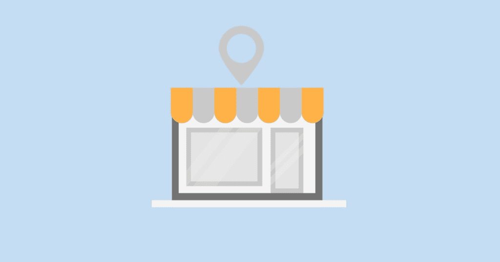
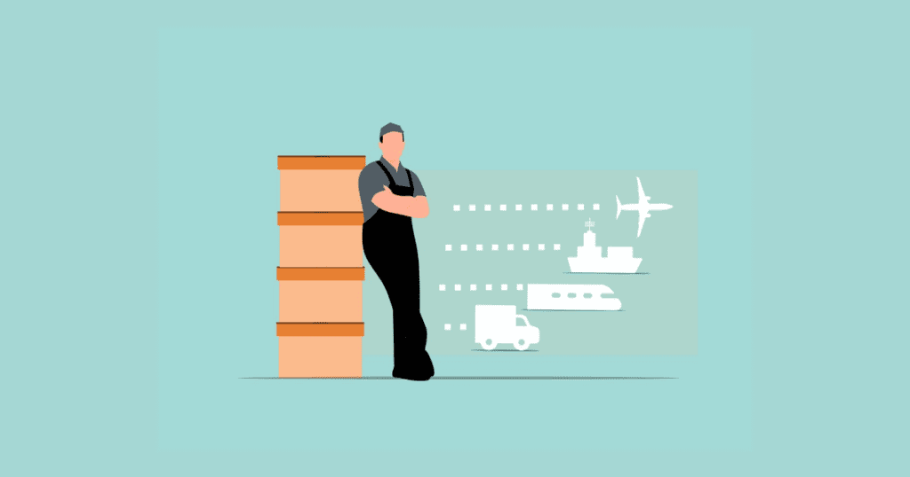

 Etsy’s <b>9 million active sellers</b> make ranking on the platform quite difficult. From implementing SEO to understanding data analytics, getting sales on Etsy is not an easy task. In this guide, we have detailed 8 strategies with specific actionable steps to help you get more sales on Etsy.

<h2>1. Rank with Etsy SEO
</h2>

No matter which platform you use, higher visibility is critical for sales. Customers can only buy from you if they see you. This is why to succeed on Etsy, you need to master its <b>search algorithm</b> via SEO. Here are some of the factors that influence Etsy SEO:

<ul>
<li>Etsy prioritizes listings based on <b>query matching </b> (tags and titles) to give buyers more relevant results.</li>
<li>It uses a <b>listing quality score</b> to rank listings based on the audience’s behavior.</li>
<li><b>Recent listings</b> are favored.</li>
<li>Listings from <b>locations</b> closer to buyers’ are preferred.</li>
</ul>
<b>Actionable Tips</b>

<ol>
<li>Use <b>keywords</b> in your shop and listings’ names, descriptions, and tags.</li>
<li>Be clear and <b>detailed</b> with titles.</li>
<li>Fill up all 13 <b>tags</b> with specific and relevant keywords.</li>
<li>Write descriptions with clear and <b>in-depth details</b> of products and their benefits. </li>
<li>Add high-quality <b>images and videos</b>.</li>
<li><b>Promote</b> your shop via guest blogging, social media, and Pinterest.</li>
</ol>
<b><i>Pro Tip:</i></b><i> Use </i><b><i>Google Keyword Planner </i></b><i>or othe</i><a href="https://www.etsy.com/market/etsy_keyword_tool"><i>r tools</i><b><i> listed by Etsy</i></b></a><i> to identify high-demand, low-competition keywords.</i>

<h5>Try SellerChamp for Yourself!
</h5>

Schedule a demo today and discover how our Bulk Lister can help you list more products, increase sales, and grow your e-commerce business faster than ever.

<h2>2. Promote with Etsy Ads
</h2>

 With over <a href="https://investors.etsy.com/overview/key-figures/default.aspx">9 million sellers</a>, paid ads can seem like a total shot in the dark. However, Etsy offers an easy way to promote; this is via <b>targeted customers</b>. For these ads, Etsy only charges you if/when a customer clicks on your listing. Additionally, there is an option to <b>define a daily budget</b> too. <b>Actionable Tips</b>

<ol>
<li><b>Start small</b> and begin with a low daily budget to see the results and identify the best ads.</li>
<li>It is recommended to use ads on your best-selling products or those with the <b>highest ROI.</b></li>
<li>Regularly <b>check ad performance</b> metrics such as click-through rates (CTR) and conversion rates. Optimize or pause underperforming campaigns.</li>
</ol>

<strong>You might also like:</strong><a href="/blog/how-to-attract-online-customers/"><b>How To Attract Online Customers? 13 Tried and Tested Tips </b></a>

<h2>3. Improve Listing Quality
</h2>

Your product’s listing details determine whether a potential customer, who has clicked on your product, will buy it or not. Everything that a listing includes such as description and images is an opportunity for you to get viewers to click the buy button and improve your Etsy sales. This is why listings need to be professional, high quality, and trustable. <b>Actionable Tips</b>

<ol>
<li>Make sure that your images and videos <b>convey the product details</b>, size, and scale well and are taken in good lighting. Cover your product from all angles.</li>
<li><b>Answer potential questions</b> that buyers may have in the description.</li>
<li>Use strong <b>visual words</b> in the title and description.</li>
<li>Highlight how your product might <b>benefit</b> the customer. </li>
<li>Include extras like free add-ons or customizations to look more attractive or <b>justify higher prices.</b></li>
</ol>

<iframe width="268" height="214" src="https://www.youtube.com/embed/YZ5d8IOyp3k?si=3zyJ5JKQenQgn7nv" title="YouTube video player" frameborder="0" allow="accelerometer; autoplay; clipboard-write; encrypted-media; gyroscope; picture-in-picture; web-share" referrerpolicy="strict-origin-when-cross-origin" allowfullscreen></iframe>
<b><i>Trick</i></b><i>: Utilize </i><a href="https://www.shopify.com/za/blog/psychological-pricing"><i>neuromarketing </i></a><i>by pricing according to the</i><b><i> $.99 effect </i></b><i>– rather than pricing your product at $25, go for $24.99.</i>

<h2>4. Offer Free Shipping
</h2>

 Over 60% shoppers say that they <a href="https://www.shopify.com/blog/free-shipping-and-conversion">won’t buy</a> from a retailer who doesn’t offer free shipping. <a href="https://www.statista.com/statistics/1471891/consumers-expecting-increase-free-delivery-relevance-online-shopping/">Free shipping</a> is expected by most consumers today, and even when it’s not, it’s still a major factor driving purchasing choices. Whether you’re a new seller or an old one, offering free shipping will get you more Etsy sales. It will also reduce your cart abandonment rates and improve your profit margins and business memorability. <b>Actionable Tips</b>

<ol>
<li><b>Reprice</b> your products and build shipping costs into the product cost. You just have to include an estimated average that covers both domestic and international shipping charges. </li>
<li>Offer free shipping on orders over a certain amount to encourage <b>larger purchases</b>.</li>
<li>Highlight free shipping in listing <b>titles and descriptions</b></li>
<li>Use Etsy’s <a href="https://help.etsy.com/hc/en-us/articles/360024198553-How-to-Offer-Free-Shipping?segment=selling"><b>Free Shipping Guarantee</b></a> tool to cater to U.S. buyers. With this, Etsy offers them free shipping for all orders above $35.</li>
</ol>

<strong>Read more:</strong><a href="/blog/common-shipping-challenges-for-sellers-and-how-to-overcome-them/"><b>Common shipping challenges for sellers and how to overcome them </b></a>

<h2>5. Benefit from Trends and Niche Markets
</h2>

Etsy is today’s most famous platform for creative, personal, and unique items. Thus, when a buyer is looking for something specific, they will likely check out Etsy first. You can utilize this consumer behavior by selling products that are in trend or cater to niche markets to get more sales on Etsy. For example, you can sell handmade products for lesser-known holidays, specific fandoms, and/or communities. <b>Actionable Tips</b>

<ol>
<li>List holiday-themed items 2-3 months in advance to <b>capture early shoppers</b>.</li>
<li>Use keyword tools to identify <b>underserved miro-niches</b> such as “biodegradable decor” or “Victorian fashion”</li>
<li><b>Refresh</b> your listings with seasonal keywords to stay relevant.</li>
<li>Offer limited-edition products during peak seasons to create urgency and <b>exclusivity</b>.</li>
</ol>

<strong>Check out:</strong><a href="/blog/ecommerce-branding-strategies/"><b>7 Proven E-Commerce Branding Strategies With Examples</b></a><b>
</b>
<b><i>Fun Fact</i></b><i>: As of current, the most </i><a href="https://blog.marmalead.com/etsy-niche-research/"><i>popular markets on Etsy</i></a><i> include weddings, handmade jewelry, candles, t-shirts, and soaps.</i>

<h2>6. Renew your listings
</h2>

While renewing too frequently is a bad idea, you should renew your listings every once in a while to give them a boost on the results page. <b>Actionable Tips</b>

<ol>
<li>Renew before major events/holidays</li>
<li>Renew listings during high-traffic hours </li>
</ol>

<strong>You might also like:</strong><a href="/blog/shopify-vs-etsy-comparison/"><b>Shopify vs Etsy: Which One is More Suitable Today? </b></a>

<h2>7. Utilize Data and Analytics
</h2>

Data-driven decisions can significantly impact your sales and profits. You can use <b>Etsy’s Shop Stats</b> and third-party tools to get valuable insights about performance. With these insights, you can improve your store, listings, and approach to managing your business. <b>Actionable Tips</b>

<ol>
<li>Select the right <b>KPIs for growth</b> based on your business plans.</li>
<li>Track conversion rates and <b>optimize</b> listings with lower rates.</li>
<li>Focus on <b>promoting</b> and restocking products that consistently perform well.</li>
<li>Experiment and conduct <b>A/B testing</b> with different photos, titles, or prices to find the best-performing variations.</li>
<li>Consider using <a href="/ecommerce-analytics-tool-insights-reports/">e-commerce analytics tools</a> for efficient data tracking and insights.</li>
</ol>

<strong>Check out:</strong><a href="/blog/what-is-multi-channel-retailing-a-beginners-guide/"><b>What is Multi Channel Retailing? A Beginner’s Guide </b></a>

<h2>8. Keep Customers Coming Back
</h2>

 Repeat customers spend about <a href="https://www.business.com/articles/returning-customers-spend-67-more-than-new-customers-keep-your-customers-coming-back-with-a-recurring-revenue-sales-model/">67% more </a>than new customers, and it is common knowledge that retaining current customers is easier than finding new ones. These customers not only bring you repeated sales but also leave <b>positive reviews and boost credibility.</b> Etsy’s <a href="https://www.contimod.com/etsy-statistics/">40.1% customer retention rate</a> is a positive sign, signifying a trend of repeat buying. Thus, to capitalize on it, you just have to sell good products and be efficient with order processing and customer service to <b> build customer loyalty.</b>
<b>Actionable Tips</b>

<ol>
<li>Reply to customer chats promptly. Etsy recommends <b>replying within 24 hours</b>, however, the faster you do it the better it as customers have to wait less.</li>
<li>Use automation tools for <a href="/blog/order-processing-definition-key-steps/">fast order processing</a> and higher customer satisfaction.</li>
<li>Personalized products stand out and foster an <b>emotional connection</b> with buyers.</li>
<li>Add in a free sample, a small gift, or a discount code for <b>another purchase</b> with orders.</li>
<li>Politely request reviews after purchase and <b>thank customers</b> who leave them.</li>
</ol>

<h2>Use SellerChamp to Get More Views on eBay
</h2>

SellerChamp is the fastest growing e-commerce automation platform this year, and has helped over 1,000 stores get more views on their listings.

{{ site.app.leads }}?utm_source=blog&utm_campaign=how-to-get-sales-on-etsy


 <a href="https://app.sellerchamp.com/leads/new"><b>Book your demo now to see how SellerChamp can help your business!</b></a>
