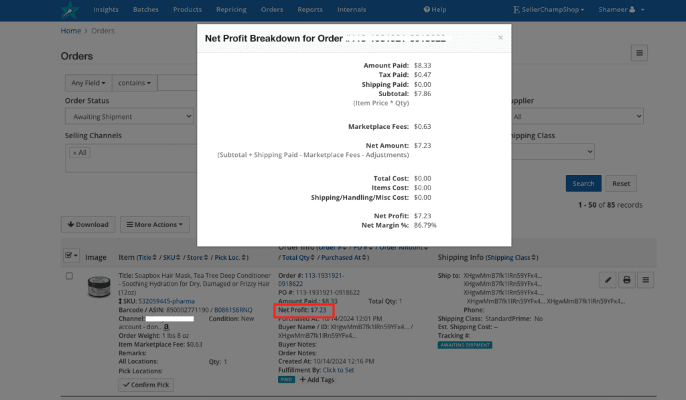
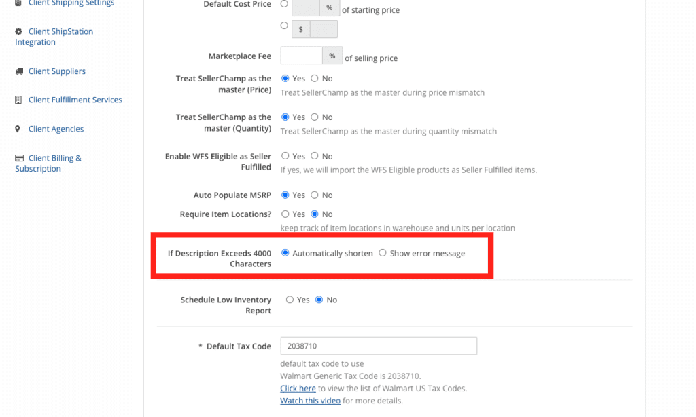
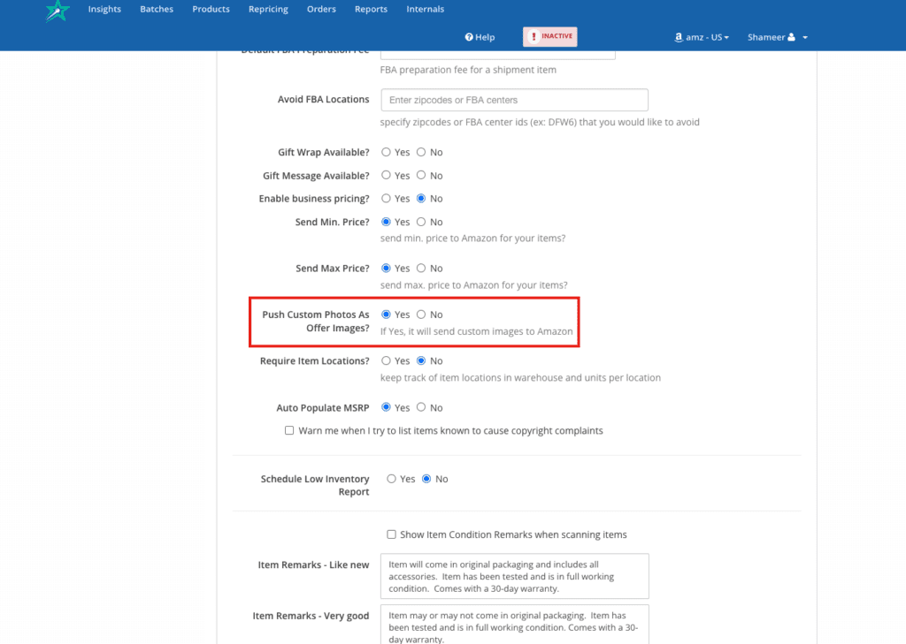
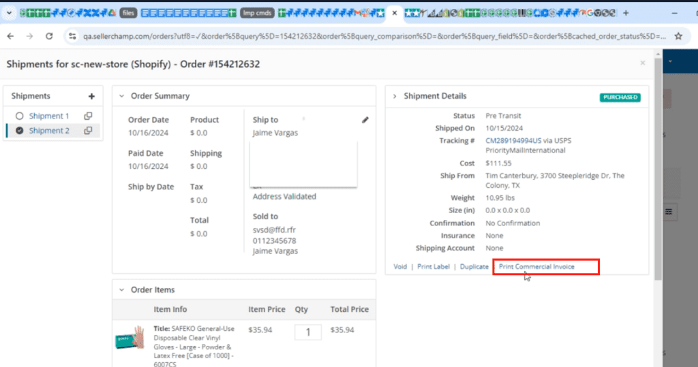
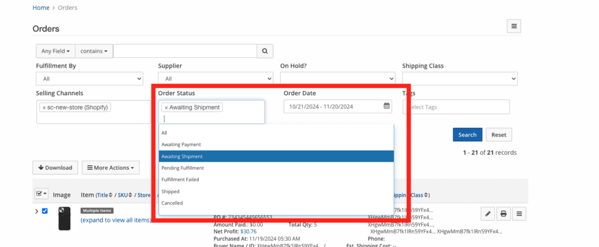
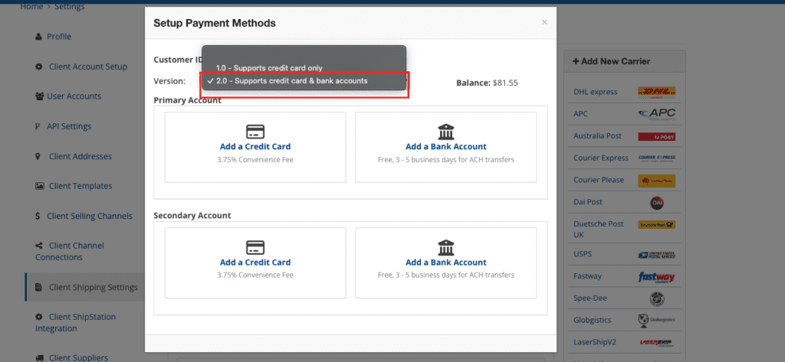
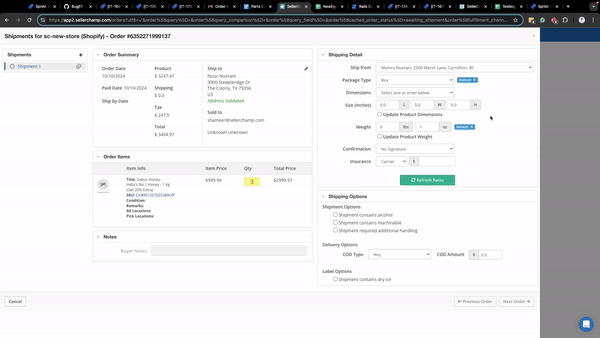

 This month, SellerChamp product updates have focused on tools designed to save you time, increase efficiency, and help you sell smarter across all your platforms. Whether you’re scaling your inventory, optimizing listings, or managing orders, these updates are here to empower your growth. Let’s dive into what’s new and how it can transform your workflow.

<h3>1. Easily View Your Net Profit for Every Order at a Glance
</h3>

 You can now effortlessly track your net profit for each order. Get instant insights into your earnings and make informed decisions to boost your business. <b>Other Exciting Updates:</b><b></b>

<ul>
<li><b>Automatically Trim Descriptions to 4,000 Characters for Walmart Submissions</b></li>
</ul>

 You now have control over how SellerChamp manages item descriptions exceeding 4,000 characters when submitting to Walmart: ✔ ️ Auto-shorten the description for a seamless submission, or Flag an error at the product level to review before submission.

<h3>2. Push Offer Images to Your Amazon Listings
</h3>

 If you turn on the above setting, SellerChamp will automatically send the custom images you’ve uploaded for your Amazon products as offer images to Amazon.

<h3>3. Print Customs & Commercial Invoices Easily
</h3>

 You can now also effortlessly print customs/commercial invoices for the labels that you have purchased directly from SellerChamp. A handy link (as shown in the screenshot) has been added, making it quick and simple to generate these documents. <b>Note:</b> This option will appear exclusively for international orders.

<h3>4. Select Multiple Order Statuses When Filtering Orders
</h3>

 You can now filter orders by selecting multiple order statuses at once on the Orders page, making it easier to manage and view your orders.

<h3>5. Add Bank Account for Shipping Label Payments and Skip Credit Card Fees
</h3>

 We’re very excited to introduce a new payment option for your shipping labels. You can now link your bank account to pay directly, helping you avoid credit card processing fees. To get started, head to your payment methods on the Shipping Settings page and add your bank account today.

<h3>6. Simplified Shipping for Larger Orders
</h3>

 Now, you can easily manage multiple boxes or packages under one shipment. Just enter the details for each piece (like dimensions) as shown in the above gif, and print a single label that covers the entire shipment. Perfect for those larger orders that need more than one box! 🎉

<h3>That’s a Wrap for November’s Updates
</h3>

We hope these new updates make your experience even better and help streamline your workflow. As always, we’re here to support you—feel free to reach out with any questions or feedback.

<a href="https://app.sellerchamp.com/leads/new"><b>Book your demo now to see how SellerChamp can help your business!</b></a>

 Thank you for being a valued part of our community. Here’s to a successful month ahead!

{{ site.app.leads }}?utm_source=blog&utm_campaign=november-product-updates


Schedule a demo today and discover how our Bulk Lister can help you list more products, increase sales, and grow your e-commerce business faster than ever.

