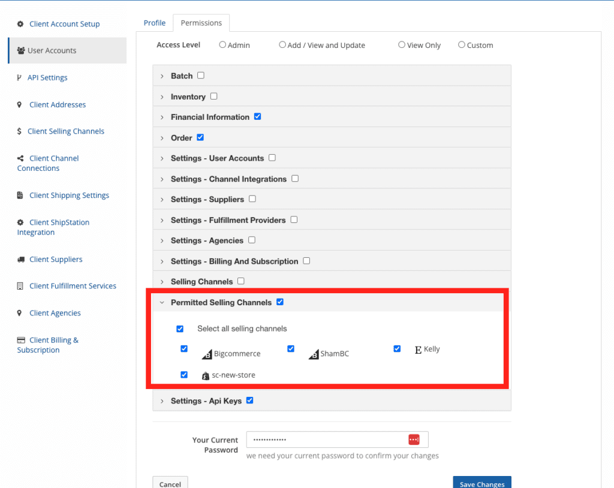
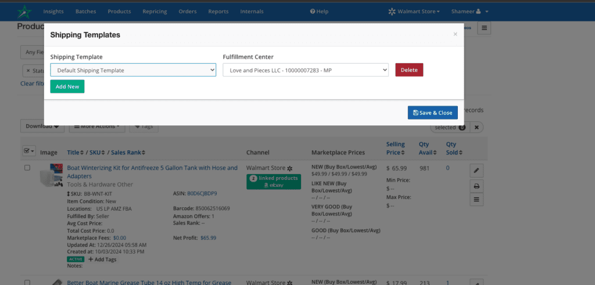
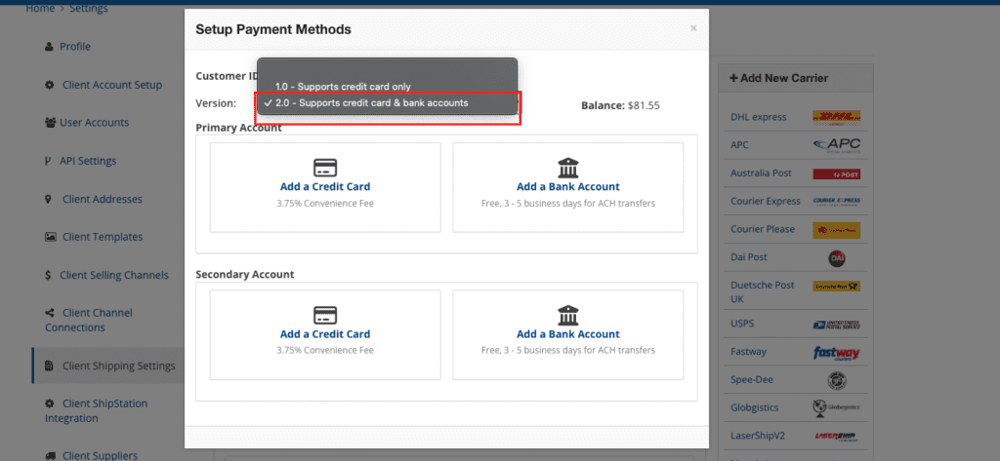
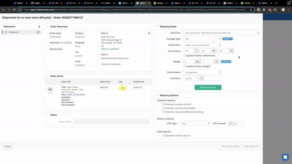

 Happy New Year! As we kick off 2025, we’re excited to share the highlights of December’s updates. Our team has been working hard to bring you tools and features that make managing your business simpler and more efficient. Let’s take a quick look at what’s new and how it can help you achieve your goals this year!

<h2>Top Update: Enhanced Amazon FBA Workflow
</h2>

We’ve made the Amazon FBA process faster and easier. With our latest update, you can now: <i>Scan, label, and box items in one simple step!</i>

<ul>
<li><b>What’s New? </b> You can now scan, label, and box an item in one seamless step. No more managing multiple box numbers or dealing with extra steps.</li>
<li><b>Why It Matters: </b> This update saves you time, reduces errors, and simplifies your workflow, letting you focus on growing your business. </li>
</ul>
<i>Give it a go and let us know how it works for you!</i>

<h2>More Exciting Updates
</h2>

<h3>Update 1. Smarter User Permissions
</h3>

 Take control of team access with our upgraded User Permissions feature.

<ul>
<li><b>What’s New?</b> You can now customize permissions so team members only see the marketplaces they need. For example, if a user is assigned to Amazon, they won’t see data from other platforms.</li>
<li><b>Why It Matters:</b> This makes managing your team easier, keeps workflows focused, and prevents unnecessary clutter.</li>
</ul>

<h3>Update 2. Easier Walmart Shipping Templates
</h3>

 Simplify your Walmart shipping settings with this handy new feature!

<ul>
<li><b>What’s New?</b> Assign Walmart Shipping Templates directly to your products. Auto-sync templates during account refreshes, and even set a default shipping template to apply automatically.</li>
<li><b>Why It Matters:</b> This feature saves time and ensures smoother shipping management for all your Walmart orders.</li>
</ul>
<i>It’s quick and hassle-free—give it a try today! </i>

<h3>Update 3. Save on Shipping Label Fees
</h3>

 No one likes extra fees, right? That’s why we’ve added a new payment option for shipping labels!

<ul>
<li><b>What’s New?</b> Link your bank account to pay directly for shipping labels, avoiding credit card processing fees. Just go to the Shipping Settings page and add your bank account to start saving. </li>
<li><b>Why It Matters:</b> Save money while keeping your shipping payments simple and hassle-free.</li>
</ul>

<h3>Update 4. Multi-Piece Shipments Made Easy
</h3>

 Handle larger orders with ease!

<ul>
<li><b>What’s New?</b> Enter details for multiple boxes under one shipment and print a single label to cover everything.</li>
<li><b>Why It Matters:</b> It’s perfect for larger orders, making the shipping process faster and more efficient.</li>
</ul>

<h2>Need Help?
</h2>
<i>We value your feedback! Let us know how these features are working for you and what else you’d like to see.</i>
<b>Visit our Help Center or</b><a href="/#"><b> chat with us directly for guidance.</b></a>

{{ site.app.leads }}?utm_source=blog&utm_campaign=sellerchamp-december-product-updates


Schedule a demo today and discover how our Bulk Lister can help you list more products, increase sales, and grow your e-commerce business faster than ever.

