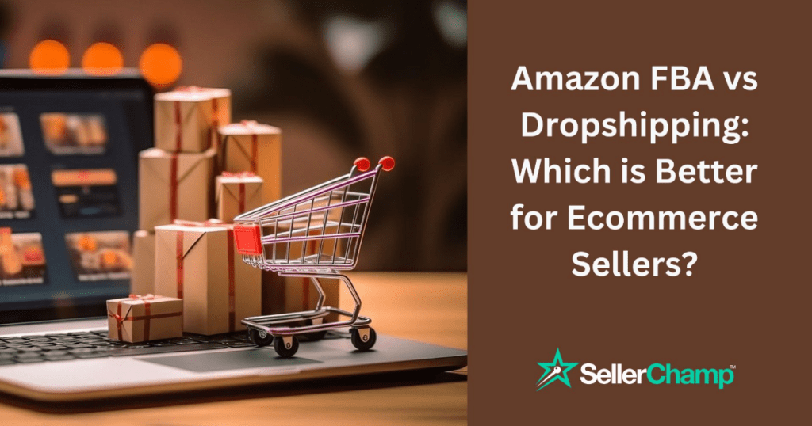
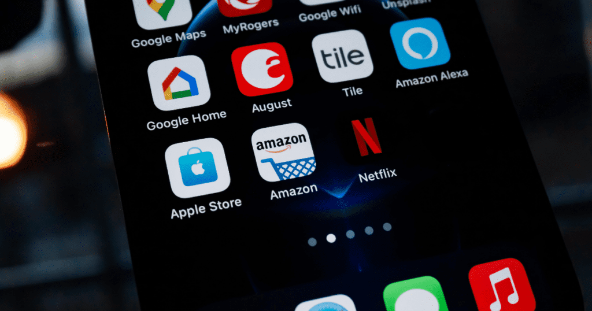
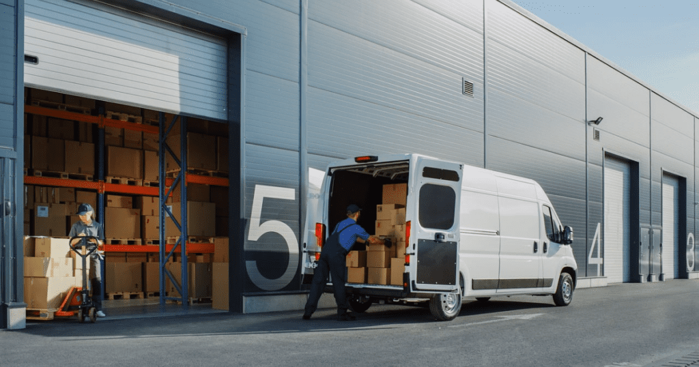
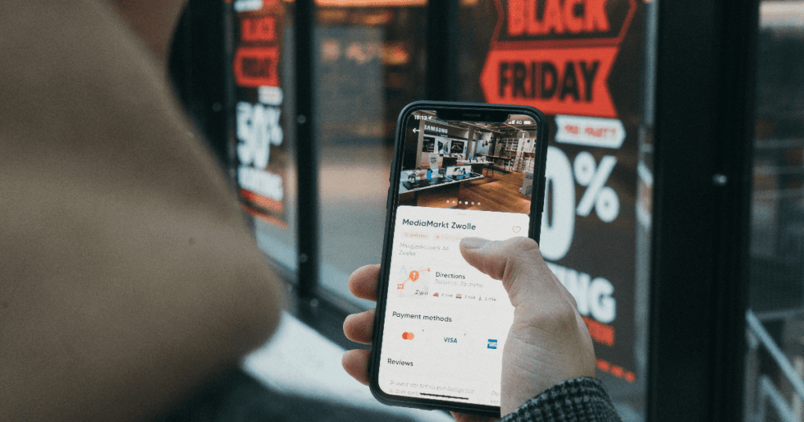

 <b>Amazon FBA vs Dropshipping</b> –which is better for e-commerce sellers? This comprehensive guide dives into both e-commerce models, comparing their <b> pros, cons, and key differences </b> to help you make an informed choice.

<b>You Might Also Like</b><a href="/blog/e-commerce-vs-dropshipping/"><b>: E-Commerce vs Dropshipping: Differences, Similarities, and Tips </b></a>

<h5>Try SellerChamp for Yourself!
</h5>

Schedule a demo today and discover how our Bulk Lister can help you list more products, increase sales, and grow your e-commerce business faster than ever.

<h2>What is Amazon FBA?
</h2>

 Amazon FBA, or Fulfillment by Amazon, is a comprehensive service designed to <b>simplify e-commerce operations</b> for sellers. With FBA, <b>Amazon takes care of everything</b> from storing your inventory in their fulfillment centers to handling packaging and shipping. This makes it a <b>simple, hands-off solution</b> where you focus on growing your business while Amazon ensures efficient operations.

<ul>
<li>Amazon FBA dominates the <a href="https://www.statista.com/statistics/274255/market-share-of-the-leading-retailers-in-us-e-commerce/">e-commerce market </a>with a <b> 37.6% share</b> in all digital sales when giants like Walmart and Target make up only 6.4% and 1.9%, respectively. </li>
<li>Out of the 9.7 million sellers on Amazon, <b> 89% </b> use<a href="https://sell.amazon.com/blog/amazon-stats">
<b>Amazon FBA</b> for their businesses</a>. </li>
</ul>

<strong>Check out:</strong><a href="/blog/boosting-sales-on-amazon-10-tips-to-skyrocket-your-profits/"><b>Boosting sales on Amazon – 10 tips to skyrocket your profits </b></a>

<h3>How It Works
</h3>

 With Amazon FBA, you outsource your order fulfillment processes to Amazon to make your business processes easier. Here’s <a href="https://sell.amazon.com/fulfillment-by-amazon">how to set up and work with Amazon FBA: </a>

<ol>
<li><b>Digital Set-up:</b> Start by creating your Amazon seller account and <a href="https://sell.amazon.com/fulfillment-by-amazon">sign up for FBA. </a>Next create your product listings and add products to your catalog.</li>
<li><b>Ship your products:</b> Once everything is set up digitally, Amazon will ask you to ship out your products to one of their fulfillment centers <b>. </b> Here, your items will be stored securely in a climate-controlled environment, ready for orders.</li>
<li><b>Order Fulfillment:</b> When a customer places an order, Amazon picks the product from the warehouse, carefully packs it, and ships it out, often with same-day or two-day delivery options through Amazon Prime.</li>
<li><b>Customer Service:</b> Amazon takes care of all customer inquiries, complaints, and even manages returns, ensuring that your customers have a smooth and professional shopping experience.</li>
<li><b>Returns Handling:</b> If a customer decides to return a product, Amazon FBA processes the return, crediting the customer and restocking the item if eligible, all without requiring your involvement.</li>
</ol>

<strong>You might also like:</strong>
<a href="/amazon-fba-checklist/"><b>AMAZON FBA CHECKLIST </b></a>

<h3>Pros of Amazon FBA
</h3>

<ol>
<li>Your products automatically qualify for <b>Amazon Prime</b> which means faster shipping and better visibility, ensuring higher customer satisfaction.</li>
<li>Amazon’s customer service team <b>takes care of returns</b>, saving you time.</li>
<li>While FBA comes with its costs, the value you receive in terms of access to a vast <b>storage and shipping network</b> makes it worthwhile.</li>
<li>Selling on Amazon’s platform gives you better <b>customer service and</b>
<b>credibility</b> with higher chances of converting customers.</li>
<li>Amazon offers <b>multiple program options</b> to help you find the one that suits your current business needs the most. </li>
</ol>

<b>Calculate your Amazon FBA profits with this </b><a href="/amazon-fba-revenue-calculator/"><b>Amazon FBA calculator. </b></a>

<h3>Cons of Amazon FBA
</h3>

<ol><li>Storage, fulfillment, and referral <b>fees</b> can sometimes add up quickly and be difficult for new sellers to manage.</li><li>Amazon’s no-questions asked return policy may lead to <b>high return volumes</b>.</li><li>Inventory limits and <b>long-term storage </b> fees can impact your budgets and scalability.</li><li>Amazon has <b>strict requirements</b> when it comes to product and packaging standards. Following these can get tedious, with risks of account restrictions and suspension.</li>
</ol>

<iframe width="1280" height="268" src="https://www.youtube.com/embed/4lFVR99_ggM" title="How to Create a FBA Shipment / Seller Fulfilled Manifest Using SellerChamp | Part 1" frameborder="0" allow="accelerometer; autoplay; clipboard-write; encrypted-media; gyroscope; picture-in-picture; web-share" referrerpolicy="strict-origin-when-cross-origin" allowfullscreen></iframe>

<h2>What is Dropshipping?
</h2>

 Dropshipping is another e-commerce model that does not require the hassle of product handling and fulfillment. With Dropshipping, you <b>outsource your business processes </b> including procurement, storage, and shipping to a third-party service, which typically is your supplier.

<ul>
<li>The dropshipping market is huge and is consistently growing. The<a href="https://www.precedenceresearch.com/dropshipping-market"> global market size for dropshipping </a>was <b> $284.55bn in 2023</b>, $351.81bn in 2024, and is expected to cross <b>$530bn by 2026. </b></li>
<li>Dropshipping gives businesses <b> total control </b> over their branding, costs, management structures and more, without any fees or restrictions involved.</li>
</ul>

<strong>Check out:</strong><a href="/blog/how-to-automate-dropshipping/"><b>How to Automate Dropshipping Practically? </b></a>

<h3>How It Works
</h3>

<ol>
<li><b>Find a Reliable Supplier: </b> For a successful dropshipping business, finding a credible supplier with quality products is key. Check out this <a href="/blog/where-to-buy-products-to-sell-online/">guide on finding the right suppliers to source products. </a></li>
<li><b>List Your Products and Launch: </b> Once all the basics (supplier and ecommerce store like<a href="/blog/shopify-vs-etsy-comparison/"> Shopify, Etsy</a>, or Walmart) are set up, you can start listing products online, and launch your store.</li>
<li><b>Communication with Supplier: </b> When an order is placed, you will have to forward the details to your supplier. This step involves ensuring accurate communication about the product, customer information, and shipping preferences to avoid errors.</li>
<li><b>Order Fulfillment:</b> From here, the supplier takes over as they package the product securely and ship it directly to your customer. </li>
</ol>

<strong>Read more:</strong><a href="/blog/walmart-dropshipping-the-beginners-guide-to-start-your-own-store/"><b>Walmart Dropshipping – The Beginner’s Guide to Start Your Own Store </b></a>

<h3>Pros of Dropshipping
</h3>

<ul>
<li><b>Low startup costs</b> as there is no need to buy inventory upfront.</li>
<li>You don’t have to worry about <b>inventory management</b>, storage, or stock.</li>
<li>Test and <b>sell various products</b> risk-free.</li>
<li><b>Profit margins</b> depend highly on your sale price and approach to branding and marketing. If you can find a low-cost supplier and manage to sell products with a high margin, you can make the business very profitable.</li>
</ul>

<h3>Cons of Dropshipping
</h3>

<ul>
<li>Dropshipping is <b>highly competitive</b> due to its low barrier to entry and easy execution. Furthermore, one supplier may work with multiple sellers which means many other sellers also sell the <b>same products</b> as you do.</li>
<li><b>High dependency on</b>
<b>suppliers</b> means that if they make a mistake, your reputation suffers.</li>
<li><b>Suppliers’ cut</b> can be a turnoff for some sellers.</li>
</ul>

<strong>Check out:</strong><a href="/blog/ecommerce-branding-strategies/"><b>7 Proven E-Commerce Branding Strategies With Examples </b></a>

<h2>Amazon FBA vs Dropshipping – Comparing the Two Models
</h2>

<h3>1. Startup Costs
</h3>

<table id="tablepress-24" class="tablepress tablepress-id-24">
<thead>
<tr class="row-1">
<th class="column-1">Amazon FBA</th><th class="column-2">Dropshipping</th>
</tr>
</thead>
<tbody>
<tr class="row-2">
<td class="column-1">Requires <strong>significant upfront investment</strong> in inventory and storage fees. </td><td class="column-2"><strong>Minimal costs</strong> since you only pay for products after making sales. 
</td>
</tr>
<tr class="row-3">
<td class="column-1">On average, new sellers spend <strong>$2,500–$6,000 to launch</strong> their Amazon FBA business.</td><td class="column-2">Around 33% of dropshippers start with <strong>less than $500</strong> making it an attractive option for individuals with limited initial capital.</td>
</tr>
</tbody>
</table>

<strong>You might also like:</strong><a href="/blog/e-commerce-cost-optimization/"><b>10 Ways to Effectively Implement E-Commerce Cost Optimization </b></a>

<h3>2. Scalability
</h3>

<table id="tablepress-25" class="tablepress tablepress-id-25">
<thead>
<tr class="row-1">
<th class="column-1">Amazon FBA</th><th class="column-2">Dropshipping</th>
</tr>
</thead>
<tbody>
<tr class="row-2">
<td class="column-1">Amazon FBA is <strong>designed to help businesses </strong>scale to the six figure mark.</td><td class="column-2">With Dropshipping, too, it is <strong>easier to</strong> scale quickly since you’re not limited by inventory storage. </td>
</tr>
<tr class="row-3">
<td class="column-1">Sellers can <strong>expand into over 180 destinations</strong>, thanks to Amazon’s global logistics network.</td><td class="column-2">Scalability is <strong>highly dependent</strong> on your ability to find reliable suppliers and maintain quality control.</td>
</tr>
<tr class="row-4">
<td class="column-1">As you scale with Amazon FBA, <strong>fulfillment costs can increase</strong> significantly with your growing business.</td><td class="column-2">Dropshipping allows sellers to <strong>offer over 2 billion products</strong> across various niches.</td>
</tr>
<tr class="row-5">
<td class="column-1"></td><td class="column-2">You can <strong>work with multiple suppliers</strong> as your business grows.</td>
</tr>
</tbody>
</table>

<strong>Check out:</strong><a href="/blog/how-can-a-multi-listing-tool-help-your-business-scale-up-grow-faster/"><b>How Can a Multi Listing Tool Help Your Business Scale Up & Grow Faster?</b></a>

<h3>3. Profit Margins
</h3>

<table id="tablepress-26" class="tablepress tablepress-id-26">
<thead>
<tr class="row-1">
<th class="column-1">Amazon FBA</th><th class="column-2">Dropshipping</th>
</tr>
</thead>
<tbody>
<tr class="row-2">
<td class="column-1">Amazon FBA offers<strong> high potential profit margins</strong> but also high overhead costs.  
</td><td class="column-2">Dropshipping profit margins are <strong>highly variable </strong>based on product, niche, location, and supplier.</td>
</tr>
<tr class="row-3">
<td class="column-1">The average <a href="/blog/amazon-vs-walmart-choosing-the-ideal-platform-for-maximum-sales-and-profits/">profit margin</a>, made by nearly 60% sellers, with Amazon FBA is <strong>15-20%</strong>. However, many successful businesses may go up to making 25-30% in profits.</td><td class="column-2">The average profit margin for Dropshipping is<strong> 10-20%</strong> with higher numbers indicating healthy growth.</td>
</tr>
</tbody>
</table>

<iframe width="1280" height="268" src="https://www.youtube.com/embed/GTDVxhG9JFw" title="Quick 2-Min Overview of SellerChamp" frameborder="0" allow="accelerometer; autoplay; clipboard-write; encrypted-media; gyroscope; picture-in-picture; web-share" referrerpolicy="strict-origin-when-cross-origin" allowfullscreen></iframe>

<h2>Who is Amazon FBA Ideal for?
</h2>

<ul>
<li>Entrepreneurs ready to invest significant capital upfront.</li>
<li>Sellers looking to leverage Amazon’s expansive marketplace for visibility.</li>
<li>Those seeking highly credible and hands-off logistics and fulfillment solutions.</li>
</ul>

<h2>Who is Dropshipping Ideal for?
</h2>

<ul>
<li>Beginners with limited startup funds and a low-risk approach.</li>
<li>Sellers prioritizing a multi-channel sales strategy from the outset.</li>
<li>Entrepreneurs exploring niche markets or testing seasonal products.</li>
<li>Individuals valuing maximum flexibility in operations and inventory management. </li>
</ul>

<h2>Request a SellerChamp Demo
</h2>

Whether through Amazon FBA or dropshipping, building a successful business requires a proactive approach. <b> Take charge of your fulfillment processes with SellerChamp. </b><a href="/solutions/"><b>Request a demo and learn how you can automate and streamline operations for greater efficiency!</b></a>

{{ site.app.leads }}?utm_source=blog&utm_campaign=amazon-fba-vs-dropshipping

