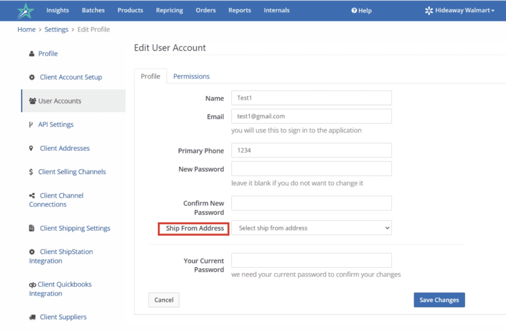
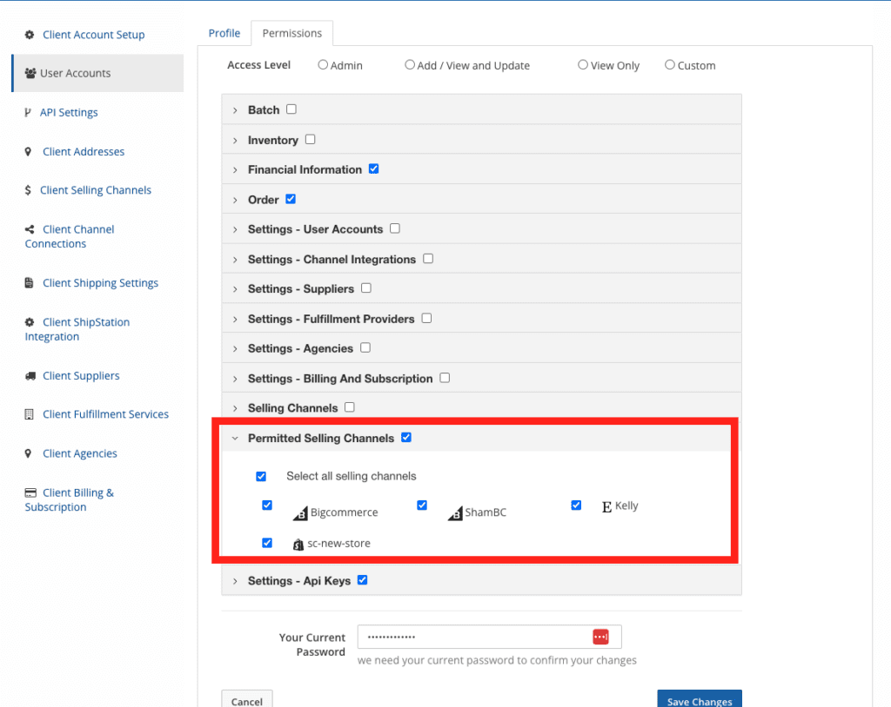
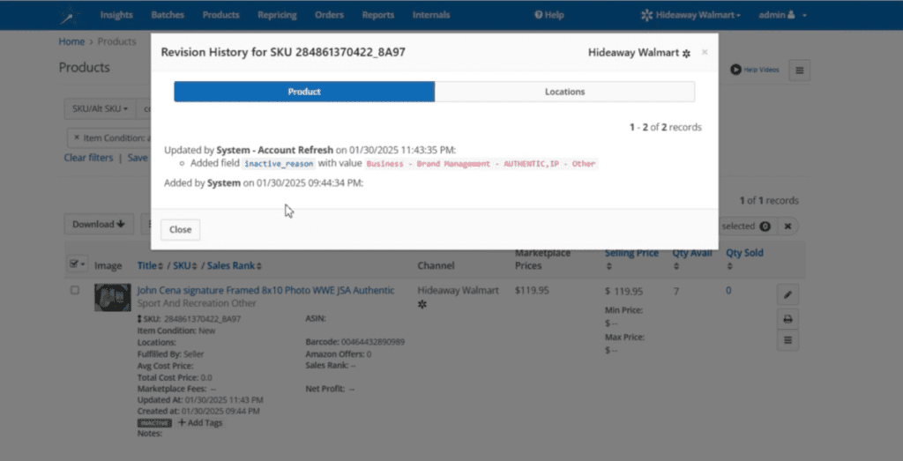

 Happy New Year! We’ve been working on new updates to make SellerChamp even better. This month, we’re introducing features to help you save time, streamline workflows, and manage your business more efficiently. Here’s what’s new:

<h2>Top Update: Enhanced Amazon FBA Workflow
</h2>

We’ve made the Amazon FBA process faster and simpler. With this update, you can now:

<ul>
<li>Scan, label, and box items in one easy step!</li>
</ul>
<b>What’s New?</b> You can now do everything—scanning, labeling, and boxing—in one smooth step. No more managing multiple box numbers or extra tasks. <b>Why It Matters:</b> This update saves time, cuts down on mistakes, and makes your work easier, so you can focus on growing your business. Give it a try and let us know how it goes!

<ul>
<li><b>Noticeable Update:</b></li>
</ul>

Some more updates from Team SellerChamp for you:

<h2>Set a Default “Ship From” Address
</h2>

 We’ve added a new feature to make shipping even easier. You can now:

<ul>
<li>Set a default “Ship From” address for specific users!</li>
</ul>
<b>What’s New?</b> You can now assign a default “Ship From” address for users, ensuring they can only use that address when creating shipping labels. <b>Why It Matters:</b> This helps maintain consistency, reduces mistakes, and keeps your shipping process smooth and reliable. Try it out and see how much easier shipping can be!

<h2>New User Permissions
</h2>

 Managing your team just got easier. With this update, you can now:

<ul>
<li>Fine-tune access and visibility for team members based on marketplace needs!</li>
</ul>
<b>What’s New?</b> Now, you can assign permissions so team members only see the marketplaces they need. For example, if a user works with Amazon, they won’t have access to orders or products from other platforms. <b>Why It Matters:</b> This keeps your system organized, improves focus, and reduces the chance of mistakes. Give it a try and let us know your thoughts!

<h2>Easier Walmart Listing Tracking
</h2>

 We’ve improved your ability to track Walmart listings. With this update, you can now:

<ul>
<li>See why your Walmart listing went inactive directly in the Product Revision History!</li>
</ul>
<b>What’s New?</b> If a Walmart item changes from Active to Inactive, you’ll see the reason for the change in the Product Revision History. <b>Why It Matters:</b> This gives you more visibility, so you can quickly address issues and keep your products live. Check it out and stay on top of your listings!

<h2>Need Help?
</h2>
<i>We value your feedback! Let us know how these features are working for you and what else you’d like to see.</i>
<b>Visit our Help Center or</b><a href="/#"><b> chat with us directly for guidance.</b></a>

{{ site.app.leads }}?utm_source=blog&utm_campaign=january-product-updates


Schedule a demo today and discover how our Bulk Lister can help you list more products, increase sales, and grow your e-commerce business faster than ever.

