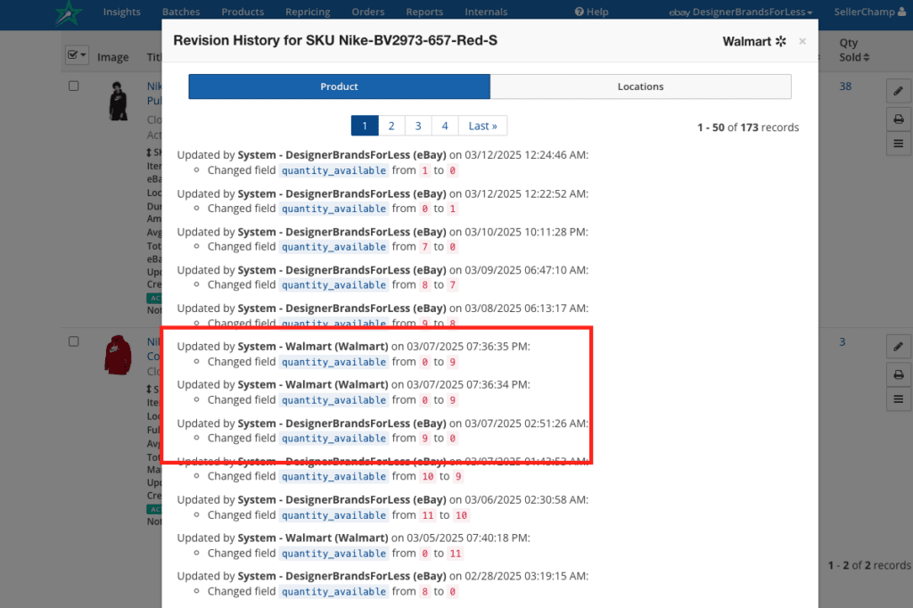
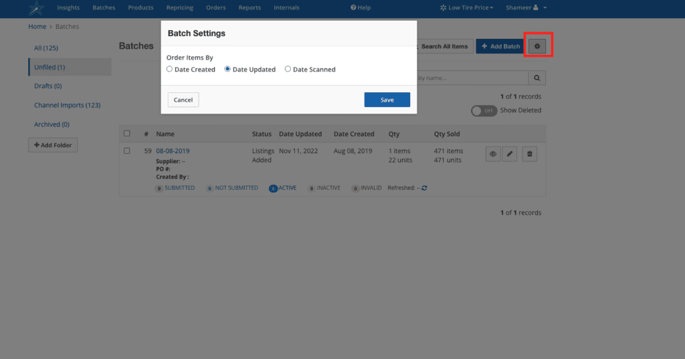
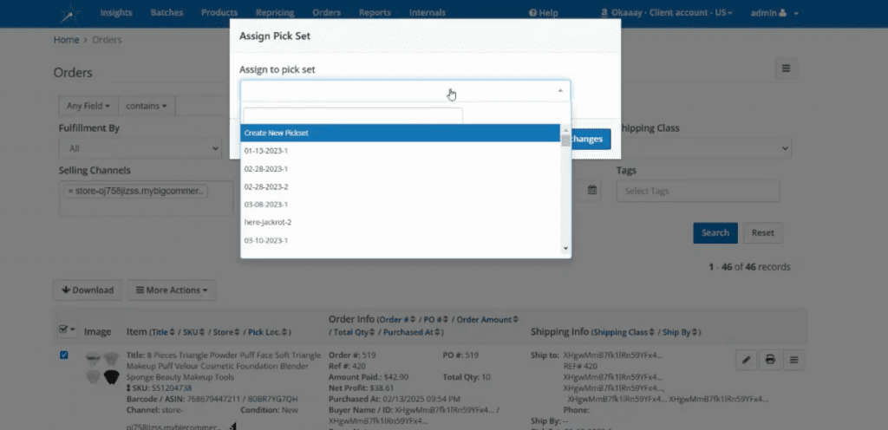
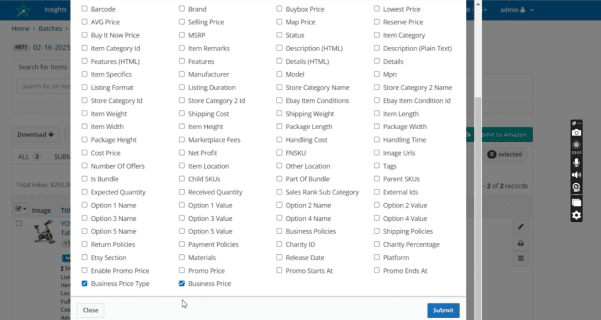

 We’ve made some updates to help you save time and manage your inventory more easily. This month, we’ve introduced new features to streamline listing, sorting, and shipping, making your selling experience smoother than ever. Here’s what’s new!

<h2>Top Feature
</h2>

Shipping FBA inventory just got a whole lot simpler! We’ve fine-tuned the process to help you ship with fewer steps. <b>What’s New:</b> Now, you can scan, label, and box your items in a single step instead of handling each task separately. <b>Why It Matters:</b> This speeds up your workflow, reduces errors, and eliminates the hassle of managing multiple box numbers manually. Less work, more efficiency! Give it a try and let us know what you think!

<h2>Other Helpful Updates
</h2>

<h3>Add Walmart Items in Bulk – Save Time!
</h3>

 Listing Walmart items in bulk is now quicker and more efficient. <b>What’s New:</b> You can now scan Walmart Item IDs in batches. Once scanned, SellerChamp will automatically fetch product details and create listings for you. Try it out and see how much easier shipping can be!

<h3>Sort Your Batch Items Your Way
</h3>

 Managing your batch inventory is now more flexible, so you can stay organized with ease. <b>What’s New:</b> We’ve added new sorting options! Now, you can sort items in your batch by Date Created, Date Updated, or Date Scanned. <b>Why It Matters:</b> Finding and managing your inventory is easier when it’s sorted the way you prefer. Quickly locate items and keep track of updates without any hassle.

<h3>Pick & Reassign Pick Sets for Orders
</h3>

 Order management just got more flexible with better control over pick sets. <b>What’s New:</b> When processing orders, you can now select a specific pick set—and if you need to change it later, you can do so directly from the Orders page. <b>Why It Matters:</b> This gives you better control over order fulfillment, making it easier to adjust assignments and improve picking efficiency.

<h3>Easily Update Amazon Business Pricing
</h3>

 Keeping your Amazon Business pricing up to date is now faster and more convenient. <b>What’s New:</b> You can now download business pricing values for your Amazon products directly from the Reports section. Plus, you can bulk update pricing fields using a CSV upload. <b>Why It Matters:</b> If you sell on Amazon Business, updating prices in bulk saves time and helps you stay competitive with accurate, up-to-date pricing. We’re always working to make SellerChamp better for you. If you have any questions or feedback, we’d love to hear from you! Thanks for being part of the SellerChamp family. More great updates are coming soon! <b>Cheers,</b><b>
</b> <b>SellerChamp Product Team</b>

<h2>Need Help?
</h2>
<i>We value your feedback! Let us know how these features are working for you and what else you’d like to see.</i>
<b>Visit our Help Center or</b><a href="/#"><b> chat with us directly for guidance.</b></a>

{{ site.app.leads }}?utm_source=blog&utm_campaign=february-update


Schedule a demo today and discover how our Bulk Lister can help you list more products, increase sales, and grow your e-commerce business faster than ever.

