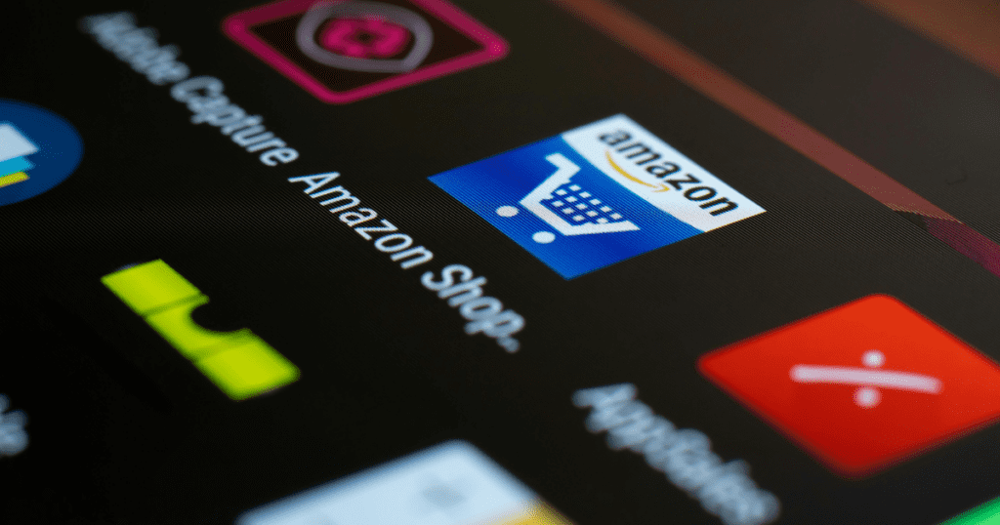

 With the e-commerce market <a href="https://www.statista.com/outlook/emo/ecommerce/worldwide">expected to hit $4.32 trillion by 2025, </a>finding the best wholesale e-commerce platform for you is crucial. Whether you’re scaling up or just starting, this comprehensive guide breaks down the <b>top 15 platforms to help you make the best choice</b>.

<h3>Understanding Wholesale E-Commerce Platforms
</h3>

Wholesale e-commerce platforms are specialized online solutions designed to facilitate bulk transactions between businesses.

They offer features tailored to B2B interactions, such as bulk ordering, custom pricing, and integrated inventory management. Implementing the best wholesale e-commerce platform can enhance efficiency, reduce operational costs, and expand market reach

{{ site.app.leads }}?utm_source=blog&utm_campaign=best-wholesale-ecommerce-platforms


<h3>Key Features to Consider When Choosing a Wholesale E-Commerce Platform
</h3>

When selecting a wholesale e-commerce platform, consider the following essential features:

<ul>
<li><b>Custom Pricing Options:</b> Allows personalized pricing for different clients or bulk orders.</li>
<li><b>Integration Capabilities:</b> Seamlessly connects with existing systems like CRM, ERP, and payment gateways.</li>
<li><b>Mobile Compatibility:</b> Provides a responsive design for users accessing the platform via mobile devices.</li>
<li><b>Robust Inventory Management:</b> Keeps track of stock levels and automates restocking processes.</li>
</ul>

<iframe width="1280" height="268" src="https://www.youtube.com/embed/KsJR4_TIjvc" title="How to Sync Inventory across Multiple Marketplaces" frameborder="0" allow="accelerometer; autoplay; clipboard-write; encrypted-media; gyroscope; picture-in-picture; web-share" referrerpolicy="strict-origin-when-cross-origin" allowfullscreen></iframe>

<h2>Top 15 Wholesale E-Commerce Platforms in 2025
</h2>

Here are the leading platforms to consider:

<h3>1. Shopify Plus
</h3>

Shopify Plus is renowned for its scalability and robust features tailored for wholesale businesses. It offers a dedicated wholesale channel, allowing businesses to manage both retail and wholesale operations from a single dashboard. With its user-friendly interface and extensive app ecosystem, Shopify Plus is ideal for businesses seeking flexibility and growth.

<h3>2. BigCommerce Enterprise
</h3>

BigCommerce Enterprise provides a comprehensive solution with built-in B2B functionalities. It supports complex pricing structures, bulk ordering, and offers seamless integration with various third-party applications. Its open API architecture allows for extensive customization, catering to the unique needs of wholesale businesses.

<h3>3. OroCommerce
</h3>

Designed specifically for B2B transactions, OroCommerce offers features like corporate account management, custom workflows, and robust reporting tools. Its flexibility and scalability make it suitable for mid to large-sized enterprises looking to enhance their wholesale operations.

<h3>4. Magento Commerce (Adobe Commerce)
</h3>

Magento Commerce is a powerful platform known for its flexibility and extensive customization options. It offers advanced B2B features such as custom catalogs, pricing, and seamless integration with various third-party services. Its open-source nature allows businesses to tailor the platform to their specific needs.

<h3>5. WooCommerce B2B
</h3>

Built on WordPress, WooCommerce B2B is a plugin that extends the capabilities of WooCommerce to support wholesale functionalities. It offers features like tiered pricing, minimum order quantities, and restricted wholesale access, making it a cost-effective solution for small to medium-sized businesses.

<h3>6. PrestaShop
</h3>

PrestaShop is an open-source e-commerce platform that offers a range of B2B modules to enhance wholesale operations. It provides features like bulk order management, customer group pricing, and extensive customization options, making it suitable for businesses seeking a flexible solution.

<b>You Might Like: </b><a href="/blog/ecommerce-branding-strategies/"><b>7 Proven E-Commerce Branding Strategies With Examples</b></a>

<h3>7. OpenCart
</h3>

OpenCart is a free, open-source platform that offers a variety of extensions to support wholesale functionalities. It provides multi-store capabilities, customer group pricing, and a user-friendly interface, making it a viable option for businesses looking for a customizable solution.

<h3>8. 3dcart (Shift4Shop)
</h3>

3dcart, now known as Shift4Shop, offers a comprehensive e-commerce solution with built-in B2B features. It provides tools for managing bulk orders, custom pricing, and integrates seamlessly with various payment gateways, catering to the needs of wholesale businesses.

<h3>9. X-Cart
</h3>

X-Cart is a flexible e-commerce platform that offers robust B2B features such as bulk ordering, custom pricing, and multi-currency support. Its open-source nature allows for extensive customization, making it suitable for businesses with specific wholesale requirements.

<strong>Read more:</strong><a href="/blog/how-to-sell-on-multiple-platforms/"><b>How to Sell on Multiple Platforms and Streamline E-Commerce</b></a>

<h3>10. Alibaba.com
</h3>

Alibaba.com is a global wholesale marketplace connecting buyers and sellers worldwide. It offers a vast range of products across various categories and provides tools for secure transactions, making it a popular choice for businesses looking to source products in bulk.

<h3>11. IndiaMART
</h3>

IndiaMART is one of the largest online B2B marketplaces in India, connecting buyers with suppliers. It offers a wide range of products and services, catering to the needs of both small and large enterprises looking to expand their wholesale operations.

<h3>12. Global Sources
</h3>

Global Sources is a Hong Kong-based B2B media company that facilitates trade between Asia and the world. It offers a comprehensive platform for wholesale buyers to connect with verified suppliers, ensuring quality and reliability in transactions.

<h3>13. Faire
</h3>

Faire is an online wholesale marketplace that connects retailers with independent brands. It offers a curated selection of products, flexible payment terms, and free returns, making it an attractive platform for retailers seeking unique products.

<h3>14. Handshake
</h3>

Handshake is a wholesale marketplace by Shopify that connects retailers with handpicked suppliers. It offers a seamless integration with Shopify stores, allowing for easy order management and product discovery.

<h3>15. Tundra
</h3>

Tundra is a zero-commission wholesale marketplace that offers a wide range of products from various suppliers. It provides fast shipping options and competitive pricing, making it a valuable platform for businesses looking to source products efficiently.

<strong>Read more:</strong><a href="/blog/top-10-e-commerce-payment-gateways-for-your-online-store-empower-your-business-with-secure-and-seamless-transactions/"><b>Top 10 E-commerce Payment Gateways for Your Online Store</b></a>

<h2>Why Choosing the Right Wholesale E-Commerce Platform Matters
</h2>

Wholesale business is quickly moving online, and the <b>B2B e-commerce market is expected to reach </b><a href="https://www.businesswire.com/news/home/20211203005471/en/The-Global-B2B-E-Commerce-Market-Size-is-Estimated-to-Reach-USD-25.65-Trillion-Expanding-at-a-CAGR-of-18.7-from-2021-to-2028.---ResearchAndMarkets.com"><b>$25.65 trillion by 2028</b>. </a>Picking the right platform is important because it affects how smoothly your business runs and how much you sell. Here’s why it matters:

<ul><li><b>Most buyers now prefer online shopping</b> – Around<a href="https://www.gartner.com/en/newsroom/press-releases/2022-06-22-gartner-sales-survey-finbds-b2b-buyers-prefer-ordering-paying-through--digital-commerce">
<b>83% of B2B buyers</b></a> choose to place orders online instead of using phone calls or emails. A user-friendly platform makes it easier for them to browse, compare, and buy products.

</li><li><b>Online sales are taking over</b> –<a href="https://www.gartner.com/en/sales/trends/future-of-sales#:~:text=By%202025%2C%20Gartner%20expects%2080,the%20past%20couple%20of%20years."><b> 90% of B2B sales</b></a> will happen through digital platforms in 2025 and onwards. If your business isn’t online, you risk losing customers to competitors who are.

</li><li><b>Faster and more efficient sales</b> – Companies using automated wholesale platforms see their<a href="https://www.mckinsey.com/capabilities/growth-marketing-and-sales/our-insights/sales-automation-the-key-to-boosting-revenue-and-reducing-costs#:~:text=According%20to%20McKinsey%20research%2C%20there,negotiation%20preparation%2C%20and%20customer%20interaction."> sales process speed up by <b>20-30%</b>.</a> Features like bulk ordering, instant invoicing, and real-time inventory updates save time and reduce mistakes.

</li><li><b>Better customer experience</b> – A good platform makes it easy for customers to reorder, check product details, and get quick support through <a href="https://www.edesk.com/" target="_blank" rel="noopener" data-saferedirecturl="https://www.google.com/url?q=https://www.edesk.com/&source=gmail&ust=1763313005506000&usg=AOvVaw1-EldJSOzg5EjJ03yiSVfc">AI-powered eCommerce customer support</a>. Happy customers are more likely to buy from you again.

</li><li><b>Stay ahead of competitors</b> – As more businesses shift online, having a strong e-commerce platform helps you stand out. It lets you offer modern features that attract and keep customers.</li>
</ul>

Choosing the right wholesale e-commerce platform isn’t just about going digital—it’s about <b>selling more, working smarter, and growing your business in a changing market</b>.

<strong>Read more:</strong><a href="/blog/how-to-sell-on-multiple-platforms/"><b>How to Sell on Multiple Platforms and Streamline E-Commerce</b></a>

<h2>Automate and Streamline Your E-Commerce With SellerChamp
</h2>

Check out SellerChamp today and simplify your wholesale e-commerce business!

<h5>Try SellerChamp for Yourself!
</h5>

Request a demo now to see how it works. <strong><a style="color: #ffffff;" href="https://app.sellerchamp.com/users/sign_up?_gl=1*o3jeep*_gcl_au*MjAyMjAzNDgwNi4xNzM3MDY4MTgx*_ga*MTc1MDE5MTE4MS4xNzM3MDY4MTgx*_ga_F2WQV1CVLC*MTc0MDI0MjYyNy4yMy4xLjE3NDAyNDU3MzYuMjMuMC4xOTY0MDkyODcz&_ga=2.13502066.494858753.1740095606-1750191181.1737068181">Get Started Here!</a></strong>

