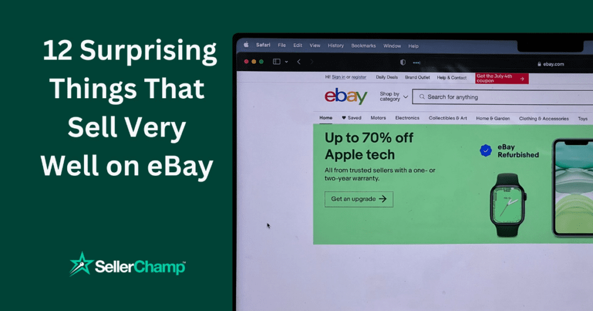
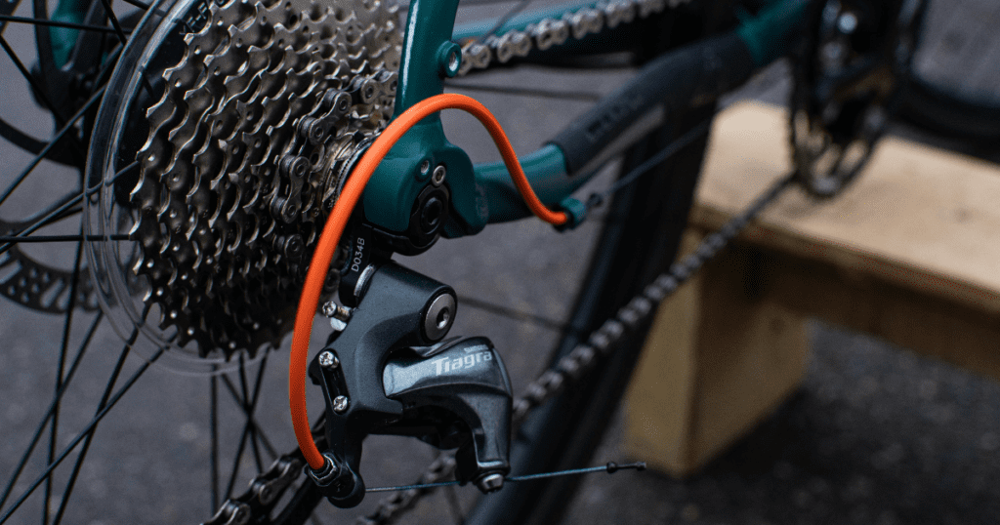
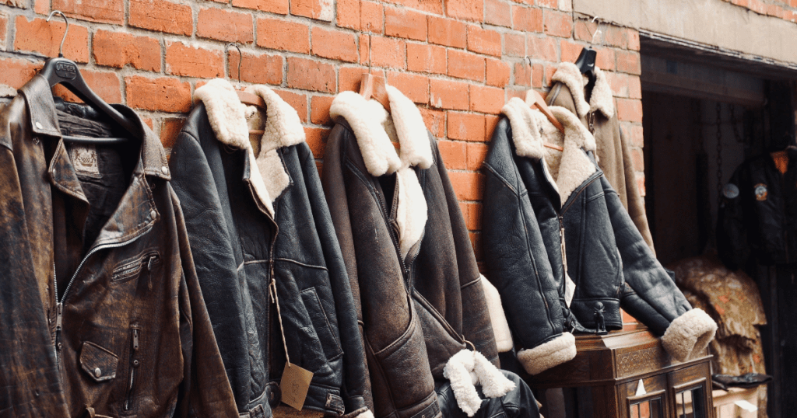
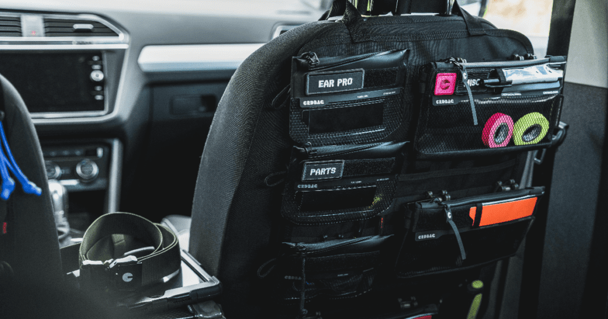
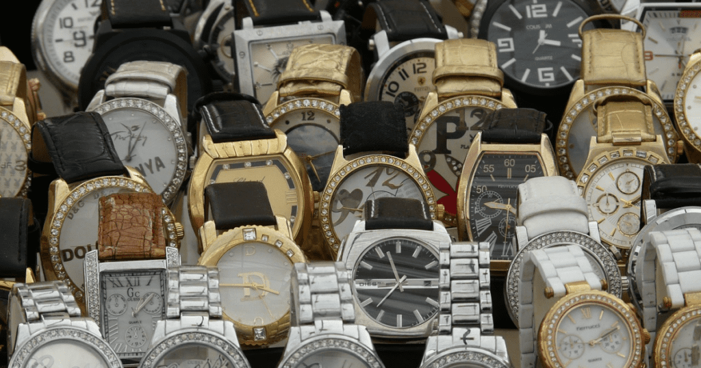
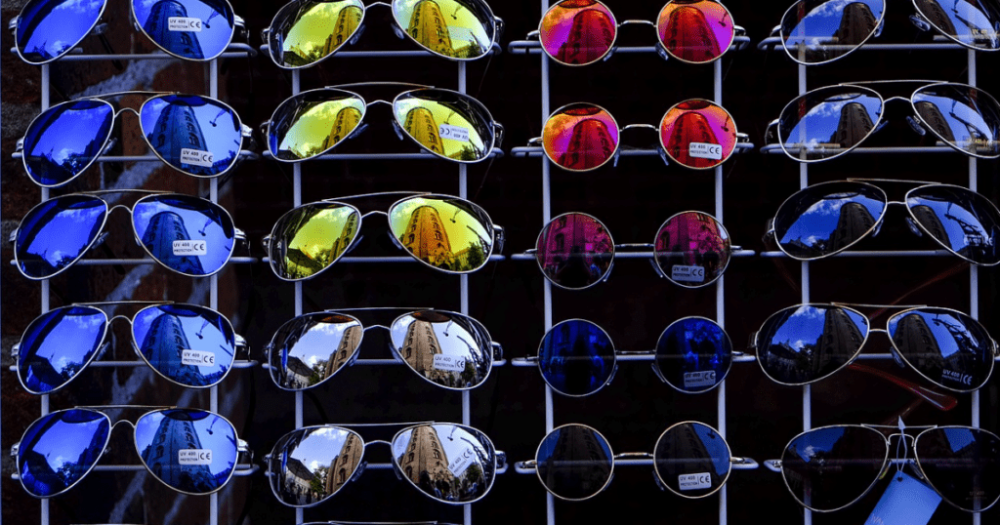
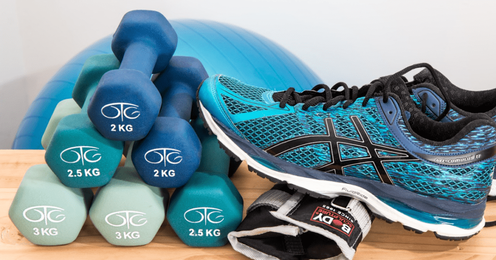
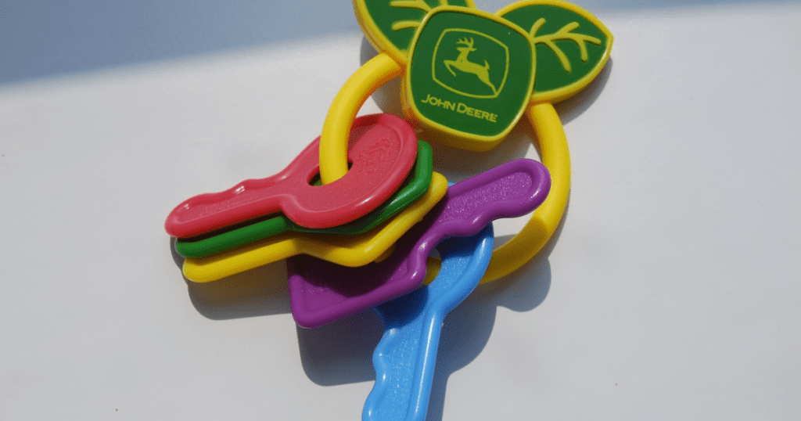
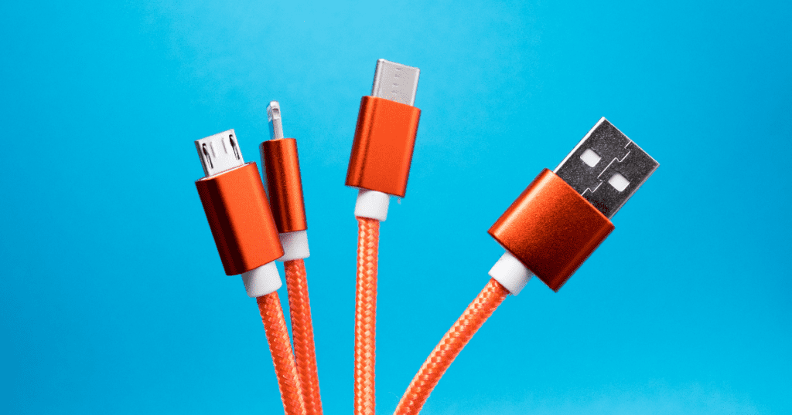

 While many well-known products can be profitable, there are some unexpected <b>things that sell surprisingly well on eBay</b> without much competition <b>.</b> These unconventional best-sellers range from <b> rare collectibles to daily essentials</b> like smartphone cables. If you want to scale your eBay business, look for such items by recognizing what others might find <b> valuable</b>, even if it seems mundane at first glance. To help you get started, we’ve rounded up <b>12 surprisingly profitable</b> items that can turn into steady sales on eBay.

<strong>You might also like:</strong><a href="/blog/how-to-get-more-views-on-ebay/"><b>How to Get More Views on eBay? 7 Game-changing Tips </b></a>

<i>Before you begin, learn how to create the perfect listing for eBay with this video:</i>

<iframe width="987" height="265" src="https://www.youtube.com/embed/Qd3adA_WfHY" title="How to Create Listings on eBay | 4 Ways" frameborder="0" allow="accelerometer; autoplay; clipboard-write; encrypted-media; gyroscope; picture-in-picture; web-share" referrerpolicy="strict-origin-when-cross-origin" allowfullscreen></iframe>

{{ site.app.leads }}?utm_source=blog&utm_campaign=surprising-things-sell-well-ebay


Want to make your flipping business easier? <a style="color: #ffffff;" href="https://app.sellerchamp.com/users/sign_up?_gl=1*1hmqx6y*_gcl_au*MjAyMjAzNDgwNi4xNzM3MDY4MTgx*_ga*MTc1MDE5MTE4MS4xNzM3MDY4MTgx*_ga_F2WQV1CVLC*MTczNzU2Mjg2Ni45LjAuMTczNzU2Mjg2Ni42MC4wLjExMzExNTUzNjg.&_ga=2.38173483.921892867.1737562867-1750191181.1737068181"><b>Request a demo of SellerChamp</b>
</a>and see how it can help you list faster, manage inventory, and increase sales!

<h2>1. Vintage McDonald’s Toys
</h2>

 Nostalgia is a powerful sales driver. McDonald’s <b>Happy Meal toys</b> from the ’80s, ’90s, and early 2000s are highly collectible with people paying exorbitant amounts for them on eBay, these days.

<ul>
<li>Toys like <b>Teenie Beanie Babies and Furby </b> are highly popular and have <b> sold for $700-900+</b> on eBay.</li>
<li>McDonald’s Pokémon cards and buckets like the Ghost bucket and McGoblin witch bucket are often listed online for <b>$50-200.</b></li>
<li>Vintage Disney, Pokémon, Hello Kitty, and movie-themed toys are some of the most <b>sought-after themed-toys </b> in this category.</li>
</ul>

If you step into this space, look for smart strategies such as <b>bundling sets together</b> to increase their value. A key tip is to <b> check for rarity</b> on collector forums or completed eBay listings.

<h2>2. Wireless Chargers
</h2>

 With wireless technology now standard in most Apple and Samsung phones, wireless chargers have become a <b> must-have accessory </b> for many.

<ul>
<li>Wireless chargers on eBay have a<a href="https://bloggingwizard.com/best-selling-items-on-ebay/?utm_source=chatgpt.com"> sell-through rate of 9,597%</a>, with 90% of listings successfully selling at an <b>average sale price of $12.23.</b></li>
<li>Buying in bulk from suppliers can boost profit margins. Chinese suppliers typically <b>charge $3-8 per charger,</b> leaving room for decent profits.</li>
<li><b>Newer models</b> with fast charging features can fetch higher prices.</li>
</ul>

<strong>Check out:</strong><a href="/blog/selling-on-amazon-vs-ebay-what-will-get-you-to-6-figures-faster/"><b>Selling on Amazon vs eBay: What Will Get You to 6 Figures Faster </b></a>

<h2>3. Vintage Kitchenware
</h2>

 Vintage kitchenware is a <b>surprisingly profitable category</b> on eBay due to its rarity and collector demand. These items, particularly from brands like <b> CorningWare and Pyrex</b>, are highly collectible with rare designs sold for up to <b> tens of thousands of dollars</b>!

<ul>
<li>Recently, a <b>Pyrex Snowflake Gaiety Casserole dish</b> was sold for around $110 on eBay.</li>
<li>While getting your hands on quality vintage brands might be difficult, <b> non-branded kitchenware </b> with vintage designs is still collectible. You can easily find vintage plates being sold for <b> $50-200</b> on eBay.</li>
<li>If you have vintage cookware in good condition, it can be a goldmine as well. Items like <b>cast iron skillets </b> and copper pans command high prices.</li>
</ul>

Buyers seek nostalgia, durability, and unique designs. Look for intact branding and minimal wear for the best value.

<h2>4. Bicycle Parts
</h2>

 Cycling parts sell surprisingly well on eBay due to the platform’s affordability and trusted reputation. Enthusiasts frequently repair or customize their bikes, creating a consistent <b>demand for individual parts</b>.

<ul>
<li><b>Used or refurbished components</b> such as Shimano gears, vintage handlebars, and carbon fibre frames often sell very fast.</li>
<li>Selling parts individually yields more profit than selling a whole bicycle.</li>
<li><b>Bicycle accessories,</b> including lights, bells, and saddlebags, are small but profitable. For example, if you source from AliExpress, you can get soft handlebars for around $3-4, and then resell them on eBay for $6-10.</li>
<li>You can also purchase items on eBay with <b>unappealing photos </b> and then list them properly at a higher price.</li>
</ul>

<strong>You might also like:</strong><a href="/blog/effective-ebay-inventory-management-tips/"><b>10 Extremely Effective eBay Inventory Management Tips </b></a>

<h2>5. Vintage Clothing
</h2>

 Retro fashion never fades, and authentic vintage clothing is <b>highly sought after </b> these days.

<ul>
<li>Vintage Levi’s jeans, 90s <b> band t-shirts, and designer pieces </b> from the 80s and 90s are highly desirable today thanks to the<a href="https://tribune.com.pk/story/2517265/why-vintage-styles-are-dominating-fashion-again"><b> revival of old fashion trends</b>.</a>
</li>
<li>Go thrift shopping to find gems that you can <b> resell for higher value</b>. It is important to be aware of both modern and vintage brands when going through thrift stores.</li>
<li>Items with unique prints, labels, or <b> limited editions</b> fetch premium prices.</li>
</ul>

Buyers love <b>authenticity</b>, so be sure to describe labels, fabric, and wear accurately. A great way to maximize profit is to look for products off-season, and then sell when the demand is highest.

<h2>6. Car Parts and Accessories
</h2>

 Car parts and accessories are popular on eBay due to their low cost and a convenient <b>purchasing process.</b> Furthermore, enthusiasts and mechanics constantly seek parts and accessories for <b>maintenance, repairs, and upgrades.</b>

<ul>
<li>Every second, three<a href="https://www.revolutionparts.com/blog/why-sell-auto-parts-on-ebay/"> auto parts or accessories are sold on eBay,</a> making it one of the <b>fastest-moving niches </b> on the platform. </li>
<li>Items like used headlights, grilles, rims, and side mirrors often sell well. You can also list <b>performance parts</b> such as exhaust systems and air filters to attract buyers.</li>
<li>Even <b> small accessories</b> like gear shift knobs, key fobs, and floor mats are in demand.</li>
<li>While it is difficult to source them, vintage and discontinued parts for <b>classic cars</b> fetch premium prices. </li>
</ul>

<strong>Check out:</strong><a href="/blog/effective-ebay-inventory-management-tips/"><b>10 Extremely Effective eBay Inventory Management Tips </b></a>

<h2>7. Watches
</h2>

 eBay is a leading marketplace for wristwatches, with <b> one sold every five seconds</b>. While both <b>vintage and modern watches</b> are profitable, luxury watches make up the majority of eBay’s watch sales.

<ul>
<li><a href="https://www.ebayinc.com/stories/news/ebay-releases-2020-luxury-watch-report-offers-shoppers-up-to-30-off-top-brands/">Top brands </a>like Rolex, Breitling, and Tag Heuer, as well as more affordable ones like <b>Casio and Seiko,</b> are consistently sold on eBay. </li>
<li>The most expensive watch ever <a href="https://www.ebayinc.com/stories/news/ebay-releases-2020-luxury-watch-report-offers-shoppers-up-to-30-off-top-brands/">sold on eBay </a>was the <b>Patek Philippe Grand Complications</b>, fetching an impressive $535,499.99.</li>
<li>Smartwatches such as Apple Watches and Garmin <b>fitness trackers</b> also perform well.</li>
</ul>

<h2>8. Sunglasses
</h2>

 Sunglasses are a <b> top-selling fashion accessory</b>, with brands like Ray-Ban, Oakley, and Gucci leading the market. While surprising for many, sunglasses sell very well on eBay, providing <b> greater exposure to sellers</b> than other marketplaces.

<ul>
<li>In 2023, <b>over 50,000 sunglasses</b> were sold on eBay each month, with an average sale price of $50.</li>
<li>Besides brands, <b>vintage and limited-edition models</b> often fetch high prices.</li>
<li>Polarized and blue-light-blocking glasses are also in high demand, with buyers often seeking <b>replacement lenses and frames.</b></li>
</ul>

<strong>You might also like:</strong><a href="/blog/how-to-bulk-list-on-ebay/"><b>How to Bulk List on eBay? Tips, Tricks & Solutions </b></a>

<h2>9. Fitness Equipment
</h2>

 The COVID-19 pandemic kicked off the <b>at-home fitness trend</b>, and it has been alive ever since. From weight training to yoga, equipment for all <b>types of training </b> sells well on eBay.

<ul>
<li>Dumbbells, resistance bands, yoga mats, and even <b>used treadmills </b> sell fast.</li>
<li>With the industry expected to grow to <b> $30.61 billion by 2034</b> and eBay being a popular platform for fitness equipment, the demand and profitability of<a href="https://www.printful.com/blog/best-selling-items-on-ebay#:~:text=5.-,Fitness%20products,eBay%20in%20this%20profitable%20category"> home gym products </a>can be expected to <b>increase dramatically</b> in the coming few years. </li>
<li>Just like most other niches, fitness products too sell best when branded.</li>
</ul>

<h2>10. Baby Products
</h2>

 Today’s <b>rapidly changing trends</b> have made baby essentials and fashion a thriving category on eBay.

<ul>
<li>Popular items include <b> strollers, baby monitors, </b> diaper bags, and bottle warmers.</li>
<li>Baby product sales on eBay reach<a href="https://www.zikanalytics.com/blog/top-selling-baby-items-on-ebay/#top-baby-products-worth-selling-on-ebay"> thousands of dollars weekly</a>, driven by <b> high demand</b> for essentials.</li>
<li>Different regions have different <a href="https://www.shelftrend.com/blog2/baby-big-on-ebay-particularly-for-niche-brands">popular baby products.</a> For example, in the US, the most popular baby products are <b> toys and safety equipment</b>, whereas in Australia, it’s car seats, <b> nappies, and décor</b>. Clothing and feeding tools are most popular globally.</li>
</ul>

<strong>Check out:</strong><a href="/blog/flipping-on-ebay/"><b>Guide to Flipping on eBay and Making Significant Profits </b></a>

<h2>11. Pet Supplies
</h2>

 In 2023, Americans spent <a href="https://petbusinessprofessor.com/petmarket/petmarketsegments/2023-pet-supplies-spending-was-23-02b-where-did-it-come-from/?utm_source=chatgpt.com">$23.023 billion</a> on pets’ supplies, showing how booming of a market the pet industry is for ecommerce.

<ul>
<li><b>Tens of thousands </b> of pet-related items are sold each month on eBay, with categories like pet beds, grooming tools, and automatic feeders being <b>top sellers.</b></li>
<li>Brands like <b>Kong, Furminator, and PetSafe </b> are in high demand and usually bring large profits.</li>
<li>Consider going for specialty items, such as <b>orthopedic pet beds</b> and interactive toys, to attract premium buyers.</li>
</ul>

<h2>12. Smartphone Cables
</h2>

 All smartphone accessories are <b>profitable on eBay</b> due to convenience, quality, and cost. However, cables in particular achieve the highest sales despite being easily accessible everywhere.

<ul>
<li>According to recent data, cables have a <b>sell-through rate of 38,680%</b>, with over 2.1 million listings and 96% of successful listings on eBay.</li>
<li>The <b> average sale price </b> of a cable on eBay is $6.55. This is quite profitable considering that you can easily source them for around <b> $0.5-2 in bulk.</b></li>
</ul>

<h2>Want to boost your eBay sales?
</h2>

<h5>Sign up for a SellerChamp demo and learn to automate for faster, smarter results.
</h5>

<b>SellerChamp</b> lets you list, sync, and manage inventory across multiple platforms with ease.

