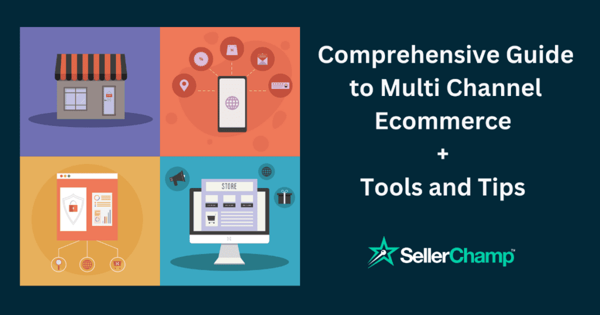
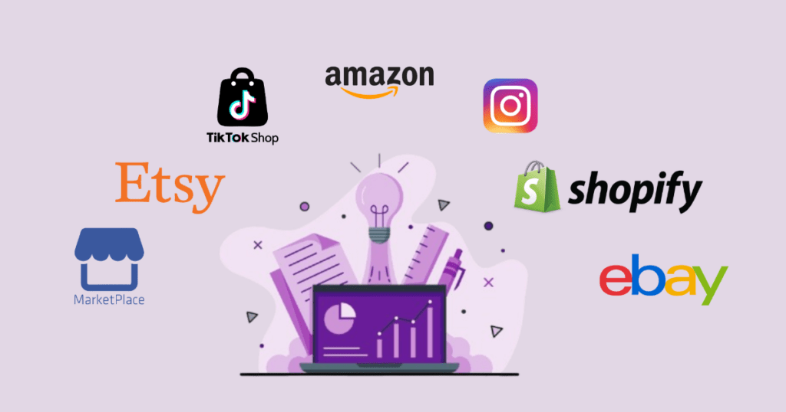
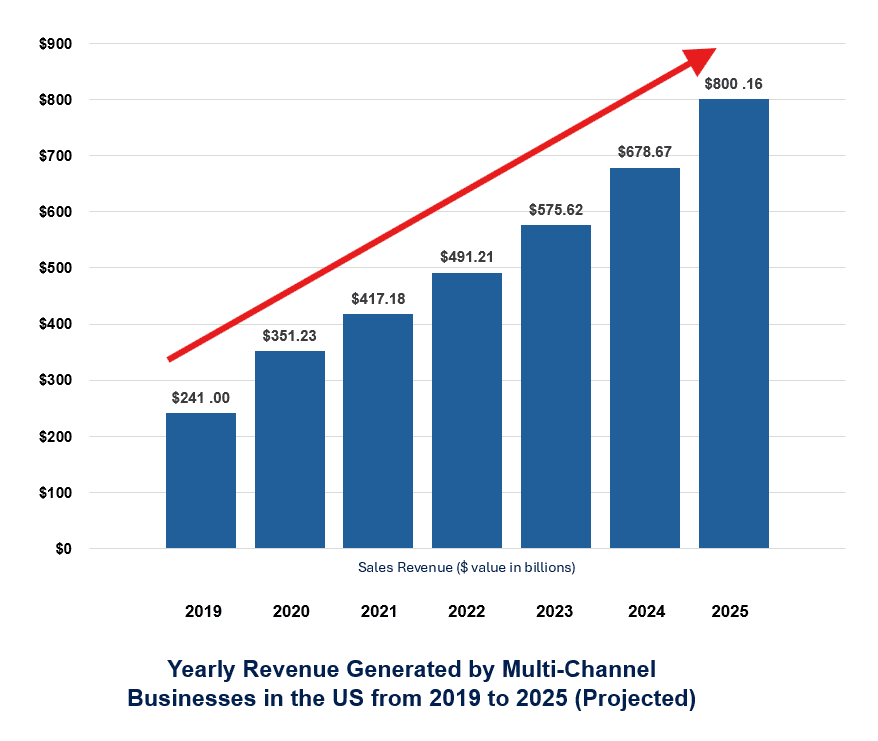
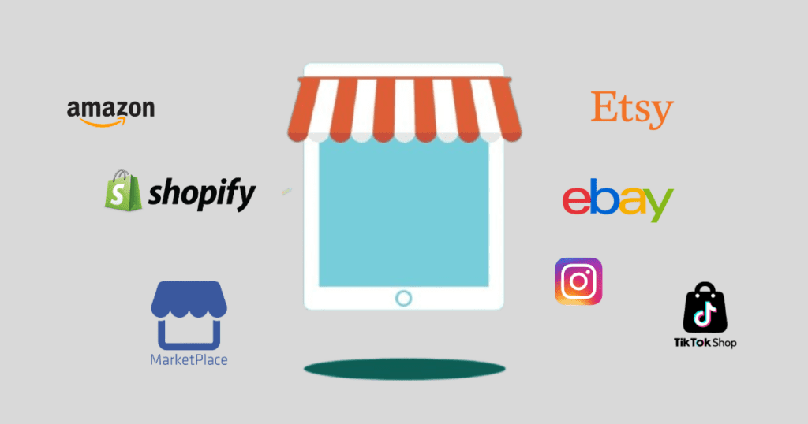

 In today’s competitive market, relying on a single selling channel is not enough. In fact, some may go as far as to say it restricts growth and constraints. Therefore, to meet the evolving consumer demands, top e-commerce sellers are adopting <b>Multi Channel E-Commerce.</b> Multi-channel sales strategies empower businesses to remain resilient, mitigate risks, and adapt to evolving market dynamics. But how does this approach work? In this comprehensive guide, we dive deep into what <b>multi-channel selling</b> is and how it works. From its <b> benefits to practical implementation</b>, you’ll find everything you need to know to successfully adopt this approach.

{{ site.app.leads }}?utm_source=blog&utm_campaign=multi-channel-ecommerce-guide


<h2>What is Multi-Channel E-Commerce?
</h2>

 Multi-channel e-Commerce is a <b> comprehensive approach to sales</b> in which products are sold across multiple platforms to reach a wider audience. This includes marketplaces like Amazon and eBay, social media channels like Instagram and TikTok, e-commerce websites, and even physical stores.

<i>Multichannel selling is being present wherever your customers might be. By embracing multichannel selling, you increase your discoverability and enhance customer convenience, making shopping easier for them.</i>

 With multi-channel selling, the goal is to <b>maximize reach, boost sales</b>, and build a <b>loyal customer base</b>.

<h2>Why Do Sellers Need Multi-Channel E-commerce?
</h2>

Relying on a single platform is for e-commerce players to achieve maximum growth potential. Single-channel sellers risk <b> losing revenue</b> if their chosen platform undergoes algorithm changes, stricter policies, or technical issues.

<i>With multi-channel selling, you take control of your business and sales, independent of third-party platforms.</i>

<ul>
<li>Sellers using multi-channel strategies generate <b>higher profits </b> compared to those relying on a single platform.</li>
<li>With increased sales, businesses grow faster and can access <b>greater expansion opportunities.</b></li>
<li><b>72% of customers</b> prefer engaging with brands across <a href="https://www.guruscoach.com/multichannel-marketing-statistics/?utm_source=chatgpt.com">multiple channels</a>. </li>
<li>eCommerce sellers using <a href="https://devrix.com/tutorial/multichannel-selling/">three or more channels</a> generate <b>143% more revenue</b> than those relying on one or two </li>
<li><a href="https://wisernotify.com/blog/omnichannel-stats/">Over 70% of customers</a> prefer to switch between <b>different purchasing methods</b> —buying online, in-store, or via different online channels, etc.</li>
<li>Consumers have <b>varying preferences</b> when choosing where they buy from. Selling on multiple channels increases the likelihood of your business being on a preferred platform. </li>
<li>Each sales channel offers <b>distinct strengths.</b> For instance, Amazon excels with its expansive inventory, while TikTok Shop offers convenience and the potential for impulsive purchases. By targeting multiple channels, you can not only reach a broader audience but also <b> leverage different strategies</b> that align with each platform’s unique characteristics.</li>
</ul>

<h2>How are E-Commerce Market Trends Supporting the Shift to Multi-Channel Selling?
</h2>

 As market dynamics and consumer needs evolve, businesses and marketplaces are responding with more <b>flexible and integrated shopping</b> experiences, driving a shift towards multi-channel selling Here are some key eCommerce trends shaping the shift towards multi-channel selling:

<h3>1. Consumer Preference for Convenience
</h3>

Modern consumers increasingly seek <b>easy and seamless</b><a href="https://www.pwc.com/us/en/services/consulting/library/consumer-intelligence-series/future-of-customer-experience.html"> shopping experiences</a>. Today, every 1 in 3 customers is willing to <b>drop a brand</b> they love after just one bad experience.

<i>More than two-thirds of companies now largely compete on</i><a href="https://www.gartner.com/en/marketing/insights/articles/key-findings-from-the-gartner-customer-experience-survey"><i> customer service and satisfaction rates</i></a><i>. In such a competitive landscape, investing in positive customer service is a key route to success.</i><a href="https://www.gartner.com/en/marketing/insights/articles/key-findings-from-the-gartner-customer-experience-survey"><i>
</i></a>

 Since even a single poor experience can lead to the <b> loss of a loyal customer</b>, ensuring satisfaction and reducing friction in the purchasing process is essential for long-term success. Multi-channel sales strategies help businesses to:

<ul>
<li>Better address <b>evolving consumer needs</b></li>
<li>Enhance brand <b>visibility </b> and <a href="/blog/how-to-attract-online-customers/">attract online customers </a></li>
<li>Drive higher <b>engagement </b> and sales.</li>
<li>Understand <b> customer needs</b> better and improve services.</li>
</ul>

<h3>2. Expansion of Online Marketplaces
</h3>

The growth of platforms like Amazon, eBay, and social commerce sites has opened new avenues for businesses to <b>reach diverse customer bases.</b> As marketplaces compete and improve their services and features, it allows sellers to <a href="/blog/sell-on-multiple-marketplaces/">go for multiple sales channels </a>rather than simply <b> picking one or two.</b> This approach allows them to tap into each platform’s best features and established audiences, to increase sales opportunities.

<h3>3. Technological Advancements
</h3>

Automation and integration tools are revolutionizing how businesses operate. Without compromising on operational efficiency or sales, these tools help <a href="/blog/automated-inventory-management/"><b>optimize inventory, </b></a><b>enhance performance</b>, and do much more across multiple sales channels.

<i>Over the past two years, 68%</i><a href="https://www.businessdasher.com/technology-in-business-statistics/"><i> of businesses using technology</i></a><i> for efficiency, innovation, and growth have seen revenue improvements. Additionally, 76% report operational cost reductions as a direct result of technology.</i><a href="https://www.businessdasher.com/technology-in-business-statistics/"><i>
</i></a>

 As technology makes conducting business easier and more efficient, it further pushes the shift towards multi-channel strategies’ adoption. The integration of Artificial Intelligence into business software is also accelerating this shift, promising even <b> greater growth and innovation </b> in the future.

<h3>4. Increased Revenue Potential
</h3>

Research indicates that retailers selling on multiple channels generate <b>more revenue</b> than those on fewer channels.

<ul>
<li>Multi-channel shoppers, on average, spend 3x more than those who buy from a single channel only. </li>
<li>With approximately, 3/4th consumers preferring to buy from multiple channels, diversifying sales channels allows you to <b>access more opportunities</b> for higher revenue.</li>
<li>eCommerce sellers using multiple channels make approximately <b> 1.5 times</b> more than competitors.</li>
<li>Revenue generated by multi-channel sales has steadily <b> increased since 2019.</b> This has prompted a growing number of businesses to adopt this strategy each year.</li>
</ul>

<h3>5. Enhanced Brand Visibility and Identity
</h3>

Being active on multiple platforms—such as online marketplaces, social media, and dedicated eCommerce sites—ensures customers encounter your brand across <b>diverse touchpoints</b>. This consistent exposure helps reinforce <b>brand recognition and memorability</b>, fosters greater trust, and cultivates long-term loyalty.

<i>Over 70% of customers prefer interacting with brands across multiple channels, with frequent, </i><a href="https://blog.flarelane.com/nine-statistics-about-cross-channel-marketing-you-should-know/"><i>multi-channel interactions</i></a><i> boosting average revenue per customer by up to 30%.</i>
<i>
</i>

<h2>5 Common Problems with Single-Channel Selling
</h2>

 As market dynamics and consumer needs evolve, businesses and marketplaces are responding with more <b>flexible and integrated shopping</b> experiences, driving a shift towards multi-channel selling Here are some key eCommerce trends shaping the shift towards multi-channel selling:

<h3>1. Limited Customer Reach
</h3>

Relying on a single platform limits your business to a narrow audience. For instance, selling exclusively on Amazon will limit your access to <b>billions of potential customers</b> on social platforms and other marketplaces. In contrast, brands with presence on multiple channels experience up to <b>89% customer retention rates,</b> outperforming competitors.

<h3>2. Revenue Dependency
</h3>

While single channel approaches can be excellent at kicking off your business, using them as a long-term solution carries <b>significant risks</b>. Selling on a single platform makes your business <b>heavily dependent</b> on it, and any disruptions or changes to the platform can directly impact your revenue. This is why it is important to <b>diversify your approach</b> and<a href="/blog/ecommerce-branding-strategies/"> establish your own brand identity,</a> rather than just being a marketplace seller.

<h3>3. Brand Visibility
</h3>

Marketers frequently use multi-channel campaigns to boost brand visibility and engagement. This concept carries to the sales domain too, as the average engagement rate of a <b>single-channel campaign is 5.4%</b> whereas for a multi-channel campaign, it’s over <b>12 times higher</b> at 18.96%.

<h3>4. Operational Challenges
</h3>

Managing inventory and orders without integrated systems can lead to <b>overselling, delays, and inefficiencies.</b> Conversely, an integrated multi-channel sales strategy, despite being more resource- and time-intensive than single-channel sales, ensures <b>better coordination and accuracy</b> across platforms. Such a strategy enables businesses to reduce operational challenges and avoid errors for smoother processes.

<h3>5. Lack of Data Insights
</h3>

Single-channel selling restricts a business from gathering comprehensive data from multiple customer touch points. This can lead to a limited understanding of customer behavior, buying patterns, and overall performance metrics.

<ul>
<li>Single-channel selling restricts the data you can track and analyze. This makes it challenging to understand customer journeys and preferences, further limiting your ability to tailor marketing efforts and improve decision-making.</li>
<li>A lack of actionable data insights can lead to missed opportunities, inaccurate forecasting, and suboptimal business strategies.</li>
<li>While inventory management may seem straightforward with a single channel, fluctuating demand can make it difficult to track and optimize stock levels effectively.</li>
</ul>

<h2>Single-Channel Fulfillment vs. Multi-Channel Fulfillment
</h2>

<table id="tablepress-39" class="tablepress tablepress-id-39 blogborder">
<thead>
<tr class="row-1">
<th class="column-1">Aspect</th><th class="column-2">Single-Channel Sales</th><th class="column-3">Multi-Channel Sales</th>
</tr>
</thead>
<tbody>
<tr class="row-2">
<td class="column-1">Revenue Potential</td><td class="column-2">Limited</td><td class="column-3">High</td>
</tr>
<tr class="row-3">
<td class="column-1">Customer Reach</td><td class="column-2">Limited to one platform</td><td class="column-3">Reaches customers across multiple platforms</td>
</tr>
<tr class="row-4">
<td class="column-1">Brand Visibility</td><td class="column-2">Restricted</td><td class="column-3">Enhanced visibility across various channels</td>
</tr>
<tr class="row-5">
<td class="column-1">Engagement Rate</td><td class="column-2">5.4%</td><td class="column-3">18.96% (up to 12x higher)</td>
</tr>
<tr class="row-6">
<td class="column-1">Platform Dependency/Risk</td><td class="column-2">High</td><td class="column-3">Low</td>
</tr>
<tr class="row-7">
<td class="column-1">Scalability</td><td class="column-2">Limited and difficult</td><td class="column-3">High</td>
</tr>
<tr class="row-8">
<td class="column-1">Inventory & Order Management</td><td class="column-2">Inefficient, prone to overselling & delays</td><td class="column-3">Centralized, reducing overselling & delays</td>
</tr>
<tr class="row-9">
<td class="column-1">Operational Costs and Efficiency</td><td class="column-2">Higher due to lack of integration</td><td class="column-3">Reduced due to streamlined systems & automation</td>
</tr>
<tr class="row-10">
<td class="column-1">Customer Engagement</td><td class="column-2">Limited</td><td class="column-3">Frequent and seamless experiences</td>
</tr>
<tr class="row-11">
<td class="column-1">Sales Performance</td><td class="column-2">Lower engagement & conversion rates</td><td class="column-3">Higher engagement, increased sales & customer retention</td>
</tr>
</tbody>
</table>

<h2>What Challenges Can Sellers Face Implementing Multi-Channel Ecommerce?
</h2>

<h3>1. Inventory Management
</h3>

As you sell on multiple channels keeping stock counts accurate and managing warehouse space effectively can become a challenge, leading to <b>delays or defects in shipments</b>.

<ul>
<li>Without real-time updates, there’s a risk of overselling or running out of stock, which leads to <b>poor customer experiences and lost sales</b>.</li>
<li><b>Forecasting sales</b> is an effective way to maintain optimal inventory levels at all times. While it is fairly simple to do so with single-channel selling, working on multiple marketplaces without the right tools can make this task particularly difficult and error-prone.</li>
</ul>

<h3>2. Order Synchronization
</h3>

Managing multiple channels manually requires significant focus and attention, making it time-consuming and prone to errors. As customers place orders across different platforms in a multi-channel setup, <b>inconsistencies,</b>

<b>delays, and errors </b> can easily arise. According to research by <b> McKinsey & Company, </b> businesses that rely on outdated methods to <a href="https://www.mckinsey.com/capabilities/growth-marketing-and-sales/our-insights/sales-automation-the-key-to-boosting-revenue-and-reducing-costs">keep track of orders and sales</a> experience up to <b>30% more errors</b>. These errors can include double orders, wrong shipping addresses, and missed shipments, all contributing to customer dissatisfaction.

<h3>3. Platform-Specific Policies
</h3>

Each sales platform comes with its own <b>unique and strict policies</b> regarding commission structures, shipping requirements, and content standards. While extensive policies are common, they also place businesses in a <b>vulnerable position</b>, where any unfavorable change can lead to a significant loss.

<ul>
<li><b>Amazon </b> has strict rules on product listings, pricing, shipping, etc, which require constant monitoring and adjustment. Failure to comply with these guidelines can lead to <b>reduced visibility, lost sales</b>, or account suspension. According to Forbes, <a href="https://www.forbes.com/councils/forbesbusinesscouncil/2022/08/11/amazon-account-suspension-101-why-it-happens-and-how-to-bounce-back/">Amazon suspends thousands </a>of accounts every year, often without explanation, and views sellers as replaceable. Selling without a <b>backup plan</b> in such a marketplace carries significant risk.</li>
<li>Similarly, platforms like <b>Google Shopping</b> have strict requirements for titles, product descriptions, and data presentation. Non-compliance on Google can lead to <a href="https://support.google.com/merchants/answer/12153802">immediate suspension</a>.</li>
<li>Many times, stores also focus on <b> homogenising offerings </b> for convenience and comparison which can impact sellers’ growth and goals negatively. </li>
</ul>

<h3>4. Time and Resource Intensive
</h3>

Manually managing multiple channels is both <b>time-intensive and error-prone</b>. As businesses scale, the complexity of handling various platforms, tracking inventory, and managing orders manually increases significantly. Without proper automation or centralized systems, businesses struggle to streamline processes and often face stock discrepancies, <b>missed orders, and delays in fulfillment</b>. Investing in technology and training to address these complexities can help simplify operations, improve efficiency, and create a foundation for business growth and expansion.

<h2>Solutions to Set Up Multi-Channel E-commerce
</h2>

While managing the complex challenges of multi-channel ecommerce can be tough, <b>the right approach</b> can ensure efficient operations that drive growth and customer satisfaction. Below are four simple strategies to tackle problems associated with multi-channel e-commerce:

<h3>1. Centralized Inventory Management
</h3>

With centralized inventory management, all products are stored at a single physical location and stock management for all marketplaces is integrated on one dashboard.

<ul>
<li>By using centralized inventory with multi-channel selling systems, you can sync stock updates across all platforms in real-time. This is crucial, as over <b>50% of global e-shoppers</b> have reported being unable to purchase products due to<a href="https://www.statista.com/statistics/1315232/out-of-stock-impact-on-online-shopping-by-country/"> out-of-stock issues. </a></li>
<li>According to research by Capgemini, businesses using integrated inventory systems experience a <b> 20% increase in inventory accuracy</b> and a 15% improvement in order fulfillment rates.</li>
<li>Centralized and <a href="/blog/automated-inventory-management/">automated inventory management </a>enables precise <b>demand forecasting and efficient procurement.</b> This can include frequently purchasing a product that runs out faster, or holding off on those that don’t sell well.</li>
</ul>

Centralized systems reduce errors caused by manual stock tracking and ensure that inaccuracies in inventory data are minimized. With centralized systems for a multi-channel business, you can reduce storage and shipping costs to make it easy to expand your business.

<h3>2. Order Management Systems
</h3>

An order management system automates <b> the processing, tracking, and fulfillment of orders, reducing errors and delays</b>, helping businesses simplify operations. It improves process efficiency and reduces errors by overseeing and managing the entire life cycle of an order, and tracking each step in the order fulfilment process.

<ul>
<li>Businesses using automated <a href="/blog/order-processing-definition-key-steps/">order processing and management </a>systems report up to <b> 67% improvement in fulfillment speed.</b></li>
<li>Order automation minimizes costs by reducing the reliance on <b>manual processes.</b></li>
<li>By streamlining order processing, businesses can free up resources to focus on other critical operations like marketing or customer services. Order management systems can help businesses <b> cut management costs</b> by an average of 70%.</li>
<li>With an order management system, you can provide real-time tracking updates to improve transparency and customer trust. </li>
</ul>

<h3>3. Data-Driven Decisions
</h3>

Data analytics allow you to identify top-performing platforms and products to refine strategies and prices for success.

<ul>
<li>Over <b>80% of businesses</b> using <a href="https://www.pragmaticinstitute.com/resources/articles/data/datas-impact-on-revenue-turning-data-insights-into-profits/">real-time data report increased revenues. </a></li>
<li>Companies that implement data analytics for decision-making report <b> 6x increased likelihood of customer retention.</b><a href="https://www.glew.io/articles/how-retail-analytics-can-boost-sales-and-customer-insights-glew"><b>
</b></a></li>
<li>Sellers leveraging data insights experience <b>30% decrease in stockouts</b> and 20% reduction in over-accumulated inventory. By aligning their inventory strategies with platform-specific and other trends, such businesses can easily improve sales and <b> reduce excess inventory.</b>
</li>
</ul>

<h3>4. Brand Consistency
</h3>

One common challenge businesses face with multi-channel sales is a <b> lack of consistency </b> in brand identity across different platforms. This can negatively impact brand recognition and customers’ perception of the business. The solution is to <b>standardize </b> messaging, design, and customer service across all sales channels to create a seamless brand experience.

<ul>
<li>Maintain a consistent identity across all your platforms. When customers recognize your presence on multiple channels or remember having made a previous purchase, they are more likely to make a repeat purchase too. </li>
<li><a href="https://wisernotify.com/blog/branding-stats/#:~:text=sales%20and%20revenue.-,Top%20Branding%20Statistics,impressions%20to%20produce%20brand%20awareness">Statistics show that 50% customers </a>prefer to <b>buy from brands they recognize and remember</b>, with an average of <b>6 to 7 impressions</b> being required to become recognizable. </li>
</ul>

<h3>5. Cross-Channel Promotions and Incentives
</h3>

Cross-channel promotions, such as discounts for customers who shop from different access points, are a powerful way to <b>drive engagement and traffic. </b> By encouraging customers to interact with your brand across multiple platforms, you can enhance customer retention <b>, boost repeat business, </b> and create a seamless brand experience.

<ul>
<li>Cross-channel promotions allow you to collect data from customers engaging with your brand on various platforms. This data can help <b> identify and retain loyal customers</b> while attracting new ones.</li>
<li>You can offer <b>platform-specific discounts </b> or exclusive deals for customers making purchases across different channels to encourage engagement.</li>
<li>Building a consistent brand experience can ensure an integrated experience no matter where a customer interacts with you. This establishes that every interaction with your brand will <b>bring value</b>, regardless of the channel chosen.</li>
</ul>

With only <b>14% of organizations </b> currently running coordinated<a href="https://pipeline.zoominfo.com/marketing/multichannel-marketing-statistics"> multi-channel campaigns</a>, there is a significant opportunity to gain a competitive advantage by leveraging this strategy effectively.

<h2>Tools for Multi-Channel Management
</h2>

<table id="tablepress-38" class="tablepress tablepress-id-38 blogborder">
<thead>
<tr class="row-1">
<th class="column-1">Multi-Channel Sales’ Management Tools</th><th class="column-2">Functionality</th><th class="column-3">Key Benefits</th>
</tr>
</thead>
<tbody>
<tr class="row-2">
<td class="column-1">Centralized Inventory Systems</td><td class="column-2">Track inventory across all platforms</td><td class="column-3">Prevent overselling and stockouts 
  Improve demand forecasting 
 
</td>
</tr>
<tr class="row-3">
<td class="column-1">Order Management Systems</td><td class="column-2">Automate order processing and tracking</td><td class="column-3">Reduce errors and speed up fulfillment</td>
</tr>
<tr class="row-4">
<td class="column-1">Data Analytics Tools</td><td class="column-2">Analyze sales data to improve decisions</td><td class="column-3">Strategic optimization of sales strategies and stock levels</td>
</tr>
<tr class="row-5">
<td class="column-1">Automation Tools</td><td class="column-2">Sync inventory and product listings across channels 
  Automate business operations and fulfillment</td><td class="column-3">Reduce manual work and increase efficiency while reducing financial burden</td>
</tr>
<tr class="row-6">
<td class="column-1">Repricing Tools</td><td class="column-2">Track market rates consistently and adjust sale prices optimally</td><td class="column-3">Ensure competitive pricing in a crowded market</td>
</tr>
<tr class="row-7">
<td class="column-1">Customer Engagement Platforms</td><td class="column-2">Manage interactions with customers and campaigns across platforms</td><td class="column-3">Enhance customer loyalty and engagement</td>
</tr>
</tbody>
</table>

<h2>Tips to Implement Multi-Channel E-commerce Management
</h2>
<b>✅ Scale Gradually</b>: Avoid overwhelming yourself by expanding to multiple platforms simultaneously. Start with one or two additional channels, and progress as performance improves. <b>✅ </b><b>Automate</b>: Utilize automation tools to manage repetitive tasks, such as synchronizing inventory and updating product listings. This will allow you to focus more on growth-oriented activities. <b>✅ </b><b>Prioritize Data: </b> Leverage data analytics to track performance for each channel and make logical decisions with high precision predictions. <b>✅ </b><b>Tailor Platform Strategies</b>: Adapt your approach for each platform’s unique audience. For example, create engaging short-form content for TikTok, but prioritize detailed descriptions and customer reviews for Amazon. <b>✅ </b><b>Consistent Branding: </b> Ensure that your brand’s messaging, visuals, and tone remain uniform across all platforms to establish trust and credibility. <b>✅ Be Tactical with Customer Engagement: Develop platform-specific campaigns, such as exclusive discounts and interactive content, to engage audiences and boost loyalty.</b>
<b>✅ </b><b>Stay Informed on Market Trends</b>: Regularly monitor changes in e-commerce trends and platform updates to maintain a competitive advantage. <b>✅ Delegate When Necessary: Consider outsourcing specialized tasks, such as content creation and logistics management, to optimize efficiency and focus on core operations. Automation is also an efficient way to simplify your tasks by delegation without compromising on accuracy. </b>

<iframe width="1318" height="300" src="https://www.youtube.com/embed/1rbiFIKWtQA" title="SellerChamp Introduction Video" frameborder="0" allow="accelerometer; autoplay; clipboard-write; encrypted-media; gyroscope; picture-in-picture; web-share" referrerpolicy="strict-origin-when-cross-origin" allowfullscreen></iframe>

<h2>SellerChamp for Multi-Channel Fulfillment
</h2>

SellerChamp provides a <b> powerful, all-in-one solution</b> to simplify complexities and help you sell smarter and scale faster. Here are four key features that SellerChamp offers to help businesses maximize revenue and growth with multi-channel e-commerce.

<h3>1. Bulk Lister
</h3>

With <a href="/bulk-lister-seller-champ/"><b>SellerChamp’s Bulk Lister</b></a>, you can <b>upload thousands of products</b> on sales channels of your choice in minutes and with exceptional accuracy. Bulk Lister allows you to <b> create and manage </b> product variations, bundles, and kits effortlessly to save time and manual labor.

<h3>2. RePricer
</h3>
<a href="/repricer-software/">SellerChamp’s RePricer</a> Software optimizes prices in real-time to <b>capture and retain customer attention</b>. It continuously <b>tracks competitor price changes </b> and adjusts your prices in real-time to make sure that you’re neither selling too low to reduce profitability, nor at costs too high to lose customers.

<h3>3. Inventory Management Module
</h3>

SellerChamp offers real-time<a href="/inventory-sync-software/"> Inventory Management Module </a>updates to ensure that stock quantities remain synced across all sales channels. No matter which platform you make a sale on, SellerChamp makes sure that the inventory is updated automatically to <b>prevent stock level misrepresentation</b> and avoid missed sales.

<h3>4. Insights & Reporting
</h3>

Track sales and profits across multiple channels with <b>intelligent, consolidated reports </b> by <a href="/ecommerce-analytics-tool-insights-reports/">SellerChamp’s Insights & Reporting tool</a>. The Insights & Reporting tool provides a comprehensive view of sales, inventory, and expenses, with detailed data analytics to help sellers <b>make informed decisions</b> and optimize overall performance.

<h3>5. Integrations
</h3>

SellerChamp offers seamless <a href="/integrations/">one-click integrations</a> with leading marketplaces, shopping carts, and service providers to ensure that everything works together. SellerChamp integrations eliminate the hassle of juggling multiple systems, and provide access to all the necessary tools and systems from <b>a single dashboard.</b> You can also integrate SellerChamp with all major marketplaces, shipping service providers, and shopping carts. SellerChamp aims to give businesses the control to focus on what matters most: growth and expansion. Whether you’re a dropshipper or a retailer, SellerChamp can help you stay competitive and thrive.

<h2>Reach out to the SellerChamp team today and learn more about managing your multi-channel business for success
</h2>

Check out SellerChamp today and simplify your wholesale e-commerce business!

<h5>Try SellerChamp for Yourself!
</h5>

Request a demo now to see how it works. <strong><a style="color: #ffffff;" href="https://app.sellerchamp.com/users/sign_up?_gl=1*o3jeep*_gcl_au*MjAyMjAzNDgwNi4xNzM3MDY4MTgx*_ga*MTc1MDE5MTE4MS4xNzM3MDY4MTgx*_ga_F2WQV1CVLC*MTc0MDI0MjYyNy4yMy4xLjE3NDAyNDU3MzYuMjMuMC4xOTY0MDkyODcz&_ga=2.13502066.494858753.1740095606-1750191181.1737068181">Get Started Here!</a></strong>

