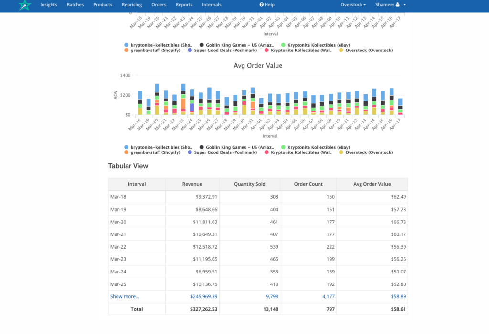
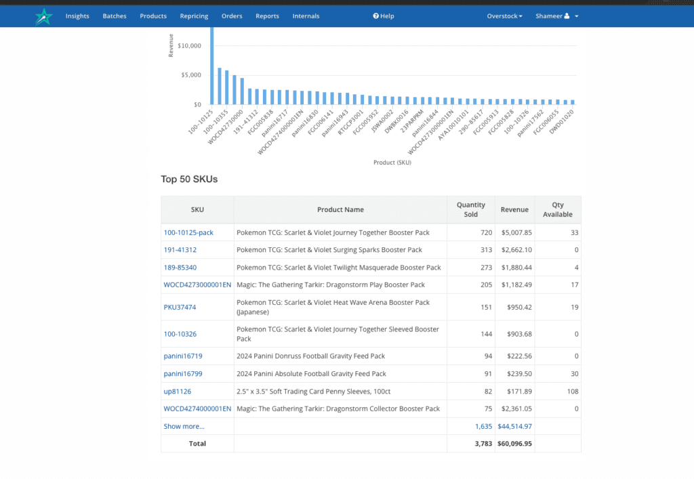
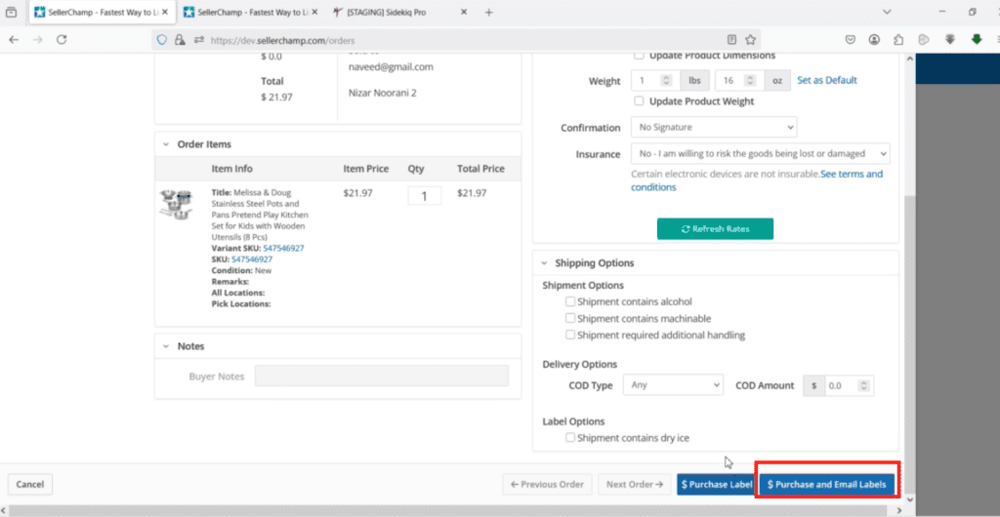
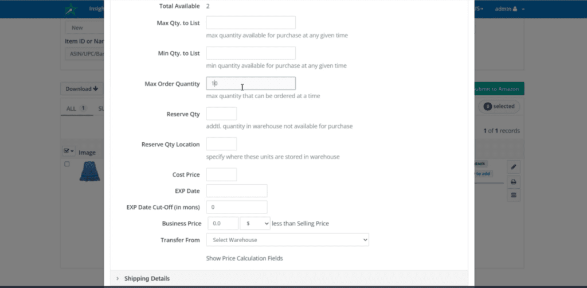

 We’ve made some exciting improvements this month that we think you’ll love! From smarter insights to time-saving tools, these updates are here to make your day-to-day smoother and more efficient. Let’s dive into what’s new this April!

<h2>Smarter Insights at a Glance
</h2>

 Quickly understand how your business is doing with a clearer view of your order trends. <b>What’s New:</b> We’ve added <b>Order Count</b> and <b>Average Order Value</b> to the Revenue Over Time table on the Insights page. <b>Why It Matters:</b> Now you can easily track how many orders you get each day and the average value per order, helping you make smarter decisions faster.

<h2>Deeper SKU-Level Insights
</h2>

 Keep better track of how each product is performing, right down to the SKU. <b>What’s New:</b> The <b>TOP 50 SKUs</b> table now includes <b>Total Revenue</b> for your chosen date range and <b>Current Quantity Available</b>. <b>Why It Matters:</b> You get a full snapshot of your top sellers and how much stock is left, perfect for managing inventory and planning your next move.

<h2>Purchase & Email Shipping Labels
</h2>

 Make shipping labels work even harder for you—without extra steps. <b>What’s New:</b> You can now <b>buy and email shipping labels</b> in one simple step. Just add an email to your Ship From address, and the label will be sent automatically once purchased. <b>Why It Matters:</b> No need to download or manually forward labels—just select, buy, and we’ll handle the rest.

<h2>Set Max Order Quantity for Amazon Listings
</h2>

 Put a limit on how many units customers can buy on Amazon. <b>What’s New:</b> A new <b>Max Order Quantity</b> field is now available when editing Amazon products. <b>Why It Matters:</b> Great for protecting your inventory and preventing bulk purchases—especially helpful during promos or limited-time offers. <b>Did You Know?</b> Two new marketplaces have joined the SellerChamp family! <b>What’s New:</b> You can now connect to <b>Newegg</b> and <b>Overstock</b> through your SellerChamp account. <b>Why It Matters:</b> More platforms mean more customers and more opportunities to grow your business. If you need help setting it up, our team’s always here for you!

That’s all for this month! As always, we’re here to help and would love to hear your thoughts. <a href="/#">Drop us a message if you have questions,</a> feedback, or need a hand with anything.

Cheers, <b>The SellerChamp Team</b>

{{ site.app.leads }}?utm_source=blog&utm_campaign=april-product-updates


Schedule a demo today and discover how our Bulk Lister can help you list more products, increase sales, and grow your e-commerce business faster than ever.

