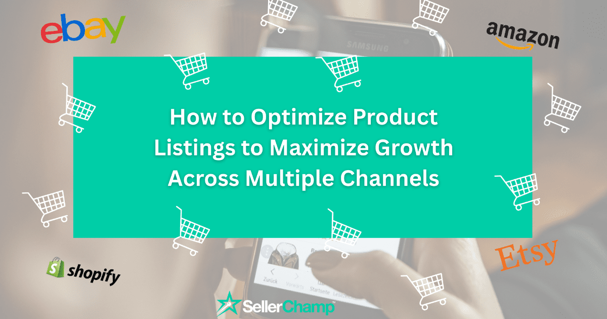
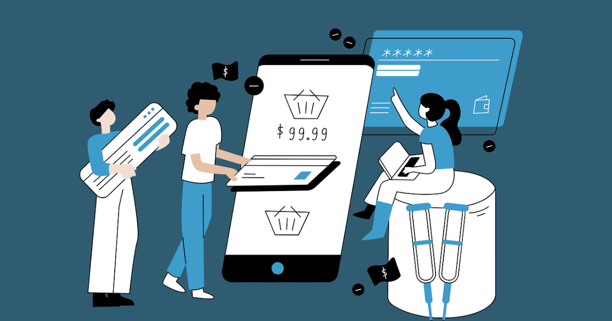

 Multi-channel selling can open up huge opportunities if your <b>product listings are optimized</b> to grab attention in a competitive environment. However, managing sales and inventory across channels can quickly become exhausting, leaving little time to focus on growth. In this guide, we’ll show you <b>practical ways to optimize listings </b> for each platform, helping you reach more customers, boost conversions, and scale sales with confidence.

<strong>You might also like:</strong><a href="/blog/sell-on-multiple-marketplaces/"><b> 13 Practical Strategies to Sell on Multiple Marketplaces</b></a><b>
</b>

{{ site.app.leads }}?utm_source=blog&utm_campaign=product-listing-optimization


<h2>1. Craft Titles That Get Found Everywhere
</h2>

<ul>
<li><b>Use relevant keywords in titles: </b> 75% of users never go past the first page of results; a <a href="/ecommerce-seo-checklist/">keyword-rich, SEO-optimized</a> title helps ensure you’re on page one of your search engine or marketplace. Include the product’s name, key features, and common search terms so algorithms can match it to buyer queries.</li>
</ul>

<ul>
<li><b>Follow each channel’s title guidelines: </b> Amazon allows up to 200 characters but prefers concise, info-rich titles, <a href="/blog/selling-on-amazon-vs-ebay-what-will-get-you-to-6-figures-faster/">whereas eBay</a> truncates after 80 characters. Tailor the length, and format your title so important info isn’t cut off.</li>
</ul>

<ul>
<li><b>Make it readable and specific: </b> Clear, specific listing titles attract the right shoppers and improve click-through rates. Be precise about model, color, size, etc., to grab buyers searching for those details. For example, prefer “Shockproof Black iPhone 13 Case with Screen Protector” over “Phone Case”.</li>
</ul>

<strong>Check out:</strong><a href="/blog/writing-the-perfect-product-listing-key-elements-to-drive-sales/"><b>Writing the Perfect Product Listing: Key Elements to Drive Sales.</b></a>

<h2>2. Write Descriptions That Turn Browsers into Buyers
</h2>

<ul><li><b>Highlight benefits and features:</b> Use descriptions to sell the product experience. Go for short paragraphs or bullet points to list features, dimensions, and how your product solves a problem or improves the buyer’s experience. A <a href="https://www.shopify.com/blog/8211159-9-simple-ways-to-write-product-descriptions-that-sell">great product description</a> can convert a hesitant buyer into a confident one.</li><li><b>Incorporate relevant keywords naturally:</b> Sprinkle in search terms buyers use (e.g., “waterproof phone case” or “organic cotton baby blanket”) for <a href="/blog/walmart-seo-mastering-keyword-optimization-for-top-rankings/">SEO</a>, but keep it readable without keyword stuffing.</li><li><b>Drive action and address questions:</b> Include a clear call-to-action and preempt common questions. If people often ask “Does this include batteries?” or “Is it machine-washable?”, put that info in the description. Eliminating doubts can<a href="https://www.lupasearch.com/blog/how-do-product-descriptions-affect-conversion-rates/#:~:text=Statistics%20suggest%20that%20accurate%20and,%5B1"> boost conversions</a> by up to 78%.</li><li><b>Use formatting to improve readability:</b> Break text into bullet points and short paragraphs with subheadings to make it easy for scanners to find details and trust you.</li>
</ul>

<strong>You might also like:</strong><a href="/blog/ecommerce-marketing-strategies/"><b>E-Commerce Marketing Strategies: How to Market Your E-Commerce Store in 2025</b></a>

<iframe width="1318" height="452" src="https://www.youtube.com/embed/6HTrvsz016s" title="Tips to Create Listings that Sell" frameborder="0" allow="accelerometer; autoplay; clipboard-write; encrypted-media; gyroscope; picture-in-picture; web-share" referrerpolicy="strict-origin-when-cross-origin" allowfullscreen></iframe>

<h2>3. Show Off with High-Quality Images
</h2>

<ul><li><b>Invest in great photos:</b>
<a href="https://claid.ai/blog/article/photos-impact-conversions/#:~:text=%2A%20For%2090,sales%20regardless%20of%20the%20category">90% of online buyers</a> say product photos are the most important factor for them when buying something online. Use multiple clear, high-resolution images from all angles to build trust instantly.</li><li><b>Show context and scale:</b> Include at least one image that shows the product in use or in context. If you’re selling a kitchen gadget, show it on a countertop or being held to help buyers gauge size and imagine using it. For wearable items, use models or real-life settings. <a href="https://www.wowcontly.com/blog/lifestyle-vs-product-only-photography-for-ecommerce">Lifestyle images can grab attention</a> and make your listing stand out.</li><li><b>Follow platform requirements:</b> Amazon requires at least 1000-pixel images with a pure white background for the main image, whereas eBay allows lifestyle shots in the gallery. It’s important to meet platform requirements for product listing optimization, to avoid bans, and to sell better. </li>
</ul>
<b>Tip: </b> Add a brief product demo video if your platform supports it. A 360° view or a how-to-use clip can further boost buyer confidence.

<strong>Check out:</strong><a href="/blog/multi-channel-inventory-management-solution-integration-steps/"><b>Multi-Channel Inventory Management Solution: Steps to Integrate Inventory Across Channels</b></a><b>
</b>

<h2>4. Price Competitively and Consistently
</h2>

<ul><li><b>Do your market research:</b> Shoppers can <a href="https://www.statista.com/statistics/1375931/price-comparison-online-shopping-habits-us/">compare prices</a> with a click, so you need to be in line with the competition; if you charge much more than others without extra value, many buyers will scroll past. Aim to be competitive while still profitable.</li><li><b>Make pricing a priority:</b> 60% of online shoppers worldwide say price is their #1 decision factor when choosing a product. This means even the best listing won’t convert if your price looks too high, so consider offering free shipping or bundle deals to add value if you can’t lower the price.</li><li><b>Keep prices aligned across channels:</b> 67% of US shoppers switch websites to get a better deal. Wherever possible, maintain consistent pricing after accounting for each channel’s fees.</li><li><b>Use dynamic pricing tools if needed:</b> For competitive niches, consider repricing software to <a href="/repricer-software/">adjust prices in real-time</a> based on rules (e.g., always $0.05 below the top competitor, or matching the lowest price while in stock). This helps you<a href="/blog/how-to-win-the-buy-box/"> win buy boxes</a> and stay competitive without constant manual checks.</li>
</ul>

<iframe width="1318" height="451" src="https://www.youtube.com/embed/tXLKxSWyqus" title="How to Cross-List and Sync Your Inventory from eBay to Amazon" frameborder="0" allow="accelerometer; autoplay; clipboard-write; encrypted-media; gyroscope; picture-in-picture; web-share" referrerpolicy="strict-origin-when-cross-origin" allowfullscreen></iframe>

<h2>5. Build Trust with Reviews and Ratings
</h2>

<ul>
<li><b>Encourage customer reviews:</b> Over <a href="https://www.webfx.com/blog/marketing/online-shopping-statistics/#:~:text=90%2B%20Online%20Shopping%20Statistics%20for,of%20consumers">90% of customers</a> read reviews as the final steps before buying. Encourage happy customers to leave feedback. For your own website, consider sending a polite follow-up email offering a discount on the next purchase for an honest review.</li>
<li><b>Highlight ratings in your listing:</b> A high rating badge makes your product more click-worthy. Products with 5+ reviews see significantly higher conversion rates than those with none, even a few 4-star reviews are better than zero.</li>
<li><b>Respond to reviews (even bad ones):</b> If someone leaves a critical review, respond professionally with an apology and a solution or clarification. This not only may win that customer back but also<a href="https://www.statista.com/topics/9736/online-reviews-in-e-commerce/#topicOverview"> signals to potential buyers</a> that you have great customer service.</li>
<li><b>Leverage Q&A sections:</b> If your sales channel supports a “Customer questions & answers” section, monitor it and provide prompt, clear answers to any new questions. </li>
</ul>

<strong>Check out:</strong><a href="/blog/ecommerce-growth-strategy/"><b>5 Proven Ecommerce Growth Strategies from 100K+ Revenue Success Stories</b></a><b>
</b>

<h2>6. Use Tools and Data to Continuously Improve
</h2>

<ul><li><b>Leverage analytics:</b> Track views, click-through rates, conversion rates, and keyword rankings if available. Many marketplaces offer reports, and for your website, you can use Google Analytics. Identify what’s working and what isn’t. Sellers who embrace <a href="/ecommerce-analytics-tool-insights-reports/">data-driven optimization</a> see 20% higher revenue growth on average.</li>
</ul>

<ul><li><b>Split-test when possible:</b> Some platforms or third-party tools allow A/B testing of listing elements (e.g., two different titles or images) to see which performs better. Even if you have to do it manually over time, experimenting can yield surprising insights.</li><li><b>Automate and save time:</b> Managing each channel separately is time-consuming and error-prone. Consider using a platform like SellerChamp to<a href="/blog/reasons-sellers-should-use-multi-channel-listing-tools/#:~:text=smarter%20decisions"> centralize your multi-channel listings.</a> A good tool enables <a href="/bulk-lister-seller-champ/">quick edits across platforms,</a> bulk uploads new products, and even auto-optimizes some content fields for your listing optimization.</li>
</ul>

<ul><li><b>Analyze and adapt:</b> Use the insights from your data to refine your strategy. If certain products sell faster on one marketplace, investigate why. Continually adapting based on performance data is how you maximize growth long-term.</li>
</ul>

<h2>Request SellerChamp Demo
</h2>
<b>Ready to grow faster across every channel? </b><a href="https://app.sellerchamp.com/leads/new"><b>Try SellerChamp today with a demo and see how easy it is to list, optimize, and scale.</b></a>

<h5>Try SellerChamp for Yourself!
</h5>

<a href="https://app.sellerchamp.com/users/sign_up?_gl=1*1ukisxs*_gcl_au*MzY0MTA0ODQyLjE3NDU1ODAyNTA.*_ga*MTc1MDE5MTE4MS4xNzM3MDY4MTgx*_ga_F2WQV1CVLC*czE3NDY1NzM1MDEkbzQ0JGcxJHQxNzQ2NTczNjM5JGo2MCRsMCRoMzc1MDYxMTU4&_ga=2.158060536.318104915.1746573501-1750191181.1737068181"><b>Request your personalized demo today </b></a>and experience smarter inventory management in action.

