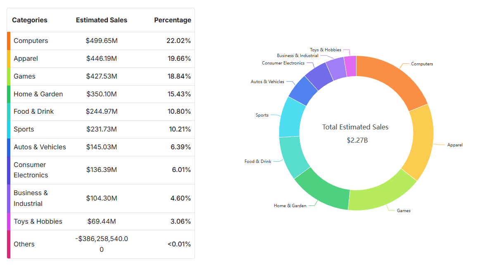
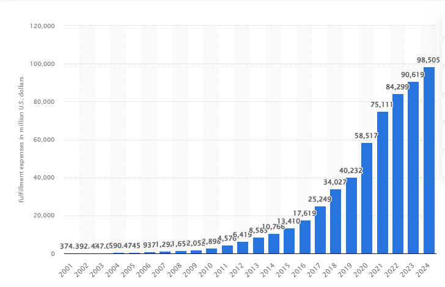
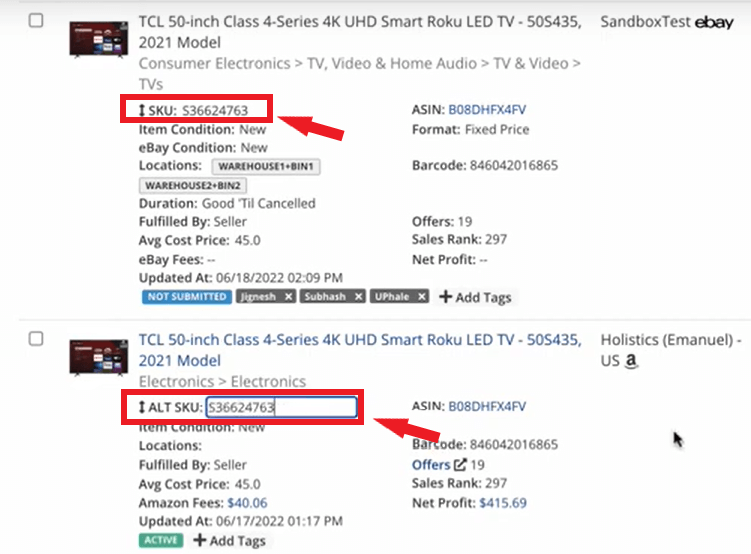
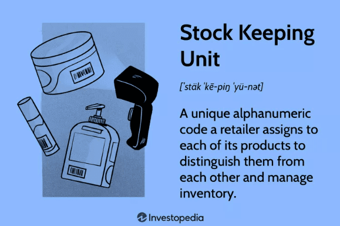



 Many marketers are in a love-hate relationship with ChannelAdvisor. On one hand, its customers earn approximately <a href="https://ecommerce.aftership.com/software/channeladvisor/statistics#:~:text=Monthly%20Sales%20of%20ChannelAdvisor%27%20Customers%20by%20Industry">$2.27 billion monthly</a>. And it’s well known for being great with channel integrations. However, ChannelAdvisor(Rithum) costs north of $1,000 monthly not including extra payments for implementation services or complex integrations. And if you’re <a href="https://www.reddit.com/r/ecommerce/comments/1fg1lqe/channeladvisor_alternatives/?utm_source=share&utm_medium=web3x&utm_name=web3xcss&utm_term=1&utm_content=share_button">a reseller losing money</a> and battling competitive trends like dropshipping, then you want a ChannelAdvisor(Rithum) alternative without the new problems. You want to eat your proverbial ChannelAdvisor cake and still have it. This article goes through a detailed side-by-side comparison of SellerChamp vs ChannelAdvisor.

{{ site.app.leads }}?utm_source=blog&utm_campaign=sellerchamp-vs-channeladvisor-comparison


<h2>SellerChamp vs ChannelAdvisor: Side-by-Side
</h2>

<table id="tablepress-58" class="tablepress tablepress-id-58 blogborder">
<thead>
<tr class="row-1">
<th class="column-1">Feature</th><th class="column-2">SellerChamp</th><th class="column-3">ChannelAdvisor</th>
</tr>
</thead>
<tbody>
<tr class="row-2">
<td class="column-1">Repricer</td><td class="column-2">Intelligent Repricer</td><td class="column-3">Automatic Repricer</td>
</tr>
<tr class="row-3">
<td class="column-1">Integrations</td><td class="column-2">One-click integrations with popular marketplaces and shopping carts</td><td class="column-3">Integrations with popular marketplaces.</td>
</tr>
<tr class="row-4">
<td class="column-1">Product Listing</td><td class="column-2">Bulk product listings via barcode scanning, file uploads, or imports</td><td class="column-3">Bulk products listing via csv or excel file</td>
</tr>
<tr class="row-5">
<td class="column-1">Target Customer</td><td class="column-2">Streamlined e-commerce operations for small to medium-sized businesses and larger businesses</td><td class="column-3">Comprehensive e-commerce solution for larger businesses and retailers.</td>
</tr>
<tr class="row-6">
<td class="column-1">SKU Flexibility</td><td class="column-2">ALT SKUs available for highly flexible product listing capabilities across several ecommerce marketplaces.</td><td class="column-3">Absent.</td>
</tr>
<tr class="row-7">
<td class="column-1">Pricing</td><td class="column-2">As low as $49/month + extra cost based on number of orders shipped per month</td><td class="column-3">As low as $1,500/month + extra costs for integrations</td>
</tr>
</tbody>
</table>

<h2>SellerChamp Key Features
</h2>

<h3>Smart Product Listing
</h3>

With ChannelAdvisor you’ll feel most comfortable listing your products with a CSV or Excel sheet.

SellerChamp, however, allows for a multitude of ways to list your product and a multitude of marketplaces you can list them.

<ol><li>Bulk Listing: There are several ways to bulk list including scanning the items’ barcodes, bulk-uploading a file or connecting to your vendor feeds. The Bulk Lister feature automates the listing process for you after that.

<iframe title="How to Upload, Delist and Relist Products Fast" src="https://www.youtube.com/embed/4ZiD2n3gGb0" width="451" height="282" frameborder="0" allowfullscreen="allowfullscreen"></iframe>

</li><li>Multi-Marketplace Listing: Having a multi-listing tool could be the decision that changes how your business operates. For one, being able to list on, say, Amazon, eBay, and etsy at once will definitely help <a href="https://www.commercethinking.com/p/overselling-vs-underselling">avoid overselling or underselling</a>.But most importantly for your bottomline, SellerChamp’s intelligent assistant helps you expand your product reach with the multi-marketplace listing feature. Also, because of the synced inventory, multi-marketplace analytics is made simple through the <a href="https://kb.sellerchamp.com/en/?q=reports">SellerChampTM manifest and inventory reports</a>.  </li><li>QuickSnap: If you’re limited to just your phone for one reason or another, with SellerChamp, you’re not limited by it. Snapping high-quality photos of your product from your mobile device and uploading them is yet another way to list those products. QuickSnap also allows you adjust product details, descriptions, tags, etc.  </li><li>Cross-List: Say you already have your products listed on Amazon and you just started selling on eBay, and you want to list those same products on eBay. With SellerChamp, all you have to do is connect your eBay to SellerChamp and then crosslist inventory from your other marketplaces, sync them with the <a href="/features/#inventory:~:text=each%20selling%20channel.-,Inventory%20Sync,-Cross%20Sell%20Your">SellerChampTM Inventory Sync</a> feature so they all update when changes are made, then begin selling!  

<iframe title="How to Cross-List and Sync Your Inventory from eBay to Amazon" src="https://www.youtube.com/embed/tXLKxSWyqus" width="318" height="282" frameborder="0" allowfullscreen="allowfullscreen"></iframe></li>
</ol>

<i> Read More: </i><a href="/blog/multi-channel-inventory-sync-system-a-boon-for-liquidators-and-retailers/"><i>Multi Channel Inventory Sync System – A Boon for Liquidators and Retailers</i></a>

<h3>Integrations
</h3>

SellerChamp provides on-click integrations on all marketplaces and shopping carts that you’re likely to use. Let’s break it down:

<ol>
<li><b>Marketplace Integrations</b>: The Multi-Marketplace listing feature doesn’t matter much if there aren’t multiple marketplaces with SellerChamp integrations. That’s why there’s a host of marketplace integrations including but not limited to:</li>

<ul>
<li>Amazon</li>
<li>Google Shopping</li>
<li>eBay</li>
<li>Walmart</li>
<li>Etsy</li>
<li>Bonanza</li>
<li>Poshmark</li>
<li>Macy’s</li>
<li>Overstock</li>
<li>Newegg</li>
</ul>
<li><b>Shopping Cart Integrations</b>: Just like marketplace integrations, you need a variety of choices where SellerChamp can be integrated. Afterall, platforms like <a href="https://www.chargeflow.io/blog/shopify-statistics#:~:text=They%27ve%20effectively%20captured%20~10.32%25%20of%20the%20market%20share">Shopify control a tenth of the market share</a>, so you want to be present place like that as well. SellerChamp integrates with shopping carts like Shopify, BigCommerce and WooCommerce.</li>
<li><b>Fulfillment Integrations</b>: Amazon FBA is the go-to for many marketers. And fulfillment costs for the company have risen steadily year-on-year.</li>
</ol>

 You should have the choice, if necessary, of access to other fulfillment partners that cater to unique needs you may have. SellerChamp offers some of these specific solutions. For example, if you want something that works well with Walmart or eBay, SellerChamp’s integration with Flexport is great and could earn you fast-shipping badges on those platforms. Or say you want to focus specifically on tire distribution, SellerChamp’s integrations with ATD and Capital Tire solves that very niche request. Find out more about API integrations below:

<iframe width="458" height="282" src="https://www.youtube.com/embed/G39tFTQ2Uuw" title="How to Use API and What to Do If It's Not Working" frameborder="0" allow="accelerometer; autoplay; clipboard-write; encrypted-media; gyroscope; picture-in-picture; web-share" referrerpolicy="strict-origin-when-cross-origin" allowfullscreen></iframe>

<h3>Inventory Management
</h3>

There are several inventory management features on SellerChamp that <b>will </b> elevate your brand. Let’s take a look at two of the most important that you’re not likely to find on traditional large business oriented platforms like ChannelAdvisor:

<ol>
<li><b>SKU Flexibility</b>: Have you ever been stuck in this situation where you want to sync two identical items across two marketplaces, but they have different SKUs? If you’ve been doing this long enough, of course you have.    If you were stuck in this scenario on Walmart or Amazon, you’d generally have to unlist and then relist the item for the desired changes to reflect.    However, with SellerChamp, you can just use the <b><i>ALT SKU (Alternate SKU)</i></b> feature to link both items together and keep them synced across multiple platforms.</li>
</ol>

<iframe width="458" height="282" src="https://www.youtube.com/embed/KsJR4_TIjvc" title="How to Sync Inventory across Multiple Marketplaces" frameborder="0" allow="accelerometer; autoplay; clipboard-write; encrypted-media; gyroscope; picture-in-picture; web-share" referrerpolicy="strict-origin-when-cross-origin" allowfullscreen></iframe> The SKU of any product is really important, so having the ability to manipulate is essential in any ecommerce inventory management platform you settle on.

<ol start="2">
<li>Intelligent Repricer: The <a href="/repricer-software/">SellecrChampTM Dynamic Repricer</a> has a track record of increasing customers’ <a href="https://feedvisor.com/university/amazon-buy-box/">Amazon Buy Box</a> spots by about 50%. This is a free visibility perk just being subscribed to SellerChamp.    Dynamic repricer operates on rules that you set around common sense factors like sales velocity, activity from competitors, etc. And best of all is that your repricer conditions can apply across all your marketplaces, freeing up time so you can do other stuff.</li>
</ol>

<h2>Request SellerChamp Demo
</h2>

Ready to simplify inventory chaos? Try SellerChamp for seamless multichannel stock syncing, faster fulfillment, and fewer errors.

<h5>Try SellerChamp for Yourself!
</h5>

<a href="https://app.sellerchamp.com/users/sign_up?_gl=1*1ukisxs*_gcl_au*MzY0MTA0ODQyLjE3NDU1ODAyNTA.*_ga*MTc1MDE5MTE4MS4xNzM3MDY4MTgx*_ga_F2WQV1CVLC*czE3NDY1NzM1MDEkbzQ0JGcxJHQxNzQ2NTczNjM5JGo2MCRsMCRoMzc1MDYxMTU4&_ga=2.158060536.318104915.1746573501-1750191181.1737068181"><b>Request your personalized demo today </b></a>and experience smarter inventory management in action.

