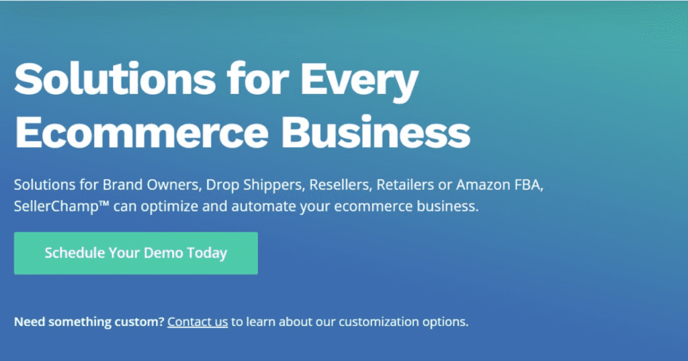
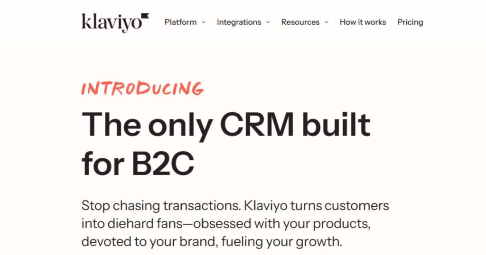
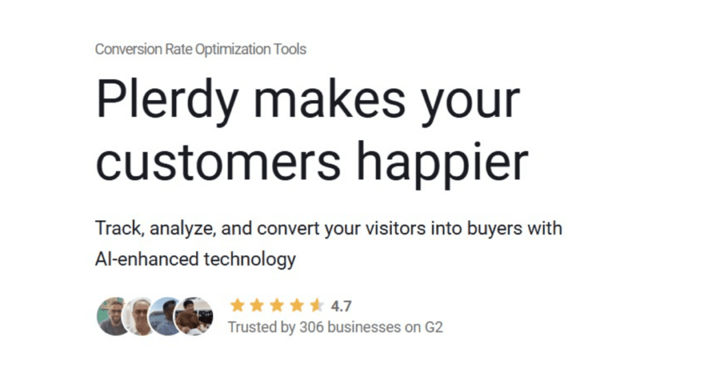
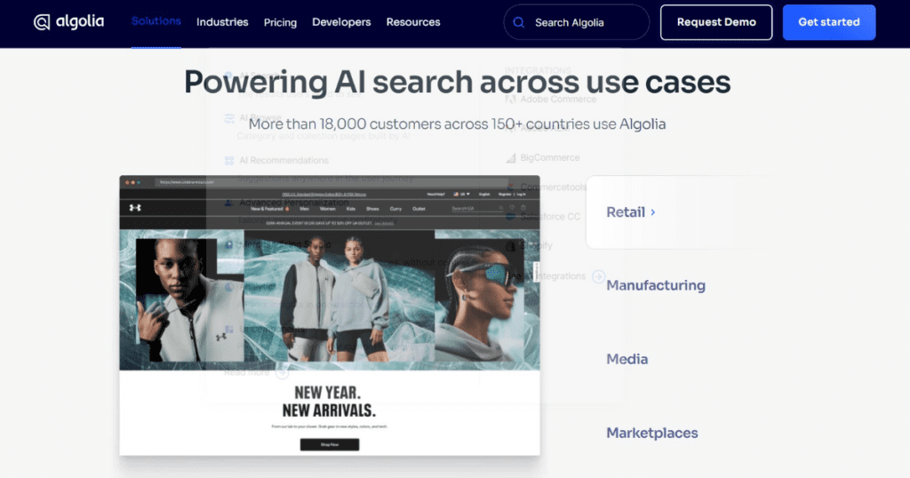
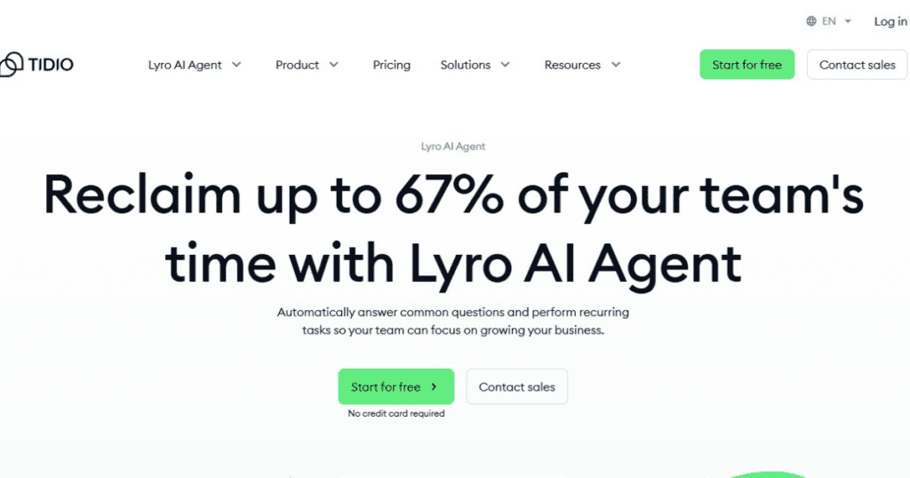

 With e-commerce sales expected to cross $4.3 trillion by 2025, AI-powered automation is no longer optional. <b>AI tools for e-commerce</b> today are actively helping business owners by becoming their 24/7 virtual assistants, <b>eliminating human errors,</b> and speeding up tasks. In this guide, we’ll explore today’s top <b>AI-driven e-commerce tools</b> that automate core operations, letting you focus on growth and sales.

<strong>You might also like:</strong><a href="/blog/ecommerce-process-automation-tools/#:~:text=Do%20you%20know%3A%20In%202025%2C,dollars%20worldwide"><b>E-Commerce Process Automation: How to Do It + Key Tools </b></a>

{{ site.app.leads }}?utm_source=blog&utm_campaign=ai-tools-for-e-commerce


<h2>1. SellerChamp
</h2>

 SellerChamp is a <b>multi-marketplace platform</b> for sellers looking to keep up with the fast-paced market. It automates core backend tasks, letting you <b>bulk upload products</b>, sync inventory, and route orders automatically across multiple sales channels. Key features of SellerChamp include:

<ul>
<li><b>Bulk Listing:</b> Upload thousands of products in minutes (via a barcode scan or file import) with the<a href="/bulk-lister-seller-champ/"> Bulk Lister. </a></li>
<li><b>Inventory Sync:</b> Keep <a href="/inventory-sync-software/">stock levels accurate </a>across all channels in real time. No matter where you sell, SellerChamp can update everything automatically on your main unified dashboard.</li>
<li><b>Automated Repricing:</b> Dynamically adjust prices 24/7 to stay competitive and win the buy box with <a href="/repricer-software/">SellerChamp’s RePricer</a>.</li>
<li><b>AI-Powered Data to Expand Reach:</b> Create <a href="/solutions/brand-owner/">polished listings in seconds</a> with AI tools to generate everything from product specifics to detailed descriptions.</li>
<li><b>Multi-Channel Fulfillment:</b> Custom workflows let you drop-ship or route orders <a href="/multi-channel-fulfillment-software/">across marketplaces</a> (integrates with UPS, ShipStation, etc.).</li>
<li><b>Reports and Insights:</b> Get intelligent, detailed <a href="/ecommerce-analytics-tool-insights-reports/">reports</a> to explore performance metrics and assess future directions. </li>
</ul>

Explore <b>SellerChamp </b><a href="https://sellerchamp.com/">here</a>.

<strong>Check out:</strong><a href="/blog/online-marketplaces-in-usa-for-ecommerce-sellers/"><b>Top 10 Online Marketplaces in USA for E-Commerce Sellers </b></a>

<h2>2. Klaviyo
</h2>

 Klaviyo is an <b>email/SMS marketing automation</b> tool that uses customer data and <b>predictive analytics</b> to send personalized messages. The company recently released Klaviyo AI, an AI automation tool designed for SMBs looking to <b>automate the sales</b> and <a href="/blog/how-to-attract-online-customers/">marketing </a>aspects of their businesses.

<ul>
<li><b>Targeted Campaigns:</b> Automate email and<a href="https://www.klaviyo.com/products/sms-marketing/best-practices"> SMS marketing </a>based on purchase history and behavior.</li>
<li><b>Smart Segmentation:</b> AI-driven audience segments for tailored promotions.</li>
<li><b>Automation Flows:</b> Pre-built templates for welcome series, birthday discounts, and more.</li>
<li><b>In-Depth Analytics:</b> Real-time reporting and predictions on open rates, <a href="/blog/ecommerce-growth-strategy/">revenue</a>, lifetime value, etc.</li>
<li><b>Personalized Benchmarks: </b> Business analytics to compare your approaches against thousands of others, helping you strategically streamline and grow your business.</li>
</ul>

Explore <b>Klaviyo </b><a href="https://www.klaviyo.com">here</a>.

<strong>You might also like:</strong><a href="/blog/multi-channel-tools-comparison/"><b>Multi-Channel Tools Comparison </b></a>

<h2>3. Salesforce Einstein
</h2>

 Salesforce Einstein brings <b>AI to customer relationship management</b> by infusing the Salesforce platform with machine learning for smarter sales and service. Key features include:

<ul>
<li><b>Predictive Sales:</b> Use AI-powered forecasts and lead scoring to identify hot prospects for sales.</li>
<li><b>Personalized Journeys:</b> Automate <a href="https://hbr.org/2022/07/what-youre-getting-wrong-about-customer-journeys">customer journeys</a> with personalized recommendations and boost interactions.</li>
<li><b>Smart Workflows and Communications:</b> Trigger actions (like follow-up tasks) based on <a href="https://www.forbes.com/councils/forbesbusinesscouncil/2024/04/25/exploring-consumer-behavior-trends-how-to-position-your-brand-for-success/">customer behavior</a>. Improve your communication with real-time predictions as you engage with customers and automate sales processes.</li>
<li><b>Unified Data:</b> Leverage all your Salesforce data (orders, support tickets, etc.) for insights.</li>
</ul>

Explore <b>Salesforce Einstein</b>

<a href="https://www.salesforce.com/ap/artificial-intelligence/">here</a>.

<strong>Check out:</strong><a href="/blog/best-omnichannel-platforms/"><b>15 Best Omnichannel Platforms to Check Out </b></a>

<h2>4. Plerdy
</h2>

 Plerdy, a conversion-rate optimization (CRO) platform, uses AI to <b>analyze user behavior</b> to convert them into buyers. It is ideal for improving business in a digital market where visuals play a strong role in influencing sales. Key features include:

<ul>
<li><b>Behavioral Analytics:</b> AI-driven <a href="https://contentsquare.com/guides/heatmaps/ux/">heatmaps</a>, session replays, and click tracking to spot friction.</li>
<li><b>Personalized Recommendations:</b> Suggest products or popups based on real-time browsing to deliver the right message/product at the right time.</li>
<li><b>A/B Testing:</b> Experiment with layouts and copy to improve conversions.</li>
</ul>

Explore <b>Plerdy </b><a href="https://www.plerdy.com/">here</a>.

<strong>You might also like:</strong><a href="/blog/product-listing-optimization/"><b>How to Optimize Product Listings to Maximize Growth Across Multiple Channels</b></a>

<h2>5. Lumen5
</h2>

 Lumen5 helps sellers <b>repurpose </b> blog posts,<a href="/blog/writing-the-perfect-product-listing-key-elements-to-drive-sales/"> product pages</a>, or reviews into engaging videos. It’s built for non-designers who want to <b>boost visibility on social media</b> and product pages. Key features include:

<ul>
<li><b>Text-to-Video</b>: Convert your written content, such as blog posts, whitepapers, etc., into polished, high-quality videos for social media or website <a href="/blog/what-is-the-customer-acquisition-funnel-stages-steps-and-tips/">funnels</a>. </li>
<li><b>Polished Talking-Head Edits</b>: Generate professional-looking edits of simple talking videos to make your content more impactful.</li>
<li><b>Media Library</b>: Access to millions of royalty-free images, videos, and music. Relevant media are automatically suggested based on your content.</li>
<li><b>Drag-and-Drop Builder</b>: Create <a href="/blog/how-to-sell-on-tiktok-shop/">TikTok</a>-style videos or product explainers in minutes.</li>
</ul>

Explore <b>Lumen5 </b><a href="https://lumen5.com/">here</a>.

<strong>Check out:</strong><a href="/blog/trending-products-for-dropshipping/"><b>Top 35 Trending Products for Dropshipping [2025 Updated] </b></a>

<h2>6. Algolia
</h2>

 Algolia helps your customers <b> find the right products</b> faster. It acts as an <b>AI search engine</b> that personalizes results based on behavior, popularity, and conversion data. Key features of Algolia include:

<ul>
<li><b>Semantic Search: </b> Supports suggestions and synonyms to instantly return the right results. For example, if your customer searches for “pullover”, Algolia will also include products with keywords like “jumper” and “hoodie” in the search results.</li>
<li><b>Ranking by Popularity</b>: Adjusts results in real-time based on what’s selling.</li>
<li><b>Personalized Recommendations</b>: Learns each<a href="https://amzscout.net/blog/online-shopper-behavior/"> shopper’s preferences</a> and intent.</li>
<li><b>Shopping Guides</b>: Converts your products into AI-based shopping guides to help ease the buying process for customers.</li>
</ul>

Explore <b>Algolia </b><a href="https://www.algolia.com/">here</a>.

<strong>You might also like:</strong><a href="/blog/amazon-fba-vs-dropshipping/"><b>Amazon FBA vs Dropshipping: Which is Better for E-Commerce Sellers? </b></a>

<h2>7. Tidio
</h2>

 An all-in-one customer support platform powered by AI, Tidio combines live chat, AI chatbots, and helpdesk tools to assist buyers instantly. Key features:

<ul>
<li><b>Lyro AI Chatbot</b>: <a href="https://www.tidio.com/blog/chatbot-automation/">Chatbot automation </a>answers 70% of all customer questions (with multi-language support), saving you time.</li>
<li><b>Multi-Channel Inbox</b>: Helps you efficiently tackle all queries on email, Messenger, Instagram, WhatsApp, and live chat in one, singular view.</li>
<li><b>Shopify + WooCommerce Integrations</b>: Integrates easily with 30+ sales, <a href="/blog/ecommerce-marketing-strategies/">marketing</a>, and other platforms to help you manage and grow your business.</li>
</ul>

Explore <b>Tidio </b><a href="https://www.tidio.com/">here</a>.

<strong>Check out:</strong><a href="/blog/where-to-buy-products-to-sell-online/"><b>Product Sourcing Guide: Where to Buy Products to Sell Online?</b></a><b>
</b>

<h2>Best AI E-Commerce Tools for Automation (2025)
</h2>

<table id="tablepress-59" class="tablepress tablepress-id-59 blogborder">
<thead>
<tr class="row-1">
<th class="column-1">Tool</th><th class="column-2">Main Strength</th><th class="column-3">Best For</th>
</tr>
</thead>
<tbody>
<tr class="row-2">
<td class="column-1"><strong>SellerChamp</strong></td><td class="column-2">Multi-channel listing, bulk listing, inventory sync, automated pricing</td><td class="column-3">Multi-channel sellers looking to scale operations across platforms</td>
</tr>
<tr class="row-3">
<td class="column-1"><strong>Klaviyo</strong></td><td class="column-2">Personalized email + SMS campaigns</td><td class="column-3">Automating marketing flows based on behavior and demographics</td>
</tr>
<tr class="row-4">
<td class="column-1"><strong>Salesforce Einstein</strong></td><td class="column-2">Predictive sales + AI-driven CRM</td><td class="column-3">Enterprises looking to manage sales pipelines with deep customer insights</td>
</tr>
<tr class="row-5">
<td class="column-1"><strong>Plerdy</strong></td><td class="column-2">AI heatmaps, UX audit, conversion tracking</td><td class="column-3">SMBs wanting to boost conversions through UX insights and behavioral data</td>
</tr>
<tr class="row-6">
<td class="column-1"><strong>Lumen5</strong></td><td class="column-2">Text-to-video and branded visual automation</td><td class="column-3">Creating engaging video content from blogs or text</td>
</tr>
<tr class="row-7">
<td class="column-1"><strong>Algolia</strong></td><td class="column-2">Real-time product search and recommendations</td><td class="column-3">Improving product discovery and search for customers</td>
</tr>
<tr class="row-8">
<td class="column-1"><strong>Tidio</strong></td><td class="column-2">Multichannel AI chatbots and inbox</td><td class="column-3">Businesses looking to cut down costs by automating customer support with AI assistants.</td>
</tr>
</tbody>
</table>

<iframe width="1318" height="370" src="https://www.youtube.com/embed/1rbiFIKWtQA" title="SellerChamp Introduction Video" frameborder="0" allow="accelerometer; autoplay; clipboard-write; encrypted-media; gyroscope; picture-in-picture; web-share" referrerpolicy="strict-origin-when-cross-origin" allowfullscreen></iframe>

<h2>Request SellerChamp Demo
</h2>

Expand your business by automating listings, pricing, and fulfillment.<a href="/solutions/">

<b>Explore SellerChamp’s solutions for e-commerce automation now</b></a><b>.</b>

<h5>Try SellerChamp for Yourself!
</h5>

<a href="https://app.sellerchamp.com/users/sign_up?_gl=1*1ukisxs*_gcl_au*MzY0MTA0ODQyLjE3NDU1ODAyNTA.*_ga*MTc1MDE5MTE4MS4xNzM3MDY4MTgx*_ga_F2WQV1CVLC*czE3NDY1NzM1MDEkbzQ0JGcxJHQxNzQ2NTczNjM5JGo2MCRsMCRoMzc1MDYxMTU4&_ga=2.158060536.318104915.1746573501-1750191181.1737068181"><b>Request your personalized demo today </b></a>and experience smarter inventory management in action.

