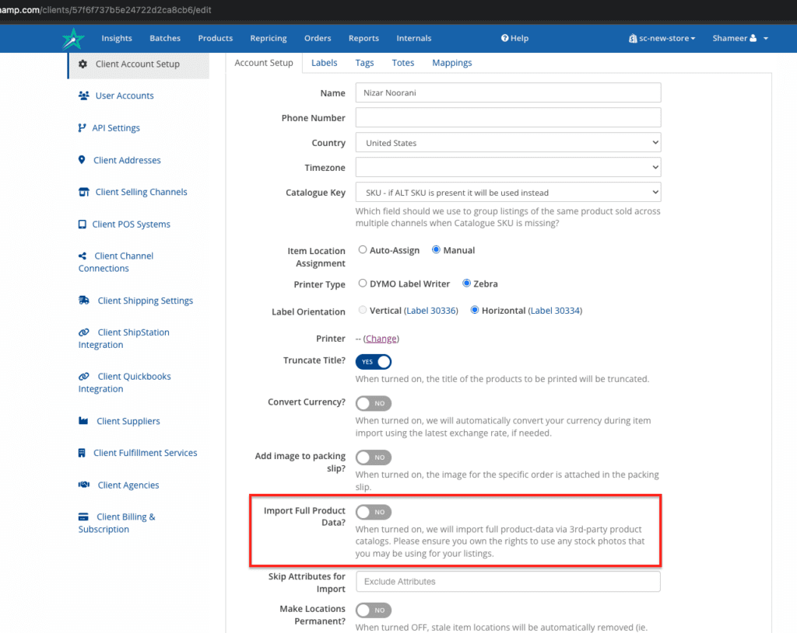
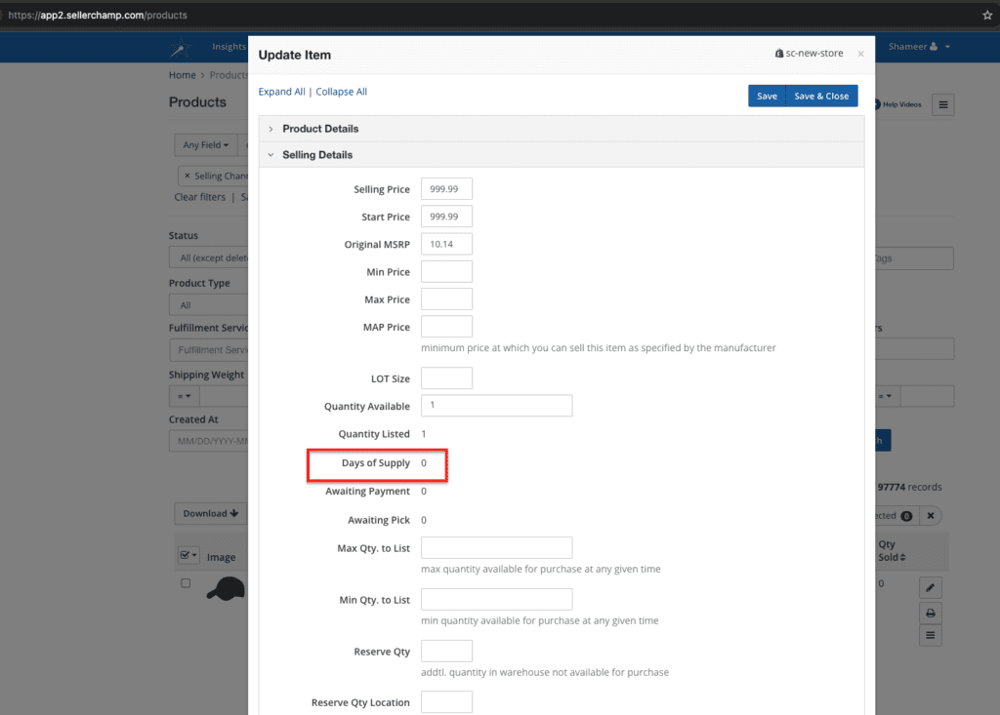
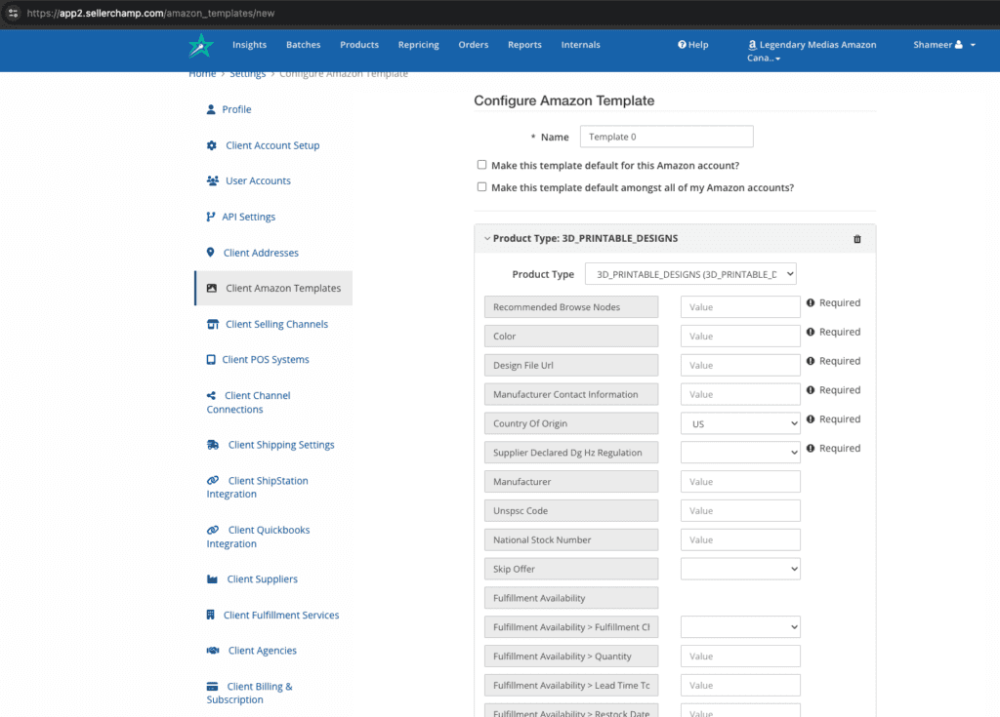
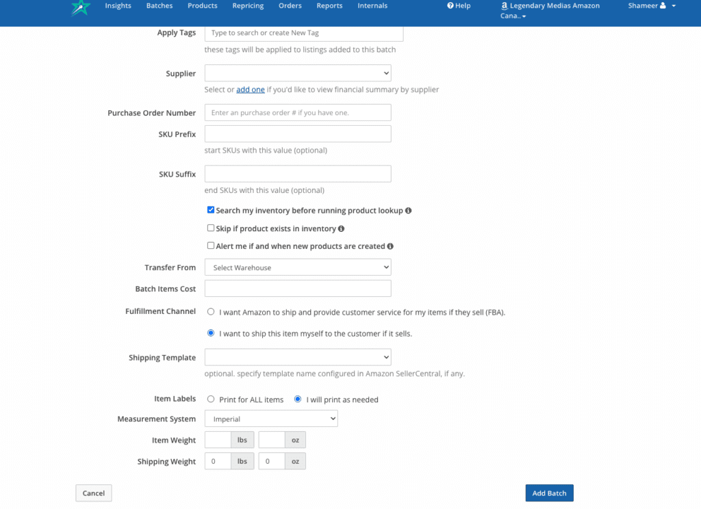
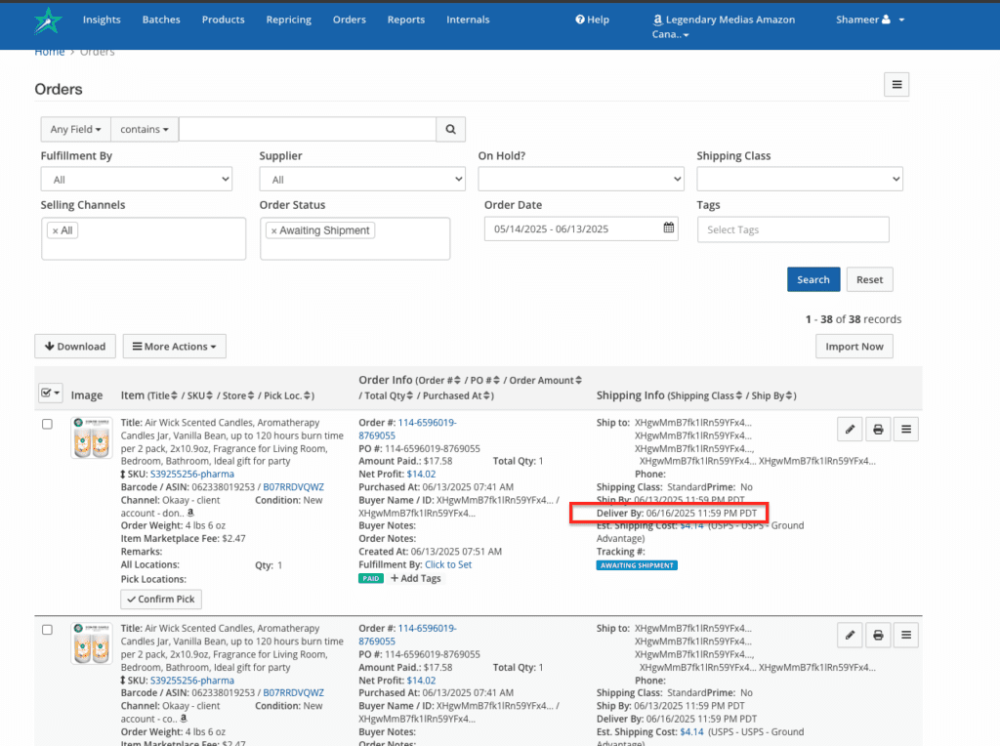
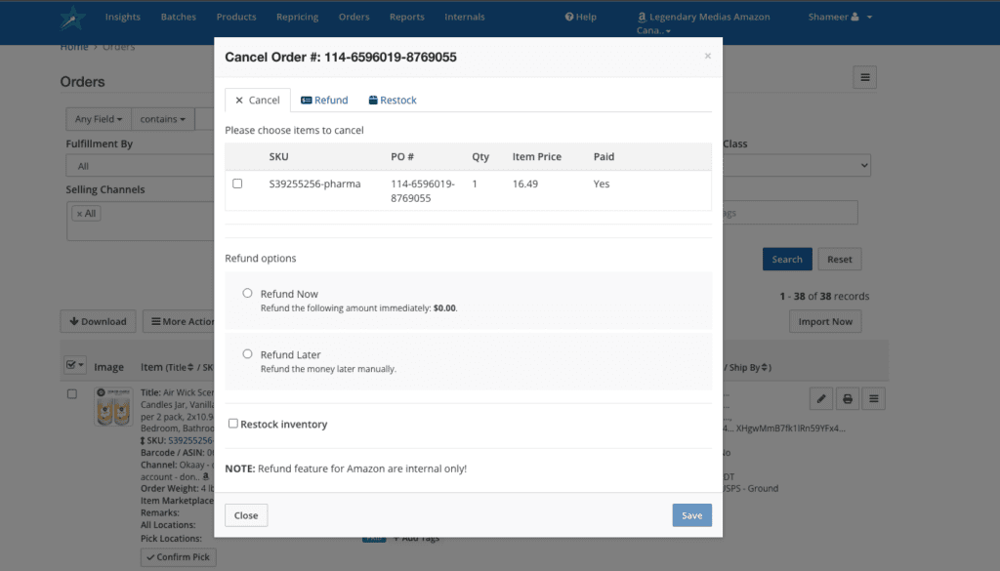

 Let’s skip the fluff — this month, we’re delivering major upgrades that speed up your workflow, protect your data, and give you more control across your entire operation. These aren’t just new features. They’re real solutions to the friction points that slow sellers down. Whether you’re scaling across Amazon, eBay, Walmart, or beyond, this update is built to help you move faster, stay leaner, and win more often. Here’s what’s new and why it matters.

<h2>Top Feature
</h2>

<h3>Smarter Batch Scanning Now Lets You Skip Specific Fields
</h3>

 Protect your custom product data while importing in bulk. <b>What’s New: </b><b>
</b> When you toggle off “Import Full Product Data,” you’ll now see a new option — “Skip Attributes for Import.” This lets you choose which fields (like Title, Brand, or Description) SellerChamp should leave untouched during batch scanning. <b>Why It Matters:</b><b> 
</b> You get to maintain full control of your product data without slowing down your workflow. No more accidentally overwriting fine-tuned titles or curated descriptions. It’s bulk importing, with surgical precision.

<h2>Other Updates
</h2>

<h3>Days of Supply Filtering for Sharper Inventory Moves
</h3>

 See how long your stock will last — and act before it’s too late. <b>What’s New:</b> <b>
</b> You can now filter by <b>Days of Supply</b> directly from the Manage Products page, and see supply duration at the product level within the Edit Product modal. <b>Why It Matters:</b> <b>
</b> Inventory planning just got proactive. With clear insight into how many days a SKU can hold out, you can restock at the right time, reduce dead inventory, and avoid last-minute scramble orders.

<h3>Amazon Templates for Faster, Consistent Listings
</h3>

 Skip the copy-paste chaos when listing similar products. <b>What’s New:</b> <b>
</b> You can now create and reuse <b>Amazon Templates</b> for the Product Types you frequently list. These templates store pre-filled attribute values so you can instantly apply them to new SKUs. <b>Why It Matters:</b> <b>
</b> If you’re listing variations of the same product type, this cuts down your listing time dramatically. It ensures accuracy, improves consistency, and slashes the risk of manual errors. Fewer clicks. Fewer mistakes. More scale.

<h3>Set Default Item & Shipping Weights Per Batch
</h3>

 Standard products? Set it once and move fast. <b>What’s New:</b> <b>
</b> You can now define a <b>default item weight and shipping weight</b> at the batch level. Every new product added or scanned into that batch will inherit those values automatically. <b>Why It Matters:</b> <b>
</b> No need to input the same weights over and over again. This is especially useful if your catalog shares uniform shipping specs. It’s a huge time-saver for high-volume listers who want to streamline every step.

<h3>Deliver By Dates for Amazon Orders
</h3>

 Prioritize fulfillment with full visibility on deadlines. <b>What’s New:</b><b> 
</b> You’ll now see the <b>Deliver By</b> date for Amazon orders right on the Orders page. <b>Why It Matters:</b> <b>
</b> No more guessing or checking Seller Central for time-sensitive orders. This helps you ship on time, protect your seller rating, and focus on what matters — fast, accurate fulfillment.

<h3>Cancel Amazon Orders Inside SellerChamp
</h3>

 Cancel Amazon orders without ever leaving your dashboard. <b>What’s New:</b><b> 
</b> You can now cancel Amazon orders directly from the SellerChamp Orders page — no Seller Central login is required. <b>Why It Matters:</b><b> 
</b> Fewer clicks. No context-switching. And more control, all from one place. It’s a smoother, faster way to manage order changes without slowing down your workflow.

<h3>New Carbon6 Integration: Unlock Lost FBA Revenue
</h3>

Partnering with Seller Investigators to help you recover what’s yours. <b>What’s New:</b><b> 

</b> SellerChamp has officially partnered with <b>Carbon6’s Seller Investigators</b>, giving you access to expert-led FBA audits that cover 8+ reimbursement types, with up to 9 months of retroactive claim eligibility. <b>Why It Matters:</b><b> 
</b> If Amazon owes you money for lost or damaged inventory, now there’s a smarter way to claim it — and you only pay when they recover funds for you. It’s risk-free revenue recovery, built right into your SellerChamp experience.

<h2>That’s a wrap for June
</h2>

Everything we ship is built to make SellerChamp faster, smarter, and more impactful for you. <a href="/#">Got feature requests or feedback?</a> We’re listening — and building.

Until next time, 
<b>– The SellerChamp Team</b>

{{ site.app.leads }}?utm_source=blog&utm_campaign=june-product-updates


Schedule a demo today and discover how our Bulk Lister can help you list more products, increase sales, and grow your e-commerce business faster than ever.

