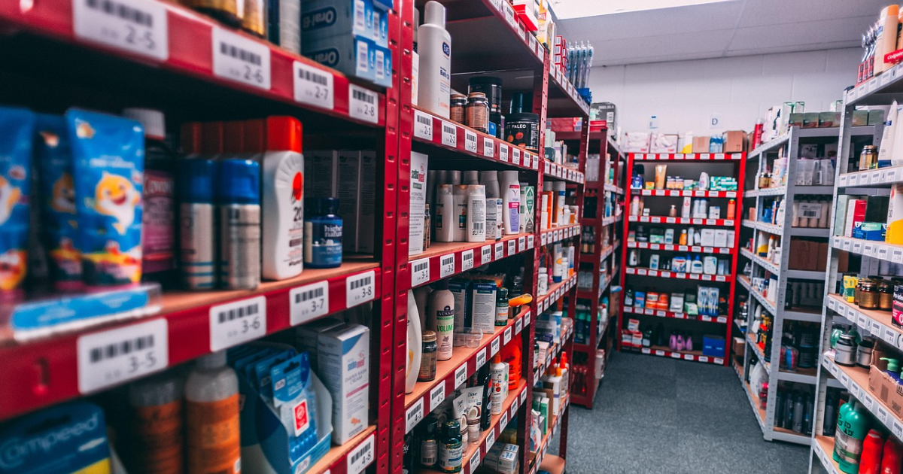

 In 2025, <b>trending products on e-commerce</b> aren’t optional—they’re essential. The top sellers aren’t chasing trends, they’re owning them. From Labubu dolls lighting up auctions to Stanley tumblers driving $750M+ in sales, these products are backed by real search data, influencer buzz, and viral urgency. This list of 35 winners is built to help you spot what sells, scale fast, and stay ahead of the pack. No fluff—just proven, profit-driving picks for sellers who know the game.

<strong>Check out:</strong><a href="/blog/ecommerce-process-automation-tools/"><b>E-Commerce Process Automation: How to Do It + Key Tools</b></a>

{{ site.app.leads }}?utm_source=blog&utm_campaign=trending-products-to-sell-on-ecomemrce


<h2>Trending Products on E-commerce
</h2>

If you are a seller, you shouldn’t miss out on these viral and trending products on e-commerce.

<ol>
<li><b>Labubu Dolls</b> – Hottest viral collectible of 2025—retailing for just $20–$30, but rare editions have <a href="https://www.bbc.com/news/articles/c780p4n33kyo">sold for up to $172,000.</a> With over 1.2 billion TikTok views and endless unboxings, they’re fueling a global collector craze you can’t ignore. If you’re selling online, this is your golden ticket. </li>
<li><b>Sonny Angels</b> – Mini blind-bag angels that ride nostalgia and haul-video demand with low price and high impulse appeal. </li>
<li><b>Squishmallows</b> – Soft plush characters with seasonal editions that drive repeat sales among teens and collectors. </li>
<li><b>Blind Box Figurines</b> – Mystery collectibles like KAWS and Tokidoki fuel unboxing excitement and social content engagement. </li>
<li><b>Mini Brands</b> – Pocket-sized product replicas perfect for impulsive purchases and viral short-form videos. </li>
<li><b>Stanley Quencher Tumblers</b> – The 40-oz cult favorite saw Stanley revenue jump from $70M in 2019 to <a href="https://www.cnbc.com/2023/12/23/how-a-40-ounce-cup-turned-stanley-into-a-750-million-a-year-business.html">$750M in 2023,</a> fueled by TikTok and influencer marketing. </li>
<li><b>Stanley Leak‑Proof ProTour Bottles</b> – Durable, travel-ready, sealed bottles favored by outdoor and fitness communities. </li>
<li><b>Stanley Pastel Lunch Boxes</b> – Stylish lunch accessories that pair well with Stanley tumblers for bundling opportunities. </li>
<li><b>Hydro Flasks</b> – Personalized, sticker-ready bottles continued strong popularity, especially among Gen Z.</li>
</ol>

<b>You Might Like: </b><a href="/blog/online-marketplaces-in-usa-for-ecommerce-sellers/"><b>Top 10 Online Marketplaces in USA for E-Commerce Sellers</b></a>

<ol start="10">
<li><b>Ember Smart Mugs</b> – Temperature-controlled, app-connected mugs suited to remote workers and office professionals.</li>
<li><b>Video Doorbells</b> – Smart home security essentials like Ring and Eufy remain strong sellers.</li>
<li><b>Smart Plugs & Power Strips</b> – Inexpensive home automation tools controlled via apps or voice.</li>
<li><b>App‑Controlled LED Light Strips</b> – Popular for gaming setups and room makeovers, often shared on social platforms.</li>
<li><b>Smart Aroma Diffusers</b> – Wellness-driven lighting and scent devices that appeal to lifestyle audiences.</li>
<li><b>Mini Projectors</b> – Portable multimedia projectors perfect for at-home theater use and unboxing reviews.</li>
<li><b>Bamboo Toothbrushes</b> – Eco-friendly, compostable toothbrushes that fit the zero-waste shopping trend.</li>
<li><b>Reusable Grocery & Produce Bags</b> – Long-lasting alternatives to plastic, popular with eco-conscious consumers.</li>
<li><b>Solar Phone Chargers</b> – Off-grid charging solutions ideal for travelers and emergency kits.</li>
<li><b>Biodegradable Cleaning Tablets</b> – Plastic-free cleaning tablets that promote sustainable home care.</li>
<li><b>Countertop Compost Bins</b> – Compact, odor-controlled bins ideal for environmentally mindful cooks in small spaces.</li>
<li><b>Toe Spacers</b> – Foot health tools trending in holistic wellness and corrective care communities.</li>
<li><b>Bakuchiol Serum</b> – A gentle, plant-derived alternative to retinol with anti-aging claims. </li>
</ol>

<b>Read More</b><b>: </b><a href="/blog/repricing-strategies-ecommerce-profitability/"><b>10 Repricing Strategies E-Commerce Giants Use to Maximize Profitability</b></a>

<ol start="23"><li><b>Mushroom Coffee & ADHD Gummies</b> – Niche functional supplements that offer both energy and focus benefits.</li><li><b>Ashwagandha Teas & Supplements</b> – Stress-relief adaptogens rising in popularity on wellness social channels.</li><li><b>LED Face Masks</b> – Home-use light therapy devices solving skin concerns and boosting beauty routines.</li><li><b>Resistance Bands & Yoga Gear</b> – Compact fitness products that ride the home workout wave.</li><li><b>Camping Cookware Kits</b> – Lightweight sets tailored to outdoor adventurers and content creators.</li><li><b>Hiking Hydration Backpacks</b> – Functional hydration gear for trail runners and cyclists.</li><li><b>Portable Solar Lanterns</b> – Collapsible eco-lanterns suited for outdoor living and emergency preparedness.</li><li><b>Padel Rackets</b> – Equipment for the growing padel sport trend, popular in sports circles.</li><li><b>GPS Pet Collars & Smart Tags</b> – Real-time tracking devices that offer pet owners reassurance.</li><li><b>Interactive AI Pet Toys</b> – Autonomous, motion-activated toys generating repeat purchases in pet circles.</li><li><b>Gaming Mouse Pads & Headsets</b> – Performance-driven accessories preferred by gamers and streamers.</li><li><b>Custom Mugs & Monogram Jewelry</b> – Personalized gifts with emotional appeal and social media shareability.</li><li><b>DIY Craft Kits</b> – Creative kits like candle-making and embroidery—ideal for mindfulness and home decor buyers</li>
</ol>

<b>Check Out </b><a href="/blog/how-to-sell-on-multiple-platform/"><b>How to Sell on Multiple Platforms? E-Commerce Guide to Multi-Channel Listing</b></a>

<h2>Why These Trending Products on Ecommerce Work
</h2>

Social proof and influencer momentum drive all 35 of these picks.

<ul>
<li>Social Proof + Influencer Buzz: Labubu dolls went viral via Lisa and Tom Brady, Stanley tumblers drove 2025 Prime Day sellouts, and niche products get traction through targeted creators. </li>
<li>Scarcity = FOMO: Limited-release blind-boxes and seasonal color drops keep consumers buying fast. </li>
<li>Values + Reuse: Eco and wellness choices build ethical brand loyalty and recurring buyers. </li>
<li>Niche Tribes = Payoff: Pet owners, gamers, padel lovers—all willing to invest in passion. </li>
<li>Multi‑Channel Reach: Listing across Shopify, Amazon, TikTok Shops, and scaling faster with SellerChamp.</li>
</ul>

<h2>Pro-Level Tactics to Win
</h2>

<ul>
<li><b>Check product demand quickly: </b> Use tools like Google Trends, Amazon’s best-seller rankings, trending TikTok hashtags, and eBay’s sold listings to see what’s actually in demand before you invest.</li>
<li><b>Offer product bundles:</b> Pair related items together—like Stanley tumblers with cleaning kits or Labubu dolls with add-ons—to increase the average amount each customer spends.</li>
<li><b>Work with micro-influencers:</b> Send your products to small influencers for unboxing or review videos. Their posts can build trust and boost your visibility fast.</li>
<li><b>Create urgency to boost sales:</b> Use countdown timers, limited-edition launches, or low-stock warnings to push shoppers to buy now rather than later.</li>
<li><b>Use smart SEO practices:</b> Include the phrase “trending products on ecommerce” in your page titles, headings, image tags, and other important areas to help people find your store online.</li>
<li><b>Automate with SellerChamp:</b> List products once, sync inventory across platforms, and automate your pricing, orders, and shipping so you can focus on growing your business.</li>
</ul>

<iframe width="1318" height="345" src="https://www.youtube.com/embed/KsJR4_TIjvc" title="How to Sync Inventory across Multiple Marketplaces" frameborder="0" allow="accelerometer; autoplay; clipboard-write; encrypted-media; gyroscope; picture-in-picture; web-share" referrerpolicy="strict-origin-when-cross-origin" allowfullscreen></iframe>

<h2>Scaling up? Or just getting started?
</h2>

SellerChamp’s powerful features can help you sell smarter with ease.<a href="/features/"> Explore all SellerChamp features to see how marketplace integrations can transform your business today.</a>

<h5>Try SellerChamp for Yourself!
</h5>

<a href="https://app.sellerchamp.com/users/sign_up?_gl=1*1ukisxs*_gcl_au*MzY0MTA0ODQyLjE3NDU1ODAyNTA.*_ga*MTc1MDE5MTE4MS4xNzM3MDY4MTgx*_ga_F2WQV1CVLC*czE3NDY1NzM1MDEkbzQ0JGcxJHQxNzQ2NTczNjM5JGo2MCRsMCRoMzc1MDYxMTU4&_ga=2.158060536.318104915.1746573501-1750191181.1737068181"><b>Request your personalized demo today </b></a>and experience smarter inventory management in action.

