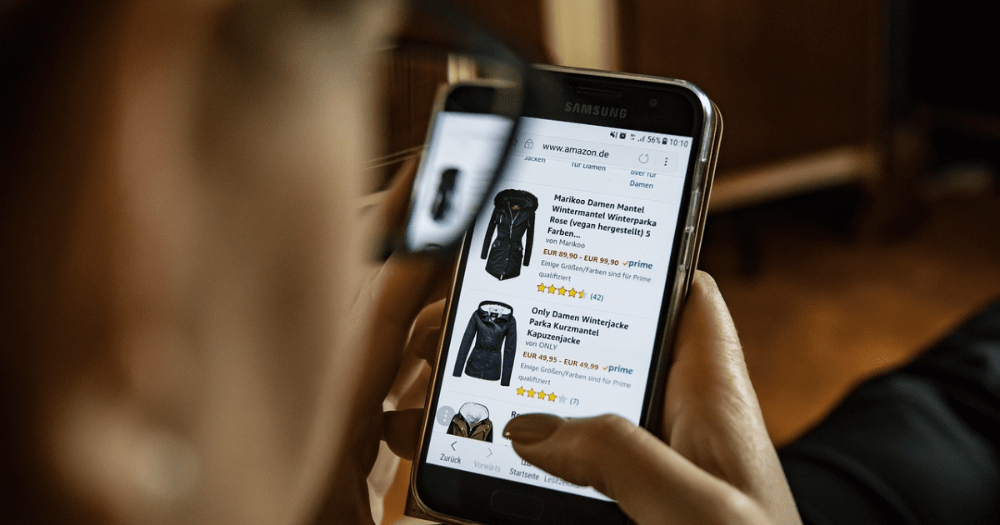

 Let me ask you something brutal but honest: <i>Are you actually using Shopify to win… or just to exist online?</i> Because here’s the truth:  Most Shopify stores <i>look</i> like businesses but <i>bleed money</i> like a leaky faucet. Why? They’re not using <b>Shopify’s competitive advantage</b> to their benefit. They’re doing what everyone else is doing—same themes, same strategies, same dead-average results. But if you want to outgrow your competition, if you want more traffic, conversions, and profit, then this post is for you. We’re going to uncover <b>7 Shopify advantages</b> that can launch your store into the top 1%. Let’s go deep, bold, and tactical.

<strong>Check out:</strong><a href="/blog/shopify-product-listing-services/"><b>10 Best Shopify Product Listing Services to Automate & Streamline Your E-Commerce</b></a>

{{ site.app.leads }}?utm_source=blog&utm_campaign=advantages-to-penetrate-on-shopify


<h2>1. Dominating the Market With Trust & Traffic
</h2>

There’s a reason over <b>5.6 million</b> merchants trust Shopify. It owns nearly<a href="https://www.yaguara.co/shopify-market-share/">

<b>29% of the ecommerce platform</b></a><b> market share</b> in the U.S. and processes over<a href="https://www.fintechwrapup.com/p/deep-dive-shopify-the-operating-system">
<b>$292 billion in annual GMV</b>.</a> That means customers already trust the platform <b>before they even land on your store</b>. <b>Smart move?</b> Lean into that trust. Use the <i>“Powered by Shopify”</i> label to boost conversions. Add Shop Pay badges. And let your audience know they’re in good hands with the same tech that powers brands like Gymshark and Kylie Cosmetics.

<h2>2. An All-In-One Growth Engine (No Tech Headaches Required)
</h2>

Running a business is hard enough. You don’t need 12 different tools duct-taped together. That’s the beauty of Shopify:

<ul> ✅ Storefront
</ul>
</ul>

<ul> ✅ Checkout
</ul>

<ul> ✅ Payments
</ul>

<ul> ✅ Marketing
</ul>

<ul> ✅ Analytics
</ul>

<ul> ✅ Mobile optimization
</ul>

<ul> ✅ Even POS for in-store selling
</ul>
<b>It’s all in one dashboard. </b> And you can extend it even further with automation tools like <a href="/?KijNam=CjsaCTadReaR1RixghUQjuWARa8LoLw9WNnE2iFadVbasIS3ok6UH048&via=sergei&gad_source=1&gad_campaignid=21576089498"><b>SellerChamp</b></a>, which handles listings, syncing, and fulfillment across Amazon, eBay, Walmart, and beyond.

<iframe width="1318" height="341" src="https://www.youtube.com/embed/KsJR4_TIjvc" title="How to Sync Inventory across Multiple Marketplaces" frameborder="0" allow="accelerometer; autoplay; clipboard-write; encrypted-media; gyroscope; picture-in-picture; web-share" referrerpolicy="strict-origin-when-cross-origin" allowfullscreen></iframe>
<b>Your competitive advantage?</b> Speed. Focus. And peace of mind. That’s what Shopify gives you when your competitors are still stuck fixing plugins.

<h2>3. Shopify’s App Arsenal (AKA: Your Profit Toolbox)
</h2>

Here’s the secret sauce: the <b>16,000+ apps</b> in the Shopify App Store. And here’s what most store owners don’t get:  You’re not supposed to <b> “do everything yourself.” </b> Let these apps sell more <i>for</i> you. Top picks:

<ul>
<li><b>Klaviyo</b> for email automations that convert like crazy </li>
<li><b>ReConvert</b> to boost AOV with one-click post-purchase upsells </li>
<li><b>Judge.me</b> for reviews that build trust </li>
<li><b>SellerChamp</b> to automate multichannel selling like a 7-figure brand</li>
</ul>

When you install the right stack, <b>you’re adding ROI machines to your store</b>.

<strong>Read more:</strong><a href="/blog/shopify-vs-etsy-comparison/"><b>Shopify vs Etsy: Which One is More Suitable Today?</b></a>

<h2>4. AI That Writes, Sells, and Saves You Time
</h2>

Shopify Magic, their built-in AI, is a game changer. According to Reuters, one Shopify brand using Magic saved 20+ hours/month, reduced returns, and <a href="https://www.reuters.com/technology/artificial-intelligence/how-canadas-shopify-is-weaving-ai-magic-pull-merchants">grew page engagement by 40%.</a> Want to:

<ul>
<li>Write high-converting product descriptions? </li>
<li>Create compelling discounts? </li>
<li>Send subject lines that get clicked?</li>
</ul>

Let AI do it <i>faster and better</i>. Then spend <i>your</i>  time testing offers, finding suppliers, and building audience loyalty. <b>Pro tip:</b> Combine Shopify Magic + SellerChamp and you’ve got automation working 24/7 in every department of your business.

<h2>5. Sell Everywhere—Without Losing Your Mind
</h2>

Shopify lets you sell on:

<ul>
<li>Amazon </li>
<li>Etsy </li>
<li>TikTok </li>
<li>Instagram </li>
<li>Google </li>
<li>Walmart</li>
</ul>

All from one place.  That’s not just convenience. That’s <b>leverage</b>. Brands using multichannel strategies grow <a href="https://www.shopify.com/ng/retail/making-the-case-for-multichannel-sales-how-a-cohesive-buying-experience-can-help-your-retail-business-prosper?"><b>30–50% faster</b> than single-channel stores, </a>according to internal Shopify data. But here’s the trick: you need a backend that actually syncs listings, stock, and pricing across those platforms. That’s where SellerChamp wins. It keeps your multichannel empire running like a machine.

<h2>6. Built to Sell Globally, Automatically
</h2>

Shopify Markets lets you sell in <b>133 currencies</b>, <b>20+ languages</b>, and auto-handles VAT, duties, and local taxes. No developer needed.  No translator needed.  No hassle. Global e-commerce is projected to hit <a href="https://www.statista.com/outlook/emo/ecommerce/worldwide?q=services"><b>$$4.32tn in 2025.</b></a> So if you’re not planning to expand globally, your competition will. Start small: test demand in Canada, UK, UAE. Use localized pages. Offer local pricing. And yes, SellerChamp can help manage fulfillment across regions.

<b>You Might Like: </b><a href="/blog/where-to-buy-products-to-sell-online/"><b>Product Sourcing Guide: Where to Buy Products to Sell Online?</b></a>

<h2>7. Shopify Plus: The Rocket Fuel for Scale
</h2>

Once you hit ~ <b>$80K/month in revenue</b>, it’s time to graduate to <b>Shopify Plus</b>. You get:

<ul>
<li>Custom checkout </li>
<li>Wholesale pricing </li>
<li>VIP support </li>
<li>Advanced automation </li>
<li>API integrations</li>
</ul>
<b>Basically: enterprise power without the enterprise headaches.</b> And here’s the kicker: most Plus brands started right where you are. They just doubled down on the <b>Shopify competitive advantage</b> earlier than everyone else.

<h2>Why Shopify’s Competitive Advantage Wins
</h2>

Here’s the cheat sheet:

<table id="tablepress-62" class="tablepress tablepress-id-62 blogborder">
<thead>
<tr class="row-1">
<th class="column-1">Advantage</th><th class="column-2">Outcome</th>
</tr>
</thead>
<tbody>
<tr class="row-2">
<td class="column-1">Market dominance</td><td class="column-2">Instant credibility</td>
</tr>
<tr class="row-3">
<td class="column-1">All-in-one tools</td><td class="column-2">Focus & speed</td>
</tr>
<tr class="row-4">
<td class="column-1">AI & apps</td><td class="column-2">Less guesswork, more growth</td>
</tr>
<tr class="row-5">
<td class="column-1">Multichannel selling</td><td class="column-2">Broader reach, more sales</td>
</tr>
<tr class="row-6">
<td class="column-1">Global ready</td><td class="column-2">Open new markets fast</td>
</tr>
<tr class="row-7">
<td class="column-1">Shopify Plus</td><td class="column-2">Scale without platform limits</td>
</tr>
</tbody>
</table>

And when you stack SellerChamp on top of Shopify? You turn that advantage into <b>a revenue machine</b>.

<b>Get more listing hacks and automation tips on the</b><a href="/blog/"><b> SellerChamp blog.</b></a>

<h2>What Makes Shopify Great: Top 5 Features Sellers Love s Competitive Advantage Wins
</h2>

Here’s why Shopify is best:

<h3>1. One-Click Multichannel Selling
</h3>

Sell on Amazon, eBay, Walmart, and TikTok directly from Shopify with seamless inventory syncing via apps like SellerChamp.

<h3>2. Lightning-Fast Checkout
</h3>

Shop Pay cuts checkout time to under 3 seconds, boosting conversions and reducing cart abandonment.

<h3>3. Built-In SEO & Blogging Tools
</h3>

Rank on Google with easy SEO settings, meta tags, and a native blog engine that brings organic traffic.

<h3>4. Massive App Ecosystem
</h3>

16,000+ apps mean you can customize everything—email, upsells, loyalty, reviews—without hiring developers.

<h3>5. Enterprise-Grade Scalability
</h3>

From solo shops to $100M brands, Shopify scales with you. Upgrade to Plus when ready, without platform switching.

<h2>Try SellerChamp Demo
</h2>

<h5>Tired of manual work?
</h5>

Let ot handle your listings, inventory, and orders. Try the <a href="https://app.sellerchamp.com/users/sign_up"><b>SellerChamp demo </b></a>and see how easy it is.

