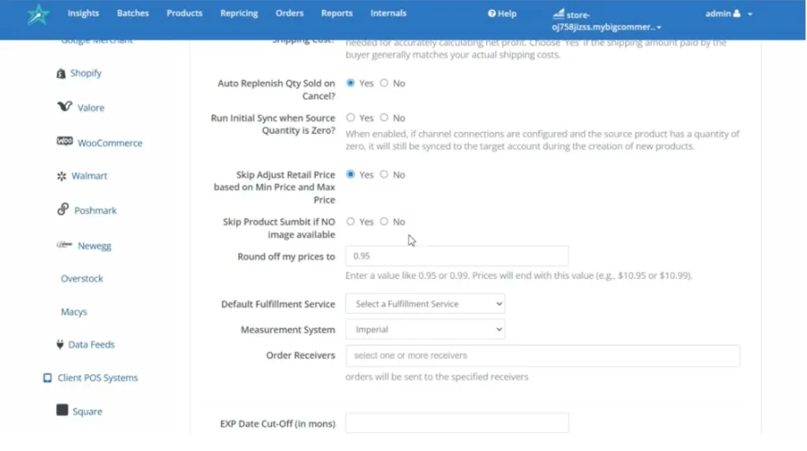
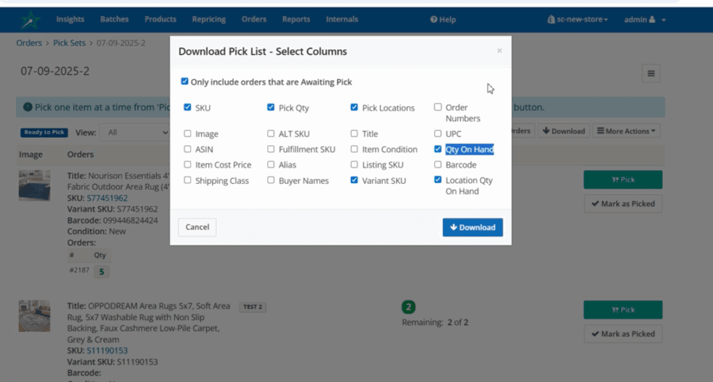
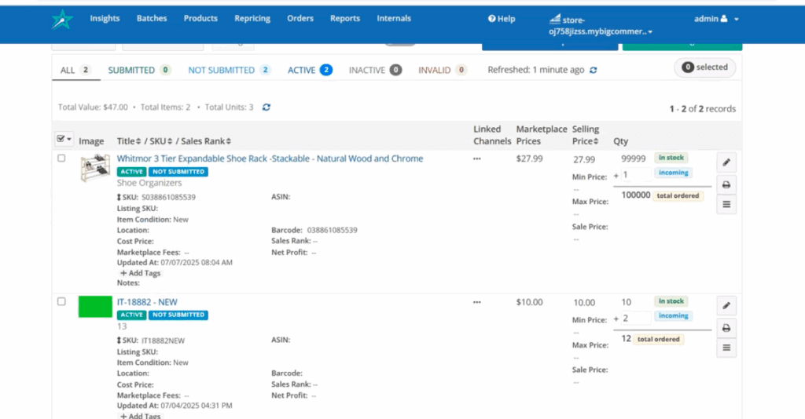
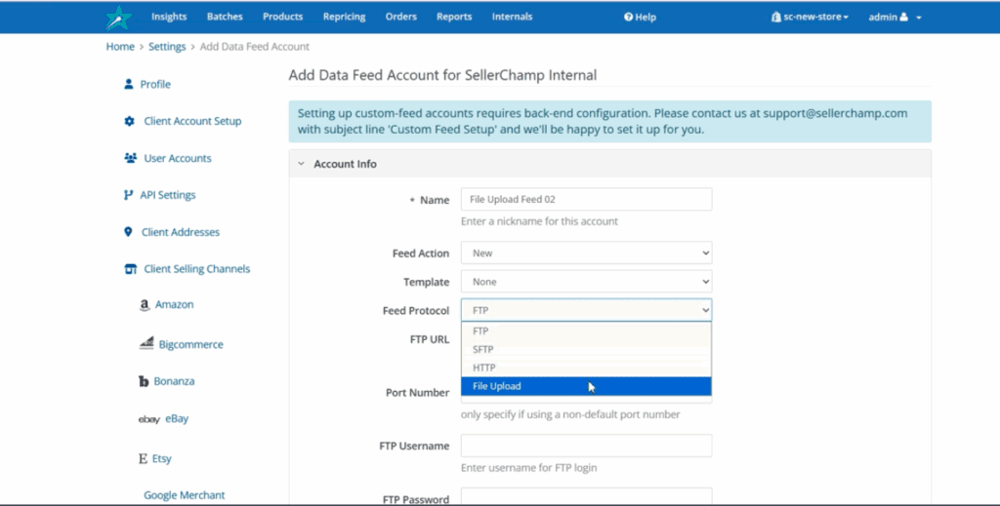
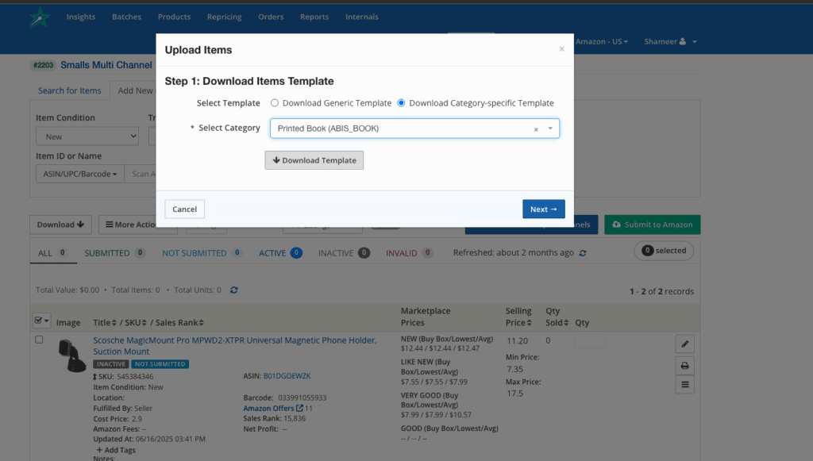
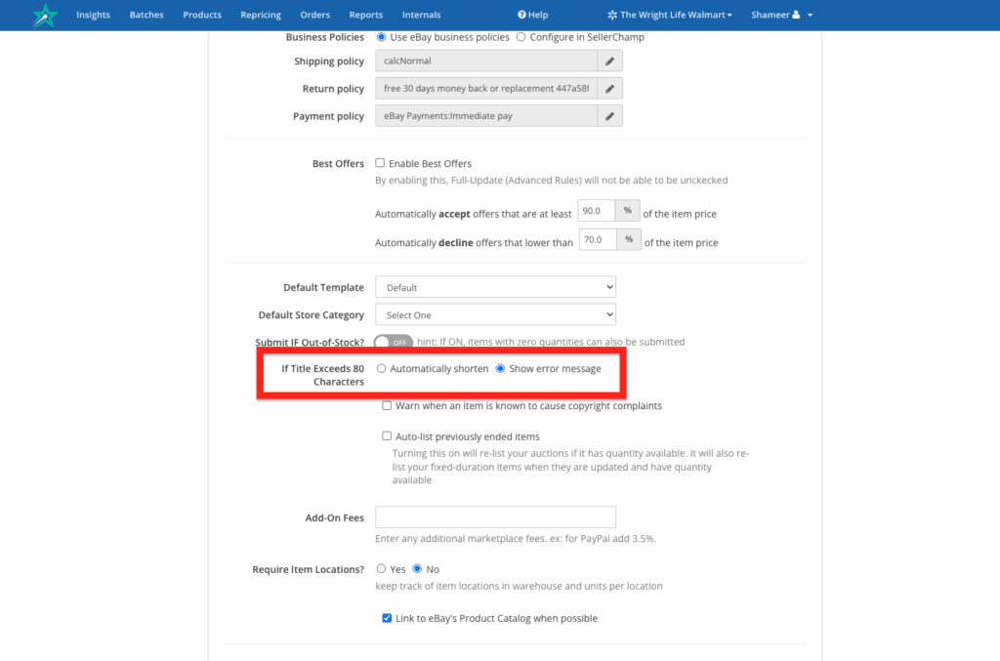
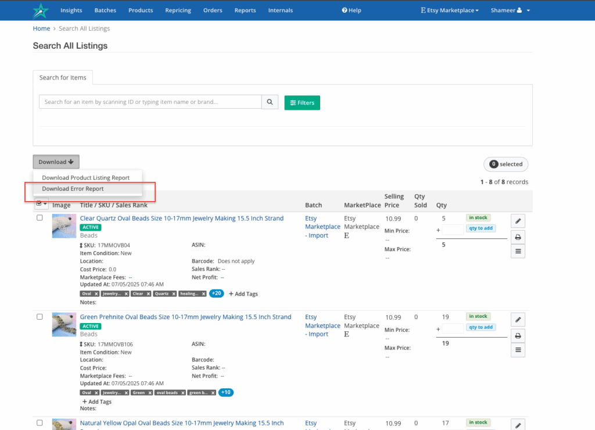

 We know selling online can get messy—lots of listings, stock to track, and orders to ship. This month, we made SellerChamp <b>faster, smarter, and easier</b> to use. From cleaner batch uploads to better stock visibility and simpler error tracking, these updates save you time and keep your listings running smoothly. Here’s what’s new and why it matters:

<h2>Top Feature
</h2>

<h3>Smarter Batch Submissions
</h3>

Submit faster without losing control. <b>What’s New:</b>

  You can now automatically skip listings without images at the marketplace level while still submitting the rest of your batch. <b>Why It Matters:</b>
  Keep batch uploads clean and error-free. No more blocked submissions due to missing images, so your workflow stays moving at full speed.

<h2>Other Updates
</h2>

<h3>1. Picklist Upgrade – More Stock Visibility
</h3>

 See exactly what’s available, right where you need it. <b>What’s New:</b>
  Picklists now include <b>Qty on Hand</b> (Qty Available + Awaiting Pick) and <b>Location Qty on Hand</b>. <b>Why It Matters:</b>
  Gain an accurate, up-to-date view of your stock across locations. Make smarter picking decisions and avoid overselling or stock gaps.

<h3>2. Refreshed Purchase Order Batches
</h3>

 Track your POs faster and easier. <b>What’s New:</b>
  The UI now organizes PO batches as <b>In Stock</b>, <b>Incoming</b>, and <b>Total Ordered</b> for clear, at-a-glance tracking. <b>Why It Matters:</b>
  Immediately know what’s available, what’s on the way, and total quantities, so managing your POs is faster and more precise.

<h3>3. Upload Files into Auto Feeds
</h3>

 Bring your supplier files straight into SellerChamp. <b>What’s New:</b>
  Along with API and FTP, you can now <b>upload files directly</b> whenever you run an Auto Feed. <b>Why It Matters:</b>
  Simplifies initial channel setups and recurring feed runs, making it faster to push supplier data into your marketplaces without extra steps.

<h3>4. Category-Specific CSV Templates for Amazon
</h3>

 Bulk updates without the guesswork. <b>What’s New:</b>
  Amazon now supports <b>category-specific CSV templates</b>, pre-filled with required item specifics — a feature already available for eBay. <b>Why It Matters:</b>
  Creating and updating products in bulk is easier, faster, and less error-prone. Save time and reduce headaches during mass uploads.

<h3>5. Smarter Description Handling
</h3>

 Stay compliant without extra work. <b>What’s New:</b>
  Set rules for marketplace character limits:

<ul>
<li>Auto-shorten with AI </li>
<li>Show an error to fix manually</li>
</ul>
<b>Why It Matters:</b>
  You control how descriptions behave across marketplaces. Fewer blocked listings, fewer manual edits, and smoother publishing.

<h3>6. Easier Error Tracking in Listings
</h3>

 Spot and fix problems faster. <b>What’s New:</b>
  Download filtered reports of all listings with errors directly from the <b>Search All Listings</b> page. <b>Why It Matters:</b>
  Quickly identify, review, and fix errors to keep your listings live and compliant — all from one report.

<h2>That’s a wrap for August
</h2>

This month’s updates are all about <b>saving time, reducing errors, and keeping your workflow smooth</b>. We’re building SellerChamp to make selling faster, smarter, and more predictable every step of the way.

Thanks for being with us,  —<strong> The SellerChamp Team</strong>

{{ site.app.leads }}?utm_source=blog&utm_campaign=august-2025-product-updates


Schedule a demo today and discover how our Bulk Lister can help you list more products, increase sales, and grow your e-commerce business faster than ever.

