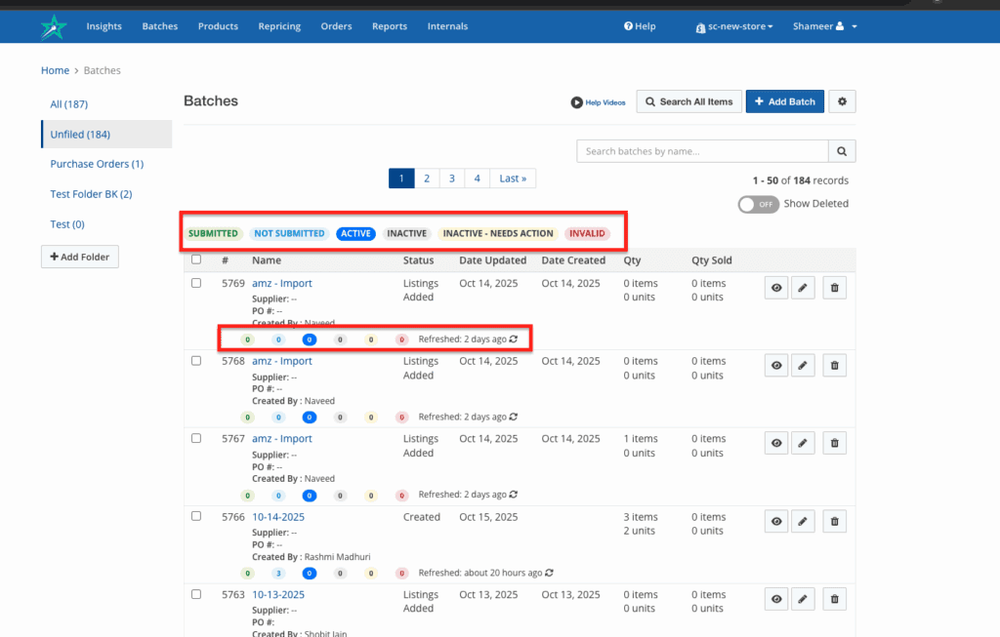
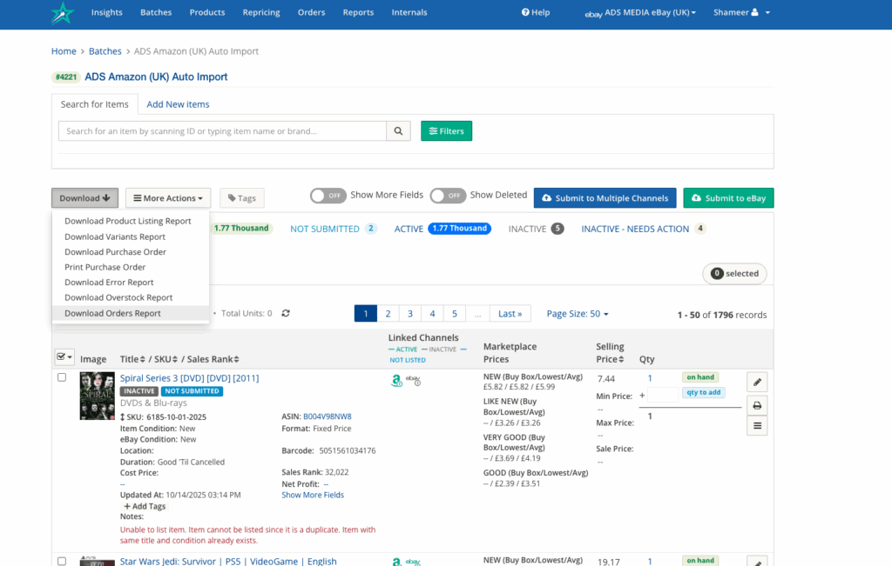
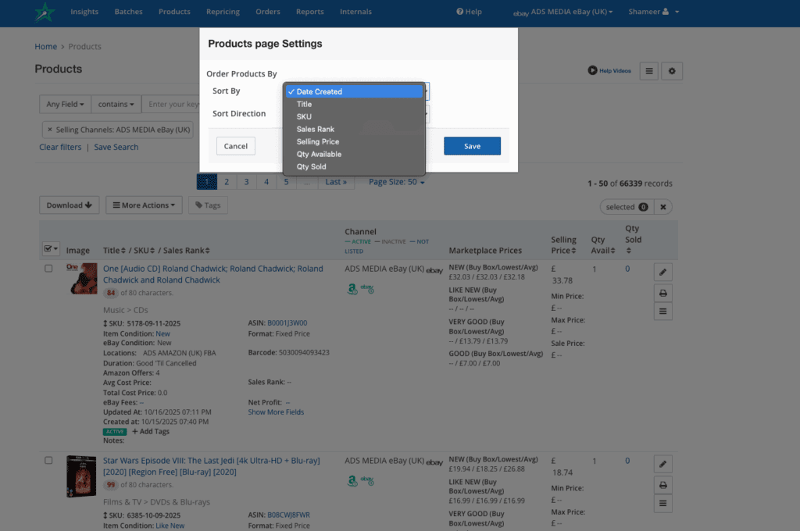
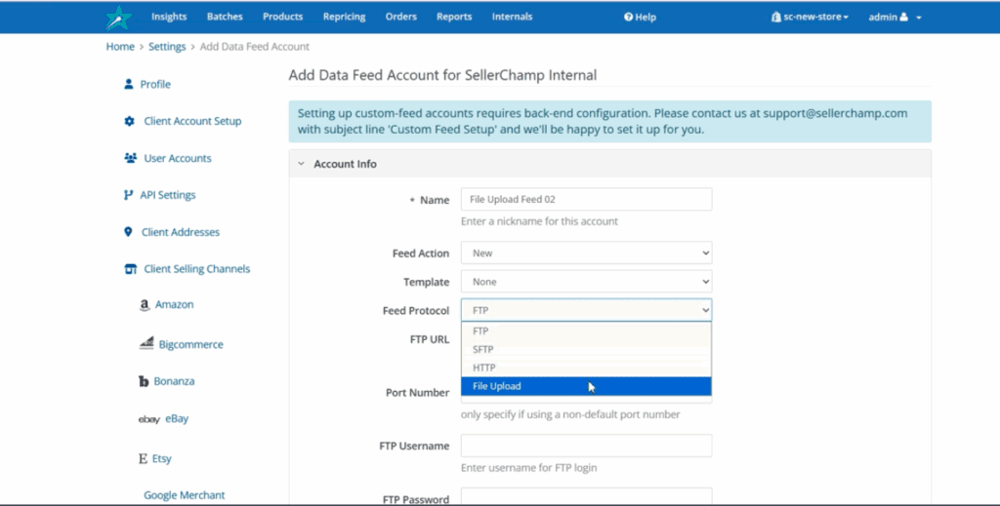
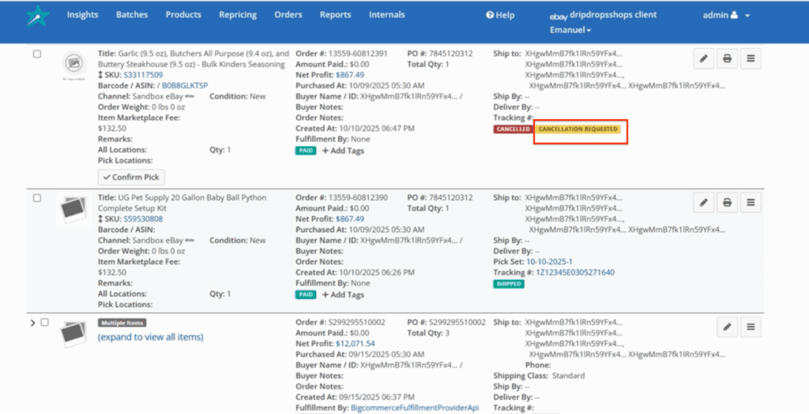
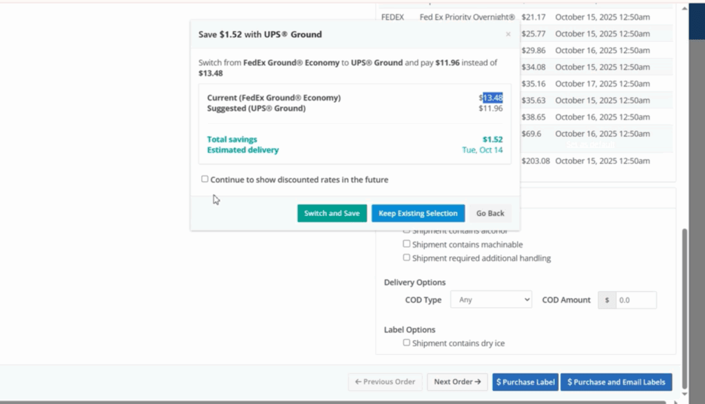

 This month was all about <b> speed and efficiency</b>. We shipped upgrades that cut extra steps, reduce manual work, and help you move faster without losing control. These updates are simple, practical, and built to improve your daily workflow. Here is what is new.

<h2>Top Feature
</h2>

<h3>Cleaner Batch View with Status Labels in the Header
</h3>

 Work faster with a cleaner and more organized batch layout. <b>What is New:</b>
  Batch status labels such as Submitted, Not Submitted, Active, and Inactive are now moved to the table header rather than displayed for each row. Status counts still remain visible and color-coded for clarity. <b>Why It Matters:</b>
  This layout reduces screen clutter, improves readability, and makes it easier to scan batch progress without distractions. You stay focused and in control during high-volume listing work.

<h2>Other Updates
</h2>

<h3>1. Download Orders Report by Date Range for Listings in a Batch
</h3>

 Track sales connected to specific batches with precision. <b>What is New:</b>
  You can now download an Orders Report for any batch and filter it by a specific date range. Reports include all order activity tied to listings within that batch. <b>Why It Matters:</b>
  This is ideal for performance tracking, batch-level profitability checks, team reporting, and reconciling order history during reviews or audits.

<h3>2. New Sorting Options on the Products Page
</h3>

 Customize your product view to match your workflow. <b>What is New:</b>
  You can now sort products by a wide range of attributes including Date Created, Title, SKU, Sales Rank, Selling Price, Quantity Available, and Quantity Sold. Sort preferences can be saved from the settings menu. <b>Why It Matters:</b>
  Finding products in large catalogs is faster and more flexible. It removes unnecessary scrolling and lets teams organize product data in a way that makes the most sense for their process.

<h3>3. eBay Cancellation Requests Now Visible in SellerChamp
</h3>

 Never miss a buyer’s cancellation again. <b>What is New:</b>
  Any eBay order with a pending buyer-initiated cancellation now displays a Cancellation Requested badge directly inside SellerChamp. <b>Why It Matters:</b>
  Catching cancellation requests quickly helps you avoid accidental shipping, reduce return costs, and maintain positive order defect metrics on eBay.

<h3>4. Smarter Shipping Suggestions and Warnings
</h3>

 Save money on labels without changing your workflow. <b>What is New:</b>
  When selecting a shipping service, SellerChamp now alerts you if a lower-priced option with a similar delivery speed is available from another carrier. You can switch with a single click or keep your original choice. <b>Why It Matters:</b>
  You save on shipping costs while keeping fulfillment fast. This feature prevents overspending on routine shipments and adds a safety check for new team members handling labels.

<h3>5. Item Specifics Mapping from Amazon to eBay
</h3>

 Improved listing quality during cross-channel publishing. <b>What is New:</b>
  When copying listings from Amazon to eBay, SellerChamp now auto-maps item specifics such as Brand, Material, Artist, and more, but only if they are already valid within the selected eBay category. <b>Why It Matters:</b>
  You get faster transfers without messy attributes that eBay rejects. Listings stay clean, accurate, and compliant without extra manual cleanup.

<h2>Performance Boost
</h2>

<h3>Bulk Updates via File Uploads are Now up to 10x Faster
</h3>

Speed upgrade for high-volume operations. <b>What is New:</b>

  Bulk file processing has been optimized for speed. Large CSV uploads for price changes, SKU edits, or product updates now complete significantly faster. <b>Why It Matters:</b>
  Instead of waiting for large updates to run, you get near real-time processing that keeps batch work, pricing updates, and catalog management moving.

<h2>That’s a wrap for September
</h2>

Every update this month is designed to make your workflow smoother, smarter, and faster. We are continuously improving SellerChamp to help your business grow without the bottlenecks that slow e-commerce sellers down.

Thanks for being with us,  —<strong> The SellerChamp Team</strong>

{{ site.app.leads }}?utm_source=blog&utm_campaign=sellerchamp-september-2025-product-updates


Schedule a demo today and discover how our Bulk Lister can help you list more products, increase sales, and grow your e-commerce business faster than ever.

